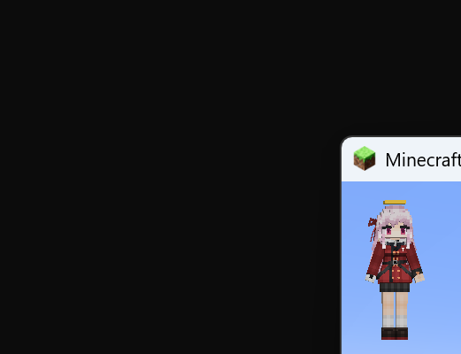
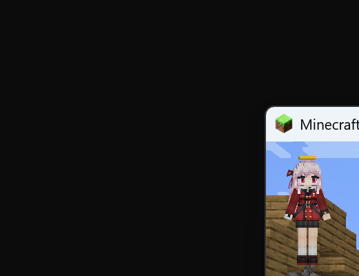

# ENGINEERING · 工程进展与验收

> 设计基线不变：见 [系统开发与设计方案.md](系统开发与设计方案.md) 与 `docs/01-06`。
> 本文件只记录**实现状态、实测数据、已知边界与下一步**。

## 1. 当前结论

**DSH 端已完整可用（v0.3.0）：插件已安装并激活，工具/命令/Skill/状态机/图像链路/双传输/回归测试全部就位；BAE、YSM 与游戏内加载验证均通过。**

- **M0 通过（Go）**：隐藏窗口离屏 WebGL 渲染稳定；GPU（RTX 4080 / ANGLE D3D11）与 SwiftShader 两条路径都通过；show/hide 往返后仍可渲染。
- **BAE 可用**：`dist/bb-agent-app` 由上游 Blockbench 5.2.2 构建产物 + agent 三件套 + YSM 默认模板组装而成。
- **协议可用**：WebSocket JSON-RPC 2.0 与 HTTP+SSE 双传输（dsh 为 server、BBAR 为 client），首包 token 鉴权、双向请求、事件、超时、断线重连均实现；变更加 `expected_revision` 前置校验。
- **YSM 可用**：默认包创建/打开（main+arm、2 贴图、303 动画、8 控制器）、显式保存（16 个文件）、导出（32 个文件 + manifest）、YSM 校验、贴图/动画/检查点/回滚。
- **dsh 插件已安装并激活**：`include:blockbench-agent`（`@local/dsh-blockbench-agent`），`autoStart:true`；**30 个 `bb_*` 工具**（默认暴露 28 个，2 个 GUI 工具由命令接管）、**5 个命令**、**1 个 Skill**（`blockbench-ysm-artist`）、进程崩溃自动重启、GUI 抢占冻结、512px 附件缩略图。
- **真实闭环已验证**：AI 通过工具创建 YSM 项目 → 加方块 → 精确 UV → 像素涂色 → 无头渲染 → 看图确认金色王冠 → 保存 → 导出。
- **游戏内加载验证已通过**：在仓库内独立安装 Forge 1.20.1 + YSM 2.6.5，把导出包放入 `config/yes_steve_model/custom/live_gold3`，启动客户端进入世界后 `/ysm model reload` + `/ysm model set`，YSM 返回 `Set 'live_gold3' models for player`，第三人称截图可见金色王冠。

## 2. 实测证据

### 2.1 M0 渲染

| 指标 | GPU（RTX 4080 Laptop / ANGLE D3D11） | safe-mode（SwiftShader） |
|---|---|---|
| 默认 YSM 模型加载 | ~400ms（64 bones / 172 cubes） | ~360ms |
| 5 机位渲染 | 62–72ms | 83ms |
| 单帧 50 次 | p50 4ms / p95 5ms | p50 9ms / p95 11ms |
| show→hide→再渲染 | ✅（513ms） | ✅（630ms） |
| 输出 | 768×768 PNG，透明背景，非空 | 同左 |

报告：[docs/M0-report.md](docs/M0-report.md)、[docs/M0-report-safe.md](docs/M0-report-safe.md)。
图片：`workspace/_m0/artifacts/m0/*.png`、`workspace/_m0-safe/artifacts/m0/*.png`。

### 2.2 端到端测试（自动化）

| 测试 | 命令 | 结果 |
|---|---|---|
| 协议 + BAE e2e（创建 YSM 包→建模→贴图→渲染→保存→导出） | `node packages/bb-agent-runtime/scripts/e2e.mjs` | ✅ PASSED（`workspace/_e2e/e2e-result.json`） |
| dsh Host 插件全工具（mock ctx + 真实 spawn BAE + 图片附件 + 命令） | `node packages/dsh-blockbench-agent/test/host-smoke.mjs` | ✅ PASSED（`workspace/_hosttest/hosttest-result.json`） |
| 导出的贴图像素校验 | PIL 读取导出 `default.png` | ✅ (8,8)=白、(10,10)=#aa3344（涂抹持久化） |

e2e 关键结果：`project.create_ysm` 返回 70 bones / 182 cubes / 2 textures / 303 animations / 8 controllers；`project.save` 16 files；`project.export_ysm` 32 files + manifest；`project.validate` ok=true。

扩展 hosttest 覆盖并通过（2026-10-18 复核）：

- revision 冲突：显式 `expected_revision:0` → `REVISION_CONFLICT`；
- 动画：`animation.create`（loop=loop）→ `set_keyframes` → `list` 可见；
- 贴图：`texture.export_png` → `texture.import_png`（workspace 路径往返）；
- 检查点：checkpoint → 额外加方块（173→174）→ `restore` 回到 173；
- `batch` 顺序执行 2 个只读调用；`diagnostics` 返回 dsh/runtime/logs；
- `/show` 后写操作被 `GUI_BUSY` 拦截，`/hide` 恢复；
- `project.close` 正常关闭。

扩展 e2e 覆盖并通过（同轮）：

- 渲染变化检测：同一状态重复渲染 → `changed_any=false` + `NO_VISIBLE_CHANGE`；编辑后渲染 → `changed_any=true`，并返回每张图的 `alpha_ratio`；
- `checkpoint` → 额外编辑 → `project.restore`：`arm_loaded=true`，随后 `project.save` 正常；
- 二次保存幂等：首次保存的 4 个文件第二次保存后内容 0 变化；
- `project.export_ysm` 生成 32 文件目录 + `export-manifest.json` + **32 文件 zip（约 475KB）**，zip 头与文件数校验通过。
- **HTTP+SSE 传输**：`e2e.mjs --transport=http` 与默认 WS 两条链路均 PASSED（同一套 20+ 调用）。

v0.3.0 新增能力（hosttest 覆盖并通过）：

- 控制器绑定：`bind_controller`（controller/state/animations）→ 写入并随保存落盘；
- 纹理图层：`create/list/select/delete/flatten`；
- PBR：`texture.pbr_create` 生成 `_n` 贴图并写盘；
- closeup + SSAA：`views:["closeup"], focus:{element:"Head"}, antialias:"ssaa"`，输出 256×256；
- 渲染 watchdog：隐藏编辑后渲染返回 `review.verdict="no_visible_change"`，带 `unchanged_streak` 与回滚建议；
- 动画语义 diff：`verify-animation-diff.mjs` 对比模板/工作包 → 302 个动画、added/removed/changed 全 0（`EQUAL`）。

### 2.4 游戏内加载验证（独立环境）

环境（全部在 `game-test/`，不污染用户实例）：

- Forge 1.20.1-47.3.20 + YSM `2.6.5-forge+mc1.20.1`，官方 1.20.1 客户端 + Mojang assets；
- 用 Minecraft server 生成平地存档、开启 `allowCommands`，客户端 `--quickPlaySingleplayer AgentWorld` 直接进世界；
- 导出包安装到 `game-test/config/yes_steve_model/custom/live_gold3`；
- 自动输入：`/ysm model reload` → `/ysm model set @s live_gold3 default`。

结果日志：

```
[Server thread/INFO] [MinecraftServer]: [AgentTester: [YSM] Set 'live_gold3' models for player 'AgentTester']
[Render thread/INFO] [ChatComponent]: [System] [CHAT] [YSM] Set 'live_gold3' models for player 'AgentTester'
```

无 YSM 相关 ERROR/Exception。第三人称截图可见角色头顶金色王冠：




> 说明：游戏内验证只覆盖"YSM 能解析、装载并渲染该导出包"；未做长期游玩/多人同步/动画全量回归。

### 2.3 真实会话内的闭环（已发生）

1. `bb_session_start(mode="new_ysm", name="live_gold3", pack_dir="live_gold3")` → 创建完整 YSM 默认包。
2. `bb_apply_model_patch`：`add_cube`（Head 上加 `GoldCrown` 7×1×7）+ `set_uv`（指定 6 面 UV 到 96,32 / 104,32 / 96,40 / 104,40）。
3. `bb_texture_patch`：在 `default.png` 的 96..110 / 32..46 精确涂金色（#ffd447 / #ffe98a / #c9971e）。
4. `bb_render_views(["front","iso_fr"])` → 返回两张多模态图片；AI 看图确认**金色王冠**出现在头顶。
5. `bb_validate` → errors=[]；`bb_save_project` → 16 files；`bb_export_ysm` → 32 files + manifest。
6. 重新打开 pack（`mode="open_pack"`）验证持久化；PIL 校验 `textures/default.png` 的 (96,32)=`(255,212,71)`、(104,40)=`(201,151,30)`。
7. 后续 live 复核：`animation.create`（loop=loop）、`animation.apply_patch`（Head rotation 2 keyframes）、`texture.export_png`/`import_png`、`checkpoint`/`restore`（174→173 cubes）、`batch`、`diagnostics` 均通过；渲染附件已降为 512×512 缩略图。

产物：

- 工作副本：`workspace/default/live_gold3/`（ysm.json、models/main.json、textures/default.png 等）
- 发布副本：`workspace/default/exports/20261018123836/live_gold3/`（含 `export-manifest.json`）
- 最终渲染：`workspace/default/artifacts/renders/r0003/{front,iso_fr}_768.png`（另有 512 附件缩略图 `*_attach512.png`）


## 3. 已实现的组成

| 模块 | 文件 | 说明 |
|---|---|---|
| BAE 主进程 | `packages/bb-agent-runtime/agent/main.js` | 隐藏窗口、独立 userData、网络拦截、插件注入、close→hide、window IPC、M0 selftest |
| preload | `packages/bb-agent-runtime/agent/preload.cjs` | 注入 `__BB_AGENT__`、受控窗口 API、fs 权限预授权配合 |
| Bridge plugin | `packages/bb-agent-runtime/agent/bb-agent-bridge.js` | WS client/dispatch、revision/预算/GUI 门控、项目/模型/贴图/动画/渲染/校验/检查点/保存/导出/GUI、YRL v0、512 附件缩略图 |
| 自检脚本 | `packages/bb-agent-runtime/agent/selftest.js` | 加载真实 YSM 默认模型，5 机位 + 50 循环 + show/hide + WebGL 信息 |
| 构建/测试 | `packages/bb-agent-runtime/scripts/{assemble,m0,e2e}.mjs` | 组装 BAE、M0 报告、协议 e2e |
| dsh Host 插件 | `packages/dsh-blockbench-agent/index.js` | 30 个 `bb_*` 工具（默认 28）、5 个命令、Skill 注册、进程监管/自动重启、revision 自动注入、超时/取消、图片附件缩略图、GPU safe-mode 降级 |
| Skill | `packages/dsh-blockbench-agent/skills/blockbench-ysm-artist.md` | 模型/贴图/动画/渲染/导出的完整工作流与边界 |
| 协议传输 | `packages/dsh-blockbench-agent/lib/ws-server.js` | 零依赖 RFC6455 + JSON-RPC + HTTP/SSE（`/rpc`,`/events`）、token、超时、双向请求 |
| 契约 | `spec/tool-manifest.json`、`spec/bridge-methods.json`、`spec/generate_spec.py` | 30 个工具 / 48 个 bridge 方法的机器可读契约 |

### DSH 端完成度清单

| 能力 | 状态 |
|---|---|
| 工具面：会话/场景/模型/贴图/动画/渲染/校验/检查点/回滚/保存/导出/批量/诊断 | ✅ |
| `/show` `/hide` `/bb-status` `/bb-start` `/bb-help` | ✅ |
| 工具 → bridge 方法映射、超时、exec AbortSignal 透传 | ✅ |
| `expected_revision` 自动注入 + bridge 侧冲突校验 | ✅ |
| GUI 可见期间写操作冻结（`GUI_BUSY`），用户编辑 revision 检测 | ✅ |
| 编辑/渲染/restore 预算与 `session.status` 展示 | ✅ |
| 进程崩溃自动重启（指数退避，最多 5 次）、端口/唯一 userData 隔离 | ✅ |
| 多模态结果：最多 4 图、512px 缩略图、原图落盘路径 | ✅ |
| Skill 注册（模型可发现、可加载） | ✅ |
| 渲染变化/空图检测（`NO_VISIBLE_CHANGE`/`EMPTY_RENDER`） | ✅ |
| closeup / focus / SSAA | ✅ |
| 渲染 watchdog（no-visible-change 计数 + 回滚建议） | ✅ |
| 纹理图层 / PBR `_n`,`_s` / 控制器绑定 | ✅ |
| HTTP+SSE 传输（与 WS 同一端口，auto/ws/http） | ✅ |
| GPU 降级（渲染失败自动 safe-mode 重启重试） | ✅ |
| 增量保存（未编辑动画/贴图不重写）+ 二次保存幂等 | ✅ |
| zip 导出（目录 + manifest + zip） | ✅ |
| restore 后 arm 重载 | ✅ |
| 游戏内 YSM 装载/渲染验证（独立 Forge 1.20.1 环境） | ✅ |
| 发布包（BAE + 插件 + 文档 + SHA256 + GPL SOURCE） | ✅ |
| 回归测试：M0/e2e/host-smoke/live/游戏内 | ✅ |

## 4. 快速验证

```powershell
$node = 'D:\dsh\resources\runtime\primary-runtime\dependencies\node\bin\node.exe'
cd F:\Deepseek_harness\blockbench
& $node packages/bb-agent-runtime/scripts/assemble.mjs   # 重新组装 BAE
& $node packages/bb-agent-runtime/scripts/m0.mjs         # M0 正常 GPU
& $node packages/bb-agent-runtime/scripts/m0.mjs --safe-mode
& $node packages/bb-agent-runtime/scripts/e2e.mjs        # 协议 + YSM 全链路 + 变化检测 + 幂等 + zip
& $node packages/dsh-blockbench-agent/test/host-smoke.mjs
& $node packages/bb-agent-runtime/scripts/package-release.mjs  # 发布包 release/
```

游戏内验证（独立环境，体积较大，已 gitignore）：

```powershell
powershell -File game-test/setup.ps1      # 首次：下载 Forge/YSM/assets 并安装
powershell -File game-test/ingame.ps1     # 启动、进世界、/ysm model set、截图
```

> 注意：如果 dsh 插件正在运行，`assemble.mjs` 会因 BAE 占用 `dist/bb-agent-app` 而 EPERM。先禁用插件（或在 dsh 中 `/hide` 后停进程），组装完再启用。

## 5. 安装与使用

- 已安装到当前 profile：entry `include:blockbench-agent`，配置见 `packages/dsh-blockbench-agent/cordis.patch.yml`。
- **发布包**：`release/bb-agent-0.3.0-202610181349.zip`（207 个文件，9.3MB，含 `bb-agent-app/`、插件 bundle、文档、`INSTALL.md`、`SHA256SUMS.txt`、GPL `SOURCE.txt`）；解包后按 `INSTALL.md` 安装。
- 当前会话可直接调用 `bb_*` 工具；`/show` 显示隐藏的 Blockbench 窗口，`/hide` 回后台并同步用户改动，`/bb-status` 查看状态，`/bb-start` 启动运行时，`/bb-help` 列出工具。
- 工作区：`F:\Deepseek_harness\blockbench\workspace\default\`；每次插件激活使用独立 `userdata-<pid>-<rand>`，避免实例锁冲突。
- 关闭/重启 dsh 后插件会自动启动 BAE（autoStart=true）。如不想常驻，把 config 的 `autoStart` 改为 false。
- 新会话可直接让模型加载 `blockbench-ysm-artist` Skill，获得完整工作流。

## 6. 已知限制（下一步）

1. **YSM 规范化仍是 v0**：只补必填/默认、保留未知字段；未逐条移植 YSM-Utils `saveNormalization`，未保证字节级幂等。已实现**增量保存**（未编辑的动画/贴图不重写）与二次保存幂等测试；动画重排/膨胀问题只对"被编辑文件"存在。
2. **动画文件语义 diff**：已提供 `verify-animation-diff.mjs`（当前模板/工作包 302 动画 EQUAL），但尚未接入 CI，也未对"被编辑过的动画文件"做逐动画回归。
3. **VLM critic 仍是简化版**：已实现 `review.verdict`/`unchanged_streak`/回滚建议与 `NO_VISIBLE_CHANGE`，但不是独立 VLM 评审模型；`docs/04` 的完整状态机仍需模型侧执行。
4. **游戏内验证范围有限**：已完成单模型装载/渲染验证；未做多人同步、服务端校验、动画全量、长时间游玩。
5. **PBR 只在支持 Iris/光影时可见**：工具会生成/保存 `_n`/`_s` 贴图，但 Blockbench 离屏渲染不展示 PBR 效果。
6. **安全/分发**：已提供 `package-release.mjs` 发布包（BAE/插件/文档/SHA256/GPL SOURCE），但未做 electron-builder 安装器与代码签名。
7. **`project.restore` 的 arm 从磁盘重载**（非 checkpoint 状态）；checkpoint 目前只保存当前 tab（主模型），arm 的 checkpoint 语义需后续补齐。
8. **未提供 dsh Client UI 面板**：状态查询走 `bb_session_status` / `/bb-status`，没有独立侧边栏或按钮。

## 7. 与设计文档的工程偏差（不修改方案）

- BAE 采用**独立 dist 组装**（复制上游构建产物 + agent 三件套 + @electron/remote + YSM 模板），等价于方案中的"最小主进程 patch"。
- 为绕过 BB5 首次 `requireNativeModule('fs')` 权限弹窗，主进程在独立 userData 中预写 `plugin_permissions.json`（只授权 bridge 插件 fs），仅 agent profile 生效。
- 渲染使用自算 zoom-to-fit + 一次 warm-up 渲染（首帧空帧）；closeup 用元素包围盒。
- 传输层 WS 与 HTTP+SSE 在同一个本地端口共存；`--transport=auto|ws|http` 控制优先/强制，auto 在 WS 连续失败后切换 HTTP。
- 附件缩略图在 renderer 里生成（512px），因为 dsh Host 侧 `nativeImage` 不可用（见 `bb_diagnostics.image.nativeImage=false`）；原图仍按 768 落盘。
- YSM 模板以 `templates/ysm_default` 随 BAE 分发（来自 YSM-Utils-Plugins assets/default，CC0 默认模型）。
- 游戏内验证使用仓库内独立 `game-test/`（Forge/YSM/assets/world），不读写用户其他 Minecraft 实例；该目录已被 `.gitignore` 排除。


