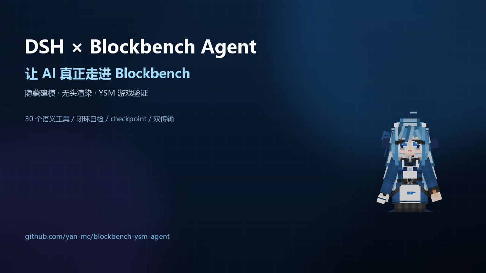

# DSH × Blockbench Agent · 完整使用手册

> 在 **DeepSeek Harness（dsh）** 里驱动一个**隐藏运行的 Blockbench**：建模、贴图、动画、无头渲染自检、YSM 校验/保存/导出，最后在 Minecraft 里加载验证。
>
> 版本：v0.4.0 · 平台：Windows（Electron）· 适用：dsh Web / Desktop profile



## 目录

1. [这是什么](#1-这是什么)
2. [能力总览](#2-能力总览)
3. [系统要求](#3-系统要求)
4. [安装](#4-安装)
5. [5 分钟快速开始](#5-5-分钟快速开始)
6. [命令](#6-命令)
7. [工具参考](#7-工具参考)
8. [典型工作流](#8-典型工作流)
9. [安全模型与 revision](#9-安全模型与-revision)
10. [渲染自检与 watchdog](#10-渲染自检与-watchdog)
11. [YSM 保存、导出与游戏验证](#11-ysm-保存导出与游戏验证)
12. [配置参考](#12-配置参考)
13. [故障排查](#13-故障排查)
14. [开发、测试与发布](#14-开发测试与发布)
15. [限制与许可](#15-限制与许可)
16. [FAQ](#16-faq)

---

## 1. 这是什么

**DSH Blockbench Agent** 是一个 dsh Host 插件 + 一个隐藏的 Blockbench Agent Runtime（BAE）组成的闭环工具链：

```text
DeepSeek / VLM
   │  调用 bb_* 工具
   ▼
dsh Host 插件  ── WebSocket / HTTP+SSE ──►  BAE（隐藏 Electron + Blockbench）
   │                                              │
   │  渲染 PNG 作为多模态附件返回                  │  语义操作模型 / 贴图 / 动画
   ▼                                              ▼
模型「看见」结果 → 继续改 / 回滚            YSM pack → zip → Minecraft
```

它解决的不是“让 AI 生成一段建模代码”，而是让 AI **真的能操作 Blockbench、看见渲染、检查结果、保存工程**，形成真正的编辑闭环。

典型用途：

- 用自然语言/多轮对话制作或修改 **YSM（Yes Steve Model）** 模型
- 给已有 YSM 模型换配色、调几何、补细节
- 生成/修改贴图、图层、PBR `_n`/`_s`
- 创建动画、关键帧、绑定动画控制器
- 用多机位渲染做视觉自检，避免“改了半天看不见”
- 导出 zip 后在 Minecraft 里加载验证

---

## 2. 能力总览

| 能力 | 说明 |
|---|---|
| **隐藏运行** | Blockbench 在后台窗口运行，不抢焦点；需要时 `/show` 打开 |
| **语义建模** | 骨骼/方块增删改、`inflate`、`rotation`、`pivot`、每面 UV |
| **像素贴图** | 像素/矩形/线/渐变/替换/镜像、图层、PBR normal/specular |
| **无头渲染** | 多机位、`closeup` 特写、`SSAA` 超采样；PNG 作为图片附件回流 |
| **变化检测** | 逐图 `changed`、`alpha_ratio`、`bbox`、`edge_touch`；空图/裁切检测 |
| **watchdog-v2** | `review.verdict`、`unchanged_streak`、`checks`、`suggestions`、`vlm_hint` |
| **检查点** | 内嵌当前贴图 + arm 快照；`restore` 一键回滚 |
| **增量保存** | 未编辑的贴图/动画不重写；动画文件合并回写，避免整文件重排 |
| **YSM 校验/导出** | required bones、纹理尺寸、ysm.json 引用、UV 边界；导出目录 + zip |
| **双传输** | WebSocket 主链路；HTTP+SSE 回退（`--transport=auto/ws/http`） |
| **安全/预算** | revision 前置校验、编辑/渲染/restore 预算、GUI 可见时冻结写操作 |
| **Client UI** | dsh Web composer dock 的 Blockbench 状态 pill（需刷新页面加载） |
| **工具规模** | 30 个 `bb_*` 工具 + 5 个命令 + 1 个 Skill |

---

## 3. 系统要求

- Windows 10/11 x64
- dsh（DeepSeek Harness）可用，且能安装本地 bundle
- Node.js ≥ 20（dsh 自带运行时也可）
- Blockbench v5.2.x 桌面版（发布包里的 BAE 基于 v5.2.2）
- 可选：Minecraft Java 1.20.1 + Forge + YSM 2.6.x（游戏内验证）

> 当前正式分发是 **zip 发布包**，不做代码签名/安装器；Windows SmartScreen 可能提示，属于未签名应用的正常现象。

---

## 4. 安装

### 4.1 解压发布包

从 [Releases](https://github.com/yan-mc/blockbench-ysm-agent/releases) 下载 `bb-agent-0.4.0-*.zip`，解压后得到：

```text
bb-agent-0.4.0/
├─ bb-agent-app/              # BAE 应用（隐藏 Blockbench + bridge）
├─ dsh-blockbench-agent/      # dsh Host 插件 bundle
├─ docs/
├─ INSTALL.md
├─ SHA256SUMS.txt
└─ SOURCE.txt                 # GPL 对应源码说明
```

### 4.2 准备 Electron

BAE 需要一个 Electron 可执行文件。推荐直接使用 Blockbench 自带的 Electron：

```text
<Blockbench 安装目录>/node_modules/electron/dist/electron.exe
```

如果使用仓库的 `vendor/blockbench`：

```text
F:\Deepseek_harness\blockbench\vendor\blockbench\node_modules\electron\dist\electron.exe
```

### 4.3 修改 bundle 配置

编辑 `dsh-blockbench-agent/cordis.patch.yml` 的 `config`：

```yaml
- insert:
    - id: blockbench-agent
      name: '@local/dsh-blockbench-agent'
      config:
        workspaceRoot: 'F:\Deepseek_harness\blockbench\models'   # 模型根目录
        project: 'deepseek-fish'                                  # 当前模型目录名
        autoStart: true
        executable: '<你的 electron.exe 绝对路径>'
        appPath: '<解压目录>\bb-agent-app'
        pluginPath: '<解压目录>\bb-agent-app\agent\bb-agent-bridge.js'
        bridgeTransport: auto
```

> `workspaceRoot` + `project` 决定工作区：`<workspaceRoot>/<project>`，所有 pack、渲染、检查点、日志都在这个目录下。

### 4.4 安装 bundle

在 dsh 中：

```text
plugin_manager install_bundle target="<解压目录>\dsh-blockbench-agent"
```

安装后插件行应显示 `active`。如果安装前插件已存在，先 `remove_bundle` 再安装。

### 4.5 验证

在任意 dsh 会话中执行：

```text
/bb-status
```

或直接让模型调用 `bb_session_status`。首次启动 BAE 可能需要数秒。

---

## 5. 5 分钟快速开始

在 dsh 会话中加载 Skill（推荐）：

```text
加载 blockbench-ysm-artist 技能
```

然后可以用自然语言描述任务，例如：

```text
用 bb_* 工具给 models/deepseek-fish 的模型加一个鲸鱼尾鳍，
改完渲染 front/iso_fr 给我看，不满意就根据渲染图继续改。
```

最小工具流程：

```text
bb_session_start({ mode: "new_ysm", name: "my_model", pack_dir: "pack" })
bb_scene({ scope: "bones" })
bb_apply_model_patch({ ops: [
  { op: "add_bone", parent: "Body", name: "Tail", pivot: [0, 16, 2] },
  { op: "add_cube", bone: "Tail", name: "tail_base", origin: [-1, 12, 3], size: [2, 6, 2] }
]})
bb_render_views({ views: ["front", "iso_fr"], size: [768, 768] })
bb_validate({})
bb_save_project({})
bb_export_ysm({ out_dir: "release", zip: true })
```

打开已有 YSM 包：

```text
bb_project_open({ pack_dir: "deepseek-fish" })
```

> `pack_dir` 相对于 `<workspaceRoot>/<project>` 工作区。

---

## 6. 命令

| 命令 | 作用 |
|---|---|
| `/show` | 显示隐藏的 Blockbench 窗口；期间写操作返回 `GUI_BUSY` |
| `/hide` | 隐藏窗口并同步用户改动，返回 `user_edits` 摘要 |
| `/bb-status` | 查看运行时/状态/预算/revision |
| `/bb-start` | 手动启动 BAE（autoStart=false 时） |
| `/bb-help` | 打印工具列表 |

---

## 7. 工具参考

### 7.1 会话与项目

| 工具 | 关键参数 | 说明 |
|---|---|---|
| `bb_session_start` | `mode:new_ysm/open_pack`, `name`, `pack_dir`, `resolution` | 新建 YSM 包或打开已有包 |
| `bb_project_open` | `pack_dir` | 打开已有 YSM 工作区（保存当前项目） |
| `bb_session_status` | — | 状态、revision、预算、loop |
| `bb_scene` | `scope:summary/bones/cube/bone`, `id`, `include_uv`, `limit` | 场景结构/骨骼/方块/UV |
| `bb_get_element` | `id` | 单个元素详情 |
| `bb_project_close` | `force` | 关闭当前项目 |
| `bb_diagnostics` | — | 进程、日志、transport、safe-mode |
| `bb_batch` | `calls:[{tool,args}]` | 批量调用（非事务） |

### 7.2 建模

| 工具 | 关键参数 | 说明 |
|---|---|---|
| `bb_apply_model_patch` | `ops[]`, `expected_revision`, `note` | 原子变更：加/改/删/重命名；一次 Undo/revision |
| | `add_bone` | `name,parent,pivot` |
| | `add_cube` | `bone,name,origin,size,inflate,rotation,pivot,texture,uv` |
| | `update_cube` | `cube_id/id,origin,size,rotation,pivot,inflate,texture` |
| | `update_bone` | `bone/bone_id/id,pivot,rotation,name` |
| | `set_uv` | `ids,faces,uv_size/sizes` |
| | `delete` | `refs:[{kind,id}]` |
| | `rename` | `id,name` |

`uv` 支持：

```json
{ "mode": "faces", "faces": { "north": [0, 0] }, "sizes": { "north": [6, 6] } }
```

`set_uv` 的 `uv_size` 可显式指定，用于把设计图压到指定面；不指定则按方块面尺寸推导。

### 7.3 贴图

| 工具 | 说明 |
|---|---|
| `bb_texture_create` | 新建空贴图/纯色贴图 |
| `bb_texture_patch` | 像素/矩形/线/渐变/替换/镜像等批量绘制 |
| `bb_texture_read` | palette / ascii / png 局部读取 |
| `bb_texture_layer` | list/create/select/delete/flatten 图层 |
| `bb_texture_pbr` | list/create PBR normal/specular |
| `bb_texture_export_png` | 导出 PNG 到工作区 |
| `bb_texture_import_png` | 从工作区导入 PNG 并定位 |

常用绘制：

```json
{ "texture": "default", "ops": [
  { "op": "rect", "x1": 4, "y1": 4, "x2": 20, "y2": 20, "color": "#cc3344" },
  { "op": "pixel", "x": 4, "y": 4, "color": "#ffffff" },
  { "op": "replace", "target": "#cc3344", "replacement": "#224488", "tol": 0 }
]}
```

### 7.4 动画

| 工具 | 说明 |
|---|---|
| `bb_animation_list` | 动画/控制器/状态列表 |
| `bb_animation_create` | 新建动画 |
| `bb_animation_patch` | set/delete keyframes、update、绑定控制器、删除动画 |
| `bb_animation_delete` | 删除动画 |

关键帧示例：

```json
{ "ops": [{
  "op": "set_keyframes", "animation": "animation.main.wave",
  "bone": "Head", "channel": "rotation",
  "keys": [{ "time": 0, "value": [0,0,0] }, { "time": 0.5, "value": [0,45,0] }]
}]}
```

控制器绑定：

```json
{ "ops": [{ "op": "bind_controller", "animation": "animation.main.wave",
  "controller": "player.pre_main", "state": "default" }] }
```

### 7.5 渲染与自检

| 工具 | 说明 |
|---|---|
| `bb_render_views` | `views`, `size`, `antialias:off/msaa/ssaa`, `focus`, `attach_images` |
| `bb_render_texture` | 贴图局部放大检查 |

`views`：`front/back/left/right/top/bottom/iso_fr/iso_fl/iso_br/iso_bl/closeup`。

返回重点：

```json
{
  "changed_any": true,
  "images": [{ "view": "front", "changed": true, "alpha_ratio": 0.34,
               "bbox": [0.1,0.05,0.9,0.98], "edge_touch": false }],
  "review": {
    "schema_version": "watchdog-v2",
    "verdict": "visible_change",
    "unchanged_streak": 0,
    "checks": [{ "id": "not_clipped", "status": "pass" }],
    "suggestions": [],
    "vlm_hint": "..."
  }
}
```

### 7.6 校验、保存、导出

| 工具 | 说明 |
|---|---|
| `bb_validate` | YSM 校验（required bones、纹理、ysm.json、UV） |
| `bb_checkpoint` | 检查点（贴图内嵌 + arm 快照） |
| `bb_revisions` | 检查点列表 |
| `bb_restore` | 回滚（需 `confirm:true`） |
| `bb_save_project` | 保存回 pack（增量） |
| `bb_export_ysm` | 校验 + 导出目录/zip |
| `bb_show_gui` / `bb_hide_gui` | 可选 GUI 工具（默认不暴露，用命令） |

---

## 8. 典型工作流

### 8.1 从零做一个 YSM 模型

1. `bb_session_start({mode:"new_ysm", name:"my_model", pack_dir:"pack"})`
2. `bb_scene({scope:"bones"})` 看模板骨骼
3. 用 `bb_apply_model_patch` 增删/改方块、加骨骼
4. `bb_texture_create` / `bb_texture_patch` 画贴图
5. `bb_render_views` 看正面/侧面/特写
6. 迭代 → `bb_validate` → `bb_save_project` → `bb_export_ysm`
7. 游戏内验证（见第 11 节）

### 8.2 修改已有模型

```text
bb_project_open({ pack_dir: "deepseek-fish" })
bb_checkpoint({ label: "before-change" })
bb_texture_patch(...)
bb_apply_model_patch(...)
bb_render_views(...)
# 不满意：
bb_restore({ revision: <checkpoint.revision>, confirm: true })
```

### 8.3 渲染自检闭环

```text
bb_render_views({ views: ["front","iso_fr"], size: [768,768] })
# 看返回 review.verdict：
# visible_change / visible_change_clipped / no_visible_change / no_change_expected / empty_render
bb_render_views({ views: ["closeup"], focus: {element:"Head"}, antialias:"ssaa" })
```

连续 `no_visible_change` 时，先查 UV/材质绑定/骨骼层级；`unchanged_streak >= 3` 建议 `bb_restore` 或换策略。

### 8.4 动画 + 控制器

```text
bb_animation_create({ name:"animation.main.wave", length:1, loop:"loop" })
bb_animation_patch({ ops:[{ op:"set_keyframes", animation:"animation.main.wave",
  bone:"Head", channel:"rotation", keys:[...] }]})
bb_animation_list({})   # 找 controller/state
bb_animation_patch({ ops:[{ op:"bind_controller", animation:"animation.main.wave",
  controller:"player.pre_main", state:"default" }]})
```

### 8.5 保存与发布

```text
bb_validate({})
bb_save_project({})
bb_export_ysm({ out_dir:"release", zip:true })
```

保存规则：

- 未编辑的贴图不重写（保持原始字节）
- 未编辑的动画文件不重写
- 被编辑的动画文件：**合并回写**，未修改动画保持原对象/顺序，只替换实际编辑的动画
- 二次保存幂等（无变化）

### 8.6 人工接管

```text
/show      # 显示 Blockbench，AI 写操作被 GUI_BUSY 挡住
（手动修改）
/hide      # 回到后台，返回 user_edits，AI 重新对账 revision
```

---

## 9. 安全模型与 revision

- **revision 前置校验**：所有写操作自动带 `expected_revision`；旧 revision 返回 `REVISION_CONFLICT`，避免覆盖。
- **预算**：默认 edit 60 / render 40 / restore 2；超限返回 `BUDGET_EXCEEDED`。
- **GUI 冻结**：`/show` 期间写操作返回 `GUI_BUSY`。
- **可回滚**：`bb_checkpoint` + `bb_restore`；checkpoint 内嵌贴图与 arm。
- **隐藏窗口**：BAE 默认 `show:false`，不抢焦点；外网请求被离线策略阻断。
- **文件沙箱**：BAE 只允许插件授权的工作区文件操作（通过预写 `plugin_permissions.json`）。

---

## 10. 渲染自检与 watchdog

`bb_render_views` 会：

1. 用固定机位/zoom-to-fit 无头渲染
2. 保存 PNG 并按需生成 512px 附件
3. 与上一次渲染做 64×64 像素差分（阈值 0.5%），避免 GPU 抖动误报
4. 计算 `alpha_ratio`、`bbox`、`edge_touch`
5. 更新 watchdog：
   - `visible_change`：有可见变化
   - `visible_change_clipped`：有变化但画面触边（可能裁切）
   - `no_visible_change`：编辑后没有可见变化
   - `no_change_expected`：没有待验证编辑
   - `empty_render`：全透明（相机/几何/GPU 问题）
6. 连续 no-visible-change 累积 `unchanged_streak`，≥3 给出回滚建议

> watchdog 是规则判定；造型/配色/是否符合意图仍需要模型（或人）看图片判断。`vlm_hint` 给出给 VLM 的提示。

---

## 11. YSM 保存、导出与游戏验证

### 11.1 导出

```text
bb_export_ysm({ out_dir: "release", zip: true })
```

产物：

```text
<workspace>/release/pack/
├─ models/*.json
├─ textures/*.png
├─ animations/*.json
├─ controller/*.json
├─ lang/*.json
├─ ysm.json
├─ export-manifest.json
└─ pack.zip
```

### 11.2 在 Minecraft 中加载

以 Forge 1.20.1 + YSM 2.6.x 为例：

1. 把 `pack/` 复制到 `.minecraft/config/yes_steve_model/custom/<pack_name>/`
2. 启动游戏，进入世界
3. 执行：

```text
/ysm model reload
/ysm model set @s <pack_name> default
```

4. 日志应出现：

```text
[YSM] Set '<pack_name>' models for player '<player>'
```

5. 第三人称/第一人称检查模型、贴图、动画是否正常。

> 游戏内验证需要正版/离线客户端环境与 YSM 版本匹配；插件本身不修改游戏，只生成标准 YSM 包。

---

## 12. 配置参考

`cordis.patch.yml` / profile patch 的 config：

| 字段 | 默认 | 说明 |
|---|---|---|
| `workspaceRoot` | `F:\...\workspace` | 模型根目录 |
| `project` | `default` | 当前项目目录名 |
| `executable` | `''` | BAE 的 electron.exe |
| `appPath` | `''` | BAE 应用目录 |
| `pluginPath` | `<appPath>/agent/bb-agent-bridge.js` | bridge 插件 |
| `autoStart` | `true` | plugin 激活时自动启动 BAE |
| `connectTimeoutMs` | `30000` | 连接超时 |
| `defaultTimeoutMs` | `120000` | RPC 默认超时 |
| `maxImagesPerCall` | `4` | 每次返回图片上限 |
| `imageMaxDimension` | `512` | 附件缩略图最大边长 |
| `imageMaxBytes` | `8388608` | 单图上限 |
| `exposeGuiTools` | `false` | 是否把 GUI 工具暴露给模型 |
| `bridgeTransport` | `auto` | `auto/ws/http` |

---

## 13. 故障排查

| 现象 | 处理 |
|---|---|
| `/bb-status` 报未连接 | 检查 `executable/appPath` 路径；`/bb-start`；看 `bb_diagnostics.logs` |
| 启动报 `EPERM` / 文件占用 | 先禁用插件/停 BAE，再升级 `dist/bb-agent-app` |
| 渲染空白/`EMPTY_RENDER` | 检查相机 bounds、模型可见性；尝试 `--safe-mode` |
| 渲染 `no_visible_change` | 检查 UV/纹理绑定/骨骼层级；必要时 `bb_restore` |
| `GUI_BUSY` | 用户正在 `/show` 状态；`/hide` 后继续 |
| 保存很慢/超时 | 关闭 GUI、减少一次 patch 规模；检查磁盘 |
| 图片附件过大 | 降低 `imageMaxDimension`/`attach_size` |
| 游戏脚本 classpath 错误 | 用 `pwsh` 7 运行 `ingame.ps1`（脚本会自动检测 PowerShell 5.1 并切换） |
| Client pill 看不到 | 刷新 dsh Web 页面；确认 bundle 含 `client.js` 且 `GET /bb-agent/status` 可访问 |
| 多实例/残留 Electron | 禁用插件后清理进程；重启 dsh |

日志：

- Host：dsh 控制台 `[blockbench-agent]`
- BAE：`<workspace>/logs/runtime.log`、`agent.log`
- 渲染：`<workspace>/artifacts/renders/`
- 测试：`workspace/_logs/`、`docs/test-evidence/`

---

## 14. 开发、测试与发布

```text
# 组装 BAE
node packages/bb-agent-runtime/scripts/assemble.mjs

# 全量回归：assemble → M0 → e2e WS → e2e HTTP+SSE → hosttest → 动画语义 diff
npm run test

# 快速回归：hosttest + 动画语义 diff
npm run test:quick

# 发布包
node packages/bb-agent-runtime/scripts/package-release.mjs
```

仓库结构：

```text
packages/bb-agent-runtime/    # BAE 组装、bridge、测试脚本
packages/dsh-blockbench-agent/# Host 插件 + Client pill + Skill
models/deepseek-fish/         # 测试模型（YSM pack + 截图 + zip）
docs/                         # 设计/工程文档 + 测试证据 + 封面
spec/                         # 工具/协议机器可读契约
game-test/                    # 可选的隔离游戏验证环境（gitignored）
```

---

## 15. 限制与许可

**已知限制（v0.4.0）**

- 动画文件已做合并回写，但还不是 YSM-Utils `saveNormalization` 的完整移植；`ysm.json`/控制器文件的字节级规范化未做。
- watchdog-v2 是规则检测 + 外部 VLM 判断，不内置视觉模型。
- PBR 贴图会生成/保存，但 Blockbench 离屏渲染不显示 PBR 效果。
- Client UI 状态 pill 需要刷新 dsh Web 页面加载；Host `/bb-agent/status` 已可用。
- 未提供 electron-builder 安装器/代码签名；zip 为正式分发方式。
- 游戏验证只覆盖单模型加载/第三人称/第一人称，不含多人同步/服务端校验。

**许可**

- 本仓库原创代码/文档：按仓库 LICENSE。
- Blockbench：GPL-3.0-or-later；BAE 是衍生发行版，发布包随附 `SOURCE.txt` 与源码说明。
- YSM-Utils-Plugins：MIT。
- Minecraft：遵守 Mojang EULA，不分发原始游戏资产。
- 模型参考图版权归原作者/社区；测试模型为自制体素模型。

---

## 16. FAQ

**Q：必须用 DeepSeek 模型吗？**
A：不必须。工具是标准 dsh Tool，任何能调用工具的模型都可以用；多模态模型才能直接“看”渲染图。

**Q：会打开 Blockbench 窗口吗？**
A：默认隐藏运行；只有 `/show` 会显示。

**Q：会修改我的 Minecraft 实例吗？**
A：插件本身不会；游戏验证需要你把导出的 pack 放进游戏目录，建议使用隔离测试环境。

**Q：能用于其他模型格式吗？**
A：当前主要面向 YSM（Bedrock geometry + ysm.json）；通用 Blockbench 能力受 bridge 方法覆盖范围限制。

**Q：为什么渲染图是透明的？**
A：默认透明背景便于判断模型轮廓；需要背景可传 `background` 参数。

**Q：模型/贴图会被上传到云端吗？**
A：不会。BAE 离线运行，外网请求被阻断；只有你主动把图片作为附件交给模型时才会进入对话。

---

*完整设计文档见 [ENGINEERING.md](ENGINEERING.md)、[系统开发与设计方案.md](<系统开发与设计方案.md>)、[spec/](spec/)。*
