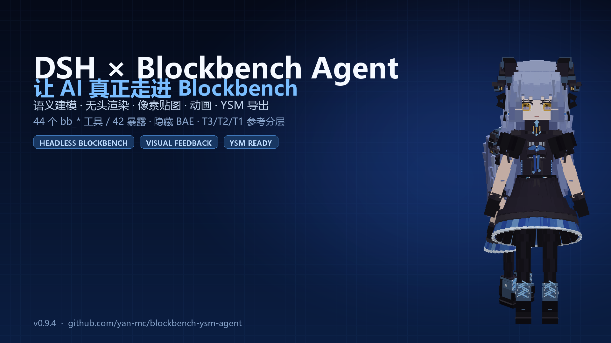

# DSH × Blockbench Agent · 完整使用手册

> 在 **DeepSeek Harness（dsh）** 里驱动一个**隐藏运行的 Blockbench**：建模、贴图、动画、无头渲染自检、YSM 校验/保存/导出，最后在 Minecraft 里加载验证。
>
> 版本：v0.9.3 · 平台：Windows（Electron）· 适用：dsh Web / Desktop profile



## ⚠️ 使用方式（重要）

**不要在主对话里直接调用 `bb_*` 工具。** 正确姿势：

```
用户提需求 → 主代理判定任务类型（不碰 bb_*）
           → 按 templates 拉起子智能体，附上完善过的任务书
           → 子智能体先 promote（补全任务书、输出计划），再执行
           → 主代理验收产物并汇总
```

原因：渲染图非常吃 token（单张 200–900）、长任务容易打断主线、事故无法隔离。

- 协议：`docs/17-子智能体委派规范.md`
- 任务书模板：`packages/dsh-blockbench-agent/assets/delegation-brief.md`
- 技能里也写了强制规则（`blockbench-ysm-artist` §0-A）

## 目录

1. [这是什么](#1-这是什么)
2. [能力总览](#2-能力总览)
3. [系统要求](#3-系统要求)
4. [安装](#4-安装)
5. [5 分钟快速开始](#5-5-分钟快速开始)
6. [命令](#6-命令)
7. [工具参考](#7-工具参考)
8. [典型工作流](#8-典型工作流)
9. [安全模型与 revision](#9-安全模型与-revision)
10. [渲染自检与 watchdog](#10-渲染自检与-watchdog)
11. [YSM 保存、导出与游戏验证](#11-ysm-保存导出与游戏验证)
12. [配置参考](#12-配置参考)
13. [故障排查](#13-故障排查)
14. [开发、测试与发布](#14-开发测试与发布)
15. [限制与许可](#15-限制与许可)
16. [FAQ](#16-faq)

---

## 1. 这是什么

**DSH Blockbench Agent** 是一个 dsh Host 插件 + 一个隐藏的 Blockbench Agent Runtime（BAE）组成的闭环工具链：

```text
DeepSeek / VLM
   │  调用 bb_* 工具
   ▼
dsh Host 插件  ── WebSocket / HTTP+SSE ──►  BAE（隐藏 Electron + Blockbench）
   │                                              │
   │  渲染 PNG 作为多模态附件返回                  │  语义操作模型 / 贴图 / 动画
   ▼                                              ▼
模型「看见」结果 → 继续改 / 回滚            YSM pack → zip → Minecraft
```

它解决的不是“让 AI 生成一段建模代码”，而是让 AI **真的能操作 Blockbench、看见渲染、检查结果、保存工程**，形成真正的编辑闭环。

典型用途：

- 用自然语言/多轮对话制作或修改 **YSM（Yes Steve Model）** 模型
- 给已有 YSM 模型换配色、调几何、补细节
- 生成/修改贴图、图层、PBR `_n`/`_s`
- 创建动画、关键帧、绑定动画控制器
- 用多机位渲染做视觉自检，避免“改了半天看不见”
- 导出 zip 后在 Minecraft 里加载验证

---

## 2. 能力总览

| 能力 | 说明 |
|---|---|
| **隐藏运行** | Blockbench 在后台窗口运行，不抢焦点；需要时 `/show` 打开 |
| **语义建模** | 骨骼/方块增删改、`inflate`、`rotation`、`pivot`、每面 UV |
| **像素贴图** | 像素/矩形/线/渐变/替换/镜像、图层、PBR normal/specular |
| **无头渲染** | 多机位、`closeup` 特写、`SSAA` 超采样；PNG 作为图片附件回流 |
| **变化检测** | 逐图 `changed`、`alpha_ratio`、`bbox`、`edge_touch`；空图/裁切检测 |
| **watchdog-v2** | `review.verdict`、`unchanged_streak`、`checks`、`suggestions`、`vlm_hint` |
| **检查点** | 内嵌当前贴图 + arm 快照；`restore` 一键回滚 |
| **增量保存** | 未编辑的贴图/动画不重写；动画文件合并回写，避免整文件重排 |
| **YSM 校验/导出** | required bones、纹理尺寸、ysm.json 引用、UV 边界；导出目录 + zip |
| **双传输** | WebSocket 主链路；HTTP+SSE 回退（`--transport=auto/ws/http`） |
| **安全/预算** | revision 前置校验、编辑/渲染/restore 预算、GUI 可见时冻结写操作 |
| **Client UI** | dsh Web composer dock 的 Blockbench 状态 pill（需刷新页面加载） |
| **局部审查** | `bb_look({isolate, zoom})` 只渲染指定骨骼子树并自动对焦；`bb_orbit` 转台、`bb_anim_check` 动画采样 |
| **参考图管线** | `bb_ref_canon`（官方基准）→ `bb_ref_search`（多源搜图）→ `bb_ref_collect`（下载去重 + 编号对照表） |
| **建模规格** | `bb_spec_save` / `bb_spec_load`：固化规格并生成构建计划 |
| **分层能力** | **T3** Nano Banana Pro 云端（需付费 API key，多参考图 → 三视图/拆解板）；T1 SAM2 ONNX（约 59MB，CPU 可跑）；T2 See-through + ComfyUI（约 7GB）；均为可选增强，T3 无 key 时降级 T2 |
| **上下文治理** | 图史压缩（旧图剥离为占位文本）+ 附件预算护栏 |
| **工具规模** | **44 个 `bb_*` 定义 / 实际暴露 42 个**（GUI 2 个由命令替代）+ 5 个命令 + 1 个 Skill；**56 个 bridge 方法 / 7 事件 / 22 错误码** |

---

## 3. 系统要求

- Windows 10/11 x64
- dsh（DeepSeek Harness）可用，且能安装本地 bundle
- Node.js ≥ 20（dsh 自带运行时也可）
- Blockbench v5.2.x 桌面版（BAE 基于 **v5.2.2** 的 Electron 43 构建）
- 可选：Minecraft Java 1.20.1 + Forge + YSM 2.6.x（游戏内验证）

> 当前正式分发是 **zip 发布包**（0.9.3 待重打），不做代码签名/安装器；Windows SmartScreen 可能提示，属于未签名应用的正常现象。

---

## 4. 安装

> 当前版本 **0.9.3**。推荐方式：**从仓库 link 安装**（本机 DSH profile 就是这样指向 `packages/dsh-blockbench-agent`）。
> GitHub Releases 上的 `0.4.0` 是历史发布；0.9.3 发布包尚未重打。

### 4.1 准备 Electron

BAE 需要一个 Electron 可执行文件。推荐直接使用仓库 vendor 里 Blockbench 自带的 Electron：

```text
F:\Deepseek_harness\blockbench\vendor\blockbench\node_modules\electron\dist\electron.exe
```

（即上游 Blockbench `v5.2.2` 的 Electron 43；用你本机 Blockbench 安装目录下的同类路径也可以。）

### 4.2 重建 dist（BAE 应用目录）

`dist/bb-agent-app` 是组装产物，不入库。首次搭建或改了 `vendor`/`packages` 后：

```powershell
cd F:\Deepseek_harness\blockbench
node packages/bb-agent-runtime/scripts/assemble.mjs
```

产物：`dist/bb-agent-app/`（含上游构建产物、`agent/` 四件套、`@electron/remote`、`templates/ysm_default`、GPL `SOURCE.txt`）。
本机 2026-11-07 基线：**190 文件 / 36MB**，`templates/` 32 文件，`agent/` 4 文件 sha256 与源码一致。

> 如果 BAE 正在运行，`dist/bb-agent-app` 会被占用（EPERM）；先停 BAE/禁用插件再组装。

### 4.3 修改 bundle 配置

编辑 `packages/dsh-blockbench-agent/cordis.patch.yml` 的 `config`（本机默认已配好）：

```yaml
- insert:
    - id: blockbench-agent
      name: '@local/dsh-blockbench-agent'
      config:
        workspaceRoot: 'F:\Deepseek_harness\blockbench\models'   # 模型根目录
        project: 'togawa-sakiko'                                  # 当前模型目录名（新验收项目）
        autoStart: true
        executable: 'F:\Deepseek_harness\blockbench\vendor\blockbench\node_modules\electron\dist\electron.exe'
        appPath: 'F:\Deepseek_harness\blockbench\dist\bb-agent-app'
        pluginPath: 'F:\Deepseek_harness\blockbench\dist\bb-agent-app\agent\bb-agent-bridge.js'
        exposeGuiTools: false
        bridgeTransport: auto
```

> `workspaceRoot` + `project` 决定工作区：`<workspaceRoot>/<project>` = `models/togawa-sakiko`。
> 所有 pack、渲染、检查点、日志都在这个目录下；`bb_project_open({pack_dir})` 的相对路径也基于它。

### 4.4 安装 / 重装 bundle（link 方式）

首次安装：

```text
plugin_manager install_bundle target=F:/Deepseek_harness/blockbench/packages/dsh-blockbench-agent
```

更新插件（改过 `index.js`/`lib/`/`skills/`/`reference/` 后）：

```text
plugin_manager remove_bundle target=@local/dsh-blockbench-agent
（停止 BAE / 清理残留 electron 进程，确认 dist 未被占用）
node packages/bb-agent-runtime/scripts/assemble.mjs          # 若改过 agent/bridge
plugin_manager install_bundle target=F:/Deepseek_harness/blockbench/packages/dsh-blockbench-agent
```

安装后插件行应显示 `active`。**改 schemas 后必须跑 host-smoke**：schema 非法会导致所有工具和 skill 一起从 DSH 消失。

### 4.5 验证

在任意 dsh 会话中执行：

```text
/bb-status
```

或直接让模型调用 `bb_session_status`。首次启动 BAE 可能需要数秒；`gpu_ok: true` 表示离屏渲染可用。

---

## 5. 5 分钟快速开始

在 dsh 会话中加载 Skill（推荐）：

```text
加载 blockbench-ysm-artist 技能
```

然后可以用自然语言描述任务，例如：

```text
用 bb_* 工具给 models/togawa-sakiko 的模型加一对双大角，
改完用 bb_look({isolate:"AllHead", zoom:2.5}) 局部渲染给我看，不满意就根据渲染图继续改。
```

最小工具流程：

```text
bb_session_start({ mode: "new_ysm", name: "my_model", pack_dir: "pack" })
bb_scene({ scope: "bones" })
bb_apply_model_patch({ ops: [
  { op: "add_bone", parent: "Body", name: "Tail", pivot: [0, 16, 2] },
  { op: "add_cube", bone: "Tail", name: "tail_base", origin: [-1, 12, 3], size: [2, 6, 2] }
]})
bb_render_views({ views: ["front", "iso_fr"], size: [768, 768] })
bb_validate({})
bb_save_project({})
bb_export_ysm({ out_dir: "release", zip: true })
```

打开已有 YSM 包：

```text
bb_project_open({ pack_dir: "pack" })
```

> `pack_dir` 相对于 `<workspaceRoot>/<project>` 工作区。

---

## 6. 命令

| 命令 | 作用 |
|---|---|
| `/show` | 显示隐藏的 Blockbench 窗口；期间写操作返回 `GUI_BUSY` |
| `/hide` | 隐藏窗口并同步用户改动，返回 `user_edits` 摘要 |
| `/bb-status` | 查看运行时/状态/预算/revision |
| `/bb-start` | 手动启动 BAE（autoStart=false 时） |
| `/bb-help` | 打印工具列表 |

---

## 7. 工具参考

> `index.js` 定义 **44 个 `bb_*`**；因 `exposeGuiTools:false` 实际暴露 **42 个**（`bb_show_gui` / `bb_hide_gui` 由 `/show` `/hide` 命令替代）。
> 权威参数以 `index.js` 实际 schema 为准（`spec/tool-manifest.json` 是手工契约源，存在已知参数漂移）。

### 7.1 会话与项目

| 工具 | 关键参数 | 说明 |
|---|---|---|
| `bb_session_start` | `mode:new_ysm/open_pack`, `name`, `pack_dir`, `resolution` | 新建 YSM 包或打开已有包 |
| `bb_project_open` | `pack_dir` | 打开已有 YSM 工作区（保存当前项目） |
| `bb_session_status` | — | 状态、revision、预算、loop |
| `bb_scene` | `scope:summary/bones/cube/bone/textures/animations`, `id`, `include_uv`, `limit` | 场景结构/骨骼/方块/UV |
| `bb_get_element` | `id` | 单个元素详情 |
| `bb_project_close` | `force` | 关闭当前项目 |
| `bb_diagnostics` | — | 进程、日志、transport、safe-mode |
| `bb_batch` | `calls:[{tool,args}]` | 批量调用（顺序执行，非事务） |

### 7.2 建模

| 工具 | 关键参数 | 说明 |
|---|---|---|
| `bb_apply_model_patch` | `ops[]`, `expected_revision`, `note` | 原子变更：加/改/删/重命名；一次 Undo/revision |
| | `add_bone` | `name,parent,pivot` |
| | `add_cube` | `bone,name,origin,size,inflate,rotation,pivot,texture,uv` |
| | `update_cube` | `cube_id/id,origin,size,rotation,pivot,inflate,texture` |
| | `update_bone` | `bone/bone_id/id,pivot,rotation,name` |
| | `set_uv` | `ids,faces,uv_size/sizes` |
| | `delete` | `refs:[{kind,id}]` |
| | `rename` | `id,name` |

`uv` 支持：

```json
{ "mode": "faces", "faces": { "north": [0, 0] }, "sizes": { "north": [6, 6] } }
```

`set_uv` 的 `uv_size` 可显式指定，用于把设计图压到指定面；不指定则按方块面尺寸推导。

### 7.3 贴图

| 工具 | 说明 |
|---|---|
| `bb_texture_create` | 新建空贴图/纯色贴图 |
| `bb_texture_patch` | 像素/矩形/线/渐变/替换/镜像等批量绘制 |
| `bb_texture_read` | palette / ascii / png 局部读取 |
| `bb_texture_layer` | list/create/select/delete/flatten 图层（保存时合成回单张 PNG） |
| `bb_texture_pbr` | list/create PBR normal(`_n`)/specular(`_s`) |
| `bb_texture_export_png` | 导出 PNG 到工作区 |
| `bb_texture_import_png` | 从工作区 PNG 或 base64 导入并定位 |

常用绘制：

```json
{ "texture": "default", "ops": [
  { "op": "rect", "x1": 4, "y1": 4, "x2": 20, "y2": 20, "color": "#cc3344" },
  { "op": "pixel", "x": 4, "y": 4, "color": "#ffffff" },
  { "op": "replace", "target": "#cc3344", "replacement": "#224488", "tol": 0 }
]}
```

### 7.4 动画

| 工具 | 说明 |
|---|---|
| `bb_animation_list` | 动画/控制器/状态列表 |
| `bb_animation_create` | 新建动画 |
| `bb_animation_patch` | set/delete keyframes、update、绑定控制器、删除动画 |
| `bb_animation_delete` | 删除动画 |

关键帧示例：

```json
{ "ops": [{
  "op": "set_keyframes", "animation": "animation.main.wave",
  "bone": "Head", "channel": "rotation",
  "keys": [{ "time": 0, "value": [0,0,0] }, { "time": 0.5, "value": [0,45,0] }]
}]}
```

控制器绑定：

```json
{ "ops": [{ "op": "bind_controller", "animation": "animation.main.wave",
  "controller": "player.pre_main", "state": "default" }] }
```

### 7.5 看 / 渲染自检（0.5–0.9 重点）

| 工具 | 说明 |
|---|---|
| `bb_look` | **首选**。多机位/多格合成一张图；可传 `cells`、`camera`、`focus`、`cell`、`cols`、`background`；**支持 `isolate` + `zoom` 局部审查** |
| `bb_orbit` | 环绕转台：`steps`（默认 8）、`from`/`to`（默认 0/360）、`elevation`（默认 15）、`axis` |
| `bb_camera` | 读/设离屏相机：`get`、`azimuth`、`elevation`、`distance`、`projection`、`fov`、`focus` |
| `bb_anim_check` | 动画采样：`animation`、`from`/`to`、`samples`（默认 4）、`camera` |
| `bb_render_views` | 固定机位多图：`views`, `size`, `antialias:off/msaa/ssaa`, `focus`, `attach_images` |
| `bb_render_texture` | 贴图局部放大检查（inline 拼图路径，不落盘） |

**`bb_look` 的 `isolate` 是关键能力**（局部审查首选，替代不可靠的 closeup 自动取景）：

```text
bb_look({ isolate: "AllHead", zoom: 2.5,
          cells: [{ camera: { azimuth: 0,  elevation: 4 } },
                  { camera: { azimuth: 40, elevation: 10 } }] })
```

- `isolate`：只渲染指定骨骼子树（其余隐藏）并自动对焦；
- `zoom`：在自动对焦基础上再放大；
- 检查单个手臂/头发/裙子时用它，不要每次渲染全身。

`views`：`front/back/left/right/top/bottom/iso_fr/iso_fl/iso_br/iso_bl/closeup`。

**编辑即看**：`bb_apply_model_patch` / `bb_texture_patch` / `bb_animation_*` 等写操作完成后，
会自动附一张 `front + iso_fr` 小拼图（同一 step 内合并成一张）。可用插件配置 `autoLook:false` 关闭。

**成本参考**：一张 2 格 320² 拼图 ≈211 token；8 角度转台 1280×640 ≈514 token；
3 张 512² 单图 ≈552 token。因此"多格拼图"比"多次单图"更省。

**上下文治理**：旧渲染图会被剥离为占位文本（surface replace，零模型调用）以控制上下文；附件默认最多 4 张、最长边 512px、单图有字节上限。

返回重点：

```json
{
  "changed_any": true,
  "images": [{ "view": "front", "changed": true, "alpha_ratio": 0.34,
               "bbox": [0.1,0.05,0.9,0.98], "edge_touch": false }],
  "review": {
    "schema_version": "watchdog-v2",
    "verdict": "visible_change",
    "unchanged_streak": 0,
    "checks": [{ "id": "not_clipped", "status": "pass" }],
    "suggestions": [],
    "vlm_hint": "..."
  }
}
```

### 7.6 参考图与建模规格（0.5–0.9 新增）

| 工具 | 说明 |
|---|---|
| `bb_ref_canon` | **第一步必做**：取角色官方基准（百科外观描述 + 官方/条目配图） |
| `bb_ref_search` | 多源搜索造型参考图（正面/侧面/背面立绘、设定集、动画截图），支持 deep 深搜 |
| `bb_ref_collect` | 下载候选图、去重，拼成一张带编号的对照表返回（一张图省 token） |
| `bb_spec_save` | 把看参考图得到的结论固化成结构化建模规格，并按语料规律校验 |
| `bb_spec_load` | 读取已保存规格，重新校验并返回构建计划（spec + plan + 人读 markdown） |

> 推荐顺序：`bb_ref_canon` → `bb_ref_search` → `bb_ref_collect` →（看图）→ `bb_spec_save` → 建模 → `bb_spec_load` 复核。

### 7.7 分层能力 T3/T2/T1（可选增强）

| 工具 | 说明 |
|---|---|
| `bb_seg_probe` | 探测分层能力（T3 配置 / GPU / 显存 / 磁盘 / ComfyUI），给出 T3/T2/T1/T0 分级与安装计划；不安装、T3 不发请求 |
| `bb_seg_t3` | **T3**：Nano Banana Pro（Gemini 3 Pro Image）多参考图 → 严格三视图 / 全景拆解板；**需付费 Gemini API key**（`nanoBanana.apiKey` 或 `GEMINI_API_KEY`）；无 key 返回 `T3_NOT_CONFIGURED` 并降级 T2；详见 [docs/25](docs/25-NanoBananaPro-T3云端拆解接入.md) |
| `bb_seg_lite` | **T1**：SAM2.1（CPU 可跑）把立绘自动切成若干部件；首次自动下载 SAM2 约 **59MB** 到 `~/.dsh-blockbench-agent/sam2` |
| `bb_seg_install` | **T2**：下载 ComfyUI 便携版 + See-through 节点 + pip 依赖（安装约 **7GB** 到 `~/.dsh-seethrough`） |
| `bb_seg_run` | **T2**：跑 See-through 完整分层（实测 **23–29 个语义层**，以返回的 layers.json 为准，见 docs/16），含深度序与遮挡补全；不自动产 PSD |

> T0 永远可用（模型直接看立绘），**核心建模不依赖 T1/T2**。T2 首次跑还会自动拉权重（约 12.5GB）。

### 7.8 校验、保存、导出与 GUI

| 工具 | 说明 |
|---|---|
| `bb_validate` | YSM 校验（required bones、纹理、ysm.json、UV） |
| `bb_checkpoint` | 检查点（贴图内嵌 + arm 快照） |
| `bb_revisions` | 检查点列表 |
| `bb_restore` | 回滚（需 `confirm:true`） |
| `bb_save_project` | 保存回 pack（增量） |
| `bb_export_ysm` | 校验 + 导出目录/zip |
| `bb_show_gui` / `bb_hide_gui` | 可选 GUI 工具（43 定义中的 2 个，默认不暴露；用 `/show` `/hide`） |

---

## 8. 典型工作流

### 8.1 从零做一个 YSM 模型

1. `bb_session_start({mode:"new_ysm", name:"my_model", pack_dir:"pack"})`
2. `bb_scene({scope:"bones"})` 看模板骨骼
3. 用 `bb_apply_model_patch` 增删/改方块、加骨骼
4. `bb_texture_create` / `bb_texture_patch` 画贴图
5. `bb_look` 看正面/侧面/特写（局部审查用 `isolate`+`zoom`）
6. 迭代 → `bb_validate` → `bb_save_project` → `bb_export_ysm`
7. 游戏内验证（见第 11 节）

### 8.2 修改已有模型

```text
bb_project_open({ pack_dir: "pack" })
bb_checkpoint({ label: "before-change" })
bb_texture_patch(...)
bb_apply_model_patch(...)
bb_render_views(...)
# 不满意：
bb_restore({ revision: <checkpoint.revision>, confirm: true })
```

### 8.3 渲染自检闭环

```text
bb_render_views({ views: ["front","iso_fr"], size: [768,768] })
# 看返回 review.verdict：
# visible_change / visible_change_clipped / no_visible_change / no_change_expected / empty_render

# 局部审查（推荐）：只渲染头部子树并放大
bb_look({ isolate: "AllHead", zoom: 2.5,
          cells: [{ camera: { azimuth: 0, elevation: 4 } },
                  { camera: { azimuth: 40, elevation: 10 } }] })
```

连续 `no_visible_change` 时，先查 UV/材质绑定/骨骼层级；`unchanged_streak >= 3` 建议 `bb_restore` 或换策略。

### 8.3b 从参考图到规格（推荐起手）

```text
bb_ref_canon({ character: "..." })      # 官方基准
bb_ref_search({ character: "...", depth: "deep" })  # 多源搜图
bb_ref_collect({ cells: 9 })            # 下载 → 去重 → 编号对照表（看图！）
bb_spec_save({ spec: {...} })           # 固化规格 → 得到构建计划
```

### 8.4 动画 + 控制器

```text
bb_animation_create({ name:"animation.main.wave", length:1, loop:"loop" })
bb_animation_patch({ ops:[{ op:"set_keyframes", animation:"animation.main.wave",
  bone:"Head", channel:"rotation", keys:[...] }]})
bb_animation_list({})   # 找 controller/state
bb_animation_patch({ ops:[{ op:"bind_controller", animation:"animation.main.wave",
  controller:"player.pre_main", state:"default" }]})
```

### 8.5 保存与发布

```text
bb_validate({})
bb_save_project({})
bb_export_ysm({ out_dir:"release", zip:true })
```

保存规则：

- 未编辑的贴图不重写（保持原始字节）
- 未编辑的动画文件不重写
- 被编辑的动画文件：**合并回写**，未修改动画保持原对象/顺序，只替换实际编辑的动画
- 二次保存幂等（无变化）

### 8.6 人工接管

```text
/show      # 显示 Blockbench，AI 写操作被 GUI_BUSY 挡住
（手动修改）
/hide      # 回到后台，返回 user_edits，AI 重新对账 revision
```

---

## 9. 安全模型与 revision

- **revision 前置校验**：所有写操作自动带 `expected_revision`；旧 revision 返回 `REVISION_CONFLICT`，避免覆盖。
- **预算**：默认 edit 60 / render 40 / restore 2；超限返回 `BUDGET_EXCEEDED`。
- **GUI 冻结**：`/show` 期间写操作返回 `GUI_BUSY`。
- **可回滚**：`bb_checkpoint` + `bb_restore`；checkpoint 内嵌贴图与 arm。
- **隐藏窗口**：BAE 默认 `show:false`，不抢焦点；外网请求被离线策略阻断。
- **文件沙箱**：BAE 只允许插件授权的工作区文件操作（通过预写 `plugin_permissions.json`）。

---

## 10. 渲染自检与 watchdog

`bb_render_views` 会：

1. 用固定机位/zoom-to-fit 无头渲染
2. 保存 PNG 并按需生成 512px 附件
3. 与上一次渲染做 64×64 像素差分（阈值 0.5%），避免 GPU 抖动误报
4. 计算 `alpha_ratio`、`bbox`、`edge_touch`
5. 更新 watchdog：
   - `visible_change`：有可见变化
   - `visible_change_clipped`：有变化但画面触边（可能裁切）
   - `no_visible_change`：编辑后没有可见变化
   - `no_change_expected`：没有待验证编辑
   - `empty_render`：全透明（相机/几何/GPU 问题）
6. 连续 no-visible-change 累积 `unchanged_streak`，≥3 给出回滚建议

> watchdog 是规则判定；造型/配色/是否符合意图仍需要模型（或人）看图片判断。`vlm_hint` 给出给 VLM 的提示。

---

## 11. YSM 保存、导出与游戏验证

### 11.1 导出

```text
bb_export_ysm({ out_dir: "release", zip: true })
```

产物：

```text
<workspaceRoot>/<project>/release/pack/
├─ models/*.json
├─ textures/*.png
├─ animations/*.json
├─ controller/*.json
├─ lang/*.json
├─ ysm.json
├─ export-manifest.json
└─ pack.zip
```

### 11.2 在 Minecraft 中加载

以 Forge 1.20.1 + YSM 2.6.x 为例：

1. 把 `pack/` 复制到 `.minecraft/config/yes_steve_model/custom/<pack_name>/`
2. 启动游戏，进入世界
3. 执行：

```text
/ysm model reload
/ysm model set @s <pack_name> default
```

4. 日志应出现：

```text
[YSM] Set '<pack_name>' models for player '<player>'
```

5. 第三人称/第一人称检查模型、贴图、动画是否正常。

> 游戏内验证需要正版/离线客户端环境与 YSM 版本匹配；插件本身不修改游戏，只生成标准 YSM 包。

---

## 12. 配置参考

`cordis.patch.yml` / profile patch 的 config：

| 字段 | 默认 | 说明 |
|---|---|---|
| `workspaceRoot` | `F:\Deepseek_harness\blockbench\models` | 模型根目录 |
| `project` | `togawa-sakiko` | 当前项目目录名（工作区 = `<workspaceRoot>/<project>`） |
| `executable` | `vendor\blockbench\node_modules\electron\dist\electron.exe` | BAE 的 electron.exe |
| `appPath` | `dist\bb-agent-app` | BAE 应用目录 |
| `pluginPath` | `<appPath>/agent/bb-agent-bridge.js` | bridge 插件 |
| `autoStart` | `true` | plugin 激活时自动启动 BAE |
| `connectTimeoutMs` | `30000` | 连接超时 |
| `defaultTimeoutMs` | `120000` | RPC 默认超时 |
| `maxImagesPerCall` | `4` | 每次返回图片上限 |
| `imageMaxDimension` | `512` | 附件缩略图最大边长 |
| `imageMaxBytes` | `8388608` | 单图上限 |
| `exposeGuiTools` | `false` | 是否把 GUI 工具暴露给模型 |
| `bridgeTransport` | `auto` | `auto/ws/http` |

---

## 13. 故障排查

| 现象 | 处理 |
|---|---|
| `/bb-status` 报未连接 | 检查 `executable/appPath` 路径；`/bb-start`；看 `bb_diagnostics.logs` |
| 启动报 `EPERM` / 文件占用 | 先禁用插件/停 BAE，再 `node packages/bb-agent-runtime/scripts/assemble.mjs` 重建 `dist/bb-agent-app` |
| 渲染空白/`EMPTY_RENDER` | 检查相机 bounds、模型可见性；尝试 `--safe-mode` |
| 渲染 `no_visible_change` | 检查 UV/纹理绑定/骨骼层级；必要时 `bb_restore` |
| `GUI_BUSY` | 用户正在 `/show` 状态；`/hide` 后继续 |
| 保存很慢/超时 | 关闭 GUI、减少一次 patch 规模；检查磁盘 |
| 图片附件过大 | 降低 `imageMaxDimension`/`attach_size` |
| 工具/skill 全部消失 | **schema 非法**：跑 `node packages/dsh-blockbench-agent/test/host-smoke.mjs` 定位，修好后重装插件 |
| BAE 卡死/窗口状态异常 | 停 BAE（禁用插件或杀 `electron.exe`）→ 重装插件或重启 dsh；必要时 `assemble.mjs` 重建 dist |
| `dist` 被占用（EPERM/EBUSY） | BAE 运行时 dist 是锁住的；先停 BAE 再组装或复制 agent 文件 |
| `node` 不在 PATH | 用 DSH 自带：`D:\deepseekharness\resources\runtime\primary-runtime\dependencies\node\bin\node.exe` |
| Client pill 看不到 | 刷新 dsh Web 页面；确认 bundle 含 `client.js` 且 `GET /bb-agent/status` 可访问 |
| 多实例/残留 Electron | 禁用插件后清理进程；重启 dsh |

日志：

- Host：dsh 控制台 `[blockbench-agent]`
- BAE：`<workspaceRoot>/<project>/logs/runtime.log`、`agent.log`
- 渲染：`<workspaceRoot>/<project>/artifacts/renders/`
- 测试：`workspace/_logs/`（`npm run test` 的产物）、`docs/test-evidence/`

---

## 14. 开发、测试与发布

```text
# 组装 BAE
node packages/bb-agent-runtime/scripts/assemble.mjs

# 全量回归：assemble → M0 → e2e WS → e2e HTTP+SSE → hosttest → 动画语义 diff
npm run test

# 快速回归：hosttest + 动画语义 diff
npm run test:quick

# 发布包
node packages/bb-agent-runtime/scripts/package-release.mjs
```

仓库结构：

```text
packages/bb-agent-runtime/    # BAE 组装、bridge、测试脚本
packages/dsh-blockbench-agent/# Host 插件 + Client pill + Skill + reference
models/                       # BAE 工作区根（workspaceRoot）；当前无测试模型，新验收项目 togawa-sakiko
docs/                         # 设计/工程文档 + test-evidence + archive + 封面
spec/                         # 工具/协议机器可读契约
material/                     # 本地参考语料（gitignored）
vendor/                       # 上游 Blockbench 5.2.2 + YSM-Utils 2.6.0（gitignored）
dist/                         # assemble.mjs 产物（gitignored）
release/                      # 发布产物（gitignored；0.9.3 待重打）
```

> 已无 `prototype/`、`game-test/`、`_archive/`、`workspace/`；归档统一在 `docs/archive/`。

---

## 15. 限制与许可

**已知限制（v0.9.1）**

- 动画文件已做合并回写，但还不是 YSM-Utils `saveNormalization` 的完整移植；`ysm.json`/控制器文件的字节级规范化未做。
- `tools/bedrock_render.py` 软渲染器未完成（骨骼 pivot 语义不对），请用 BAE 渲染。
- `arm.json`（第一人称手臂）无法重建（没有切换 Blockbench 工程 tab 的 API）。
- T1/T2 分层需要额外下载（T1 SAM2 约 59MB；T2 ComfyUI 安装约 7GB + 首次权重约 12.5GB），核心建模不依赖。
- `dist/` 与源码同步是手工的（改 bridge 后要复制/assemble 重建）。
- `spec/` 是手工契约源，与 `index.js` 实际 schema 存在 17 个工具参数漂移；以 `index.js` 为准。
- watchdog-v2 是规则检测 + 外部 VLM 判断，不内置视觉模型。
- PBR 贴图会生成/保存，但 Blockbench 离屏渲染不显示 PBR 效果。
- Client UI 状态 pill 需要刷新 dsh Web 页面加载；Host `/bb-agent/status` 已可用。
- `locale/*.json` 加载路径/时机未做端到端验证。
- 0.9.1 发布包待重打；未提供 electron-builder 安装器/代码签名（zip 为正式分发方式）。
- 游戏内验证只覆盖单模型加载/第三人称/第一人称（历史验证），不含多人同步/服务端校验；仓库不再自带 `game-test/`。

**许可**

- 本仓库原创代码/文档：按仓库 LICENSE。
- Blockbench：GPL-3.0-or-later；BAE 是衍生发行版，发布包随附 `SOURCE.txt` 与源码说明。
- YSM-Utils-Plugins：MIT；默认模型模板按官方声明为 CC0。
- Minecraft：遵守 Mojang EULA，不分发原始游戏资产。
- 参考语料（`material/`）版权归原作者/社区，仅本地研究、不随仓库分发；历史测试模型为自制体素模型（已清理）。

---

## 16. FAQ

**Q：必须用 DeepSeek 模型吗？**
A：不必须。工具是标准 dsh Tool，任何能调用工具的模型都可以用；多模态模型才能直接“看”渲染图。

**Q：会打开 Blockbench 窗口吗？**
A：默认隐藏运行；只有 `/show` 会显示。

**Q：会修改我的 Minecraft 实例吗？**
A：插件本身不会；游戏验证需要你把导出的 pack 放进游戏目录，建议使用隔离测试环境。

**Q：能用于其他模型格式吗？**
A：当前主要面向 YSM（Bedrock geometry + ysm.json）；通用 Blockbench 能力受 bridge 方法覆盖范围限制。

**Q：为什么渲染图是透明的？**
A：默认透明背景便于判断模型轮廓；需要背景可传 `background` 参数。

**Q：模型/贴图会被上传到云端吗？**
A：不会。BAE 离线运行，外网请求被阻断；只有你主动把图片作为附件交给模型时才会进入对话。

---

*完整设计文档见 [ENGINEERING.md](ENGINEERING.md)、[系统开发与设计方案.md](<系统开发与设计方案.md>)、[spec/](spec/)。*
