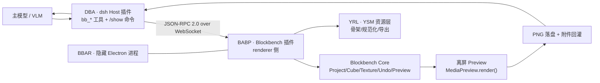

# YSM × Blockbench 无头建模与贴图 Agent 插件 · 系统开发与设计方案

> 在 dsh（DeepSeek Harness）内，让 AI 通过**高级语义 Tool** 驱动后台隐藏的 Blockbench，完成"从头建模 → 像素级贴图 → 无头多机位渲染 → VLM 视觉自检 → 修正 → YSM 导出"的完整闭环；用户可随时 `/show` 唤醒 GUI 接手。

## 工程状态

**已实现并验证**：隐藏窗口 BAE、JSON-RPC bridge（WS + HTTP/SSE 双传输）、30 个 `bb_*` 工具、`/show /hide` 命令、Skill、YSM 创建/打开/保存/zip 导出、动画/贴图/图层/PBR/控制器绑定、检查点/回滚、增量保存与幂等、渲染变化/空图检测、closeup/SSAA、渲染 watchdog、512px 附件、GPU 降级、游戏内加载验证、发布打包。当前版本 **v0.3.0**。

- 工程状态/实测数据：[ENGINEERING.md](ENGINEERING.md)
- 从零搭建：[SETUP.md](SETUP.md)
- 实现包说明：[packages/README.md](packages/README.md)
- 机器可读契约：[spec/tool-manifest.json](spec/tool-manifest.json)、[spec/bridge-methods.json](spec/bridge-methods.json)

---

## 0. 先读结论（TL;DR）

| 问题 | 结论 |
|---|---|
| 怎么隐藏 Blockbench？ | 上游 `electron/main.js` **硬编码 `win.show()`**，必须 fork 主进程（3 处小改：不 show、`backgroundThrottling:false`、注入 bridge 插件）；渲染层零改动。 |
| 怎么无头出图？ | 复用 Blockbench 内置**离屏 Preview**（`MediaPreview`/`NoAAPreview`）+ `Screencam.advancedScreenshot(cb)` + `Blockbench.writeFile`；renderer 已 `preserveDrawingBuffer:true`，全程无对话框。 |
| 怎么让 AI 不写原始 JSON？ | dsh 侧注册 `bb_*` 语义工具（建模 patch / 像素绘制 / 渲染 / 校验），底层 JSON-RPC 转给 Blockbench 插件；回执只给 changed ids + diff + 摘要，列表全部分页。 |
| 怎么让 AI "看见"？ | `ctx.attachments.saveImage()` + `output.render()` 返回 `image` block；全分辨率 PNG 落盘，模型按需 `read_image`；图片默认 512px、每轮 ≤4 张（图片会重复计费）。 |
| 怎么保证 YSM 能进游戏？ | YSM-Utils 是 **UI 插件、无导出 API、只写 ysm.json**；必须自研 YRL（规范化/骨架/导出编排），并强制 `export_empty_groups=true`（否则 30 根空定位骨骼被剪，进游戏缺手持物/鞘翅）。 |
| 怎么人机协同？ | dsh 原生 `/show` `/hide` 命令（`ctx.commands.register`），不消耗模型 token；GUI 期间冻结写操作，`/hide` 后 resync revision 并注入用户改动摘要。 |
| 通信走什么？ | 本地 WebSocket JSON-RPC 2.0（dsh 为 server，BBAR 为 client）；首包 token 鉴权；协议与传输解耦，可回退 HTTP+SSE / Python client。 |
| 最大的技术风险？ | 隐藏窗口下 WebGL 的稳定性（不同 GPU/驱动/远程桌面）。**必须先用 M0 Spike 验证**，再投入开发。 |

---

## 1. 交付物导航

| 文件 | 内容 | 对应需求模块 |
|---|---|---|
| **[系统开发与设计方案.md](<系统开发与设计方案.md>)** | 合并版主文档（推荐通读） | 全部 |
| [docs/01-总体架构与数据流.md](docs/01-总体架构与数据流.md) | 架构图、进程/生命周期、数据流、ADR、目录规范 | ① 系统架构与数据流 |
| [docs/02-通信协议规范.md](docs/02-通信协议规范.md) | WebSocket JSON-RPC 2.0 规范、方法目录、错误码、超时/幂等、示例 | ② 通信协议 |
| [docs/03-Tool-API-清单.md](docs/03-Tool-API-清单.md) | 21 个 `bb_*` 工具的参数/返回/错误/预算、Tool 设计原则 | ③ Tool API 声明 |
| [docs/04-闭环状态机.md](docs/04-闭环状态机.md) | 状态机、预算/收敛/回滚、VLM 评审协议、失败恢复、伪代码 | ④ 闭环工作流 |
| [docs/05-工程难点与避坑指南.md](docs/05-工程难点与避坑指南.md) | Electron/WebGL、启动/注入、Undo/保存、贴图/UV、YSM、Token、Windows、许可 | ⑤ 工程难点 |
| [docs/06-实施路线图与验收.md](docs/06-实施路线图与验收.md) | M0–M6 里程碑、测试策略、验收标准、发布与团队分工 | 落地计划 |
| [spec/tool-manifest.json](spec/tool-manifest.json) | 机器可读工具清单（JSON Schema） | ③ 契约 |
| [spec/bridge-methods.json](spec/bridge-methods.json) | 机器可读 JSON-RPC 方法/事件/错误码 | ② 契约 |
| [spec/generate_spec.py](spec/generate_spec.py) | 契约生成器（改一处生成两份 JSON） | 工具链 |
| **[ENGINEERING.md](ENGINEERING.md)** | **工程实现状态/实测数据/DSH 端完成度/已知限制**（设计不变，实现以此为准） | 落地状态 |
| [packages/README.md](packages/README.md) | 两个实现包的构建、测试与运行命令 | 工程说明 |
| [projects/](projects/README.md) | 实际工程：首个 DeepSeek 鲸鱼娘 YSM 模型、渲染/游戏内截图、BUG 与迭代记录 | 落地工程 |
| [prototype/](prototype/README.md) | dsh 插件 + BAE 主进程/preload/bridge 插件骨架；WS 协议冒烟测试已通过 | 参考实现 |
| [research/blockbench-core.md](research/blockbench-core.md) | Blockbench v5.2.2 源码级研究（847 行，文件:行号） | 事实依据 |
| [research/ysm-format.md](research/ysm-format.md) | YSM 格式/插件导入导出研究（999 行，文件:行号） | 事实依据 |
| [research/dsh-integration.md](research/dsh-integration.md) | dsh 插件/Tool/多模态/命令研究（565 行，取证） | 事实依据 |

---

## 2. 系统一览



三条关键链路：

1. **语义编辑**：`bb_apply_model_patch` / `bb_texture_patch` → 一个 Undo 事务 → revision+1 → 有界回执。
2. **无头反馈**：`bb_render_views` → 离屏 Preview 多机位渲染 → PNG 落盘 → 降采样 → `ImageBlock` → 模型视觉自检。
3. **人机协同**：`/show` 显示同一进程窗口 → 冻结 AI 写操作 → 用户手改 → `/hide` → 重新同步 revision。

---

## 3. 已核实的事实基线（节选）

- Blockbench v5.2.2：Electron 43 + Vue2 + three.js r129；`electron/main.js` 在 `loadURL().finally()` 中 `win.show()`；窗口无 `backgroundThrottling`。
- Preview renderer：`alpha:true`、`preserveDrawingBuffer:true`；存在离屏 `MediaPreview`/`Screencam.NoAAPreview`；`Screencam.advancedScreenshot(..., cb)` 在传入 cb 时不弹 UI。
- 贴图：`Texture.getActiveCanvas()` + `updateChangesAfterEdit()` 才能刷新 3D；Undo aspects `{textures:[t],bitmap:true}`。
- 保存：`Codecs.*.compile()/write()`、`Blockbench.writeFile` 无对话框；`export()/exportFile()/Action.trigger()` 会弹 native 模态（`window.confirm/alert` 在桌面端被替换为同步 MessageBox，会卡死 renderer）。
- 插件：`source:'file'` 条目按绝对路径加载；可在主进程 `did-finish-load` 后用 `executeJavaScript` 执行 `new Plugin().loadFromFile({path}, false)` 注入并持久化。
- YSM：`ysm.json` spec 2；默认主模型 64 bones / 172 cubes / 30 空骨骼（26 个 Locator）；贴图 128×128 per-face UV；动画 Bedrock 1.8、控制器 1.19；YSM-Utils 为纯 UI 插件、只写 ysm.json。
- dsh：`ctx.tools.register(defineTool(...))`、`ctx.commands.register(...)`、`ctx.attachments.saveImage()`、`ctx.effect()` 清理；图片会从产生起在每次请求中重复计费。

> 完整证据（文件:行号、官方文档链接）见三份 research 报告与各章末尾的引用。

---

## 4. 如何阅读

| 你的角色 | 建议顺序 |
|---|---|
| 架构/负责人 | 本 README → `01` → `04` → `06` |
| dsh / Agent 工程师 | `01` → `02` → `03` → `prototype/dsh-plugin/` |
| Electron / 渲染工程师 | `01` §4 → `05` §1/§2 → `06` M0 |
| YSM / 建模工程师 | `03` → `05` §3/§4/§5 → `research/ysm-format.md` → `prototype/blockbench-agent/` |
| QA | `06` §3–§5、`04` §12 |

---

## 5. 原型状态（诚实声明）

| 项 | 状态 |
|---|---|
| 传输层（WS 握手/鉴权/双向请求/事件/并发/超时） | ✅ 已用本机 Node 24 跑通 `prototype/dsh-plugin/ws-smoke-test.mjs` |
| 原型所有 JS 文件语法 | ✅ `node --check` 全部通过 |
| Electron 隐藏窗口 + WebGL 真实出图 | ❌ 未在本机运行（需按 M0 构建 BAE） |
| YSM 默认包创建/导入/导出 | ❌ 骨架未实现完整 YRL（见 `research/ysm-format.md §8.4` 清单） |
| dsh 插件安装/启用 | ❌ 未安装、未修改当前 profile |
| 视觉闭环端到端（VLM） | ❌ 设计完成，待 M5 验证 |

---

## 6. 下一步（M0，1–3 天）

1. 构建 BAE：`node prototype/blockbench-agent/build.mjs`（需 Node ≥20、npm、网络）。
2. 启动隐藏窗口，用 `executeJavaScript` 对 `MediaPreview` 做 5 机位渲染 → 检查 PNG 非空/尺寸/alpha。
3. 连续 50 次渲染 + show/hide 往返 + 无 GPU（`--disable-gpu`）三组测试。
4. 结果写入 `docs/M0-report.md`；**未通过不进入 M1**。
5. 详见 [docs/06](docs/06-实施路线图与验收.md) 的 M0 清单。

---

## 7. 目录

```
F:\Deepseek_harness\blockbench\
├─ README.md                      # 本文件
├─ 系统开发与设计方案.md          # 合并版主文档
├─ docs\                          # 01–06 分章
├─ spec\                          # 机器可读契约 + 生成器
├─ prototype\                     # 骨架代码（dsh-plugin / blockbench-agent）
├─ research\                      # Blockbench / YSM / dsh 研究证据
├─ vendor\blockbench\             # 上游 v5.2.2（只读）
├─ vendor\YSM-Utils-Plugins\      # 上游 v2.6.0（只读）
└─ workspace\                     # 运行时数据（未创建/未使用）
```

---

## 8. 许可与声明

- 本方案与原创代码/文档：按项目需要授权；引用第三方内容遵循其原许可。
- **Blockbench**：GPL-3.0-or-later。BAE 是衍生发行版，发布时必须随包提供对应源码/修改说明与许可证；不得暗示官方背书。
- **YSM-Utils-Plugins**：MIT；复用其规范化规则/代码需保留版权与许可声明。
- **YSM 默认模型**：官方文档注明以 CC 0 发布（可修改分发）；用户提供的参考图/皮肤版权由用户负责。
- **Minecraft**：遵守 Mojang EULA，不分发原始游戏资产。
