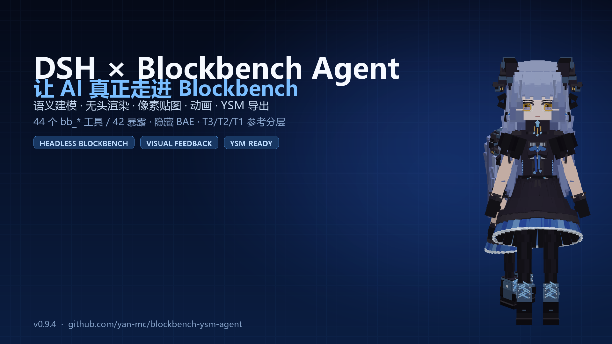
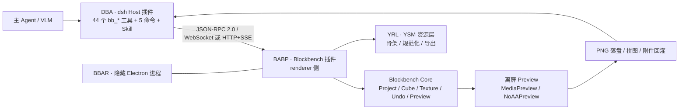
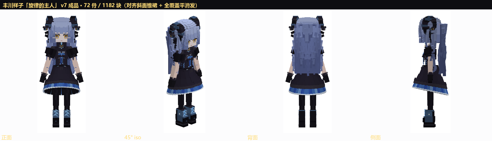
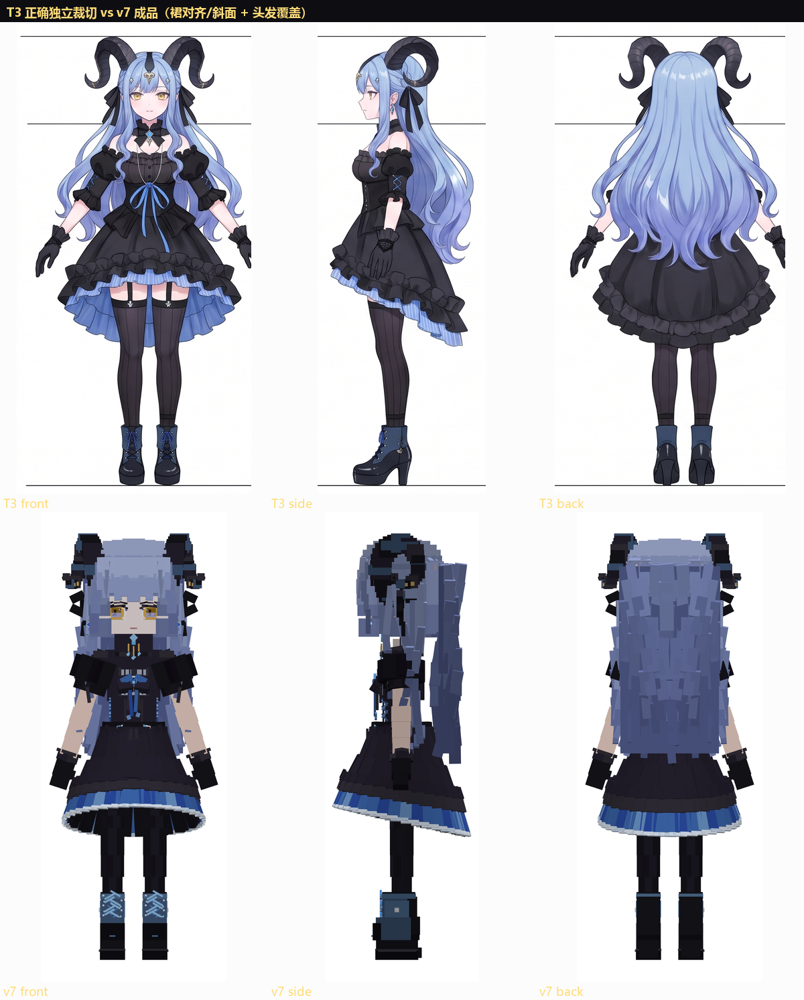
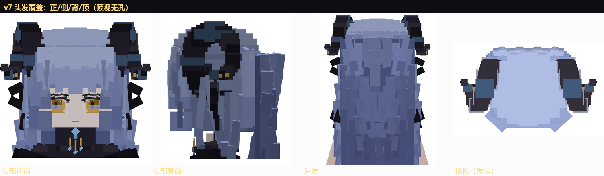

<p align="center">
  
</p>

<h1 align="center">DSH × Blockbench Agent</h1>

<p align="center">
  <b>让 AI 真正走进 Blockbench：隐藏建模 · 无头渲染 · 像素贴图 · 动画 · YSM 游戏导出</b>
</p>

<p align="center">
  
  
  
  
  
</p>

<p align="center">
  <a href="MANUAL.md"><b>📖 使用手册</b></a> ·
  <a href="SETUP.md"><b>⚙️ 从零搭建</b></a> ·
  <a href="models/togawa-sakiko/README.md"><b>🧩 丰川祥子案例</b></a> ·
  <a href="packages/dsh-blockbench-agent/skills/blockbench-ysm-artist.md"><b>🎨 建模 Skill</b></a> ·
  <a href="HANDOVER.md">交接档案</a> ·
  <a href="https://github.com/yan-mc/blockbench-ysm-agent/releases">Releases</a>
</p>

> **一句话**：给 dsh 里的 AI 装上“Blockbench 的手和眼睛”——它能用语义工具建 YSM 模型、按像素改贴图、无头渲染自检、做动画、保存/导出并在 Minecraft 里验证；需要人工时 `/show` 把同一窗口交给你。

> **当前状态（2026-11-08）**：发布版 **0.9.4**（发布包 `bb-agent-0.9.4` zip，10.2MB / 226 文件，已构建并随 GitHub Releases 提供）。44 个 `bb_*` 工具定义 / 42 个实际暴露、5 个命令、1 个 Skill、56 个 bridge 方法 / 7 个事件 / 22 个错误码；单元测试 **84/84**、host-smoke **35 步**、契约 **44/44** 对齐；案例模型 **丰川祥子「旋律的主人」72 骨 / 1182 块 / 303 动画**，`bb_validate` 0 error。GitHub Releases 上的 **0.4.0 为历史发布**；0.9.4 为当前发布。

---

## ✨ 这个项目是什么

**DSH × Blockbench Agent** 是一个面向 **Minecraft YSM（Yes Steve Model）皮肤/模型** 的 AI 建模工作台。它不是“让模型直接输出一段 JSON”，而是把 Blockbench 变成一个**可被 Agent 语义化操纵、可观察、可回滚、可交付**的后台服务：

- **Blockbench 被隐藏运行**：Agent 操作真实的 Blockbench 5.2.2（Blockbench Agent Runtime / BAE），不是模拟器；
- **Agent 不写原始 JSON**：通过 `bb_*` 语义工具操作骨骼、方块、UV、贴图、动画、控制器；
- **Agent 能看见结果**：无头离屏渲染回传 PNG，编辑即看、隔离检查、环绕转台、动画采样；
- **Agent 能判断“像不像”**：参考图管线（官方基准 → 多源搜图 → T3/T2/T1 分层）把 2D 角色拆成可逐部件核对的部件图；
- **Agent 能交付**：检查点/回滚、YSM 校验、保存、导出目录 + zip，最终进入 Minecraft 验证。

它解决的痛点很具体：Blockbench 是 GUI 软件、YSM 是复杂私有格式、参考图是 2D 插画而模型是 3D 体素——这三层之间过去只能靠人来回看、来回改。这个项目把三层接成了一条**可自动验证的闭环**。

---

## 🚀 核心能力

| 能力 | 说明 |
|---|---|
| **隐藏 BAE** | 隐藏 Electron Blockbench 窗口运行；`/show` 显示同一窗口人工接管，`/hide` 交还 Agent 并同步用户改动 |
| **语义建模** | 加/删/改骨骼与方块、批量 patch、`expected_revision` 并发保护、一个 patch 一个 Undo |
| **像素贴图** | 纹理创建/绘制/导入导出、图层、PBR normal/specular、按颜色 swatch 的像素级编辑 |
| **无头渲染反馈** | `bb_look` / `bb_render_views` / `bb_orbit` / `bb_camera` / `bb_render_texture`；支持 isolate 局部、多格拼图、参数化相机 |
| **动画** | 动画 CRUD、关键帧 patch、控制器绑定、`bb_anim_check` 时间轴采样 |
| **参考图管线** | `bb_ref_canon` 官方基准 → `bb_ref_search` 多源深搜 → `bb_ref_collect` 去重对照表；用户选图后再喂分层 |
| **三层立体参考** | **T3** Nano Banana Pro 云端三视图/拆解板（付费 key）、**T2** See-through 本地 29 语义层、**T1** SAM2 轻量分割；T3 > T2 > T1 |
| **规格驱动** | `bb_spec_save` / `bb_spec_load` 固化角色/比例/配色/部件/预算/gaps，生成构建计划 |
| **检查点/回滚** | `bb_checkpoint` 内嵌当前贴图与 arm 快照，`bb_restore` 回滚 |
| **YSM 交付** | 创建/打开/保存/`bb_validate`/`bb_export_ysm`（目录 + zip + manifest），保留 303 动画与控制器 |
| **Agent Team / Skill** | 内置 `blockbench-ysm-artist` 作业手册；主代理只做验收，子代理执行建模/贴图/检查 |
| **安全与预算** | 编辑/渲染/回滚预算、GUI_BUSY 冻结写操作、渲染 watchdog、图片附件压缩、API key 只从 profile/env 读取 |

---

## 🏗️ 架构



三条关键链路：

1. **语义编辑**：`bb_apply_model_patch` / `bb_texture_patch` → 一个 Undo 事务 → revision+1 → 有界回执。
2. **无头反馈**：`bb_look` / `bb_render_views` → 离屏 Preview → PNG/拼图 → 附件 → Agent 视觉自检。
3. **人机协同**：`/show` 显示同一进程 → 冻结 AI 写操作 → 用户手改 → `/hide` → revision resync。

更细的协议、状态机与工程坑见 [docs/01](docs/01-总体架构与数据流.md)、[docs/02](docs/02-通信协议规范.md)、[docs/04](docs/04-闭环状态机.md)、[docs/05](docs/05-工程难点与避坑指南.md)。

---

## 🧰 工具面（44 定义 / 42 暴露）

机器可读契约：[`spec/tool-manifest.json`](spec/tool-manifest.json) · 协议：[`spec/bridge-methods.json`](spec/bridge-methods.json)（56 方法 / 7 事件 / 22 错误码）。

| 组 | 工具 | 用途 |
|---|---|---|
| 会话 | `bb_session_start` `bb_session_status` `bb_project_open` `bb_project_close` | 建/开/关 YSM 工程 |
| 读 | `bb_scene` `bb_get_element` `bb_revisions` `bb_diagnostics` | 骨骼/方块/UV/诊断 |
| 写 | `bb_apply_model_patch` `bb_batch` `bb_checkpoint` `bb_restore` | 建模 patch / 批量 / 检查点 / 回滚 |
| 贴图 | `bb_texture_create` `bb_texture_patch` `bb_texture_read` `bb_texture_import_png` `bb_texture_export_png` `bb_texture_layer` `bb_texture_pbr` `bb_render_texture` | 像素编辑 / 图层 / PBR / 放大核对 |
| 观察 | `bb_look` `bb_render_views` `bb_orbit` `bb_camera` `bb_anim_check` | 拼图 / 多视图 / 转台 / 相机 / 动画采样 |
| 参考 | `bb_ref_canon` `bb_ref_search` `bb_ref_collect` | 官方基准 / 多源搜图 / 对照表 |
| 规格 | `bb_spec_save` `bb_spec_load` | 建模规格与构建计划 |
| 分层 | `bb_seg_probe` `bb_seg_t3` `bb_seg_install` `bb_seg_lite` `bb_seg_run` | T3 云端 / T2 / T1 参考与三视图 |
| 动画 | `bb_animation_create` `bb_animation_patch` `bb_animation_delete` `bb_animation_list` | 关键帧 / 控制器 |
| 交付 | `bb_validate` `bb_save_project` `bb_export_ysm` | 校验 / 保存 / YSM 导出 |

> `bb_show_gui` / `bb_hide_gui` 有定义但默认不暴露，由 `/show` `/hide` 命令接管；完整参数/错误/预算见 [docs/03](docs/03-Tool-API-清单.md) 与 `spec/tool-manifest.json`。

---

## 🔍 参考图管线：T3 > T2 > T1

模型像不像，上限由参考决定。项目把参考处理分成可降级的三级：

| 级别 | 能力 | 前置 | 适用 |
|---|---|---|---|
| **T3** | **Nano Banana Pro（Gemini 3 Pro Image）**：多张参考 → 严格三视图 + 头/上身/下身/手/脚 + 服装单品拆解，或全展开部件板 | 付费 API key（官方或 APIYI 中转） | 官方立绘带动作/背景/遮挡、缺背面 |
| **T2** | **See-through**：本地 ComfyUI，23–29 语义层 + 深度序 + 遮挡补全 | NVIDIA GPU + ComfyUI + 权重 | 精修档；可见部分最可靠 |
| **T1** | **SAM2.1 ONNX**：轻量分割，部件掩膜 + bbox/面积 | CPU + 59MB 模型 | 标准档必做；快速部件清单/比例 |

**T3 的实际工作流**：搜图 → 带编号对照表 → **给用户挑选** → 喂 `bb_seg_t3` → 逐张人工复核 → 把 T3 结果当“假设”写进 `spec.gaps`，再建模。T3 不是官方设定，也不是精确尺寸依据。

关键教训（已写进 Skill）：**参考板必须按原图像素独立裁切 front/side/back 并逐张目检**——T3 生成的拆解板经常把多个视图/部件排在同一张图里，按比例估算会裁串（我们真实踩过：front 混进 side、side 混进 back）。正确裁切示例见 [`sakiko-t3-crop-proof.png`](docs/assets/showcase/sakiko-t3-crop-proof.png)。

---

## 👁️ 视觉反馈闭环

Agent 不靠“脑补”验收，靠渲染：

- **编辑即看**：写操作自动附一张小拼图；
- **局部检查**：`bb_look({isolate:"Skirt", zoom:1.5})` 只渲染指定骨骼子树；
- **多角度**：front/back/left/iso/45°，`bb_orbit` 一次 8 角度；
- **多格拼图**：2–8 帧合一张，token 比多次渲染低 2–3 倍；
- **watchdog-v2**：变化/空图/裁剪/无进展检测；
- **动画采样**：`bb_anim_check` 按时间轴采 4–16 帧。

> 规则判断不等于视觉判断：造型、配色、神态仍由 Agent/人看图确认；项目里的 case study 就是这么一轮轮修出来的。

---

## 🎨 案例：丰川祥子「旋律的主人」v7

> 明日方舟 × BanG Dream! Ave Mujica 联动干员；YSM 皮肤，2×512 贴图，303 动画。
> 完整过程：[`models/togawa-sakiko/README.md`](models/togawa-sakiko/README.md) · [`V7-FINAL-REPORT.md`](models/togawa-sakiko/V7-FINAL-REPORT.md)



| 指标 | 值 |
|---|---|
| 迭代 | 217 → 355 → 401 → 510 → 534 → 1100 → 1117 → **1182 块** |
| 骨骼 | **72**（含 `Cape` / `CapeLow` / `HairBow_R` / `HairCap`） |
| 动画 | **303**（未触碰） |
| 校验 | `bb_validate` strict **0 error** |
| 导出 | `pack.zip` **516,768 B / 32 条目** |

这一版修了三个典型问题：

1. **裙体对齐/连接**：生成器 `origin=pivot−R·loc` 把旋转乘了两次，裙中心偏 1.87u；改为世界坐标重建、五裙骨按方位重分，裙中心对齐身体、腰封贴胯。
2. **斜面截断锥**：前下摆 15.4 / 后 12.4（差 3.0u），不是水平圆锥；连续内壳挡腿，蓝衬裙+白细边连续。
3. **头发全覆盖 + 平滑段链**：`HairCap` 实心叠层穹顶 + 内填充（顶视 0 孔），刘海/后发/侧发按 5–12° 段间旋转、0.2–0.3 重叠，去掉针刺与错位台阶。




更多：裙细节 [`sakiko-skirt-detail-v7.png`](docs/assets/showcase/sakiko-skirt-detail-v7.png) · v6→v7 裙对比 [`sakiko-v6-vs-v7-skirt.png`](docs/assets/showcase/sakiko-v6-vs-v7-skirt.png) · T2 29 层 [`t2-29-layers.png`](docs/assets/showcase/t2-29-layers.png)。

---

## 📦 快速开始

前置：**Windows 10/11 x64、Node ≥ 20、pnpm、Python 3.10+**；可选 Java 17 + Minecraft 1.20.1（仅游戏内验证）。

```powershell
git clone https://github.com/yan-mc/blockbench-ysm-agent.git <仓库目录>
cd <仓库目录>

# 1) 重建上游（vendor 不入库）
git clone --depth 1 --branch v5.2.2 https://github.com/JannisX11/blockbench vendor/blockbench
cd vendor/blockbench; pnpm install --node-linker=hoisted; npm run build-electron; cd ../..

git clone --depth 1 --branch v2.6.0 https://github.com/YesSteveModel/YSM-Utils-Plugins vendor/YSM-Utils-Plugins

# 2) 组装隐藏 BAE
node packages/bb-agent-runtime/scripts/assemble.mjs

# 3) 装 dsh 插件（在 DSH 中执行）
plugin_manager install_bundle target=<仓库目录>/packages/dsh-blockbench-agent
```

安装后：`/bb-status` 查看连接，`/bb-start` 手动启动，`/bb-help` 列出工具。详细配置（`workspaceRoot` / `executable` / `appPath` / `pluginPath`）见 [SETUP.md](SETUP.md)。

> **API key 只放 dsh profile / 环境变量**（`nanoBananaApiKey` 或 `GEMINI_API_KEY`）。仓库里的 `cordis.patch.yml` 只有占位符，**不会提交任何真实 key**。

---

## 🔒 配置与安全

- 本仓库**不包含** `vendor/`、`dist/`、`material/`、`release/`、`workspace/`、模型 artifacts/exports/checkpoints/refs；
- 模型参考图是第三方版权素材，**只留本地，绝不分发**；
- API key 从 dsh profile 或环境变量读取；`bb_seg_probe` 只检查配置、不发请求、不耗额度；
- BAE 通过本地 WebSocket/HTTP JSON-RPC 通信，首包 token 鉴权；写操作带 revision 保护，GUI 可见时冻结写操作；
- 模型导出包只包含 YSM 资源，不包含游戏本体资产；Blockbench 衍生部分遵循 GPL-3.0，插件部分 MIT（见 [NOTICE.md](NOTICE.md)）。

---

## 🗂️ 仓库布局

```
<仓库根目录>/
├─ README.md                  # 本文件：门面 / 功能 / 架构 / 案例 / 快速开始
├─ MANUAL.md                  # 完整使用手册
├─ SETUP.md                   # 从零搭建
├─ ENGINEERING.md             # 工程状态 / 实测数据 / 已知限制
├─ HANDOVER.md                # 交接班档案
├─ FOLDER-MAP.md              # 目录地图
├─ NOTICE.md                  # 第三方许可
├─ docs/                      # 架构/协议/工具 API/状态机/建模方法/实证分析/案例
│  ├─ 01–07, 10–18, 20–25    # 设计与实战文档
│  ├─ assets/                 # 封面 / 展示图
│  ├─ test-evidence/          # 回归证据（历史）
│  └─ archive/                # 历史设计基线 / 旧证据
├─ spec/                      # 机器可读契约 + 生成器
├─ packages/
│  ├─ bb-agent-runtime/       # BAE：隐藏 Electron + bridge + 构建脚本
│  └─ dsh-blockbench-agent/   # dsh Host 插件：44 工具 + 5 命令 + Skill + Client pill
├─ models/togawa-sakiko/      # 案例模型工作区（pack/ 随仓库，artifacts/refs/exports 本地）
└─ tools/ research/ media/    # 分析脚本 / 源码研究 / 宣传素材
```

---

## 🧪 质量与验证

| 项 | 结果 |
|---|---|
| 单元测试 | **84/84**（7 个 `*.test.mjs`） |
| host-smoke | **35 步**，schema lint 42 工具 |
| 契约 | `spec/tool-manifest.json` 44 工具；`spec/bridge-methods.json` 56/7/22；`generate_spec.py` 重跑 0 diff |
| 模型校验 | 丰川祥子 v7：`bb_validate` strict 0 error（3 个已知 warning：512 贴图 ×2、可选 ViewLocator） |
| 导出 | 32 条目 zip + export-manifest（逐文件 sha256） |

```powershell
node --test packages/dsh-blockbench-agent/test/*.test.mjs
node packages/dsh-blockbench-agent/test/host-smoke.mjs
python spec/generate_spec.py
```

---

## 📚 文档地图

| 想了解 | 读 |
|---|---|
| 总体架构/数据流 | [docs/01](docs/01-总体架构与数据流.md) |
| 通信协议 | [docs/02](docs/02-通信协议规范.md) |
| 44 个工具 API | [docs/03](docs/03-Tool-API-清单.md)、[spec/tool-manifest.json](spec/tool-manifest.json) |
| 闭环状态机/预算/回滚 | [docs/04](docs/04-闭环状态机.md) |
| 工程难点/避坑 | [docs/05](docs/05-工程难点与避坑指南.md) |
| 参考图收集 | [docs/11](docs/11-参考图收集管线.md)、[docs/18](docs/18-官方基准与深度搜索.md) |
| T3 Nano Banana Pro | [docs/24](docs/24-立绘转三视图与拆解方案调研.md)、[docs/25](docs/25-NanoBananaPro-T3云端拆解接入.md) |
| 建模方法/语料规律 | [docs/21 总纲](docs/21-现代化建模总纲.md)、[21a 衣服/裙](docs/21a-衣服与裙子结构.md)、[21b 身体](docs/21b-身体曲线塑造.md)、[21c 头发/面部](docs/21c-头发与面部.md) |
| 眼睛/头发/角实证 | [docs/23](docs/23-眼睛头发与角实证分析.md) |
| 建模 Skill | [blockbench-ysm-artist.md](packages/dsh-blockbench-agent/skills/blockbench-ysm-artist.md) |
| 案例复盘 | [models/togawa-sakiko/README.md](models/togawa-sakiko/README.md) · [V7 报告](models/togawa-sakiko/V7-FINAL-REPORT.md) |
| 历史设计基线 | [docs/archive/README-design-baseline-2026-10.md](docs/archive/README-design-baseline-2026-10.md) |

---

## 🛣️ 已知边界 / 下一步

- **Windows 优先**：BAE 基于 Electron 43 + Blockbench 5.2.2；跨平台未验证。
- **T3 需要付费 key**：无 key 自动降级 T2/T1；生成结果是“假设”，必须人工复核。
- **VLM critic 未内置**：当前以渲染 watchdog + Agent/人看图判定为主。
- **发布包**：0.9.4 通过 `node packages/bb-agent-runtime/scripts/package-release.mjs` 构建（需先 assemble）；GitHub Releases 0.4.0 为历史发布。
- **模型精度**：v7 仍有后发片状/发帽叠层、裙层次简化、蓝白宽色块等差距（详见 V7 报告）；后续可继续用 Skill 的曲面/发缕规则迭代。

---

## 📄 许可与声明

- 本仓库原创代码/文档：**MIT**（插件部分）；BAE 衍生自 **Blockbench 5.2.2（GPL-3.0-or-later）**，分发时随包提供源码/修改说明与许可证，不暗示官方背书。
- **YSM-Utils-Plugins**（MIT）：复用其规范化规则时保留版权声明。
- **Minecraft / YSM**：遵守 Mojang EULA 与 YSM 许可，不分发游戏本体资产。
- 角色「丰川祥子」及参考图版权归原权利方；仓库内的模型/展示图仅用于技术案例，参考图本身不随仓库分发。
- 第三方参考模型语料（`material/`）来自本地安装，**仅本地研究，不提交仓库**。
