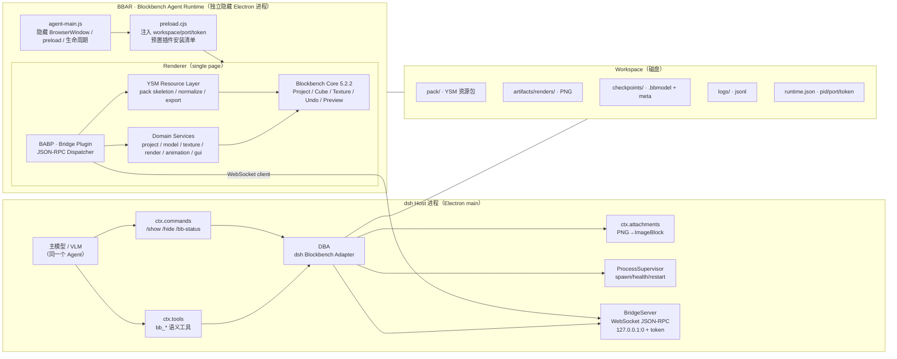
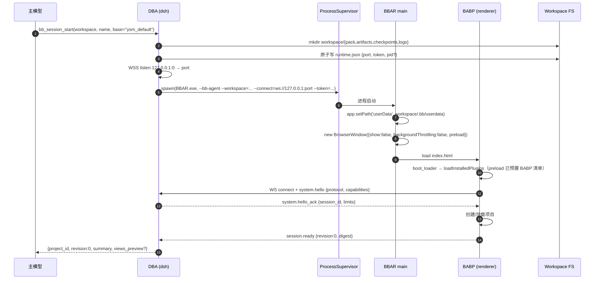
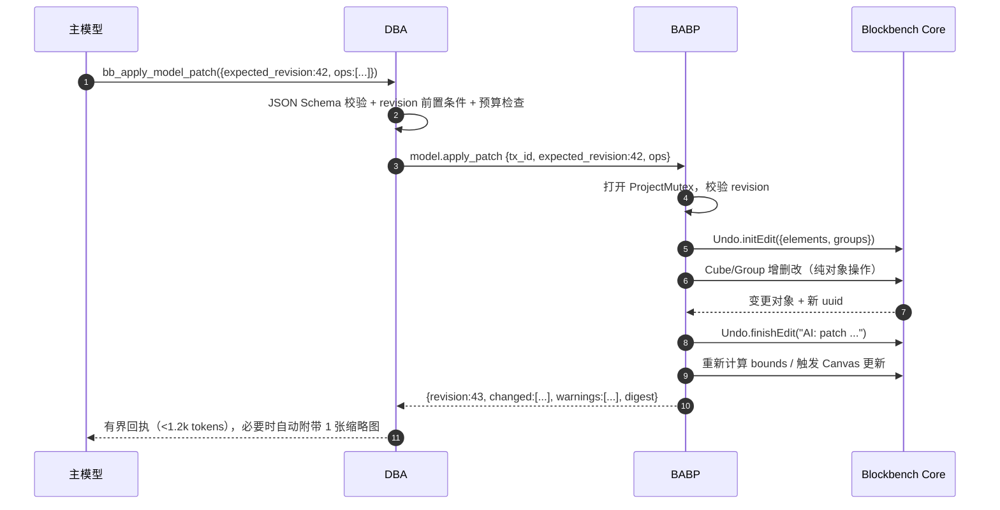
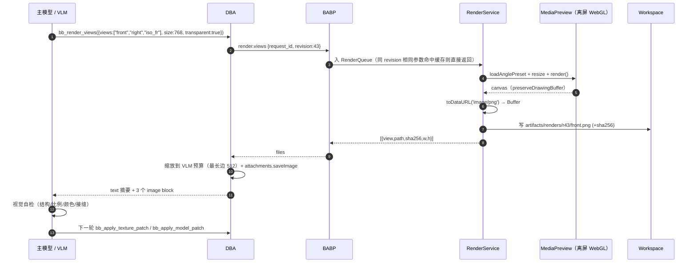
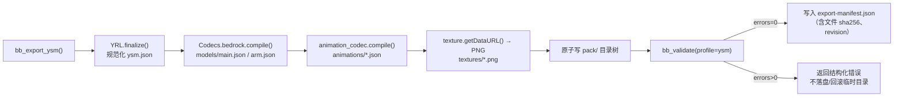

# 01 · 总体架构与数据流

> 文档版本：v1.0（设计基线：Blockbench 5.2.2 / YSM-Utils-Plugins 2.6.0 / dsh Cordis Host）
> 适用范围：在 dsh（DeepSeek Harness）内实现"无头 Blockbench 建模 + 像素贴图 + 无头渲染 + VLM 自检"闭环。
> 配套文档：`02-通信协议规范.md`、`03-Tool-API-清单.md`、`04-闭环状态机.md`、`05-工程难点与避坑指南.md`、`06-实施路线图与验收.md`。

---

## 1. 设计目标与非目标

### 1.1 目标（按优先级）

| 优先级 | 目标 | 可验收指标 |
|---|---|---|
| P0 | **AI 全程不接触原始 JSON**：所有模型/贴图/动画操作经语义 Tool 完成 | Tool 入参/出参中不出现完整 bbmodel/bedrock JSON；单次工具调用结果 ≤ 2.5k tokens |
| P0 | **无头长驻**：用户看不到 Blockbench 窗口，进程可被 dsh 反复调用 | 隐藏窗口下完成创建→编辑→渲染→导出；连续 2h 无人工干预 |
| P0 | **像素级贴图**：按像素坐标逐点/逐矩形绘制，不引入 SD 生成 | 128×128 贴图可精确复现参考色值（ΔE ≤ 1） |
| P0 | **无头多机位渲染**：固定机位输出 PNG 供 VLM 读取 | 6 个机位、透明背景、768px，单次渲染 P95 ≤ 1.5s |
| P0 | **YSM 规范兼容**：产出可直接被 YSM 模组加载的资源包 | `ysm.json` spec 2 校验通过；模型/贴图/动画路径与默认包一致 |
| P1 | **人机协同**：`/show` 秒级唤醒 GUI，用户改完后自动回后台 | `show_gui` → 可见 P95 ≤ 500ms；hide 后模型状态与 revision 同步 |
| P1 | **可回滚/可复现**：每次 AI 修改可定位、可撤销、可重放 | 任一 revision 可恢复到 `.bbmodel` 检查点；操作日志可重放 |
| P2 | **多会话隔离**：同一 dsh 可并行处理多个皮肤项目 | 每个项目独立 workspace、独立 Blockbench 进程、独立端口/token |

### 1.2 非目标（明确不做）

- **不做通用 GUI 自动化**：不模拟鼠标点击、不依赖 Electron 调试协议驱动 UI；所有能力经内部 API 调用。
- **不做 SD/扩散模型出图**：贴图只允许程序化像素操作 +（可选）用户提供的参考图采样。
- **不做 YSM 运行时**：不重新实现 Molang 解释器/动画混合器；YSM 侧只保证"格式正确"，最终效果由 YSM 模组验证。
- **不把 Blockbench 暴露到公网**：Bridge 仅绑定 `127.0.0.1`，带一次性 token。
- **不做云端多租户**：单机、单用户、按 workspace 隔离。

---

## 2. 事实基线（源码取证）

> 这些事实决定了架构必须长什么样。路径以仓库 `F:\Deepseek_harness\blockbench\vendor\` 为根。

| # | 事实 | 证据 |
|---|---|---|
| F1 | Blockbench 5.2.2 为 Electron 43 + Vue 2.7 + three.js r129，构建入口 `dist/bundle.js`，主进程 `electron/main.js` 仅 332 行 | `vendor/blockbench/package.json`；`electron/main.js` |
| F2 | 主进程创建窗口后 `win.loadURL(...).finally(() => win.show())`，**原生不支持隐藏长驻**；`requestSingleInstanceLock` 按 app 生效 | `electron/main.js:61-185` |
| F3 | 插件运行时从 `app.getPath('userData')/plugins/` 加载；安装清单持久化在 `localStorage["StateMemory.installed_plugins"]` | `js/plugin_loader.ts:1114-1120`、`js/util/state_memory.ts`、`js/plugin_loader.ts:136-145` |
| F4 | 渲染进程拥有完整 Node 能力（`nodeIntegration: true, contextIsolation: false`），插件可直接 `require('fs')`/`@electron/remote` | `electron/main.js:77-83`；`js/native_apis.ts:4-21` |
| F5 | 预览渲染器使用 `new THREE.WebGLRenderer({ alpha:true, preserveDrawingBuffer:true })`，且存在**离屏 Preview**：`MediaPreview`、`Screencam.NoAAPreview` | `js/preview/preview.ts:337, 396-402, 2542-2547` |
| F6 | 内置 `Screencam.advancedScreenshot(preview, options, cb)` 支持机位预设、分辨率、MSAA/SSAA、缩放、隐藏 gizmo，cb 模式直接回传 dataURL，**不弹保存对话框** | `js/preview/screenshot.js:279-353`、`js/preview/preview.ts:85-215` |
| F7 | 相机预设包含 `north/south/east/west/top/bottom/isometric_right/isometric_left` 等正交机位；`Format.forward_direction` 默认 `'-z'` | `js/preview/preview.ts:85-215`、`js/io/format.ts:681` |
| F8 | 项目模型：`ModelProject`、`Cube`、`Group/OutlinerElement`、`Texture`、`Animator` 均为全局类；`newProject(format)`、`Codecs[id].compile()/load()`、`Undo.initEdit/finishEdit` 可纯代码调用 | `js/io/project.ts:19,738`；`js/io/codec.ts:17-33,198`；`js/undo.js:17-95` |
| F9 | 贴图是 canvas：`texture.ctx` 可 `getImageData/putImageData`；改完调用 `texture.updateChangesAfterEdit()` 同步 dataURL、材质与预览；写入 `Undo` 后撤销栈生效 | `js/texturing/textures.js:16-120, 1851-1874` |
| F10 | YSM-Utils-Plugins 2.6.0（MIT）是**UI 型插件**：提供"创建默认包/导入 YSM 目录"对话框，**没有注册 Codec、没有导出 API**；核心可复用逻辑是 `loadNormalization/saveNormalization`（纯函数，但被 rollup 打包进闭包） | `vendor/YSM-Utils-Plugins/src/index.js`、`src/import/*.js`、`rollup.config.js` |
| F11 | dsh 的 Host 插件是 Cordis 插件：`ctx.tools.register(ToolDefinition)` 注册模型工具、`ctx.commands.register(CommandDefinition)` 注册斜杠命令、`ctx.attachments.saveImage()` 持久化图片、`ctx.subprocess.spawn()` 管理子进程 | `cordis_inspect_query(Service: tools/commands/attachments)`（本机 dsh 运行时取证） |
| F12 | dsh Tool 的 `output.render()` 可返回 `ContentBlock[]`，其中 `{type:'image', attachment: ImageAttachmentRef}` 即多模态图片块；因此"渲染 PNG → 模型可见"无需额外协议 | `ToolOutputDefinition` / `ImageBlock` 类型（dsh Service 契约） |
| F13 | 隐藏窗口渲染可行性的关键：`backgroundThrottling:false` + `show:false` + 手动调用 `MediaPreview.render()`；离屏 Preview 不受主循环/rAF 节流影响，且 renderer 已 `preserveDrawingBuffer:true` | Electron 官方 WebPreferences/Page Visibility 文档；`js/preview/preview.ts:337,396-402,503-548,2542-2547` |
| F14 | 纯代码保存/导出路径存在且**默认不弹窗**：`Codecs.project.compile()`、`Codecs.bedrock.compile()/write()`、`Codecs.*.write(content,path)`、`Blockbench.writeFile(path,{savetype:'image'})`；反之 `Codec.export()`/`Blockbench.exportFile()`/`Action.trigger()` 会弹 native 对话框。注意两个例外：目标模型文件存在但非法 JSON 时 `write()` 会弹覆盖确认；`export_over.trigger()` 内部 async 不会被 await | `js/io/codec.ts:198-257,321-327`；`js/file_system.ts:359-497`；`js/formats/bedrock/bedrock.js:1258+,1399-1461`；`js/io/io.js:378-472` |
| F17 | YSM-Utils 插件**只写 ysm.json**；模型/动画/控制器/贴图写回依赖 Blockbench 智能保存。headless 必须显式编排：`export_empty_groups=true` → 模型 `codec.write(compile(), export_path)` → 动画/控制器 `exportFile/compileFile` → `saveTextures()` → ysm.json | `YSMP/src/import/open_import_dialog.js:42-46`；`BB/js/io/io.js:378-472`；`BB/js/formats/bedrock/bedrock_animation.js:551-717` |
| F18 | YSM 默认主模型：`models/main.json` 64 根骨骼/172 cubes、唯一 `Root`、128×128 per-face UV；`arm.json` 6 骨骼/双根。运行时硬编码组名以官方 wiki 的 A 级清单为准（Head/AllHead/ViewLocator/各 Locator/`ysmGlow*` 等） | `YSMP/assets/default/models/main.json`；[YSM 模型制作](https://ysm.cfpa.team/wiki/tph2yetr/)；`research/ysm-format.md §2.3/§2.6` |
| F19 | `export_empty_groups` 默认 true；关闭会把 30 根空骨骼（多数是 Locator）整棵剪掉，导致进游戏缺手持物/鞘翅/拔刀剑 | `BB/js/interface/setup_settings.js:329`；`BB/js/formats/bedrock/bedrock.js:991` |
| F15 | 插件注入最稳路径：自定义主进程在 `did-finish-load` 后轮询 `Blockbench.setup_successful`，执行 `new Plugin().loadFromFile({path}, false)`；`first=false` 不弹 confirm，且插件会自持久化到 `StateMemory.installed_plugins`，下次启动自动按 `source:'file'` 加载 | `js/plugin_loader.ts:548-585,659-675,1240-1246`；`js/desktop.ts:139-156` |
| F16 | 启动时 `loadInstalledPlugins()` 先等待插件仓库 JSON（默认 10s 超时）；离线/黑洞网络会拖慢启动。agent profile 必须离线化或在主进程拦截外部请求 | `js/plugin_loader.ts:1133-1191`；`js/boot_loader.js:158-176` |

---

## 3. 总体架构

### 3.1 架构图



### 3.2 组件职责

| 组件 | 运行位置 | 职责 | 不做什么 |
|---|---|---|---|
| **DBA**（dsh Blockbench Adapter） | dsh Host 插件（TypeScript） | 注册 `bb_*` 工具与 `/show` 命令；校验参数/schema；管理 revision 与预算；进程监督；把 PNG 转成 `ImageBlock`；对模型输出做截断与摘要 | 不直接读写模型 JSON；不渲染 |
| **BridgeServer** | dsh Host 进程内 | 本地 WebSocket 服务端；JSON-RPC 2.0 编解码；鉴权；请求路由/超时/取消；事件推送 | 不持有项目状态（状态在 BABP） |
| **BBAR** | 独立 Electron 进程 | 隐藏窗口承载 Blockbench；隔离 userData；启动/崩溃恢复；`/show` 时显示窗口 | 不实现业务语义 |
| **BABP** | BBAR renderer（Blockbench 插件） | 协议分发；调用 Blockbench 内部 API；Undo/事务；渲染调度；YSM 导出 | 不面向用户弹窗 |
| **YRL** | BABP 内模块 | YSM pack 骨架生成/读取/规范化/导出；对 YSM 运行时约定做校验 | 不做动画运行时 |
| **Workspace** | 磁盘 | 唯一事实源：pack/、artifact、checkpoint、log、runtime | — |

### 3.3 为什么是"两个进程 + 一个本地 WebSocket"

1. **必须两个进程**：Blockbench 是完整 Electron 应用，放在 dsh renderer 里会引入两套 Electron/Vue/three 冲突，且无法独立崩溃恢复；放在 dsh main 里会污染 dsh 生命周期。
2. **必须独立 userData**：Blockbench 的插件清单、设置、最近项目都在 `localStorage`。给每个 workspace 独立 `--userData`/`app.setPath('userData')`，才能做到多项目隔离、可重复启动、不污染用户日常 Blockbench。
3. **必须本地 RPC 而非 stdio**：Blockbench 侧是长驻 renderer；stdio 需要主进程做管道代理，跨 renderer 还要 IPC，且无法被 Python 客户端复用。WebSocket + JSON-RPC 天然支持请求/响应、批量、事件、取消，且浏览器/Node/Python 都能接。
4. **不要用 MCP 直连 Blockbench**：MCP 的 server 生命周期、stdio 传输和工具模型都面向"外部集成"，而这里 Blockbench 是**被 dsh 托管的子进程**；由 DBA 直接注册原生 Tool 才能复用 dsh 的 attachments、命令、会话上下文与权限体系。

---

## 4. 进程模型与生命周期

### 4.1 启动时序



**关键设计**：dsh 先监听端口，再把端口/token 通过命令行 + 环境变量传给 BBAR；BBAR 的 preload 在页面脚本执行前把 token/port/workspace 注入 `window.__BB_AGENT__`（**不预写 localStorage**：Blockbench 的安装清单在 leveldb 里，离线预写不可靠）。主进程在 `did-finish-load` 后轮询 `Blockbench.setup_successful`，确认渲染进程就绪后执行：

```js
win.webContents.executeJavaScript(
  `new Plugin().loadFromFile(${JSON.stringify({ path: bridgePath, name: 'bb-agent-bridge.js', content: '' })}, false)`
)
```

`first=false` 不会触发原生 confirm；插件加载后会把自己写入 `StateMemory.installed_plugins`（`source:'file'`），**下次启动由 `loadInstalledPlugins()` 自动加载**。首启注入失败时主进程重试 3 次，并在 WS 握手超时时给出明确错误。这样**不需要修改 Blockbench 渲染层任何源码**，只需 3 个自有文件（`agent-main.js`、`preload.cjs`、`bb-agent-bridge.js`）。

> 注意：`loadInstalledPlugins()` 会先等待插件仓库 JSON（默认 10s 超时），`boot_loader` 还有一个 2s 的兜底 `app-loaded`。因此 **不能假设 `app-loaded` 时插件已加载**；我们的握手以 BABP 主动连上 WS 为准。

### 4.2 常驻与健康检查

- BBAR 完成后台常驻：窗口 `show:false`、`skipTaskbar:true`；`before-quit` 时写入 `shutdown.json`。
- 心跳：BABP 每 2s 发 `event.heartbeat {revision, render_queue_len}`；DBA 超过 8s 未收到则标记 `DEGRADED`，超过 20s 触发重启（最多 2 次，指数退避）。
- 崩溃：main 监听 `render-process-gone`、`child-process-gone`；重启后从最近 checkpoint 恢复项目，并广播 `event.recovered {from_revision}`。
- 空闲回收：默认常驻，不自动退出；可由 dsh 配置 `idleTimeoutMs`（默认 0=不回收）在无工具调用 30min 后退出，下次按需冷启动（冷启动 ~5-8s，需在 UI 提示）。

### 4.3 `/show` 人机协同生命周期

```mermaid
sequenceDiagram
  autonumber
  participant U as 用户
  participant D as DBA
  participant R as BABP
  participant E as BBAR main
  participant M as 主模型
  U->>D: /show（dsh 原生命令，不进模型）
  D->>R: gui.show {mode:"inspect", freeze_agent:true}
  R->>E: currentwindow.show(); focus(); setSkipTaskbar(false)
  R-->>D: gui.state {visible:true, revision}
  D-->>U: "Blockbench 已显示，当前 revision=42；编辑完成后输入 /hide 返回"
  Note over R,M: 期间模型工具被 DBA 拦截为 GUI_BUSY
  U->>D: /hide
  D->>R: gui.hide {resync:true}
  R->>E: currentwindow.hide(); setSkipTaskbar(true)
  R->>R: 扫描用户改动（Undo 栈/项目事件）→ 新 revision
  R-->>D: gui.state {visible:false, revision:43, user_edit:true}
  D-->>M: 注入一条系统消息：用户手改 + diff 摘要
```

规则：
- `/show` 是 **dsh 原生斜杠命令**，由 DBA 用 `ctx.commands.register()` 注册，直接执行、不消耗主模型一轮 token。
- GUI 可见期间，DBA 对 `bb_*` 变更类工具返回 `GUI_BUSY`，只允许只读工具；`/hide` 后自动 resync revision，并把"用户改了什么"的压缩 diff 作为系统上下文注入。
- 用户直接关闭窗口时，BBAR 拦截 `close` 事件 → `preventDefault + hide()`，不退出进程；只有 `system.shutdown` 或 dsh 退出才真正结束。

### 4.4 进程隔离与并发

| 维度 | 策略 |
|---|---|
| 每 workspace 进程数 | 1（单实例锁 + `runtime.json` 中的 pid/port 探活） |
| 每进程项目数 | 1（headless 下不做多 tab；`open_pack` 会关闭当前项目） |
| 全局并发 | 默认 2 个 BBAR（可配置）；工具调用按 project 串行化 |
| 端口/token | 每进程随机端口 + 128bit 一次性 token；token 写入 `runtime.json`（权限 0600） |
| 残留进程 | DBA 启动时扫描 workspace 锁文件，pid 不存在或 cmdline 不匹配则清理；Windows 用 `taskkill /T /F` 兜底 |
| 死锁 | 所有渲染请求进单一 RenderQueue；变更类请求进 ProjectMutex；两者不互相等待（渲染只读快照） |

### 4.5 Agent profile 的离线化与静默

BBAR 使用独立 `--userData`/`app.setPath('userData')`，并在首次加载完成后写入以下设置（通过 `executeJavaScript` + `Settings.saveLocalStorages()` 持久化）：

| 设置 | 值 | 目的 |
|---|---|---|
| `settings.automatic_updates` | `false` | 禁止 renderer 侧自动更新 |
| `settings.automatic_plugin_updates` | `false` | 禁止启动时下载插件更新 |
| `settings.background_rendering` | `true` | 窗口失焦/隐藏时仍渲染（默认已 true，显式固化） |
| `settings.classroom_mode` | `true` | 减少启动屏广告/推荐区块 |
| `settings.dialog_save_codec` | `false` | 避免保存时弹 codec 选择器 |

主进程侧：
- **不调用 `autoUpdater`**（我们自己维护版本；BAE 是固定版本发行）。
- 在 `session.defaultSession.webRequest.onBeforeRequest` 中取消所有 `https/http` 外部请求（放行 `file://` 与 `ws://127.0.0.1`）。这样 `loadInstalledPlugins()` 的插件仓库请求会快速失败，避免 10s 启动阻塞；同时彻底关闭埋点/新闻/更新检查。
- 不覆盖用户日常 Blockbench 的 userData；每个 workspace 一个独立 profile，可并行、可删除重建。
- 原生模态安全网：agent profile 内把 `window.confirm/alert` 覆盖为"返回安全默认值 + 记录日志"；`Blockbench.showMessageBox` 包一层自动选择第一个非破坏性按钮。**只在 BBAR profile 内生效**，不影响用户自己的 Blockbench。

---

## 5. 数据流

### 5.1 语义编辑流（核心）



约束：
- **所有变更必须在一个 `Undo.initEdit/finishEdit` 对之间同步完成**，不得跨 `await`（Blockbench Undo 不是异步安全的）。
- 每次成功变更 `revision += 1`；`expected_revision` 不匹配即返回 `REVISION_CONFLICT`，由模型重读 digest 后重试。
- 变更回执只返回"变了什么"：`changed_ids`、字段级 diff（最多 20 条）、校验告警，不返回整棵树。
- 批量操作用一个事务；部分失败默认整体回滚（`atomic:true`），不允许"改了一半"。

### 5.2 渲染反馈流



渲染原则：
- **固定机位、固定焦距、固定光照**，保证跨 revision 可比；机位定义与映射见 `03-Tool-API-清单.md` 的 `views` 枚举。
- 默认**透明背景**（`renderer.setClearAlpha(0)`）；另提供 `background:"#rrggbb"` 用于对比。
- 默认关闭 gizmo/网格/坐标轴/骨骼可视化；关闭动画（`Animator.preview` 停表），保证静态一致性。
- 每次渲染带 `revision` 与参数 hash；命中缓存直接复用，不重复耗 GPU。
- 全分辨率 PNG 落盘；给模型的附件是降采样版（最长边 512，单张 ≤ 200KB），全尺寸路径供模型按需再取。

### 5.3 导出流



- 导出是**语义幂等**的：同一 revision + 同一选项 → 结构/内容一致。**字节级幂等需要额外固定**：JSON 缩进/换行设置（`settings.json_indentation/minifiedout/final_newline`）与动画键顺序；Blockbench 保存动画时可能按 `Animation.all` 顺序重排文件内键（语义不变）。若要求字节级复现，YRL 使用固定 writer 并在导出层重排。
- 显式导出序列（不能依赖 ysm-utils 或 Blockbench 自动保存）：
  1. `Settings.set('export_empty_groups', true)`；
  2. 当前项目 `codec = Codecs[Project.export_codec] ?? Codecs.bedrock`；`codec.write(codec.compile(), targetPath)`；
  3. 动画按文件分组 `AnimationCodec.codecs.bedrock.exportFile(path)`（只写脏项）；控制器 `...bedrock_animation_controller.exportFile(path)`；
  4. `saveTextures()` 或逐张 `texture.save()`；
  5. ysm.json：复制对象 → `saveNormalization()` → 固定 writer 写盘。
- 导出目录与工作副本分离：`pack/` 为工作副本，`exports/<timestamp>/` 为发布副本；支持 `out_dir`。
- 动画/控制器按 YSM 默认包的文件名布局输出；`ysm.json` 由 YRL 规范化（`spec:2`、路径分隔符 `/`、空字段清理）。
- 导出完成后可选生成一张 `preview.png` 与 `thumbnail.png`，写入包根目录供用户/模组列表展示。

---

## 6. 关键设计决策（ADR）

| ADR | 决策 | 备选方案 | 结论与理由 |
|---|---|---|---|
| ADR-1 | **自建 Blockbench Agent Edition（BAE）**：固定上游版本 + 自有 `agent-main.js/preload/bridge plugin`，构建独立安装包 | ① 不改源码，用 stock Blockbench + `--userData` 装插件；② 用 Playwright 驱动 Web 版 | ① 上游 `electron/main.js` 在 `loadURL` 后**硬编码 `win.show()`/`maximize()`**，且没有 `backgroundThrottling:false` 开关，stock 方案无法真正隐藏；插件注入也缺少可靠入口；② Web 版无"同一进程秒级唤醒 GUI"，文件系统/权限受限。BAE 主进程只需改 3 处（不 show、backgroundThrottling、注入 bridge），渲染层零改动，升级成本可控 |
| ADR-2 | **WebSocket + JSON-RPC 2.0**，dsh 作 server、BBAR 作 client | stdio、HTTP REST、Unix socket、MCP | WS 支持双向事件/批量/取消，Node/浏览器/Python 均有标准实现；dsh 侧 `ws` 依赖可随 bundle 安装；比 stdio 少一层主进程代理 |
| ADR-3 | **复用 Blockbench 内置离屏 Preview + Screencam** | 自建 three.js 渲染器；Electron `capturePage` | 内置渲染器保证与 Blockbench 视口一致（材质/UV/光照/Molang），且 `preserveDrawingBuffer:true` 可直接读 PNG；`capturePage` 只能拿整窗、受 DPI 影响且隐藏窗口下不稳定 |
| ADR-4 | **自研最小 YRL**，复用 ysm-utils 的纯逻辑并保留 MIT 声明；同时允许用户加载 ysm-utils 做 GUI 编辑 | 直接调用 ysm-utils 函数；fork 整个插件 | ysm-utils 为 UI 插件、无导出 API、强依赖 Dialog/Action；headless 只需"骨架/规范化/路径映射"约 500 行。GUI 模式把 ysm-utils 作为可选项共存 |
| ADR-5 | **语义 Tool + 统一 patch 原语**，禁止原始 JSON 读写 | 让模型直接编辑 bbmodel JSON；只提供细粒度单操作 | 原始 JSON 会撑爆上下文且破坏 Undo/一致性；单操作会导致往返爆炸。统一 patch 原语在 token 与可控性之间取平衡 |
| ADR-6 | **revision + checkpoint + 事务** | 只靠 Undo 栈；每次全量快照 | Undo 栈只在进程内且易被用户操作打乱；全量快照太贵。revision 负责并发正确性，checkpoint 负责跨进程恢复 |
| ADR-7 | **dsh 侧同时注册工具与原生命令** | 只注册工具（让模型自己调 show）；只做命令 | 工具用于 AI 自主闭环；命令用于人机协同（`/show` 不消耗 token、不打断 Agent）。两者共用同一 Bridge 会话 |

---

## 7. 目录与工件规范

### 7.1 代码仓库布局（建议）

```
F:\Deepseek_harness\blockbench\
├─ docs\                          # 本设计文档集
├─ spec\                          # 机器可读协议/工具清单
├─ prototype\                     # 骨架代码（设计参考）
├─ vendor\                        # 上游源码（只读）
│  ├─ blockbench\                 # JannisX11/blockbench @ v5.2.2
│  └─ YSM-Utils-Plugins\          # YesSteveModel/YSM-Utils-Plugins @ v2.6.0
├─ packages\
│  ├─ bb-agent-runtime\           # BAE：构建脚本 + agent/ 三件套 + 打包配置
│  │  ├─ agent\main.js            #   隐藏窗口、userData、进程生命周期
│  │  ├─ agent\preload.cjs        #   注入 workspace/token、预置插件清单
│  │  ├─ agent\bb-agent-bridge.js #   BABP 插件（renderer）
│  │  └─ build.mjs                #   拉取/构建 Blockbench 上游 + 组装
│  ├─ dsh-blockbench-agent\       # DBA：dsh bundle（Host 插件 + locale + icon）
│  └─ bb-protocol\                # 共享类型：JSON-RPC 方法/错误码/TS 类型
└─ workspace\                     # 运行时数据（不进 git）
```

### 7.2 每个项目的 Workspace

```
workspace\<project_slug>\
├─ pack\                              # YSM 资源包工作副本（唯一事实源）
│  ├─ ysm.json
│  ├─ models\{main,arm}.json
│  ├─ animations\*.json
│  ├─ controller\main.animation_controllers.json
│  ├─ textures\*.png
│  ├─ lang\{en_us,zh_cn}.json
│  └─ avatar\  sounds\ functions\
├─ artifacts\
│  ├─ renders\r<revision>\{front,back,left,right,iso_fr,iso_fl,closeup_*}.png
│  ├─ renders\latest\                 # 软链/副本，供 UI 快速展示
│  └─ texture-previews\t<texture_id>_x8.png
├─ checkpoints\
│  ├─ r0000.bbmodel
│  ├─ r0000.meta.json                 # revision/ysh/时间/触发原因
│  └─ ...
├─ logs\
│  ├─ bridge.jsonl                    # JSON-RPC 全量（脱敏 token）
│  └─ agent.log                       # 主进程日志
├─ exports\<YYYYMMDD-HHmmss>\         # 发布副本 + manifest
├─ .bb\
│  ├─ userdata\                       # Blockbench userData（插件/设置/localStorage）
│  ├─ runtime.json                    # {pid,port,token,started_at,version}
│  └─ lock                            # 单实例锁（pid + boot_id）
└─ session.json                       # project_id / 当前 revision / 统计
```

### 7.3 命名与版本

- `project_id`：`<slug>-<8hex>`，创建时生成，写入 `session.json`。
- `revision`：从 0 递增的整数；每次成功变更 +1；checkpoint 名 `r%04d`。
- Artifact：`artifacts/renders/r0042/front_768.png`；返回给模型时同时给 `path` 与 `sha256`。
- 协议版本：`bb-agent/1`；`system.hello` 协商，major 不同即拒绝。

---

## 8. 兼容性与升级策略

| 风险 | 策略 |
|---|---|
| Blockbench 上游升级 | 固定 tag（建议 `v5.2.2`），`build.mjs` 校验 commit；升级时跑 `06` 的回归清单（Preview API/Screencam/Codec/Undo/插件加载 5 项） |
| Blockbench 插件 API 变化 | BABP 只使用稳定 API（`Project/Cube/Texture/Undo/Codecs/Preview/Screencam`）；对实验性 API 封装 `compat.*`，失败降级 |
| YSM-Utils 升级 | 只复用其规范化规则；用 fixtures（默认包 + 2 个社区包）做回归；规则差异进 `YRL` 版本号 |
| dsh 升级 | DBA 只依赖公开 Service（tools/commands/attachments/subprocess/fs）；在 manifest 声明 `engines.dsh`，安装时校验 |
| 跨平台 | Windows 为一等公民（用户环境）；macOS 验证隐藏窗口渲染；Linux 需 xvfb/headless 方案（见 05） |
| 多显示器/DPI | 渲染分辨率与实际窗口尺寸解耦（离屏 Preview 自主 resize）；保存/显示用逻辑像素 |

---

## 9. 非功能性指标（设计预算）

| 指标 | 目标 | 测量点 |
|---|---|---|
| 冷启动 | ≤ 8s（SSD，含 Electron） | spawn → `session.ready` |
| 热工具调用 RTT | ≤ 80ms P50 / ≤ 250ms P95（不含渲染） | `tools.execute` → RPC result |
| 单次渲染 | ≤ 1.5s P95（768×768，MSAA） | `render.views` 单机位 |
| 单张渲染附件 | ≤ 200KB（512px 降采样） | DBA 附件前 |
| 单次编辑回执 | ≤ 1.2k tokens | DBA 序列化后 |
| 单轮闭环（改→渲→看） | ≤ 6s P95 | 3 机位渲染 + 附件 |
| 常驻内存 | BBAR ≤ 900MB（含 three 场景/纹理） | 任务管理器 |
| 连续运行 | 2h 无泄漏（render 100 次内存增长 < 15%） | 长跑脚本 |
| 恢复时间 | 崩溃后 ≤ 15s 恢复到最后 checkpoint | fault injection |

---

## 10. 风险摘要（详见 05）

1. **隐藏窗口下的 WebGL 稳定性**是唯一的"生死问题"：必须在 M0 Spike 验证（Windows 10/11、集显/独显、远程桌面场景）。兜底方案：透明度 0 窗口、虚拟屏、离屏 OSR、Linux xvfb。
2. **YSM 运行时硬约定**（骨骼名/层级/贴图尺寸/动画名）必须固化到 `bb_validate(profile=ysm)`，否则"看起来对但进游戏不显示"。
3. **模型上下文预算**：图像附件与场景摘要最容易被忽视；DBA 必须默认有界、按需展开。
4. **GPL 合规**：BAE 是 Blockbench 衍生发行版，必须随包提供对应源码与许可证；不得暗示官方背书。

---

## 11. 下一步

1. 按 `06-实施路线图与验收.md` 的 **M0 Spike** 先验证隐藏窗口渲染（1-2 天），再投入协议与工具开发。
2. 以 `spec/bridge-methods.json` 为单一契约源，同时生成 TS 类型与 Python 客户端类型。
3. 每个模块先写 fixture 回归（默认 YSM 包、渲染 golden），再接模型闭环。
