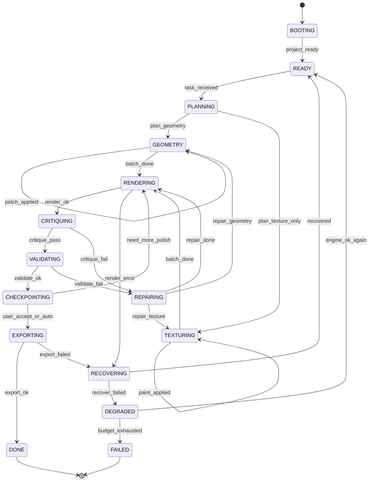
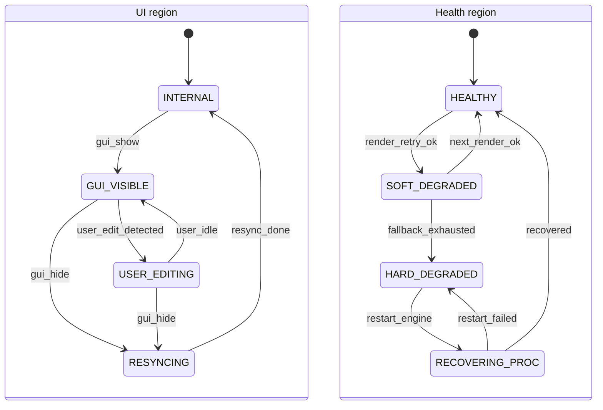
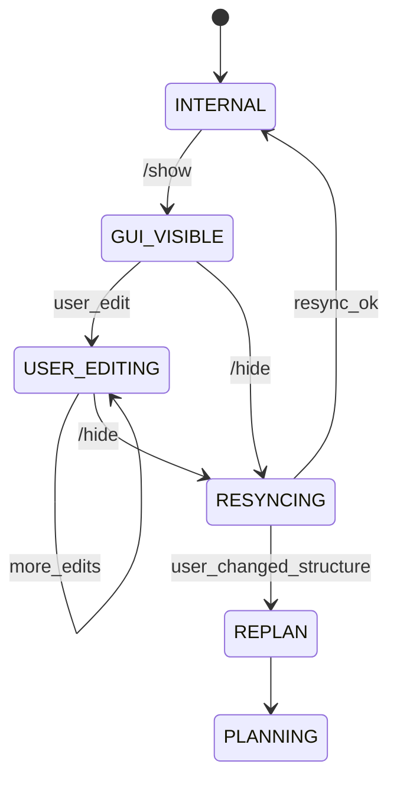

# 04 · 闭环反馈工作流：State Machine 设计

> 目标：把"AI 指令 → 插件执行 → 无头渲染 → VLM 视觉反馈 → AI 自检 → 修正"变成**可收敛、可回滚、可观测、不会无限烧 token** 的状态机。
> 本状态机由三层共同实现：**模型策略（Skill/Prompt）+ DBA 门控（代码强制）+ Watchdog（确定性检测）**。只有门控是强制的，模型策略可以被提示词调优。

---

## 1. 设计原则

1. **先确定性、后视觉**：几何越界、UV 越界、YSM 必需骨骼、文件引用等能用代码判断的，绝不交给 VLM。
2. **视觉只回答"像不像"**：VLM 负责比例、配色、接缝、风格一致性；不负责发现数组越界。
3. **有界迭代**：轮数、渲染数、编辑数、墙钟时间都有硬上限；超限必须降级为"交付 + 说明"或请求用户。
4. **检查点先于风险**：任何"大改"（>5 个 cube、换配色方案、回滚）前自动 checkpoint；回归立即回滚。
5. **一次只改一个维度**：同一轮里不要同时改比例和配色，否则 VLM 无法归因。
6. **可视化证据绑定**：每条缺陷必须指向具体 view + 区域；没有证据的"感觉不对"不算缺陷。
7. **人机协同是高优先级中断**：用户 `/show` 时立即冻结 Agent 写入，恢复后重新同步，不覆盖用户改动。

---

## 2. 角色与职责

| 角色 | 由谁实现 | 职责 |
|---|---|---|
| **Planner** | 主模型（受 Skill 约束） | 制定/调整建模计划，选择下一批工具 |
| **Executor** | DBA + BABP | 执行语义 Tool，保证事务/revision/Undo |
| **Critic** | 主模型（同一会话的"评审步骤"），可选独立 subagent | 读渲染图，输出结构化 critique JSON |
| **Watchdog** | DBA（确定性代码） | 预算、no-progress、revision 冲突、渲染失败、回归检测 |
| **Human** | 用户（`/show`） | 检视/手改/批准；GUI 期间冻结 Agent |
| **Recovery** | BBAR main + DBA | 崩溃重启、GPU 降级、检查点恢复 |

> 建议：MVP 用"同一模型 + 强制 critique JSON 步骤"；质量不稳定时再引入独立 Critic subagent（不同系统提示、只读工具），避免"自己改自己评"的盲区。

---

## 3. 状态机总览

### 3.1 主流程（phase region）



### 3.2 正交区域（orthogonal regions）



- UI region 与主流程正交：GUI 可见时主流程进入"冻结"（所有变更 Tool 返回 `GUI_BUSY`），但只读/校验可继续。
- Health region 与主流程正交：健康降级不直接终止主流程，但会阻止"以视觉为唯一依据"的判断。

---

## 4. 状态定义表

| 状态 | 进入动作 | 允许 Tool | 退出条件 | 超时/预算 |
|---|---|---|---|---|
| `BOOTING` | 启动 BBAR、握手、load pack | `bb_session_status` | `session.ready` | 30s → `RECOVERING` |
| `READY` | 建立 digest、创建 checkpoint r0 | 只读 + `bb_session_start/open` | 收到任务描述 | 无 |
| `PLANNING` | 读 summary、用户参考图、写计划（模型内部） | 只读 + `bb_checkpoint` | 计划给出第一组 ops | 2 次只读内必须产出 ops |
| `GEOMETRY` | 执行 `bb_apply_model_patch` | 建模 + 只读 + checkpoint | 达到"本批完成"标准 | ≤3 次写操作后必须渲染 |
| `TEXTURING` | 执行 `bb_texture_patch` | 贴图 + 只读 + checkpoint | 本批绘制完成 | ≤4 次写操作后必须渲染 |
| `RENDERING` | `bb_render_views` 入队执行 | 渲染 + 只读 | 图返回 | 单机位 30s；3 机位 60s |
| `CRITIQUING` | 读图 + critique（模型步骤） | 只读 + `bb_validate` | 产出 critique JSON | 1 次 critique 步骤 |
| `VALIDATING` | `bb_validate(profile=ysm)` | 只读 | errors=0 或进入修复 | 10s |
| `REPAIRING` | 按 defect 选择修复策略 | 建模/贴图 + 只读 | 修复批次完成 → 重新渲染 | ≤2 轮同一 defect |
| `CHECKPOINTING` | `bb_checkpoint` + 记录评分 | 只读 + checkpoint | 检查点落盘 | 10s |
| `EXPORTING` | `bb_save_project` + `bb_export_ysm` | 只读 + 导出 | manifest 写出 | 120s |
| `DONE` | 汇总产出、渲染终稿 | 只读 | 用户新任务 | 无 |
| `GUI_VISIBLE` | `gui.show` 返回 | 只读 | `/hide` | 用户决定 |
| `USER_EDITING` | 检测到用户 Undo/项目事件 | 只读 | `/hide` 或用户空闲 60s | — |
| `RESYNCING` | `gui.hide` + 重新读 scene | 只读 | revision 对齐 | 15s |
| `RECOVERING` | 重启 renderer/进程、恢复 checkpoint | `bb_session_status` | 恢复成功 | 3 次重启 |
| `DEGRADED` | 记录降级原因，禁用视觉置信 | 只读 + validate | 引擎恢复 | 会话结束 |
| `FAILED` | 写 `failure-report.json` | 只读 | — | — |

---

## 5. 事件与转换表

| 事件 | 来源 | From → To | Guard / Action |
|---|---|---|---|
| `project_ready` | BABP | BOOTING → READY | revision=0；写入 `session.json` |
| `task_received` | 用户消息 | READY → PLANNING | 预算清零；若已有项目则先 checkpoint |
| `plan_emitted` | 模型 | PLANNING → GEOMETRY/TEXTURING | 计划必须含"验收标准"与"最多 N 轮" |
| `patch_applied` | Tool 回执 | * → GEOMETRY/TEXTURING | revision+1；累计 edit_count |
| `batch_done` | 模型判断 | GEOMETRY/TEXTURING → RENDERING | 每批写操作 ≤3/≤4；否则 Watchdog 强制渲染 |
| `render_ok` | 渲染返回 | RENDERING → CRITIQUING | 至少 1 张图；记录 view hash |
| `render_error` | 渲染错误 | RENDERING → RECOVERING | 先重试降级（msaa→off→512→SwiftShader） |
| `critique_pass` | Critic JSON | CRITIQUING → VALIDATING | pass=true 且无 critical/major |
| `critique_fail` | Critic JSON | CRITIQUING → REPAIRING | 至少 1 条可执行 defect |
| `validate_ok` | `bb_validate` | VALIDATING → CHECKPOINTING | errors=0；strict 模式 warning 也阻断 |
| `validate_fail` | `bb_validate` | VALIDATING → REPAIRING | 按 error code 修复 |
| `checkpoint_ok` | checkpoint | CHECKPOINTING → EXPORTING / RENDERING | 用户接受或评分≥阈值且轮数≥2 |
| `export_ok` | export | EXPORTING → DONE | manifest+校验通过 |
| `export_failed` | export | EXPORTING → REPAIRING | 修复 validation/文件问题 |
| `gui_show` | `/show` 命令 | 任意 → GUI_VISIBLE（正交置位） | DBA 置 `frozen=true` |
| `user_edit` | Blockbench 事件 | GUI_VISIBLE → USER_EDITING | revision+1（source=user） |
| `gui_hide` | `/hide` 命令 | GUI_* → RESYNCING | 重新 `bb_scene`，注入 diff |
| `resync_done` | DBA | RESYNCING → 之前状态 | 若用户改动影响当前计划，强制 REPLAN |
| `engine_lost` | heartbeat/崩溃 | 任意 → RECOVERING | checkpoint 恢复；记 `event.recovered` |
| `engine_ok` | 健康检查 | RECOVERING → READY | 清空渲染缓存 |
| `no_progress` | Watchdog | 任意 → REPAIRING(策略切换) | 连续 2 轮同 defect 签名 |
| `regression` | Watchdog | REPAIRING → RECOVERING(rollback) | 评分下降 ≥0.1 或新增 critical |
| `budget_exhausted` | Watchdog | 任意 → FAILED | 写 failure-report + 请求用户 |
| `user_cancel` | dsh 取消 | 任意 → FAILED(aborted) | 取消当前请求，保存 checkpoint |

---

## 6. 预算、收敛与熔断

### 6.1 默认预算（可在 dsh 配置覆盖）

| 预算 | 默认 | 触发后 |
|---|---|---|
| 总写操作（模型/贴图/动画） | 60 次 | 拒绝新写入，要求 `bb_export_ysm` 或说明 |
| 总 patch 调用 | 30 次 | 同上 |
| 总渲染轮数 | 40 次（每轮 1–3 机位） | 只允许最终确认渲染 |
| 闭环迭代 | 8 轮（一次"改→渲→评"算一轮） | 强制收敛：≥0.75 则导出，否则请用户 |
| 回滚次数 | 2 次 | 禁止再回滚，改为缩小改动 |
| 同一 defect 修复 | 2 次 | 第二次失败 → 策略切换（换尺寸/换贴图/换机位） |
| 墙钟 | 30 min | 保存 + 汇报 |
| 单次渲染 | 60s（3 机位） | 降级重试 |
| 图片附件 | 每轮 ≤4 张 | 超出只落盘 |

### 6.2 收敛判据（全部满足才算 pass）

```text
PASS =  VLM.pass == true
     && VLM.score >= 0.82
     && VLM.defects.filter(severity in {blocker, critical, major}).length == 0
     && bb_validate(profile="ysm").errors.length == 0
     && 至少检查过 views: front + right + iso_fr
     && 本 revision 的渲染图与上一轮相比有实际变化（非空改动）
```

### 6.3 No-Progress 检测（确定性）

Watchdog 在 DBA 内实现，不依赖模型自觉：

1. **缺陷签名**：`sig = sorted(defect.type + ":" + defect.part)`。
2. 若 `sig` 连续 2 轮完全相同 → 注入系统提示"换策略"；第 3 轮仍相同 → 强制回滚到上一个 checkpoint 并请求用户。
3. **无效修改检测**：若本轮声明修复了某 defect，但对应 view 的感知 hash（dHash）与上一轮相同 → 判定"未生效"，拒绝继续同一策略。
4. **振荡检测**：revision A→B→A 的渲染图 dHash 相同且缺陷在 A/B 间来回 → 停止该维度改动。

### 6.4 回归检测与回滚

在 REPAIRING 完成并渲染后：

```text
if new_critical_defect_any() or score_drop >= 0.10:
    bb_restore(last_checkpoint)     # 自动
    strategy = next_strategy()      # 换策略
    restores_used += 1
```

回滚后必须重新 `bb_scene` 并对齐 revision；**禁止**在回滚后的同一轮继续发原 patch。

---

## 7. 渲染 / 评审协议

### 7.1 分阶段机位策略

| 阶段 | 必看机位 | 目的 | 图尺寸 |
|---|---|---|---|
| 轮廓/比例（GEOMETRY 后） | `front`, `right`, `iso_fr` | 判断体型、肢体位置、比例 | 768 |
| 对称/背面（可选） | `back`, `left` | 检查镜像错误、背部穿模 | 768 |
| 贴图细节（TEXTURING 后） | `front` + `bb_render_texture(scale=8, region=...)` | 判断色块、接缝、像素错误 | 768 / 纹理放大 |
| 局部特写 | `bb_render_views(views=["closeup"], focus={element:"LeftArm"})` | 肩线、袖口、腰带等 | 512 |
| 终稿 | `front`, `right`, `iso_fr`, `back` | 交付确认 | 1024（落盘），512（附件） |

**固定条件**：`transparent=true`、`shading=true`、`show_gizmos=false`、`pose="rest"`、固定 zoom-to-fit；同一轮比较必须用同一组参数，否则 VLM 会把参数差异当模型差异。

### 7.2 评审输入（给 VLM 的上下文）

1. 图片顺序与 view 名称（`[front][right][iso_fr]`）。
2. 当前阶段目标（"把左臂袖子做大 10% 并改成深蓝"）。
3. 模型 bounds 与 revision（用于判断比例）。
4. 上一轮的缺陷清单与已做修改（避免重复报告）。
5. 评分 rubric（见 7.4）与输出 JSON schema。
6. 明确要求："只报告图中可见的问题；不确定的标 `confidence:"low"`；不要给代码/JSON patch，只给观察与修复方向。"

### 7.3 Critique JSON Schema

```json
{
  "patches": [
    {
      "pass": false,
      "score": 0.64,
      "summary": "整体比例接近，但左袖偏长、肩线偏低，深蓝区域缺少高光。",
      "defects": [
        {
          "id": "D1",
          "type": "G2",
          "part": "LeftArm",
          "view": "front",
          "severity": "major",
          "confidence": "high",
          "observation": "左袖下沿比右袖低约 3px，且外扩 1px",
          "evidence": { "view": "front", "box": [268, 196, 412, 368] },
          "fix_direction": "把左袖 cube 的 size.y 减 0.2 并上移 origin.y 0.2；或镜像右袖尺寸"
        },
        {
          "id": "D2",
          "type": "T3",
          "part": "LeftArm/upper",
          "view": "iso_fr",
          "severity": "major",
          "confidence": "medium",
          "observation": "袖口与躯干交界处有 1px 裂缝（背景色透出）",
          "evidence": { "view": "iso_fr", "box": [320, 300, 380, 340] },
          "fix_direction": "inflate +0.1 或用相邻色补边"
        }
      ],
      "next_actions": [
        "bb_apply_model_patch: update LeftArm cubes (size.y -0.2, origin.y +0.2)",
        "bb_texture_patch: 沿袖口补 1px 深色边"
      ]
    }
  ]
}
```

- `type` 使用第 7.5 节缺陷分类；`part` 必须能在 `bb_scene` 中找到。
- 每条 defect 的 `evidence` 是近似区域，不要求精确像素（避免模型编造精确坐标）。
- `next_actions` 只写方向和工具名，由 Planner 转成正式 ops。

### 7.4 评分 rubric

| 维度 | 权重 | 说明 |
|---|---|---|
| 轮廓与比例 | 0.30 | 身高/肩宽/头身比/四肢长度与参考一致 |
| 对齐与对称 | 0.20 | 左右肢体、关节位置、穿模/缝隙 |
| 配色与明暗 | 0.20 | 主色/辅色/高光/阴影与参考一致，无色带错误 |
| 贴图细节与 UV | 0.20 | 像素边缘干净、无拉伸、无接缝、无空白 |
| YSM/技术合规 | 0.10 | 必需骨骼、层级、贴图尺寸、动画绑定 |

- `score = Σ(weight × dimension_score)`，dimension_score 由 VLM 给 0–1。
- **阈值**：≥0.82 pass；0.65–0.82 小修；<0.65 大改/回滚。
- 若 VLM 两次评分差异 >0.12，取较低分并标记 `unstable=true`，建议补一个机位再评。

### 7.5 缺陷分类（便于策略库与统计）

| 前缀 | 类别 | 示例 |
|---|---|---|
| G1 | 比例/体型 | 头太大、腿太短 |
| G2 | 关节/位置 | 肩线偏移、手臂插入躯干 |
| G3 | 旋转/朝向 | 脚掌朝错、头歪 |
| G4 | 对称 | 左右袖子不等长 |
| G5 | 间隙/穿模 | 腰部接缝、方块重叠 |
| G6 | 轮廓/造型 | 轮廓不够方、缺少装饰块 |
| T1 | 颜色错误 | 主色偏红/偏灰 |
| T2 | 缺失/空洞 | 应有像素为透明 |
| T3 | 接缝/错位 | UV 边界不连续、1px 裂缝 |
| T4 | 明暗/噪声 | 高光过亮、噪点过密 |
| T5 | 调色板漂移 | 同一材质出现过多相近色 |
| T6 | UV 拉伸/越界 | 纹理被压缩、超出边界 |
| Y1 | YSM 骨骼 | 必需骨骼缺失/改名 |
| Y2 | YSM 层级 | 父子关系错误导致动画错位 |
| Y3 | YSM 贴图 | 尺寸不是 128、多贴图引用错 |
| Y4 | YSM 动画 | 动画名/控制器引用错 |
| P1 | 取景/可读性 | 模型被裁切、视角歧义 |
| P2 | 遮挡 | 部件互相挡住，需换机位 |

### 7.6 修复策略库（defect → action）

| defect | 首选策略 | 备选 |
|---|---|---|
| G1/G2/G4 | `bb_apply_model_patch`: `update_cube` 改 size/origin；对称部位用 `mirror` | 回滚到上一版，基于右肢重建左肢 |
| G3 | `update_bone`/`update_cube` 改 rotation；检查 pivot | 用 `set_uv` 修正贴图朝向 |
| G5 | `inflate +0.1`；或加过渡 cube；或 `update_cube` 对齐边界 | 回滚并重新对齐 |
| G6 | 加装饰 cube（腰带/肩甲/发饰），优先小体积多块 | 换参考图重规划 |
| T1/T5 | `texture.read(format:"palette")` 取目标色；`replace` + `shade` | 重新 `rect` 覆盖整个区域 |
| T2 | `texture.read(region)` 找空洞；`pixel/rect` 补 | 若 UV 错，先修 UV |
| T3 | `copy_mirror` + 1px `line` 描边；`outline` | 用 `auto_uv` 重新排版 |
| T4/T6 | 降低 palette 数量；用 2–3 阶 shader；`set_uv` 对齐 | 重画该区域 |
| Y1/Y2 | 从默认骨架恢复缺失骨骼；对照 `bb_scene` 修正 parent | 重新 `bb_session_start(template:"default")` |
| Y3/Y4 | 统一 128×128；补齐 ysm.json 引用；绑定控制器 | 导出前阻塞 |

---

## 8. 人机协同子状态机



规则：

1. `/show` 时 DBA 置 `frozen=true`；所有变更 Tool 直接返回 `GUI_BUSY`，不排队、不静默丢弃。
2. GUI 可见期间，模型可以继续做只读分析；**禁止**渲染（避免与用户视角竞争 GPU）——如需要，返回 `GUI_BUSY`。
3. 用户编辑通过 Blockbench `Undo`/项目事件检测；每次编辑 `revision += 1`（source=`user`）。
4. `/hide` 后 DBA 取 `bb_scene(summary)` 对比进入 GUI 时的快照，生成"用户改动摘要"（结构化 diff，≤500 tokens）注入模型上下文。
5. 若用户改动涉及骨骼结构/贴图尺寸 → 当前计划失效，强制进入 PLANNING；否则只更新 revision 继续。
6. 用户手动保存/导出不影响 bridge；`/hide` 后以磁盘 `pack/` 为准重新对齐。

---

## 9. 失败与恢复状态

### 9.1 恢复矩阵

| 故障 | 检测 | 动作 | 模型感知 |
|---|---|---|---|
| WS 断开 | 心跳超时 8s | 重连（指数退避），重放未完成请求（幂等键） | `event.reconnected` |
| renderer 崩溃 | `render-process-gone` | 重启窗口；恢复最近 checkpoint；清渲染缓存 | `event.recovered {from_revision}` |
| GPU 上下文丢失 | `webglcontextlost` | 重建 Preview；失败则重启进程 | `ENGINE_DEGRADED` |
| 渲染黑图 | 像素方差 < 阈值 | 重试；检查 camera/场景；降级 | `RENDER_FAILED` + hint |
| 磁盘满/只读 | 写 checkpoint/export 失败 | `CHECKPOINT_FAILED`；停止导出 | 错误提示 |
| 用户强杀进程 | runtime 探活失败 | 重新 spawn + 恢复 checkpoint | `event.recovered` |
| 死锁 | 请求 > deadline 2 倍 | 取消请求，释放锁，重试 1 次 | `TIMEOUT` |
| 协议错误 | method/params 非法 | 返回 `INVALID_PARAMS`；不重启 | 模型自修参数 |

### 9.2 降级语义

- `SOFT_DEGRADED`：渲染可用但质量下降（AA off/分辨率降）。模型可以继续，但 critique 时降低对边缘细节的置信度。
- `HARD_DEGRADED`：无 WebGL/持续黑图。**禁止**基于图片判断；改为确定性校验（`bb_validate`、UV 数字、包围盒），并向用户说明"本轮无法视觉自检"。

---

## 10. 参考实现（伪代码）

### 10.1 DBA 门控（确定性，必须实现）

```ts
type Phase = "BOOTING"|"READY"|"PLANNING"|"GEOMETRY"|"TEXTURING"|
             "RENDERING"|"CRITIQUING"|"VALIDATING"|"REPAIRING"|
             "CHECKPOINTING"|"EXPORTING"|"DONE"|"GUI_VISIBLE"|"RECOVERING"|"DEGRADED"|"FAILED";

const WRITE_TOOLS = new Set([
  "bb_apply_model_patch","bb_texture_create","bb_texture_patch",
  "bb_animation_patch","bb_save_project","bb_export_ysm","bb_restore"
]);

function gate(state: SessionState, tool: string): void {
  if (state.gui === "VISIBLE" && WRITE_TOOLS.has(tool)) {
    throw rpcError(-32016, "GUI_BUSY", { hint: "用户正在查看/编辑，输入 /hide 后继续" });
  }
  if (state.health === "HARD_DEGRADED" && tool === "bb_render_views") {
    throw rpcError(-32021, "ENGINE_DEGRADED", { hint: "视觉自检不可用，改用 bb_validate" });
  }
  if (WRITE_TOOLS.has(tool) && state.budget.writes >= state.budget.maxWrites) {
    throw rpcError(-32018, "RESOURCE_LIMIT", { hint: "达到写操作预算，请导出或结束" });
  }
}

function afterTool(state: SessionState, tool: string, result: any): void {
  if (tool.startsWith("bb_apply_") || tool === "bb_texture_patch") {
    state.budget.writes++;
    state.lastEditAt = Date.now();
    state.unrenderedWrites++;
    if (state.unrenderedWrites > 4) {
      state.forceRender = true;   // 写进下一次工具结果的 next 提示
    }
  }
  if (tool === "bb_render_views") {
    state.budget.renders++;
    state.unrenderedWrites = 0;
    state.forceRender = false;
  }
}
```

### 10.2 模型侧循环策略（写进 Skill）

```text
loop:
  1. 读取/刷新 bb_scene summary（不重复读未变化的部分）
  2. 规划本批（≤3 个写操作），说明"验收标准"
  3. 执行写操作（可合并为 bb_batch）
  4. 强制渲染（front,right,iso_fr；必要时 closeup）
  5. 输出 critique JSON（严格按 schema）
  6. 若 pass=false：
       - 只保留优先级最高的 1-2 条 defect
       - 从策略库选修复动作
       - 若同一 defect 已修 2 次 → 换策略或回滚
       - 回到 2
  7. 若 pass=true → bb_validate → checkpoint → 可选导出
  8. 任何预算/降级/用户中断 → 按状态机转移，不要硬撑
```

### 10.3 一次完整迭代（示例）

```text
[rev 12] 用户：给默认 Steve 加一件肩甲，深蓝配色，左右对称。
AI → bb_scene(summary)                         # 64 bones / 172 cubes / 128x128
AI → bb_apply_model_patch(ops=[
        add_bone(parent="UpperBody", name="LeftShoulder", pivot=[4,23,0]),
        add_cube(bone="LeftShoulder", origin=[3.5,22,-2], size=[4,2,4]),
        mirror(ids=["LeftShoulder"], axis="x", mode="copy")
      ])                                        # rev 13
AI → bb_render_views(["front","right","iso_fr"]) # 三张图
AI → critique: score 0.61, D1(G4 对称) + D2(T1 颜色偏亮)
AI → bb_texture_patch(texture="default", ops=[
        rect(... #24466b), line(... #3a6ea5), shade(...)
      ])                                        # rev 14
AI → bb_render_views(["front","right","iso_fr"]) # 复查
AI → critique: score 0.86, 无 major → pass
AI → bb_validate(profile="ysm")                 # errors=0
AI → bb_checkpoint(label="shoulder_armor_v1")   # r0014
AI → bb_export_ysm()                            # 输出目录 + manifest
```

---

## 11. 可观测性与回放

- 每个状态转移写 `workspace/logs/loop.jsonl`：
  ```json
  {"ts":1730000000,"event":"phase/enter","phase":"RENDERING","revision":46,"reason":"3 writes since last render"}
  {"ts":1730000010,"event":"critique","revision":46,"score":0.64,"defects":["G2:LeftArm","T3:LeftArm/upper"]}
  {"ts":1730000020,"event":"checkpoint","revision":46,"path":"checkpoints/r0046.bbmodel"}
  ```
- 记录每次渲染的 `(revision, view, size, options, sha256, dHash)`，用于 no-progress/回归检测与评测。
- 支持"回放"：按 loop.jsonl + checkpoint 重建某轮状态，用于调试 VLM 误判。

---

## 12. 状态机测试清单

- [ ] 每个事件在表格里都有明确 From/To，且代码 `gate()` 与表格一致。
- [ ] 所有变更 Tool 在 `GUI_VISIBLE` / `HARD_DEGRADED` / 预算耗尽时行为已测试。
- [ ] 连续 2 轮相同 defect → 触发策略切换；3 轮 → 回滚 + 请求用户。
- [ ] 评分下降 ≥0.1 或新增 critical → 自动回滚到上一 checkpoint。
- [ ] 渲染失败 3 次 → 降级链走完并输出 `ENGINE_DEGRADED`。
- [ ] 渲染回黑图/空图 → 不发 critique（避免模型基于空图判断）。
- [ ] 用户 `/show` 期间写操作 100% 被拦截；`/hide` 后 revision 对齐且注入 diff。
- [ ] 崩溃重启后能从 checkpoint 恢复，revision 单调不回退。
- [ ] 预算耗尽后导出路径仍可用（不允许"卡死无法交付"）。
