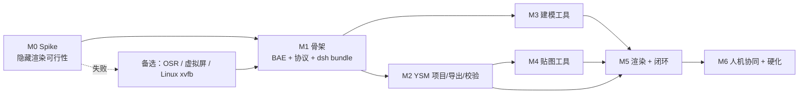

# 06 · 实施路线图、验收与测试策略

> 本文件回答"怎么落地、先做什么、怎么证明能做对"。
> 所有里程碑都以**可执行验收**结尾；M0 是 go/no-go 关卡，未通过不得进入 M1。

---

## 0. 前置结论（来自源码/环境调研）

| 已确认 | 依据 |
|---|---|
| 隐藏窗口 + 离屏 Preview 渲染 PNG 的代码路径存在 | `vendor/blockbench/js/preview/preview.ts:337,396-402,2542-2547`；`screenshot.js:279-353` |
| 插件可在不修改渲染层源码的前提下注入 | 自定义主进程 + `Plugin.loadFromFile(path, false)`；`plugin_loader.ts:548-585,659-675` |
| 保存/导出可完全无对话框 | `Codecs.*.compile()/write()`、`Blockbench.writeFile()`；`codec.ts:198-257,321-327`、`file_system.ts:450-497` |
| dsh 侧可注册工具/命令/图片附件/子进程 | `ctx.tools.register`、`ctx.commands.register`、`ctx.attachments.saveImage`、`ctx.subprocess`/`node:child_process` |
| 图片可进入模型上下文 | `ImageBlock` + `attachments` 服务；`read_image` 已在本机实测成功 |

**仍需实机验证**：隐藏窗口下 WebGL 帧是否稳定、GPU/驱动差异、多实例单实例锁、OSR 兼容性（见 `research/blockbench-core.md §8`）。

---

## 1. 里程碑与验收

### M0 · 可行性 Spike（2–3 天，Go/No-Go）

**目标**：证明"隐藏窗口能稳定出图"这一条生死假设。

任务：
1. 在 `vendor/blockbench` 上 `npm install && npm run build-electron`。
2. 复制/改写最小 `electron/main.js`：去掉 `win.show()`/`maximize()`；`webPreferences` 增加 `backgroundThrottling:false`；保留默认 `paintWhenInitiallyHidden`。
3. 启动（独立 userData + `--remote-debugging-port` 作为临时调试口），用 `executeJavaScript`：
   ```js
   const p = MediaPreview;
   p.loadAnglePreset(DefaultCameraPresets.find(x => x.id === 'north'));
   p.resize(768, 768);
   p.render();
   const url = p.canvas.toDataURL('image/png');
   ({ width: p.canvas.width, height: p.canvas.height, bytes: url.length,
      nonEmpty: (() => { const c = document.createElement('canvas'); c.width=64; c.height=64;
        const x=c.getContext('2d'); x.drawImage(p.canvas,0,0,64,64);
        const d=x.getImageData(0,0,64,64).data; return d.some(v=>v!==0); })() })
   ```
4. 把 dataURL 写盘，检查 PNG 尺寸/透明度/非空像素比例。
5. 连续渲染 50 次，记录耗时与内存增长；试 `front/back/left/right/iso_fr` 五个机位。
6. 试：窗口 `show:false` 时 `document.visibilityState`、rAF 计数；最小化/遮挡/远程桌面场景。
7. 试无 GPU：`--disable-gpu` / 强制 SwiftShader，记录是否可出图与耗时。
8. 试 GUI：`currentwindow.show()` 后用户可操作；`hide()` 后继续渲染。

**通过标准（全部满足）**
- [ ] 5 个机位均产出非空 PNG，尺寸精确 768×768，alpha 存在。
- [ ] 单帧渲染 P95 ≤ 1.5s（目标机器）。
- [ ] 50 次连续渲染无崩溃、无 WebGL context lost、内存增长 < 200MB。
- [ ] `show/hide` 往返后仍能出图。
- [ ] 无 GPU 时有明确降级路径（SwiftShader 出图或明确报错）。
- [ ] 离线启动（阻断外网）≤ 8s。

**失败预案**：见 `05-工程难点与避坑指南.md` §1.4（透明度 0 窗口、OSR、虚拟屏、Linux xvfb）。

### M1 · 骨架（1 周）

- BAE 构建流水线：`build.mjs`（拉取固定 tag、构建、组装 `agent/`、electron-builder 打包）。
- `agent-main.js` / `preload.cjs` / `bb-agent-bridge.js` 三件套；插件注入 + 自持久化。
- 协议最小集：`system.hello/ping`、`project.create_ysm`、`project.get_scene`、`system.shutdown`。
- DBA bundle：`apply(ctx)`、`ctx.tools.register` 3 个工具、`/show` `/hide` 命令、进程监督与清理。
- 渲染最小集：`render.views` 单机位 + `Blockbench.writeFile` 落盘。
- `workspace` 目录规范、`runtime.json`、日志。

**通过标准**：一条命令启动 dsh → 工具创建默认 YSM 项目 → 渲染 `front` → PNG 落盘 → `/show` 弹出窗口 → `/hide` 回后台；全链路 30s 内。

### M2 · YSM 项目与校验（1.5 周）

- YRL：默认包骨架生成、ysm.json 读取/规范化、路径映射、文件布局。
- `project.create_ysm/open_pack/save/export_ysm/validate`。
- 模型加载：`Codecs.bedrock`（main/arm）→ Blockbench 项目；贴图加载；YSM 元数据。
- 导出：`Codecs.bedrock.compile()+write()`、动画编译、贴图 PNG、`ysm.json`。
- `bb_validate(profile=ysm)`：必需骨骼/层级/贴图尺寸/UV/文件引用。

**通过标准**
- 用默认包创建 → 不改动直接导出 → 与默认包**结构等价**（文件清单、ysm.json 规范化后 JSON diff 为空，除时间戳）。
- 打开一个真实社区 YSM 包 → 读 digest → 保存 → 重新打开，模型/贴图/动画数量与路径一致。
- 校验能捕获 5 类已知坏例（缺骨骼、UV 越界、贴图尺寸错、ysm.json 引用缺失、动画名错）。

### M3 · 建模工具（1.5 周）

- `bb_scene` / `bb_get_element` / `bb_apply_model_patch`（add/update/delete/mirror/uv/reparent）。
- Undo 事务、revision、bounds 更新、name 冲突处理。
- 黄金用例：新建 bone/cube、改尺寸、逐面 UV、镜像左右、删除级联。

**通过标准**
- 20 个 patch 场景 fixture 全部通过（含错误路径）。
- 每次 patch 只产生 1 个 Undo 条目；撤销后场景与操作前逐字段一致。
- patch 回执 ≤ 500 tokens；无原始 JSON 泄漏。

### M4 · 贴图工具（1 周）

- `bb_texture_create/patch/read`；pixel/rect/line/replace/shade/outline/copy_mirror/import_png。
- `Texture.getActiveCanvas()` + `updateChangesAfterEdit()` + `Undo.initEdit({textures,bitmap:true})`。
- 调色板统计、区域 ASCII、纹理放大渲染。

**通过标准**
- 逐像素写入 128×128 全部像素，颜色值逐点校验 ΔE≤1。
- 批量 1000 ops 一次 Undo；撤销后原图字节级恢复（PNG 解码比较）。
- 图层贴图（layers_enabled）写入正确层、合成后 3D 更新。

### M5 · 无头渲染与闭环（1.5 周）

- `render.views` 多机位、缓存、透明背景、焦距/zoom-to-fit、closeup、纹理放大。
- DBA：图片降采样 + `attachments.saveImage` + `output.render` 图片块；超时/取消。
- 闭环门控：预算、no-progress、回滚、critique schema、Skill 提示词。
- 一次真实闭环：默认 Steve → 加肩甲 → 贴图 → 自检 3 轮 → 导出。

**通过标准**
- 同一 revision + 参数第二次渲染缓存命中（<50ms）。
- 3 机位渲染端到端（含附件）≤ 4s。
- 闭环在 8 轮内收敛（fixture 3 个不同任务，至少 2 个 pass）。
- 人为注入 1 个明显缺陷（袖子颜色错），VLM 能报出并修复。
- 预算耗尽时能导出并给出说明，不卡死。

### M6 · 人机协同与硬化（1 周）

- `/show` `/hide` 全链路：冻结/恢复/用户改动 diff/revision 对齐。
- 崩溃恢复、GPU 降级、离线、断网、端口冲突、磁盘满。
- 安全：token、路径沙箱、payload 限制、方法白名单。
- 打包、安装说明、诊断工具、回归脚本。

**通过标准**
- GUI 显示期间写工具 100% 返回 `GUI_BUSY`；`/hide` 后 revision 对齐且用户改动被摘要注入。
- kill renderer / kill 进程 / 断网 / 磁盘只读 四类故障均能在 15s 内恢复到可用状态或明确失败。
- 安全测试全通过（见 §3.5）。

---

## 2. 工作分解与依赖



并行建议：
- 2 人：A 做 BAE + 渲染 + 协议；B 做 DBA + YSM + 工具。M5 后合流。
- 1 人：严格按 M0→M1→M2→M4→M3→M5→M6（贴图先于复杂建模，因为贴图是差异化能力）。

---

## 3. 测试策略

### 3.1 分层

| 层 | 内容 | 工具 |
|---|---|---|
| 单元 | JSON-RPC 编解码、schema 校验、revision、YRL 规范化、validator、绘制算法（Bresenham/镜像/裁剪） | Vitest/Jest；纯函数无 Electron |
| 契约 | `spec/bridge-methods.json` → TS 类型生成；每个方法 fixture 正常/错误各 1 | 自建 conformance runner |
| 集成 | 真启动 BBAR（隐藏），跑 hello → create → patch → render → export | Node test + WS client |
| 视觉回归 | 固定 fixture 的 golden PNG；dHash + SSIM 阈值；同 revision 必须一致 | pngjs + pixelmatch/ssim |
| E2E | 从 dsh 工具调用到导出包的完整场景 | dsh 测试会话或直接调用 DBA 的 execute |
| 故障注入 | 杀 renderer、断网、GPU 禁用、磁盘只读、端口占用、用户 GUI 抢占 | 脚本 + 环境变量开关 |
| 安全 | token 暴力、路径穿越、超大 payload、未知方法、批处理炸弹 | 负向测试 |

### 3.2 Fixture 设计

| ID | 场景 | 断言 |
|---|---|---|
| F-001 | 默认 Steve 创建 → 直接导出 | 与默认包结构等价；ysm.json normalized equal |
| F-002 | 给 LeftArm 加肩甲（对称）+ 深蓝贴图 | 3 机位渲染非空；`bb_validate` errors=0；UV 不越界 |
| F-003 | 故意把右袖改长 2 单位 | critique 报 G4；修复后评分回升 |
| F-004 | 贴图接缝 1px 裂缝 | critique 报 T3；`copy_mirror`+描边修复 |
| F-005 | 打开社区 YSM 包 → 改一处颜色 → 保存 → 重开 | 颜色持久化；其余文件不变 |
| F-006 | GUI `/show` 手改 → `/hide` | revision 对齐；用户改动摘要正确；Agent 未覆盖 |
| F-007 | GPU 降级 | `ENGINE_DEGRADED`；禁止 critique；导出仍可用 |
| F-008 | 预算耗尽 | 导出可用；failure-report 完整 |

### 3.3 渲染黄金测试

- 每个 fixture 的每个机位保存 golden（首次人工确认为准）。
- 同 revision + 同参数，SSIM ≥ 0.9999（应字节级一致；若有差异则查随机/时间依赖）。
- 不同 revision 的预期修改：SSIM 落在预期区间（如改颜色应 0.5–0.95）。
- 透明背景检查：四角 alpha=0、模型区域 alpha>0；无黑边/白边。
- 空图检测：非透明像素占比 > 0.5%，否则报 `EMPTY_RENDER`。

### 3.4 性能基准

| 指标 | 目标 | 采集 |
|---|---|---|
| 冷启动 → ready | ≤ 8s | main 进程日志时间戳 |
| hello RTT | ≤ 30ms | ping × 100 |
| 单机位渲染 768 | ≤ 1.5s P95 | 100 次 |
| 3 机位 + 附件 | ≤ 4s P95 | 50 次 |
| patch 100 ops | ≤ 300ms | 50 次 |
| patch 1000 texture ops | ≤ 800ms | 20 次 |
| 导出默认包 | ≤ 3s | 20 次 |
| 内存（2h） | 增长 < 15% | 采样 RSS |

### 3.5 安全测试清单

- [ ] 无 token / 错 token 连接被拒（4001），不泄露信息。
- [ ] 非 loopback 无法连接（防火墙/绑定测试）。
- [ ] `pack_dir` 含 `..`、绝对路径、符号链接 → 拒绝。
- [ ] 方法白名单外 → `METHOD_NOT_FOUND`。
- [ ] 8MB+ payload → 关闭连接，不 OOM。
- [ ] 批量 1000 请求 → 拒绝（`RESOURCE_LIMIT`）。
- [ ] `bb_restore` 无 `confirm:true` → 拒绝。
- [ ] 插件注入路径不可被请求参数控制（只能由主进程 env 指定）。
- [ ] 日志不含 token/base64 原文。

### 3.6 长跑与稳定性

- 2h  soak：每 30s 一次 patch+render；检查内存、句柄数、GPU 内存、日志错误。
- 重启 20 次：检查 userData 锁、端口、残留进程。
- 并发 2 个 workspace：独立端口/token，互不影响。

---

## 4. 验收标准（Definition of Done）

### 4.1 DBA（dsh 插件）

- [ ] `apply(ctx)` + `inject` + `Config`；`ctx.effect` 清理子进程/端口/定时器。
- [ ] 工具集固定、schema 稳定、`bb_*` 命名统一；每个工具自管超时。
- [ ] 图片附件路径 A（内嵌）+ B（路径+read_image）都可用，失败降级。
- [ ] `/show` `/hide` `/bb-status` 命令注册成功；命令不产生模型消息。
- [ ] `install_bundle` 安装成功；中英文 locale + 图标；版本兼容检查通过。
- [ ] 错误码与协议文档一致；错误信息可操作。

### 4.2 BBAR

- [ ] 构建可复现：固定 Blockbench tag，步骤脚本化，产物含许可证与源码获取说明。
- [ ] 隐藏启动、独立 userData、离线、自动更新关闭。
- [ ] 插件注入幂等（重复启动不重复注册）。
- [ ] 崩溃自动重启 + checkpoint 恢复；GUI show/hide 正常。
- [ ] 日志分级、runtime.json 原子写、锁文件清理。

### 4.3 协议

- [ ] `spec/bridge-methods.json` 覆盖全部方法/错误码，生成类型通过编译。
- [ ] JSON-RPC 2.0 兼容：单请求/批/通知/错误；`_meta` 幂等生效。
- [ ] 取消/进度/超时在渲染与导出上可用。
- [ ] revision 冲突、GUI 抢占、降级三类错误端到端可复现。

### 4.4 闭环

- [ ] 8 轮内收敛；预算/回滚/no-progress 生效。
- [ ] 每次 critique 有结构化 JSON；每条缺陷有 view+区域+severity。
- [ ] 导出前 validate errors=0；导出包可被 YSM 加载（用户实测或解析校验）。
- [ ] 失败路径有 report，不"静默失败"。

---

## 5. 发布与运维

### 5.1 构建流水线

```text
1. git clone --depth 1 --branch v5.2.2 https://github.com/JannisX11/blockbench vendor/blockbench
2. npm ci --prefix vendor/blockbench
3. npm run build-electron --prefix vendor/blockbench     # 产出 dist/bundle.js
4. node packages/bb-agent-runtime/build.mjs            # 组装 dist-app/（index.html/css/assets/dist/agent/package.json）
5. electron-builder --dir / --win nsis                 # 产物带 GPL 许可证与源码获取说明
6. 冒烟：启动 → hello → render → export
```

### 5.2 版本策略

- BAE 版本 = `blockbench_version + agent_revision`（如 `5.2.2-agent.3`）。
- 协议版本 `bb-agent/1`；破坏性变更升 major，`system.hello` 拒绝不兼容。
- 每个发布产出一个 `compatibility.json`：Blockbench commit、Electron/Node 版本、YSM-Utils 版本、工具 schema hash。

### 5.3 诊断与日志

- `workspace/logs/bridge.jsonl`：请求/事件/耗时/错误码。
- `workspace/logs/agent.log`：主进程/崩溃/GPU。
- 诊断工具（Host 工具或命令）：
  - `bb_session_status` 返回 health；
  - `/bb-status` 命令输出人类可读摘要；
  - `bb_diagnostics`（可选）：GPU/UA/插件列表/缓存/磁盘。
- 一键收集：`workspace/diagnostics.zip`（脱敏）。

### 5.4 升级回归清单（Blockbench 升级时）

1. `electron/main.js` 的窗口创建点是否仍可 patch（show/backgroundThrottling）。
2. `Preview.render/resize`、`Screencam.advancedScreenshot` 签名与行为。
3. `plugin_loader` 的注入/持久化时序。
4. `Texture.updateChangesAfterEdit/getActiveCanvas` 刷新链。
5. `Codecs.*.compile/write`、`Blockbench.writeFile`。
6. `Undo.initEdit/finishEdit` aspects。
7. YSM-Utils 的默认包与规范化规则。

---

## 6. 团队分工（建议）

| 角色 | 负责 | 主要交付 |
|---|---|---|
| Agent/协议工程师 | DBA、协议、状态机、工具 schema、VLM 闭环 | `packages/dsh-blockbench-agent`、`spec/` |
| Electron/渲染工程师 | BAE、隐藏窗口、渲染服务、GPU 稳定性、打包 | `packages/bb-agent-runtime` |
| YSM/建模工程师 | YRL、模型/动画/贴图工具、validator | BABP 的 ysm/model/texture 模块 |
| QA/工具链 | fixtures、golden、故障注入、性能、发布检查 | `tests/`、CI、诊断工具 |

单人开发建议顺序：M0 → M1 → M2 → M4（贴图）→ M3（建模）→ M5 → M6。

---

## 7. 第一天就能执行的任务清单（M0 Spike）

```powershell
# 0) 环境（Node ≥20、Git、Windows 10/11）
cd F:\Deepseek_harness\blockbench\vendor\blockbench
npm ci
npm run build-electron      # 生成 dist/bundle.js

# 1) 复制一份最小 agent 主进程（M0 阶段可先用 --remote-debugging-port 手动驱动）
#    改动点：去掉 win.show()/maximize；webPreferences 加 backgroundThrottling:false
# 2) 启动（独立 userData，避免污染）
npx electron . --userData F:\Deepseek_harness\blockbench\workspace\_spike\userdata --remote-debugging-port=9223

# 3) 用 CDP（chrome-remote-interface 或 DevTools Protocol HTTP）执行：
#    - 创建/加载默认 bedrock 项目
#    - MediaPreview.resize(768,768); loadAnglePreset('north'); render(); toDataURL()
#    - Blockbench.writeFile('...\\front.png', {content:url, savetype:'image'})
#    - 检查 PNG 非空、尺寸、alpha；重复 50 次

# 4) 记录结果到 docs/M0-report.md（通过/失败、耗时、GPU、驱动）
```

**M0 输出**：`M0-report.md` + 5 张不同机位 PNG + 性能数据 + Go/No-Go 结论。

---

## 8. 交付物清单

| 交付物 | 路径 |
|---|---|
| 设计文档集 | `docs/01..06`、根目录合并版 |
| 机器可读契约 | `spec/tool-manifest.json`、`spec/bridge-methods.json` |
| 骨架代码 | `prototype/`（electron-main/preload/bridge-plugin/dsh-plugin） |
| 研究证据 | `research/*.md`（Blockbench / YSM / dsh） |
| 上游源码 | `vendor/blockbench`、`vendor/YSM-Utils-Plugins`（只读） |
| M0 报告（待产出） | `docs/M0-report.md`（实机验证后） |
