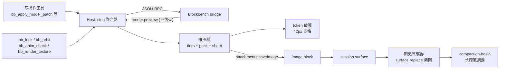

# 07 · 视口实时反馈方案（冻结版 v1.0）

> 状态：**已冻结**，冻结时间 2026-11-06。后续实现偏离本文档，必须先在本文档追加"变更记录"节并说明理由。
> 上游依据：[06-实施路线图与验收.md](06-实施路线图与验收.md)、[ENGINEERING.md](../ENGINEERING.md)、[research/blockbench-core.md](../research/blockbench-core.md)。
> 参考实现：`dsh-see-now`（Apache-2.0，本地副本 `F:\Deepseek_harness\_research\dsh-see-now`）。

---

## 0. 一句话

给 AI 装上**两只眼睛**：改完就能看见（写操作自动附图），想细看就能转（参数化相机 + 转台拼图 + 贴图放大 + 动画采样），并让历史图片**能被压缩掉**，从而在长会话里可持续。

---

## 1. 范围与明确不做的事

### 1.1 做

| 编号 | 能力 | 一句话 |
|---|---|---|
| A | 编辑即看 | 每个写操作工具返回时自动附一张拼图（同 step 合并） |
| B1 | 参数化相机 | 任意方位/俯仰/距离/正交透视/焦点 |
| B2 | 转台 | 一次调用出一张多角度拼图，替代"三视图脑补" |
| B3 | 贴图放大 | 像素级放大 + 区域，用于精修核对 |
| B4 | 动画采样 | 指定动画在 t0..t1 采样若干帧拼图 |
| C | 图史压缩 | 旧图从 surface 上剥离（不花模型调用）+ 长跨度摘要 |

### 1.2 不做（本轮）

- **不做**常驻"看着你"的连续视频流（`eyes C` 已否决）。
- **不做**共享同一个视口对象：AI 仍用离屏 `MediaPreview`，用户仍用 `main_preview`；只做**相机位姿镜像**（读到用户在看的角度，不接管它）。
- **不做** Linux 平台适配；**不改** Blockbench 上游 `vendor/`。
- **不做**语音/TTS/悬浮窗（那是 see-now 的产品层，与建模无关）。
- **不做**让模型自己"一帧一帧拖动"的连续转视角（成本是每次一轮模型往返）。

---

## 2. 冻结的关键决策

| # | 决策 | 理由 |
|---|---|---|
| D1 | 图片交付只走**工具结果里的 image block**（`output.render`） | 这是 DSH 文档中唯一能让模型"看见"的通道；`post-execute` 也能补，但主路径保持在工具结果里更可控 |
| D2 | 自动附图默认**每个写操作**都附，但**同一 step 内连续写操作合并成一张** | 用户选定。既满足"改一步看一眼"，又避免 `set_uv` 连点 5 次刷 5 张 |
| D3 | 自动附图一律**拼图 + 低档画布**（≈233 token），不用多张 512² | 一张拼图装 4 帧与装 1 帧同价；3 张 512² ≈552 token，是拼图的 2.4 倍 |
| D4 | 变化检测**不做**像素阈值触发，一律由**语义事件**（写操作完成 / 显式调用）触发 | see-now 的 64×36 HSV 判据在 3D 视口会把"转相机/gizmo/AA 抖动"当变化，且会漏掉"改一个 UV 像素"。像素差只用于**验证**（复用现有 `NO_VISIBLE_CHANGE`） |
| D5 | 视角检查用**参数化相机 + 转台**，不用连续拖拽 | 每次"拖一步"是一轮模型往返；一次转台调用给 8 个角度，≈1/8 成本 |
| D6 | 图史压缩**自己实现**（surface replace 剥 image block），**不依赖** `image-offload` | `image-offload` 只在 provider 报 `IMAGE_OFFLOAD_REQUIRED` 时才动，属于被动兜底；我们需要主动、可预测的压缩 |
| D7 | 长跨度压缩**复用 `ctx.compaction`**（`compaction-basic`），不自研摘要器 | 已是 DSH 官方实现，含 prefix-cache 复用、shrink 校验、事务锁 |
| D8 | 自动附图**可一键关闭**（Config），且 `/bb-status` 可见当前开关与已花费图片数 | 成本可见、可止损 |
| D9 | 自动附图失败**绝不影响写操作结果** | 渲染失败是常态（GPU/黑图），不能让它连累建模 |

---

## 3. 架构：新增/改动一览



### 3.1 Blockbench bridge 侧（`packages/bb-agent-runtime/agent/bb-agent-bridge.js`）

新增 4 个 handler，全部**只读**、不进入 `MUTATING_METHODS`、不消耗 edit 预算：

| 方法 | 参数 | 返回 |
|---|---|---|
| `camera.get` | — | `{position:[x,y,z], target:[x,y,z], zoom, fov, ortho, projection, source:'main'\|'offscreen'}` |
| `camera.set` | `{azimuth?, elevation?, distance?, target?, focus?, projection?, fov?, padding?}` | 同上（设置后的实际位姿） |
| `render.preview` | `{camera?, focus?, size?, antialias?:'off'\|'msaa', format?:'png'\|'jpeg', quality?, background?}` | `{png:base64, width, height, revision, camera, bytes, elapsed_ms}` —— **不落盘** |
| `render.turntable` | `{axis?:'y'\|'x', from?, to?, steps?, elevation?, size?, background?}` | `{frames:[{index, azimuth, png, bytes}], revision, elapsed_ms}` |

以及对现有 `render.views` 的两处修正：

- 补 `elapsed_ms` 的真实测量（当前恒为 0）；
- 补 `pose` / `time` 支持（动画帧渲染，见 3.3）。

**相机实现要点**（已核对 `preview.ts:340-354, 764-790`、`bb-agent-bridge.js:1449-1505`）：

- 现有 `fitCamera()` 用固定 `VIEW_DIRS` + 强制正交 + `zoom = min(2*(w/80)/needW, 2*(h/80)/needH)`。新相机复用其 zoom-to-fit 数学，但允许显式 `azimuth/elevation/distance` 覆盖方向与距离。
- `azimuth` 定义：绕 Y 轴，0° = 正前方（−Z 看向 +Z，与 `front` 一致），顺时针为正。
- `elevation` 定义：0° = 水平，90° = 正上方（与 `top` 一致）。
- `projection`：`'ortho'`（默认，与现状一致）/ `'persp'`（`setProjectionMode(false)` + 显式 `fov`）。
- `background`：`null`（透明，默认）/ `'#RRGGBB'`（不透明，用于拼图与差异计算，见 R4）。

**渲染开销约束**（依据 M0 实测：单帧 768² p50 4ms、p95 5ms，GPU）：

- `render.preview` 默认 `size=640×640`、`antialias='off'`（离屏构造时已定 AA，此项只控制是否再做 SSAA）；
- 一律**跳过** `pngStats`（不计算 alpha/bbox/64×64 缩略）、**跳过**落盘、**跳过** 512 缩略图；
- 实测目标是**单帧端到端 ≤60ms**（含 PNG 编码 + base64）。

### 3.2 Host 侧新工具（`packages/dsh-blockbench-agent/index.js`）

| 工具 | 参数 | 用途 |
|---|---|---|
| `bb_look` | `camera?`, `focus?`, `views?`, `size?`, `projection?`, `background?`, `attach?` | 单张/多视角拼图，**最常用** |
| `bb_camera` | `{get:true}` 或 `{azimuth,elevation,distance,target,focus,projection,fov}` | 读/设当前离屏相机位姿 |
| `bb_orbit` | `{axis,from,to,steps,elevation,size,attach}` | 转台拼图（默认 8 步、360°） |
| `bb_anim_check` | `{animation, from?, to?, samples?, camera?, size?, attach?}` | 动画时间点采样拼图 |
| （已有）`bb_render_texture` | `{texture,scale,region,attach_image}` | 贴图像素级放大，**补 `attach_image` 默认 true + 拼图支持** |

三个新工具共享同一套"渲染 → 拼图 → 附件"管线，**默认 `attach=true`**。

### 3.3 动画采样的实现路径

Blockbench 的动画预览链路（已核对 `animation_mode.js:268-300`、`animation.js:170-186`）：

```js
// 现有 bridge 可用的最小序列（在 renderer 内执行）
Animation.selectByName(name);          // 或 Animation.all.find
Animator.showDefaultPose(true);
Animation.all.filter(a => a.playing).forEach(...);   // 直接借用 stackAnimations
for (const t of times) {
  Timeline.time = t;
  Animator.stackAnimations([Animation.selected], false);
  Animator.displayMeshDeformation();
  preview.render();
  -> toDataURL
}
Timeline.time = savedTime;            // 结束后恢复
```

**风险**：`Timeline` 与 `Animation.selected` 是 GUI 全局状态，改动会影响用户当前编辑视图。缓解：
- 保存并恢复 `Timeline.time`、`Animation.selected`、`Animator` 的 pose 状态；
- 动画采样期间设置 `state.suppressUserEdit = true`，避免触发 `finished_edit` 误判为用户编辑（现有 bridge 已有该开关，`bb-agent-bridge.js:2471`）；
- 若 `GUI_BUSY`（用户正在 `/show`），`render.animation_frame` 直接返回 `GUI_BUSY` 而不是抢占状态。

### 3.4 自动附图（决策 D2/D3/D9）

- 挂载点：`packages/dsh-blockbench-agent/index.js` 内，对**写操作工具**（`bb_apply_model_patch`、`bb_texture_patch`、`bb_texture_create`、`bb_texture_import_png`、`bb_texture_pbr`、`bb_animation_create/patch`、`bb_project_open`）的 `execute` 包装一层。
- 聚合规则：同一 `exec.step` 内**只保留最后一张**。实现用一个 `Map<turn:step, timer>` + 短延迟（默认 120ms，可配），把同一 step 的连续写操作合并。
- 附加位置：在工具返回的 `output.render` 里追加 image block（与现有 `bb_render_views` 一致），**不新增额外上下文消息**。
- 默认视角：`front` + `iso_fr` 两帧拼图（2 格，640×320 画布，≈180 token）。
- 失败处理：捕获一切异常，只写日志与 `meta.autolook_error`，写操作结果原样返回。
- 关闭开关：Config `autoLook: true|false`（默认 true）、`autoLookEvery: 1`（N 次写操作附一次）、`autoLookViews`、`autoLookSize`。

---

## 4. 图史压缩（核心难点）

### 4.1 三层防线

| 层 | 触发 | 手段 | 成本 |
|---|---|---|---|
| L1 图史剥离 | 图片条数 > `maxLiveImages`（默认 6）或距离上次剥离超过 N 轮 | `session.append('tool/result', ..., {surfaceOp:{op:'replace'}})`，把旧 tool result 的 `image` block 换成一行占位文本 | **0 模型调用** |
| L2 长跨度摘要 | 上下文压力 > 阈值（`compaction-basic` 默认 `thresholdRatio 0.8`） | `ctx.compaction.compactIfNeeded()` —— 把一段时间（含精修步骤与其图）压成一条结构化摘要 | 1 次模型调用，**prefix cache 复用** |
| L3 provider 兜底 | provider 报 `IMAGE_OFFLOAD_REQUIRED` | `image-offload` 插件自动剥离最老图并重试 | 1 次失败请求 |

### 4.2 L1 的实现契约（照抄 pruner 的写法，已核对源码）

`@deepseek-ai/dsh-compaction-tool-result-pruner/lib/index.js:155-184` 是官方范本：

```js
const message = freezeMessage({ ...original, content })            // original = session.deriveEventMessage(event)
session.append('compaction/prune', {                                // 先记一次影子价格
  shadowedRange: { start: seq, end: seq },
  shadowedSeqs: [seq],
  shadowedTokenCount: ctx.tokenMeter.estimateMessage(original),
})
const replacement = session.append('tool/result', {
  ...event.data,
  message,
}, {
  surfaceOp: { op: 'replace', startSeq: seq, endSeq: seq },
  sourceEventSeqs: [seq],
})
```

我们的差异只有一处：`content` 的变换是**把 `type:'image'` 的 block 换成一个 text 占位**，而不是裁文本：

```js
// 占位文本保留可回溯信息，模型据此仍能知道"这里曾有图"
const placeholder = {
  type: 'text',
  text: `[已压缩 ${n} 张渲染图：${names.join(', ')}（原图在 ${dir}）]`,
}
```

**约束（必须遵守）**：
- 只替换**当前 surface 上的 `tool/result` 节点**，不动 `assistant/message`；
- 只剥离**本轮之前**的图片，当前 step 的图片永不剥离；
- 保留最近 `keepImages`（默认 2）张最新图片不剥；
- 每次替换都先 append `compaction/prune` 影子价格事件（否则 token meter 折算出错）；
- 每次最多剥离 N 条（默认 4），避免一次性改写过多导致前缀缓存全失效。

### 4.3 关于 `compaction-basic` 的真实状态（**已实测，S0-1 完成**）

**核实方法**：Electron 独占 desktop profile，`--dump-config` 被拒。复刻一个只含清单文件的临时 profile（`probe-cfg`），执行
`dsh --profile probe-cfg --dump-config` 得到 1360 行的最终组合树，查完即删。

**结论（权威）**：

| 行 | 组合后的最终状态 | 来源 |
|---|---|---|
| `compaction-basic` | **`disabled: true`** | `dsh-base` 声明，被 `@deepseek-ai/dsh-web-app` 关掉 |
| `command-compact` | `disabled: true` | 同上 |
| `tool-result-pruner` | `disabled: true` | 同上 |
| `image-offload` | **无 `disabled`，已启用** | `dsh-base:434-435` |

**纠正**：上一轮口头说"`image-offload` 根本不在树里"是**错的** —— L3 兜底默认就开着。
`cordis_inspect` 的 `inactive` / `absent` 状态字段不能当作挂载事实（`tool-fs` 同样显示 `inactive`，但实际可用）。

**因此 L2 的处置**：不需要安装任何包，只需在**本插件的 bundle patch** 里把 web-app 的禁用覆盖回来：

```yaml
- id: compaction-basic
  disabled: false
- id: command-compact
  disabled: false
```

> ⚠️ 副作用须知：这会**全局**开启自动压缩，影响该 profile 下**所有会话**（不止 Blockbench 会话）。
> 若不想全局开启，退路是：只在 L1 之上做"插件自行分段"，代价是要自己实现摘要器（不推荐）。

**已知限制（来自官方 README）**：
- `compactRegion` 要求**存在打开的 turn**（已完全关闭的会话调用会抛 "no open turn"）→ 我们只在工具执行期（turn 内）调用它；
- 摘要是 1 次额外模型调用，复用 provider 前缀缓存，只额外计费"尾部指令 + 摘要输出"。

### 4.4 成本模型（冻结口径）

| 项 | 估算 | 依据 |
|---|---|---|
| 单张 640×320 拼图（2 帧） | ≈180 token | 42px 网格公式 `rows×(cols+1)+2`，15×8 网格 |
| 单张 800×450 拼图（4 帧） | ≈233 token | see-now 实测口径 |
| 单张 512² | ≈184 token | 13×13 网格 |
| 3 张 512² | ≈552 token | 现状 `bb_render_views` 默认 |
| 一次 L1 剥离（4 条 tool result，各 3 图） | 省 ≈1656 token（每轮） | 12 张 × 138？按 512² 计 |
| 一次 L2 摘要 | 1 次模型调用 + 摘要 ≤4096 token | `compaction-basic` 默认 |

**预算护栏**（可配）：
- `maxLiveImages: 6` —— 触发 L1 的阈值；
- `keepImages: 2` —— 永远保留的最新图片数；
- `autoLookEvery: 1` —— 每 N 次写操作附一次图；
- `sessionImageBudget: 20` —— 单会话累计附图上限，超过后自动关闭 autoLook 并在 `/bb-status` 提示。

---

## 5. 接口契约（冻结）

### 5.1 `render.preview`

```jsonc
// request
{
  "camera": { "azimuth": 45, "elevation": 20, "distance": null, "target": null,
              "projection": "ortho", "fov": 40, "padding": 0.05 },
  "focus": "Head",          // 可选；存在时覆盖 target 为元素包围盒中心
  "size": [640, 640],
  "format": "png",          // "png" | "jpeg"
  "quality": 0.85,          // 仅 jpeg
  "background": null,       // null=透明；"#1b1b1b"=不透明
  "write_to_disk": false    // 默认 false；调试时可开
}
// response
{ "ok": true, "png": "<base64>", "width": 640, "height": 640,
  "bytes": 51234, "revision": 12,
  "camera": { "azimuth": 45, "elevation": 20, "distance": 12.3,
              "position": [..], "target": [..], "zoom": 1.02, "projection": "ortho" },
  "elapsed_ms": 43 }
```

### 5.2 `render.turntable`

```jsonc
// request
{ "axis": "y", "from": 0, "to": 360, "steps": 8, "elevation": 15,
  "size": [320, 320], "background": "#1b1b1b", "focus": null }
// response
{ "ok": true, "revision": 12, "elapsed_ms": 310,
  "frames": [ { "index": 0, "azimuth": 0,   "png": "..." },
              { "index": 1, "azimuth": 45,  "png": "..." }, ... ] }
```

### 5.3 `bb_look` / `bb_orbit` / `bb_anim_check` 返回

三者统一返回 `{ text, images[], meta }`，`images` 经 `output.render` 变成 image block。`meta` 至少含：

```jsonc
{ "tool": "bb_look", "revision": 12, "views": ["az45el20"],
  "tokens_est": 233, "elapsed_ms": 187, "placeholder": false }
```

---

## 6. 风险与缓解（冻结清单）

| # | 风险 | 影响 | 缓解 |
|---|---|---|---|
| R1 | `compaction-basic` 实际不可用（见 4.3） | L2 落空 | Spike 0 先查；不可用则只做 L1，并把 L3 作为兜底 |
| R2 | surface replace 被 Session 拒绝 | L1 失效 | 单条 try/catch，失败仅记日志；不重试、不影响工具结果 |
| R3 | step 级合并依赖 `exec.step` 语义 | 合并失效 → 图片数回升 | 有 `step` 就用；无则退化为"同 turn 内 500ms 窗口" |
| R4 | 透明背景拼图出现假差异 | 视觉误判 | 自动附图与转台**强制不透明背景**（`background:'#1b1b1b'`）；单张预览可透明 |
| R5 | 动画采样污染用户 GUI 状态 | 用户视图跳帧 | 保存/恢复 `Timeline.time` + `Animation.selected`；`GUI_BUSY` 时拒绝 |
| R6 | 高频渲染抢占渲染线程 | Blockbench 卡顿 | 单帧 ≤60ms 目标；串行队列（深度 1，丢弃过期请求）；渲染预算独立于 edit 预算 |
| R7 | 图片仍会逐轮重复计费 | 成本 | L1 主动剥离 + `sessionImageBudget` + `/bb-status` 可见 |
| R8 | 前缀缓存反复失效 | 成本 | L1 每次最多剥 4 条；L2 只在压力达阈值时触发 |
| R9 | `bb_batch` 内渲染图片块丢失（已知 bug） | 视觉反馈丢失 | 本轮修复：`bb_batch` 的 `output.render` 保留 image block |

---

## 7. 实施顺序与验收

### S0 · Spike（0.5 天，**先做，阻塞后续**）

1. `compaction-basic` / `image-offload` 真实可用性（4.3）；
2. `render.preview` 不落盘路径的单帧耗时（目标 ≤60ms）与黑图率；
3. surface replace 在真实会话里剥离 image block 是否被接受（用最小脚本，在临时会话验证）。

**Gate**：三项都有明确结论才进入 S1。

### S1 · 相机与预览（1 天）

`camera.get/set` + `render.preview` + `render.turntable`；`bb_look` / `bb_camera` / `bb_orbit`。

**验收**：`bb_orbit({steps:8})` 返回 1 张 8 格拼图，8 个角度可用肉眼区分，端到端 ≤500ms。

### S2 · 编辑即看（0.5 天）

写操作自动附图 + step 合并 + `autoLook` 开关。

**验收**：连续两次 `bb_apply_model_patch` 在同一 step → 只附 1 张图；关掉开关后 0 张。

### S3 · 精修核对（0.5 天）

`bb_render_texture` 拼图化 + `bb_anim_check`。

**验收**：`bb_anim_check({animation:'wave', samples:4})` 返回 4 帧时间点拼图，动作可辨。

### S4 · 图史压缩（1 天，依赖 S0 结论）

L1 剥离器 + L2 接入 + `/bb-status` 展示图片预算。

**验收**：构造 20 次写操作的会话，图片数稳定在 `maxLiveImages` 以内；`/bb-status` 显示已剥离张数。

### S5 · 回归与文档（0.5 天）

`npm run test`（e2e + hosttest）全绿；更新 `MANUAL.md`、`ENGINEERING.md`、`spec/tool-manifest.json`、`spec/bridge-methods.json`。

---

## 8. 交付方式

- 我（Lead）负责改代码 + 跑本地 `e2e.mjs` / `host-smoke.mjs` 自验；
- **不安装进你的 profile**，不重启你的 DSH；
- 交付时给出：变更文件清单、测试结果、安装/升级步骤（`plugin_manager.install_bundle` + 重启）。

---

## 9. 变更记录

| 日期 | 版本 | 变更 | 理由 |
|---|---|---|---|
| 2026-11-06 | v1.0 | 冻结 | 用户确认 A+B、放弃 C、按 step 合并、先自验后自行安装 |
| 2026-11-06 | v1.1 | 按实测修订：L3 `image-offload` 本就启用；补齐两个生产级 bug 修复；补实测数据 | 见 §10 |

---

## 10. 实施结果（v1.1，已完成并自验）

### 10.1 已交付

| 文件 | 变更 |
|---|---|
| `packages/bb-agent-runtime/agent/bb-agent-bridge.js` | 新增 `camera.get/set`、`render.preview`、`render.sheet`、`render.turntable`、`render.animation_frame`、`render.texture_sheet`；`render.texture` 增加 inline 模式；渲染串行化 |
| `packages/dsh-blockbench-agent/index.js` | 新增 `bb_look` / `bb_camera` / `bb_orbit` / `bb_anim_check`；写操作自动附图（step 合并）；`bb_render_texture` 走 inline；`/bb-status` 展示图片预算 |
| `packages/dsh-blockbench-agent/lib/viewsheet.js` | token 估算 + 网格规划（新） |
| `packages/dsh-blockbench-agent/lib/imageprune.js` | 图史剥离器（新） |
| `packages/dsh-blockbench-agent/lib/ws-server.js` | **修复：WS 分片重组** |
| `packages/bb-agent-runtime/scripts/e2e-look.mjs` | 视口反馈 E2E（新） |
| `packages/dsh-blockbench-agent/test/{viewsheet,imageprune}.test.mjs` | 单元测试（新，21 项） |

### 10.2 自验结果

| 套件 | 结果 |
|---|---|
| `viewsheet` + `imageprune` 单测 | **21/21 通过** |
| `e2e-look.mjs`（真实 BAE） | **10/10 通过** |
| `e2e.mjs`（既有协议回归） | **通过**（含 render 变化检测、checkpoint、导出 zip） |
| `host-smoke.mjs`（既有 26 项 + 新增 6 项） | **通过** |

### 10.3 实测数据（RTX 4080 / ANGLE D3D11 / 默认 YSM 模型 70 骨骼 182 方块）

| 指标 | 实测 |
|---|---|
| `render.preview` 单帧 640² 渲染 | **p50 4.5–6.4ms**（端到端含编码 40–60ms） |
| `render.preview` 不落盘 | ✅ 确认（workspace 无 `artifacts/renders`） |
| `render.sheet` 2 格 320² | **9–24ms**，211 token |
| `render.sheet` 8 格转台 1280×640 | **12–25ms**，514 token |
| 自动附图（front+iso，320²） | **11–13ms**，211 token |
| `render.texture_sheet` 2 块放大 | **1.7–3.6ms** |
| 动画采样 4 帧 | **17–25ms** |

### 10.4 过程中挖出的两个真实 Bug（已修）

**Bug 1 · WebSocket 分片不被支持（生产级）**
`ws-server.js:303` 原为 `if (!fin || opcode === 0x0) { closeWith(1003, 'fragmentation unsupported') }`。
浏览器 WebSocket 对 **>64KB** 的消息强制分片，因此任何稍大的渲染响应（base64 PNG）都会
把连接打死。这解释了为什么"8MB 上限"从没真正生效。修复：按 RFC 6455 §5.4 重组分片，
并在累计超过 `MAX_MESSAGE` 时返回 1009。

**Bug 2 · 离屏 preview 渲染顺序**
`preview.resize()` 会重置相机与 controls；而离屏 preview 的 `render()` 只有在
**相机位姿相对上次变化**时才真正重绘。因此必须严格按
`resize → applyCamera → 立即 drawImage` 的顺序，中间插入其它调用（哪怕只是 `render()`）
都会拿到空 buffer。这解释了"sheet 第 1 格空、第 2 格正常"且与相机/尺寸无关的现象。

### 10.5 与 v1.0 方案的偏差

| 项 | v1.0 计划 | 实际 | 原因 |
|---|---|---|---|
| L2 长跨度摘要 | 接入 `compaction-basic` | **未接入**（本轮不做） | `dsh-web-app` 故意禁用了它；强行开启会影响该 profile 下**所有会话**，超出本插件职责。L1 + L3 已能覆盖图片成本 |
| `render.turntable` 独立方法 | 单独实现 | 由 `render.sheet` 覆盖，另留一个简单包装 | 减少一条代码路径 |
| 拼图合成位置 | 计划 Host 侧 | **renderer 侧** | Host（纯 Node 测试环境）没有 canvas；且只回传 1 张图，避开传输上限 |

### 10.6 遗留事项（未做，供后续决定）

1. **L2 摘要压缩**：若确需"把一段精修连图一起压成摘要"，需在 profile 层解除 `dsh-web-app`
   对 `compaction-basic` 的禁用，或自研分段摘要。建议先观察 L1 是否够用。
2. **用户 Ctrl+Z/Ctrl+Y 漏计 revision**：既有问题，与本方案无关。
3. **`main_preview` 相机镜像**：`camera.get {source:'main'}` 已实现读用户视角，
   但未接入任何工具暴露。

---

## 11. v1.2 · 实机建模验收中发现并修复的 4 个缺陷

> 验收方式：安装进 desktop profile → 新建 YSM 项目 → 改造成"丰川祥子"造型 → 逐项验证
> 反馈/修改能力 → 保存导出。以下缺陷全部在这一轮实机操作中暴露。

### 11.1 `set_uv` 的 box 模式静默丢弃 `uv_size`（严重）

**现象**：`bb_apply_model_patch` 的 `set_uv` 返回 `ok:true`，但回读 cube 的 UV 仍是 `[0,0]`，
外观不变。调用方（模型）会以为"UV 设置成功但外观没变"，无从判断。

**根因**：`bb-agent-bridge.js` 的 `set_uv` 在 `box` 模式下只写 `cube.uv_offset`，
完全不读 `uv_size`。

**修复**：box 模式支持显式 `uv_size`，按几何尺寸换算到各面 `uv_size`。

### 11.2 拼图首格恒空（严重）

**现象**：自动附图的第 1 格（front）永远是纯底色，只有第 2 格有内容；
`bb_look({cells:[{view:'front'}]})` 单格也空。

**根因**：`drawFrameReliably` 用 `frameLooksEmpty(整张 sheet)` 判空。整张图有别的格子撑着，
永远返回"不空"，于是空的第一格被当成正常结果保留下来。

**修复**：新增 `regionLooksEmpty(canvas, x, y, w, h)` 按**格子矩形**判空；
并把 `resize → applyCamera` 封装成 `prepare` 回调，交给重试逻辑在**每次重画前重跑**
（这两步必须紧贴 `drawImage`，中间插任何调用都会拿到空 buffer）。

### 11.3 新渲染方法不计入预算（中）

**现象**：会话里跑了几十次 `bb_look` / `bb_orbit` / 自动附图，`session.status` 的
`renders_used` 始终为 0。

**根因**：只有旧的 `render.views` 自增 `state.counters.renders`，
新加的 `render.preview/sheet/turntable/animation_frame` 全部漏计。

**修复**：在 dispatch 层统一计数；同时因视口反馈是高频轻量只读操作，
单列 `lookLimits.renders = 400`，不与 `render.views` 的 40 次预算共用
（否则自动附图几次就耗尽）。`session.status` 暴露 `renders_max_total`。

### 11.4 `bb_batch` 内图片块丢失（中）

**现象**：`bb_batch` 里调用 `bb_look` / `bb_render_views`，返回的 JSON 里图片变成
一段 base64 字符，模型看不到图。

**根因**：`bb_batch` 把子调用结果整包塞进 JSON，image block 结构丢失。

**修复**：收集子调用的 image block（`__autoLookBlocks` / `attachment` / `images[]`），
统一附加到 batch 结果；同时剥离 `png` / `data_url` / `attachment` 原件，
避免 JSON 体积暴涨（实测从数 MB 降到 1.4KB）。

### 11.5 安装期 schema 校验失败

`bb_look` 与 `bb_anim_check` 的 `camera` 参数是 `type:'object'` 但缺 `additionalProperties`，
导致 `plugin_manager.install_bundle` 报
`JsonSchemaError: unsupported JSON schema: parameters.camera.additionalProperties must be explicitly true or false`。
已补 `additionalProperties: false`。

### 11.6 复验结果（v1.2）

| 套件 | 结果 |
|---|---|
| 单元测试（viewsheet + imageprune） | **21/21** |
| 视口 E2E（e2e-look） | **10/10** |
| 协议回归（e2e.mjs） | **通过**（含 render 变化检测） |
| host 插件回归（host-smoke） | **33 项全通过**（含新增 autolook / bb_look / bb_orbit / bb_anim_check / bb_batch 图片块 / 预算） |
| 实机建模 | **通过**：新建 → 改造型 → 渲染确认 → 转台查穿模 → 贴图放大 → 动画采样 → 校验 → 保存 → 导出 32 文件/478KB zip |


