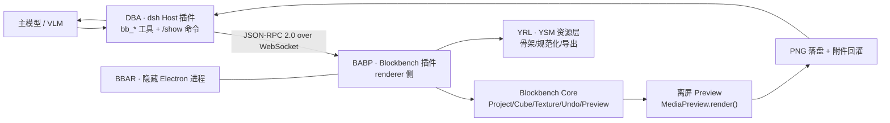

# 设计文档基线（2026-10-18，历史归档）

> 这是旧 README 中「历史设计基线」整节的归档，保留设计意图与事实依据；当前实现状态请看 [../../ENGINEERING.md](../../ENGINEERING.md)、[../../HANDOVER.md](../../HANDOVER.md)。其中的工具数量、里程碑、目录结构可能已过时，不要当作现况引用。
# 设计文档（历史设计基线）

> **本节及以下为 2026-10-18 版设计稿（合并版），保留设计意图与事实依据；实现状态以 [ENGINEERING.md](ENGINEERING.md) 与 [HANDOVER.md](HANDOVER.md) 为准。**
> 其中的工具数量、里程碑状态、目录结构均可能过时，不要当作现况引用。

## 0. 先读结论（TL;DR）

| 问题 | 结论 |
|---|---|
| 怎么隐藏 Blockbench？ | 上游 `electron/main.js` **硬编码 `win.show()`**，必须 fork 主进程（3 处小改：不 show、`backgroundThrottling:false`、注入 bridge 插件）；渲染层零改动。 |
| 怎么无头出图？ | 复用 Blockbench 内置**离屏 Preview**（`MediaPreview`/`NoAAPreview`）+ `Screencam.advancedScreenshot(cb)` + `Blockbench.writeFile`；renderer 已 `preserveDrawingBuffer:true`，全程无对话框。 |
| 怎么让 AI 不写原始 JSON？ | dsh 侧注册 `bb_*` 语义工具（建模 patch / 像素绘制 / 渲染 / 校验），底层 JSON-RPC 转给 Blockbench 插件；回执只给 changed ids + diff + 摘要，列表全部分页。 |
| 怎么让 AI "看见"？ | `ctx.attachments.saveImage()` + `output.render()` 返回 `image` block；v0.5 起支持**编辑即看**（写操作自动附图）、`bb_look`/`bb_orbit` 多格拼图、参数化相机、动画采样；旧图可被剥离为占位文本以控上下文。 |
| 怎么保证 YSM 能进游戏？ | YSM-Utils 是 **UI 插件、无导出 API、只写 ysm.json**；必须自研 YRL（规范化/骨架/导出编排），并强制 `export_empty_groups=true`（否则 30 根空定位骨骼被剪，进游戏缺手持物/鞘翅）。 |
| 怎么人机协同？ | dsh 原生 `/show` `/hide` 命令（`ctx.commands.register`），不消耗模型 token；GUI 期间冻结写操作，`/hide` 后 resync revision 并注入用户改动摘要。 |
| 通信走什么？ | 本地 WebSocket JSON-RPC 2.0（dsh 为 server，BBAR 为 client）；首包 token 鉴权；协议与传输解耦，可回退 HTTP+SSE / Python client。 |
| 最大的技术风险？ | 隐藏窗口下 WebGL 的稳定性（不同 GPU/驱动/远程桌面）。**必须先用 M0 Spike 验证**，再投入开发。 |

---

## 1. 交付物导航

| 文件 | 内容 | 对应需求模块 |
|---|---|---|
| **[系统开发与设计方案.md](<系统开发与设计方案.md>)** | 合并版主文档（历史合订本，推荐通读设计意图） | 全部 |
| [docs/01-总体架构与数据流.md](docs/01-总体架构与数据流.md) | 架构图、进程/生命周期、数据流、ADR、目录规范 | ① 系统架构与数据流 |
| [docs/02-通信协议规范.md](docs/02-通信协议规范.md) | WebSocket JSON-RPC 2.0 规范、方法目录、错误码、超时/幂等、示例 | ② 通信协议 |
| [docs/03-Tool-API-清单.md](docs/03-Tool-API-清单.md) | 43 定义 / 41 暴露的 `bb_*` 工具参数/返回/错误/预算、Tool 设计原则 | ③ Tool API 声明 |
| [docs/04-闭环状态机.md](docs/04-闭环状态机.md) | 状态机、预算/收敛/回滚、VLM 评审协议、失败恢复、伪代码 | ④ 闭环工作流 |
| [docs/05-工程难点与避坑指南.md](docs/05-工程难点与避坑指南.md) | Electron/WebGL、启动/注入、Undo/保存、贴图/UV、YSM、Token、Windows、许可 | ⑤ 工程难点 |
| [docs/06-实施路线图与验收.md](docs/06-实施路线图与验收.md) | M0–M6 里程碑、测试策略、验收标准、发布 | 落地计划 |
| [spec/tool-manifest.json](spec/tool-manifest.json) | 机器可读工具清单（JSON Schema，44 工具） | ③ 契约 |
| [spec/bridge-methods.json](spec/bridge-methods.json) | 机器可读 JSON-RPC 方法/事件/错误码（56/7/22） | ② 契约 |
| [spec/generate_spec.py](spec/generate_spec.py) | 契约生成器（手工维护的契约源，重跑应 0 diff） | 工具链 |
| **[ENGINEERING.md](ENGINEERING.md)** | **工程实现状态/实测数据/DSH 端完成度/已知限制**（设计不变，实现以此为准） | 落地状态 |
| [HANDOVER.md](HANDOVER.md) | 交接班档案（第一手现状） | 落地状态 |
| [packages/README.md](packages/README.md) | 两个实现包的构建、测试与运行命令 | 工程说明 |
| [models/](models/README.md) | 模型工程工作区（当前无测试模型，新验收项目进行中） | 落地工程 |
| [research/blockbench-core.md](research/blockbench-core.md) | Blockbench 5.2.2 源码级研究（677 行非空，文件:行号） | 事实依据 |
| [research/ysm-format.md](research/ysm-format.md) | YSM 格式/插件导入导出研究（826 行非空，文件:行号） | 事实依据 |
| [research/dsh-integration.md](research/dsh-integration.md) | dsh 插件/Tool/多模态/命令研究（439 行非空，取证） | 事实依据 |

---

## 2. 系统一览



三条关键链路：

1. **语义编辑**：`bb_apply_model_patch` / `bb_texture_patch` → 一个 Undo 事务 → revision+1 → 有界回执。
2. **无头反馈**：`bb_look` / `bb_render_views` → 离屏 Preview 渲染 → PNG 落盘/拼图 → `ImageBlock` → 模型视觉自检。
3. **人机协同**：`/show` 显示同一进程窗口 → 冻结 AI 写操作 → 用户手改 → `/hide` → 重新同步 revision。

---

## 3. 已核实的事实基线（节选）

- Blockbench v5.2.2：Electron 43 + Vue2 + three.js r129；`electron/main.js` 在 `loadURL().finally()` 中 `win.show()`；窗口无 `backgroundThrottling`。
- Preview renderer：`alpha:true`、`preserveDrawingBuffer:true`；存在离屏 `MediaPreview`/`Screencam.NoAAPreview`；`Screencam.advancedScreenshot(..., cb)` 在传入 cb 时不弹 UI。
- 贴图：`Texture.getActiveCanvas()` + `updateChangesAfterEdit()` 才能刷新 3D；Undo aspects `{textures:[t],bitmap:true}`。
- 保存：`Codecs.*.compile()/write()`、`Blockbench.writeFile` 无对话框；`export()/exportFile()/Action.trigger()` 会弹 native 模态（`window.confirm/alert` 在桌面端被替换为同步 MessageBox，会卡死 renderer）。
- 插件：`source:'file'` 条目按绝对路径加载；可在主进程 `did-finish-load` 后用 `executeJavaScript` 执行 `new Plugin().loadFromFile({path}, false)` 注入并持久化。
- YSM：`ysm.json` spec 2；默认主模型 64 bones / 172 cubes / 30 空骨骼（26 个 Locator）；贴图 128×128 per-face UV；动画 Bedrock 1.8、控制器 1.19；YSM-Utils 为纯 UI 插件、只写 ysm.json。
- dsh：`ctx.tools.register(defineTool(...))`、`ctx.commands.register(...)`、`ctx.attachments.saveImage()`、`ctx.effect()` 清理；图片会从产生起在每次请求中重复计费。

> 完整证据（文件:行号、官方文档链接）见三份 research 报告与各章末尾的引用。

---

## 4. 如何阅读

| 你的角色 | 建议顺序 |
|---|---|
| 接手/负责人 | [HANDOVER.md](HANDOVER.md) → [docs/21](docs/21-现代化建模总纲.md) → Skill → [docs/07](docs/07-视口实时反馈方案-冻结.md) |
| 架构/设计 | 本 README 设计段 → `01` → `04` → `06` |
| dsh / Agent 工程师 | `01` → `02` → `03` → `packages/` |
| Electron / 渲染工程师 | `01` §4 → `05` §1/§2 → `ENGINEERING.md` |
| YSM / 建模工程师 | `docs/20`/`21*` → `research/ysm-format.md` → Skill |
| QA | `06` §3–§5、`docs/test-evidence/` |

---

## 5. 历史里程碑状态（2026-10，仅供追溯）

| 项 | 当时状态 |
|---|---|
| 传输层（WS 握手/鉴权/双向请求/事件/并发/超时） | ✅ 已跑通 WS 冒烟 |
| M0 隐藏窗口 + WebGL 真实出图 | ✅ 通过（GPU 与 SwiftShader 两条路径） |
| YSM 默认包创建/导入/导出 | ✅ 已实现 |
| dsh 插件安装/启用 | ✅ 已安装并激活 |
| 视觉闭环端到端（VLM） | 🟡 规则 watchdog + 外部模型看图，无内置 critic |

> 完整进展见 [ENGINEERING.md](ENGINEERING.md)，2026-10 的 M0 报告已归档到 `docs/archive/`。

---

## 6. 下一步方向

1. 重打 **0.9.3 发布包**（`node packages/bb-agent-runtime/scripts/package-release.mjs`）。
2. 完成新验收项目 `togawa-sakiko`（明日方舟×BanG Dream 丰川祥子，联动皮肤「旋律」，双大角）。
3. 完善 T1/T2 分层与 `bedrock_render`（当前未完成，勿依赖）。
4. 补 `arm.json` 重建与 locale 加载验证（见 HANDOVER「已知限制」）。

---

## 7. 目录（当前真实布局）

```
<仓库根目录>\
├─ README.md                      # 门面：封面 / 工程状态 / 历史设计基线
├─ MANUAL.md                      # 完整使用手册（v0.9.3）
├─ HANDOVER.md                    # 交接班档案（第一手）
├─ ENGINEERING.md                 # 工程状态/实测数据/已知限制
├─ FOLDER-MAP.md                  # 目录地图与维护约定
├─ SETUP.md                       # 从零搭建
├─ NOTICE.md                      # 第三方许可
├─ 系统开发与设计方案.md          # 历史设计合订本（2026-10-18）
├─ docs\                          # 设计文档 01–07/10–18/20/21* + archive + test-evidence + assets
├─ spec\                          # 机器可读契约 + 生成器
├─ packages\
│  ├─ bb-agent-runtime\           # BAE 运行时（main/preload/bridge/selftest/scripts）
│  ├─ dsh-blockbench-agent\       # dsh Host 插件 + Client pill + Skill + reference
├─ models\                        # BAE 工作区根（当前无测试模型，README 说明约定）
├─ material\                      # 本地参考语料（gitignored，约 329.1MB）
├─ tools\                         # 分析脚本 + ysmparser 解密器 + extract_corpus.py
├─ research\                      # Blockbench / YSM / dsh 研究证据
├─ media\                         # 介绍视频、幻灯片、构建脚本
├─ vendor\                        # 上游 Blockbench 5.2.2 + YSM-Utils 2.6.0（只读，约 1.54GB）
├─ dist\bb-agent-app\             # assemble.mjs 组装产物（本地运行）
├─ release\                       # 发布物落点（当前为空，0.9.3 待重打）
└─ .gitignore / .gitattributes / LICENSE / package.json
```

> 没有 `prototype/`、`game-test/`、`_archive/`；`workspace/` 已在 2026-11-07 清理。归档统一放 `docs/archive/`。

---

## 8. 许可与声明

- 本方案与原创代码/文档：按项目需要授权；引用第三方内容遵循其原许可。
- **Blockbench**：GPL-3.0-or-later。BAE 是衍生发行版，发布时必须随包提供对应源码/修改说明与许可证；不得暗示官方背书。
- **YSM-Utils-Plugins**：MIT；复用其规范化规则/代码需保留版权与许可声明。
- **YSM 默认模型**：官方文档注明以 CC 0 发布（可修改分发）；用户提供的参考图/皮肤版权由用户负责。
- **Minecraft**：遵守 Mojang EULA，不分发原始游戏资产。
- **参考语料**（`material/`）：第三方模型/贴图，仅本地研究使用，不随仓库分发（已 gitignore）。