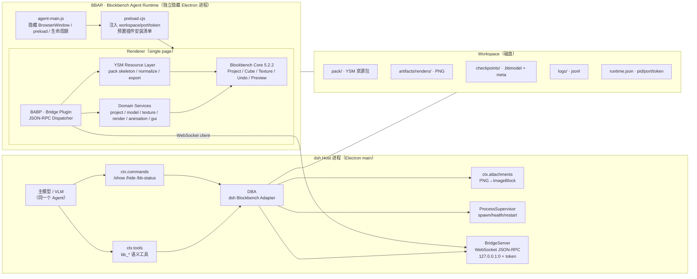
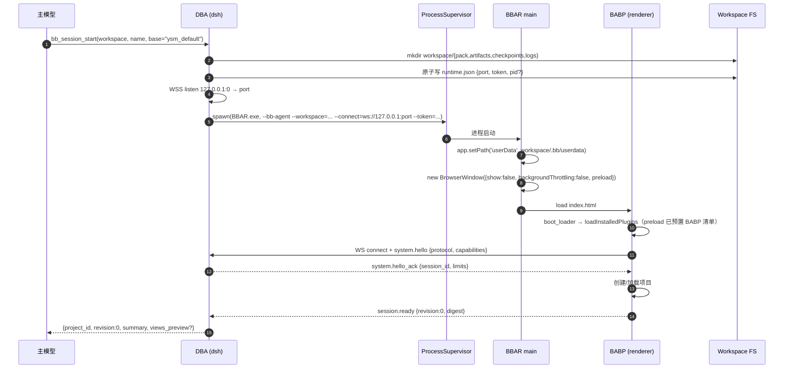
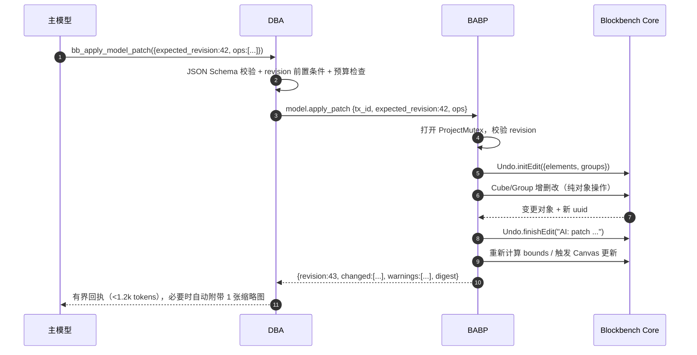
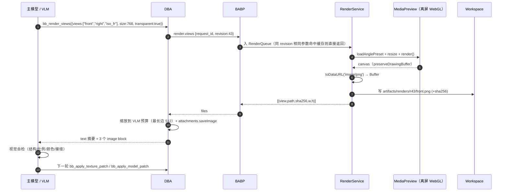
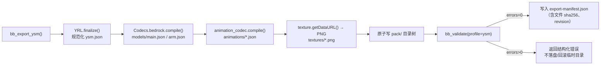
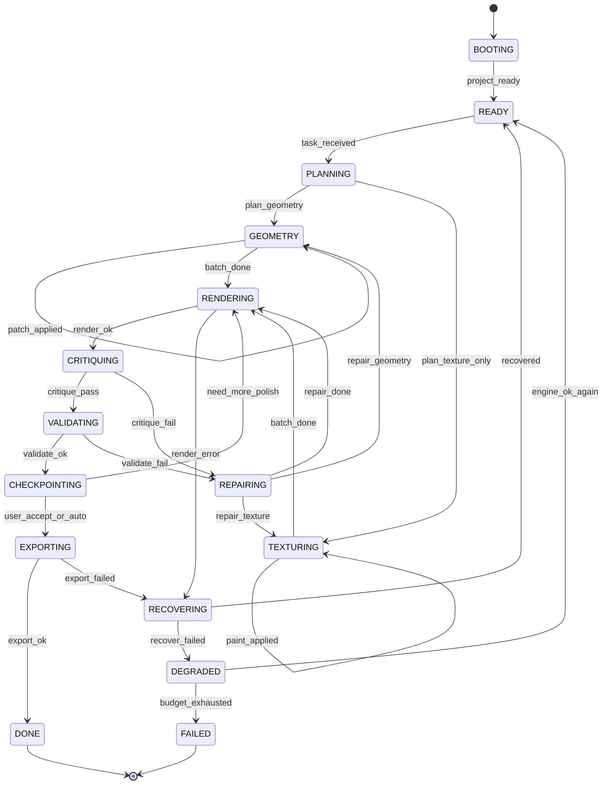
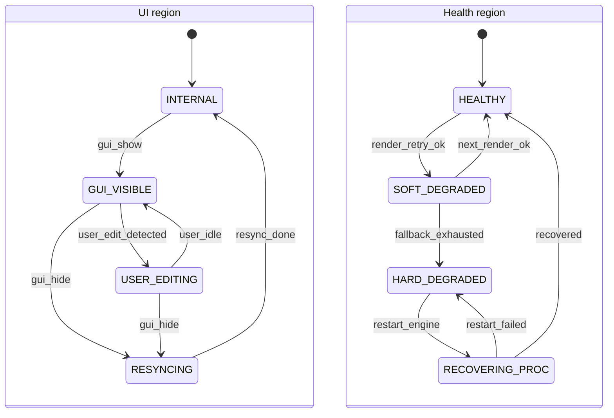
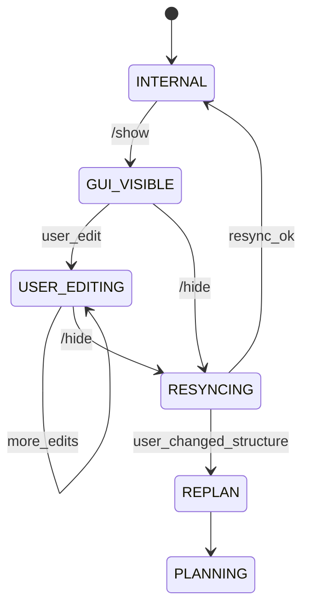
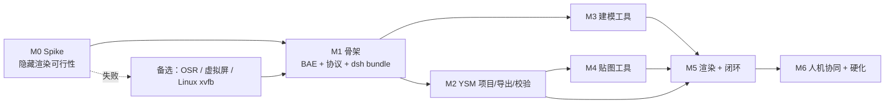

# 【系统开发与设计方案】YSM × Blockbench 无头建模与贴图 Agent 插件

> 版本：v1.0 · 设计基线：Blockbench 5.2.2 / YSM-Utils-Plugins 2.6.0 / dsh Cordis Host
> 本文档由 `docs/` 下 6 个分章 + 附录合并生成；分章可单独阅读，详细证据见 `research/`。

## 目录

1. 总体架构与数据流
2. 通信协议规范
3. AI 专属 Tool API 清单
4. 闭环反馈工作流与状态机
5. 工程实现难点与避坑指南
6. 实施路线图、验收与测试策略
7. 附录 · M0 可行性 Spike 报告模板


---

# 01 · 总体架构与数据流

> 文档版本：v1.0（设计基线：Blockbench 5.2.2 / YSM-Utils-Plugins 2.6.0 / dsh Cordis Host）
> 适用范围：在 dsh（DeepSeek Harness）内实现"无头 Blockbench 建模 + 像素贴图 + 无头渲染 + VLM 自检"闭环。
> 配套文档：`02-通信协议规范.md`、`03-Tool-API-清单.md`、`04-闭环状态机.md`、`05-工程难点与避坑指南.md`、`06-实施路线图与验收.md`。

---

## 1. 设计目标与非目标

### 1.1 目标（按优先级）

| 优先级 | 目标 | 可验收指标 |
|---|---|---|
| P0 | **AI 全程不接触原始 JSON**：所有模型/贴图/动画操作经语义 Tool 完成 | Tool 入参/出参中不出现完整 bbmodel/bedrock JSON；单次工具调用结果 ≤ 2.5k tokens |
| P0 | **无头长驻**：用户看不到 Blockbench 窗口，进程可被 dsh 反复调用 | 隐藏窗口下完成创建→编辑→渲染→导出；连续 2h 无人工干预 |
| P0 | **像素级贴图**：按像素坐标逐点/逐矩形绘制，不引入 SD 生成 | 128×128 贴图可精确复现参考色值（ΔE ≤ 1） |
| P0 | **无头多机位渲染**：固定机位输出 PNG 供 VLM 读取 | 6 个机位、透明背景、768px，单次渲染 P95 ≤ 1.5s |
| P0 | **YSM 规范兼容**：产出可直接被 YSM 模组加载的资源包 | `ysm.json` spec 2 校验通过；模型/贴图/动画路径与默认包一致 |
| P1 | **人机协同**：`/show` 秒级唤醒 GUI，用户改完后自动回后台 | `show_gui` → 可见 P95 ≤ 500ms；hide 后模型状态与 revision 同步 |
| P1 | **可回滚/可复现**：每次 AI 修改可定位、可撤销、可重放 | 任一 revision 可恢复到 `.bbmodel` 检查点；操作日志可重放 |
| P2 | **多会话隔离**：同一 dsh 可并行处理多个皮肤项目 | 每个项目独立 workspace、独立 Blockbench 进程、独立端口/token |

### 1.2 非目标（明确不做）

- **不做通用 GUI 自动化**：不模拟鼠标点击、不依赖 Electron 调试协议驱动 UI；所有能力经内部 API 调用。
- **不做 SD/扩散模型出图**：贴图只允许程序化像素操作 +（可选）用户提供的参考图采样。
- **不做 YSM 运行时**：不重新实现 Molang 解释器/动画混合器；YSM 侧只保证"格式正确"，最终效果由 YSM 模组验证。
- **不把 Blockbench 暴露到公网**：Bridge 仅绑定 `127.0.0.1`，带一次性 token。
- **不做云端多租户**：单机、单用户、按 workspace 隔离。

---

## 2. 事实基线（源码取证）

> 这些事实决定了架构必须长什么样。路径以仓库 `F:\Deepseek_harness\blockbench\vendor\` 为根。

| # | 事实 | 证据 |
|---|---|---|
| F1 | Blockbench 5.2.2 为 Electron 43 + Vue 2.7 + three.js r129，构建入口 `dist/bundle.js`，主进程 `electron/main.js` 仅 332 行 | `vendor/blockbench/package.json`；`electron/main.js` |
| F2 | 主进程创建窗口后 `win.loadURL(...).finally(() => win.show())`，**原生不支持隐藏长驻**；`requestSingleInstanceLock` 按 app 生效 | `electron/main.js:61-185` |
| F3 | 插件运行时从 `app.getPath('userData')/plugins/` 加载；安装清单持久化在 `localStorage["StateMemory.installed_plugins"]` | `js/plugin_loader.ts:1114-1120`、`js/util/state_memory.ts`、`js/plugin_loader.ts:136-145` |
| F4 | 渲染进程拥有完整 Node 能力（`nodeIntegration: true, contextIsolation: false`），插件可直接 `require('fs')`/`@electron/remote` | `electron/main.js:77-83`；`js/native_apis.ts:4-21` |
| F5 | 预览渲染器使用 `new THREE.WebGLRenderer({ alpha:true, preserveDrawingBuffer:true })`，且存在**离屏 Preview**：`MediaPreview`、`Screencam.NoAAPreview` | `js/preview/preview.ts:337, 396-402, 2542-2547` |
| F6 | 内置 `Screencam.advancedScreenshot(preview, options, cb)` 支持机位预设、分辨率、MSAA/SSAA、缩放、隐藏 gizmo，cb 模式直接回传 dataURL，**不弹保存对话框** | `js/preview/screenshot.js:279-353`、`js/preview/preview.ts:85-215` |
| F7 | 相机预设包含 `north/south/east/west/top/bottom/isometric_right/isometric_left` 等正交机位；`Format.forward_direction` 默认 `'-z'` | `js/preview/preview.ts:85-215`、`js/io/format.ts:681` |
| F8 | 项目模型：`ModelProject`、`Cube`、`Group/OutlinerElement`、`Texture`、`Animator` 均为全局类；`newProject(format)`、`Codecs[id].compile()/load()`、`Undo.initEdit/finishEdit` 可纯代码调用 | `js/io/project.ts:19,738`；`js/io/codec.ts:17-33,198`；`js/undo.js:17-95` |
| F9 | 贴图是 canvas：`texture.ctx` 可 `getImageData/putImageData`；改完调用 `texture.updateChangesAfterEdit()` 同步 dataURL、材质与预览；写入 `Undo` 后撤销栈生效 | `js/texturing/textures.js:16-120, 1851-1874` |
| F10 | YSM-Utils-Plugins 2.6.0（MIT）是**UI 型插件**：提供"创建默认包/导入 YSM 目录"对话框，**没有注册 Codec、没有导出 API**；核心可复用逻辑是 `loadNormalization/saveNormalization`（纯函数，但被 rollup 打包进闭包） | `vendor/YSM-Utils-Plugins/src/index.js`、`src/import/*.js`、`rollup.config.js` |
| F11 | dsh 的 Host 插件是 Cordis 插件：`ctx.tools.register(ToolDefinition)` 注册模型工具、`ctx.commands.register(CommandDefinition)` 注册斜杠命令、`ctx.attachments.saveImage()` 持久化图片、`ctx.subprocess.spawn()` 管理子进程 | `cordis_inspect_query(Service: tools/commands/attachments)`（本机 dsh 运行时取证） |
| F12 | dsh Tool 的 `output.render()` 可返回 `ContentBlock[]`，其中 `{type:'image', attachment: ImageAttachmentRef}` 即多模态图片块；因此"渲染 PNG → 模型可见"无需额外协议 | `ToolOutputDefinition` / `ImageBlock` 类型（dsh Service 契约） |
| F13 | 隐藏窗口渲染可行性的关键：`backgroundThrottling:false` + `show:false` + 手动调用 `MediaPreview.render()`；离屏 Preview 不受主循环/rAF 节流影响，且 renderer 已 `preserveDrawingBuffer:true` | Electron 官方 WebPreferences/Page Visibility 文档；`js/preview/preview.ts:337,396-402,503-548,2542-2547` |
| F14 | 纯代码保存/导出路径存在且**默认不弹窗**：`Codecs.project.compile()`、`Codecs.bedrock.compile()/write()`、`Codecs.*.write(content,path)`、`Blockbench.writeFile(path,{savetype:'image'})`；反之 `Codec.export()`/`Blockbench.exportFile()`/`Action.trigger()` 会弹 native 对话框。注意两个例外：目标模型文件存在但非法 JSON 时 `write()` 会弹覆盖确认；`export_over.trigger()` 内部 async 不会被 await | `js/io/codec.ts:198-257,321-327`；`js/file_system.ts:359-497`；`js/formats/bedrock/bedrock.js:1258+,1399-1461`；`js/io/io.js:378-472` |
| F17 | YSM-Utils 插件**只写 ysm.json**；模型/动画/控制器/贴图写回依赖 Blockbench 智能保存。headless 必须显式编排：`export_empty_groups=true` → 模型 `codec.write(compile(), export_path)` → 动画/控制器 `exportFile/compileFile` → `saveTextures()` → ysm.json | `YSMP/src/import/open_import_dialog.js:42-46`；`BB/js/io/io.js:378-472`；`BB/js/formats/bedrock/bedrock_animation.js:551-717` |
| F18 | YSM 默认主模型：`models/main.json` 64 根骨骼/172 cubes、唯一 `Root`、128×128 per-face UV；`arm.json` 6 骨骼/双根。运行时硬编码组名以官方 wiki 的 A 级清单为准（Head/AllHead/ViewLocator/各 Locator/`ysmGlow*` 等） | `YSMP/assets/default/models/main.json`；[YSM 模型制作](https://ysm.cfpa.team/wiki/tph2yetr/)；`research/ysm-format.md §2.3/§2.6` |
| F19 | `export_empty_groups` 默认 true；关闭会把 30 根空骨骼（多数是 Locator）整棵剪掉，导致进游戏缺手持物/鞘翅/拔刀剑 | `BB/js/interface/setup_settings.js:329`；`BB/js/formats/bedrock/bedrock.js:991` |
| F15 | 插件注入最稳路径：自定义主进程在 `did-finish-load` 后轮询 `Blockbench.setup_successful`，执行 `new Plugin().loadFromFile({path}, false)`；`first=false` 不弹 confirm，且插件会自持久化到 `StateMemory.installed_plugins`，下次启动自动按 `source:'file'` 加载 | `js/plugin_loader.ts:548-585,659-675,1240-1246`；`js/desktop.ts:139-156` |
| F16 | 启动时 `loadInstalledPlugins()` 先等待插件仓库 JSON（默认 10s 超时）；离线/黑洞网络会拖慢启动。agent profile 必须离线化或在主进程拦截外部请求 | `js/plugin_loader.ts:1133-1191`；`js/boot_loader.js:158-176` |

---

## 3. 总体架构

### 3.1 架构图



### 3.2 组件职责

| 组件 | 运行位置 | 职责 | 不做什么 |
|---|---|---|---|
| **DBA**（dsh Blockbench Adapter） | dsh Host 插件（TypeScript） | 注册 `bb_*` 工具与 `/show` 命令；校验参数/schema；管理 revision 与预算；进程监督；把 PNG 转成 `ImageBlock`；对模型输出做截断与摘要 | 不直接读写模型 JSON；不渲染 |
| **BridgeServer** | dsh Host 进程内 | 本地 WebSocket 服务端；JSON-RPC 2.0 编解码；鉴权；请求路由/超时/取消；事件推送 | 不持有项目状态（状态在 BABP） |
| **BBAR** | 独立 Electron 进程 | 隐藏窗口承载 Blockbench；隔离 userData；启动/崩溃恢复；`/show` 时显示窗口 | 不实现业务语义 |
| **BABP** | BBAR renderer（Blockbench 插件） | 协议分发；调用 Blockbench 内部 API；Undo/事务；渲染调度；YSM 导出 | 不面向用户弹窗 |
| **YRL** | BABP 内模块 | YSM pack 骨架生成/读取/规范化/导出；对 YSM 运行时约定做校验 | 不做动画运行时 |
| **Workspace** | 磁盘 | 唯一事实源：pack/、artifact、checkpoint、log、runtime | — |

### 3.3 为什么是"两个进程 + 一个本地 WebSocket"

1. **必须两个进程**：Blockbench 是完整 Electron 应用，放在 dsh renderer 里会引入两套 Electron/Vue/three 冲突，且无法独立崩溃恢复；放在 dsh main 里会污染 dsh 生命周期。
2. **必须独立 userData**：Blockbench 的插件清单、设置、最近项目都在 `localStorage`。给每个 workspace 独立 `--userData`/`app.setPath('userData')`，才能做到多项目隔离、可重复启动、不污染用户日常 Blockbench。
3. **必须本地 RPC 而非 stdio**：Blockbench 侧是长驻 renderer；stdio 需要主进程做管道代理，跨 renderer 还要 IPC，且无法被 Python 客户端复用。WebSocket + JSON-RPC 天然支持请求/响应、批量、事件、取消，且浏览器/Node/Python 都能接。
4. **不要用 MCP 直连 Blockbench**：MCP 的 server 生命周期、stdio 传输和工具模型都面向"外部集成"，而这里 Blockbench 是**被 dsh 托管的子进程**；由 DBA 直接注册原生 Tool 才能复用 dsh 的 attachments、命令、会话上下文与权限体系。

---

## 4. 进程模型与生命周期

### 4.1 启动时序



**关键设计**：dsh 先监听端口，再把端口/token 通过命令行 + 环境变量传给 BBAR；BBAR 的 preload 在页面脚本执行前把 token/port/workspace 注入 `window.__BB_AGENT__`（**不预写 localStorage**：Blockbench 的安装清单在 leveldb 里，离线预写不可靠）。主进程在 `did-finish-load` 后轮询 `Blockbench.setup_successful`，确认渲染进程就绪后执行：

```js
win.webContents.executeJavaScript(
  `new Plugin().loadFromFile(${JSON.stringify({ path: bridgePath, name: 'bb-agent-bridge.js', content: '' })}, false)`
)
```

`first=false` 不会触发原生 confirm；插件加载后会把自己写入 `StateMemory.installed_plugins`（`source:'file'`），**下次启动由 `loadInstalledPlugins()` 自动加载**。首启注入失败时主进程重试 3 次，并在 WS 握手超时时给出明确错误。这样**不需要修改 Blockbench 渲染层任何源码**，只需 3 个自有文件（`agent-main.js`、`preload.cjs`、`bb-agent-bridge.js`）。

> 注意：`loadInstalledPlugins()` 会先等待插件仓库 JSON（默认 10s 超时），`boot_loader` 还有一个 2s 的兜底 `app-loaded`。因此 **不能假设 `app-loaded` 时插件已加载**；我们的握手以 BABP 主动连上 WS 为准。

### 4.2 常驻与健康检查

- BBAR 完成后台常驻：窗口 `show:false`、`skipTaskbar:true`；`before-quit` 时写入 `shutdown.json`。
- 心跳：BABP 每 2s 发 `event.heartbeat {revision, render_queue_len}`；DBA 超过 8s 未收到则标记 `DEGRADED`，超过 20s 触发重启（最多 2 次，指数退避）。
- 崩溃：main 监听 `render-process-gone`、`child-process-gone`；重启后从最近 checkpoint 恢复项目，并广播 `event.recovered {from_revision}`。
- 空闲回收：默认常驻，不自动退出；可由 dsh 配置 `idleTimeoutMs`（默认 0=不回收）在无工具调用 30min 后退出，下次按需冷启动（冷启动 ~5-8s，需在 UI 提示）。

### 4.3 `/show` 人机协同生命周期

```mermaid
sequenceDiagram
  autonumber
  participant U as 用户
  participant D as DBA
  participant R as BABP
  participant E as BBAR main
  participant M as 主模型
  U->>D: /show（dsh 原生命令，不进模型）
  D->>R: gui.show {mode:"inspect", freeze_agent:true}
  R->>E: currentwindow.show(); focus(); setSkipTaskbar(false)
  R-->>D: gui.state {visible:true, revision}
  D-->>U: "Blockbench 已显示，当前 revision=42；编辑完成后输入 /hide 返回"
  Note over R,M: 期间模型工具被 DBA 拦截为 GUI_BUSY
  U->>D: /hide
  D->>R: gui.hide {resync:true}
  R->>E: currentwindow.hide(); setSkipTaskbar(true)
  R->>R: 扫描用户改动（Undo 栈/项目事件）→ 新 revision
  R-->>D: gui.state {visible:false, revision:43, user_edit:true}
  D-->>M: 注入一条系统消息：用户手改 + diff 摘要
```

规则：
- `/show` 是 **dsh 原生斜杠命令**，由 DBA 用 `ctx.commands.register()` 注册，直接执行、不消耗主模型一轮 token。
- GUI 可见期间，DBA 对 `bb_*` 变更类工具返回 `GUI_BUSY`，只允许只读工具；`/hide` 后自动 resync revision，并把"用户改了什么"的压缩 diff 作为系统上下文注入。
- 用户直接关闭窗口时，BBAR 拦截 `close` 事件 → `preventDefault + hide()`，不退出进程；只有 `system.shutdown` 或 dsh 退出才真正结束。

### 4.4 进程隔离与并发

| 维度 | 策略 |
|---|---|
| 每 workspace 进程数 | 1（单实例锁 + `runtime.json` 中的 pid/port 探活） |
| 每进程项目数 | 1（headless 下不做多 tab；`open_pack` 会关闭当前项目） |
| 全局并发 | 默认 2 个 BBAR（可配置）；工具调用按 project 串行化 |
| 端口/token | 每进程随机端口 + 128bit 一次性 token；token 写入 `runtime.json`（权限 0600） |
| 残留进程 | DBA 启动时扫描 workspace 锁文件，pid 不存在或 cmdline 不匹配则清理；Windows 用 `taskkill /T /F` 兜底 |
| 死锁 | 所有渲染请求进单一 RenderQueue；变更类请求进 ProjectMutex；两者不互相等待（渲染只读快照） |

### 4.5 Agent profile 的离线化与静默

BBAR 使用独立 `--userData`/`app.setPath('userData')`，并在首次加载完成后写入以下设置（通过 `executeJavaScript` + `Settings.saveLocalStorages()` 持久化）：

| 设置 | 值 | 目的 |
|---|---|---|
| `settings.automatic_updates` | `false` | 禁止 renderer 侧自动更新 |
| `settings.automatic_plugin_updates` | `false` | 禁止启动时下载插件更新 |
| `settings.background_rendering` | `true` | 窗口失焦/隐藏时仍渲染（默认已 true，显式固化） |
| `settings.classroom_mode` | `true` | 减少启动屏广告/推荐区块 |
| `settings.dialog_save_codec` | `false` | 避免保存时弹 codec 选择器 |

主进程侧：
- **不调用 `autoUpdater`**（我们自己维护版本；BAE 是固定版本发行）。
- 在 `session.defaultSession.webRequest.onBeforeRequest` 中取消所有 `https/http` 外部请求（放行 `file://` 与 `ws://127.0.0.1`）。这样 `loadInstalledPlugins()` 的插件仓库请求会快速失败，避免 10s 启动阻塞；同时彻底关闭埋点/新闻/更新检查。
- 不覆盖用户日常 Blockbench 的 userData；每个 workspace 一个独立 profile，可并行、可删除重建。
- 原生模态安全网：agent profile 内把 `window.confirm/alert` 覆盖为"返回安全默认值 + 记录日志"；`Blockbench.showMessageBox` 包一层自动选择第一个非破坏性按钮。**只在 BBAR profile 内生效**，不影响用户自己的 Blockbench。

---

## 5. 数据流

### 5.1 语义编辑流（核心）



约束：
- **所有变更必须在一个 `Undo.initEdit/finishEdit` 对之间同步完成**，不得跨 `await`（Blockbench Undo 不是异步安全的）。
- 每次成功变更 `revision += 1`；`expected_revision` 不匹配即返回 `REVISION_CONFLICT`，由模型重读 digest 后重试。
- 变更回执只返回"变了什么"：`changed_ids`、字段级 diff（最多 20 条）、校验告警，不返回整棵树。
- 批量操作用一个事务；部分失败默认整体回滚（`atomic:true`），不允许"改了一半"。

### 5.2 渲染反馈流



渲染原则：
- **固定机位、固定焦距、固定光照**，保证跨 revision 可比；机位定义与映射见 `03-Tool-API-清单.md` 的 `views` 枚举。
- 默认**透明背景**（`renderer.setClearAlpha(0)`）；另提供 `background:"#rrggbb"` 用于对比。
- 默认关闭 gizmo/网格/坐标轴/骨骼可视化；关闭动画（`Animator.preview` 停表），保证静态一致性。
- 每次渲染带 `revision` 与参数 hash；命中缓存直接复用，不重复耗 GPU。
- 全分辨率 PNG 落盘；给模型的附件是降采样版（最长边 512，单张 ≤ 200KB），全尺寸路径供模型按需再取。

### 5.3 导出流



- 导出是**语义幂等**的：同一 revision + 同一选项 → 结构/内容一致。**字节级幂等需要额外固定**：JSON 缩进/换行设置（`settings.json_indentation/minifiedout/final_newline`）与动画键顺序；Blockbench 保存动画时可能按 `Animation.all` 顺序重排文件内键（语义不变）。若要求字节级复现，YRL 使用固定 writer 并在导出层重排。
- 显式导出序列（不能依赖 ysm-utils 或 Blockbench 自动保存）：
  1. `Settings.set('export_empty_groups', true)`；
  2. 当前项目 `codec = Codecs[Project.export_codec] ?? Codecs.bedrock`；`codec.write(codec.compile(), targetPath)`；
  3. 动画按文件分组 `AnimationCodec.codecs.bedrock.exportFile(path)`（只写脏项）；控制器 `...bedrock_animation_controller.exportFile(path)`；
  4. `saveTextures()` 或逐张 `texture.save()`；
  5. ysm.json：复制对象 → `saveNormalization()` → 固定 writer 写盘。
- 导出目录与工作副本分离：`pack/` 为工作副本，`exports/<timestamp>/` 为发布副本；支持 `out_dir`。
- 动画/控制器按 YSM 默认包的文件名布局输出；`ysm.json` 由 YRL 规范化（`spec:2`、路径分隔符 `/`、空字段清理）。
- 导出完成后可选生成一张 `preview.png` 与 `thumbnail.png`，写入包根目录供用户/模组列表展示。

---

## 6. 关键设计决策（ADR）

| ADR | 决策 | 备选方案 | 结论与理由 |
|---|---|---|---|
| ADR-1 | **自建 Blockbench Agent Edition（BAE）**：固定上游版本 + 自有 `agent-main.js/preload/bridge plugin`，构建独立安装包 | ① 不改源码，用 stock Blockbench + `--userData` 装插件；② 用 Playwright 驱动 Web 版 | ① 上游 `electron/main.js` 在 `loadURL` 后**硬编码 `win.show()`/`maximize()`**，且没有 `backgroundThrottling:false` 开关，stock 方案无法真正隐藏；插件注入也缺少可靠入口；② Web 版无"同一进程秒级唤醒 GUI"，文件系统/权限受限。BAE 主进程只需改 3 处（不 show、backgroundThrottling、注入 bridge），渲染层零改动，升级成本可控 |
| ADR-2 | **WebSocket + JSON-RPC 2.0**，dsh 作 server、BBAR 作 client | stdio、HTTP REST、Unix socket、MCP | WS 支持双向事件/批量/取消，Node/浏览器/Python 均有标准实现；dsh 侧 `ws` 依赖可随 bundle 安装；比 stdio 少一层主进程代理 |
| ADR-3 | **复用 Blockbench 内置离屏 Preview + Screencam** | 自建 three.js 渲染器；Electron `capturePage` | 内置渲染器保证与 Blockbench 视口一致（材质/UV/光照/Molang），且 `preserveDrawingBuffer:true` 可直接读 PNG；`capturePage` 只能拿整窗、受 DPI 影响且隐藏窗口下不稳定 |
| ADR-4 | **自研最小 YRL**，复用 ysm-utils 的纯逻辑并保留 MIT 声明；同时允许用户加载 ysm-utils 做 GUI 编辑 | 直接调用 ysm-utils 函数；fork 整个插件 | ysm-utils 为 UI 插件、无导出 API、强依赖 Dialog/Action；headless 只需"骨架/规范化/路径映射"约 500 行。GUI 模式把 ysm-utils 作为可选项共存 |
| ADR-5 | **语义 Tool + 统一 patch 原语**，禁止原始 JSON 读写 | 让模型直接编辑 bbmodel JSON；只提供细粒度单操作 | 原始 JSON 会撑爆上下文且破坏 Undo/一致性；单操作会导致往返爆炸。统一 patch 原语在 token 与可控性之间取平衡 |
| ADR-6 | **revision + checkpoint + 事务** | 只靠 Undo 栈；每次全量快照 | Undo 栈只在进程内且易被用户操作打乱；全量快照太贵。revision 负责并发正确性，checkpoint 负责跨进程恢复 |
| ADR-7 | **dsh 侧同时注册工具与原生命令** | 只注册工具（让模型自己调 show）；只做命令 | 工具用于 AI 自主闭环；命令用于人机协同（`/show` 不消耗 token、不打断 Agent）。两者共用同一 Bridge 会话 |

---

## 7. 目录与工件规范

### 7.1 代码仓库布局（建议）

```
F:\Deepseek_harness\blockbench\
├─ docs\                          # 本设计文档集
├─ spec\                          # 机器可读协议/工具清单
├─ prototype\                     # 骨架代码（设计参考）
├─ vendor\                        # 上游源码（只读）
│  ├─ blockbench\                 # JannisX11/blockbench @ v5.2.2
│  └─ YSM-Utils-Plugins\          # YesSteveModel/YSM-Utils-Plugins @ v2.6.0
├─ packages\
│  ├─ bb-agent-runtime\           # BAE：构建脚本 + agent/ 三件套 + 打包配置
│  │  ├─ agent\main.js            #   隐藏窗口、userData、进程生命周期
│  │  ├─ agent\preload.cjs        #   注入 workspace/token、预置插件清单
│  │  ├─ agent\bb-agent-bridge.js #   BABP 插件（renderer）
│  │  └─ build.mjs                #   拉取/构建 Blockbench 上游 + 组装
│  ├─ dsh-blockbench-agent\       # DBA：dsh bundle（Host 插件 + locale + icon）
│  └─ bb-protocol\                # 共享类型：JSON-RPC 方法/错误码/TS 类型
└─ workspace\                     # 运行时数据（不进 git）
```

### 7.2 每个项目的 Workspace

```
workspace\<project_slug>\
├─ pack\                              # YSM 资源包工作副本（唯一事实源）
│  ├─ ysm.json
│  ├─ models\{main,arm}.json
│  ├─ animations\*.json
│  ├─ controller\main.animation_controllers.json
│  ├─ textures\*.png
│  ├─ lang\{en_us,zh_cn}.json
│  └─ avatar\  sounds\ functions\
├─ artifacts\
│  ├─ renders\r<revision>\{front,back,left,right,iso_fr,iso_fl,closeup_*}.png
│  ├─ renders\latest\                 # 软链/副本，供 UI 快速展示
│  └─ texture-previews\t<texture_id>_x8.png
├─ checkpoints\
│  ├─ r0000.bbmodel
│  ├─ r0000.meta.json                 # revision/ysh/时间/触发原因
│  └─ ...
├─ logs\
│  ├─ bridge.jsonl                    # JSON-RPC 全量（脱敏 token）
│  └─ agent.log                       # 主进程日志
├─ exports\<YYYYMMDD-HHmmss>\         # 发布副本 + manifest
├─ .bb\
│  ├─ userdata\                       # Blockbench userData（插件/设置/localStorage）
│  ├─ runtime.json                    # {pid,port,token,started_at,version}
│  └─ lock                            # 单实例锁（pid + boot_id）
└─ session.json                       # project_id / 当前 revision / 统计
```

### 7.3 命名与版本

- `project_id`：`<slug>-<8hex>`，创建时生成，写入 `session.json`。
- `revision`：从 0 递增的整数；每次成功变更 +1；checkpoint 名 `r%04d`。
- Artifact：`artifacts/renders/r0042/front_768.png`；返回给模型时同时给 `path` 与 `sha256`。
- 协议版本：`bb-agent/1`；`system.hello` 协商，major 不同即拒绝。

---

## 8. 兼容性与升级策略

| 风险 | 策略 |
|---|---|
| Blockbench 上游升级 | 固定 tag（建议 `v5.2.2`），`build.mjs` 校验 commit；升级时跑 `06` 的回归清单（Preview API/Screencam/Codec/Undo/插件加载 5 项） |
| Blockbench 插件 API 变化 | BABP 只使用稳定 API（`Project/Cube/Texture/Undo/Codecs/Preview/Screencam`）；对实验性 API 封装 `compat.*`，失败降级 |
| YSM-Utils 升级 | 只复用其规范化规则；用 fixtures（默认包 + 2 个社区包）做回归；规则差异进 `YRL` 版本号 |
| dsh 升级 | DBA 只依赖公开 Service（tools/commands/attachments/subprocess/fs）；在 manifest 声明 `engines.dsh`，安装时校验 |
| 跨平台 | Windows 为一等公民（用户环境）；macOS 验证隐藏窗口渲染；Linux 需 xvfb/headless 方案（见 05） |
| 多显示器/DPI | 渲染分辨率与实际窗口尺寸解耦（离屏 Preview 自主 resize）；保存/显示用逻辑像素 |

---

## 9. 非功能性指标（设计预算）

| 指标 | 目标 | 测量点 |
|---|---|---|
| 冷启动 | ≤ 8s（SSD，含 Electron） | spawn → `session.ready` |
| 热工具调用 RTT | ≤ 80ms P50 / ≤ 250ms P95（不含渲染） | `tools.execute` → RPC result |
| 单次渲染 | ≤ 1.5s P95（768×768，MSAA） | `render.views` 单机位 |
| 单张渲染附件 | ≤ 200KB（512px 降采样） | DBA 附件前 |
| 单次编辑回执 | ≤ 1.2k tokens | DBA 序列化后 |
| 单轮闭环（改→渲→看） | ≤ 6s P95 | 3 机位渲染 + 附件 |
| 常驻内存 | BBAR ≤ 900MB（含 three 场景/纹理） | 任务管理器 |
| 连续运行 | 2h 无泄漏（render 100 次内存增长 < 15%） | 长跑脚本 |
| 恢复时间 | 崩溃后 ≤ 15s 恢复到最后 checkpoint | fault injection |

---

## 10. 风险摘要（详见 05）

1. **隐藏窗口下的 WebGL 稳定性**是唯一的"生死问题"：必须在 M0 Spike 验证（Windows 10/11、集显/独显、远程桌面场景）。兜底方案：透明度 0 窗口、虚拟屏、离屏 OSR、Linux xvfb。
2. **YSM 运行时硬约定**（骨骼名/层级/贴图尺寸/动画名）必须固化到 `bb_validate(profile=ysm)`，否则"看起来对但进游戏不显示"。
3. **模型上下文预算**：图像附件与场景摘要最容易被忽视；DBA 必须默认有界、按需展开。
4. **GPL 合规**：BAE 是 Blockbench 衍生发行版，必须随包提供对应源码与许可证；不得暗示官方背书。

---

## 11. 下一步

1. 按 `06-实施路线图与验收.md` 的 **M0 Spike** 先验证隐藏窗口渲染（1-2 天），再投入协议与工具开发。
2. 以 `spec/bridge-methods.json` 为单一契约源，同时生成 TS 类型与 Python 客户端类型。
3. 每个模块先写 fixture 回归（默认 YSM 包、渲染 golden），再接模型闭环。


---

# 02 · dsh ↔ Blockbench 通信协议规范（BB-Agent Protocol v1）

> 传输：WebSocket（RFC 6455）· 消息：JSON-RPC 2.0 · 拓扑：dsh Host 为 server，BBAR 为 client
> 本规范是**唯一契约源**；`spec/bridge-methods.json` 是其机器可读版本，TypeScript/Python 类型均应由此生成。

---

## 1. 设计原则

1. **面向"语义操作"而非"远程函数"**：方法粒度对齐领域事务（一次 patch、一次多机位渲染），而不是把 Blockbench 内部函数逐个暴露。
2. **有状态、带版本**：会话绑定唯一 project；所有读结果带 `revision`；所有变更必须携带 `expected_revision`（除非显式 `force`）。
3. **有界**：请求/响应有大小上限；列表接口必须分页/限量；渲染默认只回传文件元数据，不内联大图。
4. **可取消、可超时**：每个请求可带 deadline；长任务（渲染/导出）支持 `$/cancel` 与 `$/progress`。
5. **幂等**：网络重试安全；`_meta.client_request_id` 去重。
6. **可演进**：`system.hello` 协商版本与 capabilities；新增方法/字段向后兼容，删除/改义必须升 major。
7. **本地但不可信**：默认只绑 loopback、强制 token、方法白名单、路径沙箱；不假设客户端一定友好。

---

## 2. 传输层

### 2.1 端点与连接

| 项 | 规范 |
|---|---|
| URL | `ws://127.0.0.1:<ephemeral_port>/bb-agent/v1` |
| 绑定 | 仅 `127.0.0.1`（禁止 `0.0.0.0`/IPv6 公网） |
| 端口 | dsh 启动时 `listen(0)` 由 OS 分配，写入 `workspace/.bb/runtime.json` |
| 子协议 | `Sec-WebSocket-Protocol: bb-agent.v1`（不匹配则 400） |
| 连接数 | 每 session 1 条；重连由 client 指数退避（0.5s→8s，上限 10 次） |
| 帧 | 文本帧承载 JSON；二进制帧保留（v1 不使用） |
| 心跳 | WebSocket ping/pong 10s；应用层 `event.heartbeat` 2s（供 UI/健康检查） |
| 关闭码 | 1000 正常；4001 鉴权失败；4002 协议版本不符；4003 会话被替换；4004 引擎降级 |

### 2.2 鉴权（连接后首包）

浏览器 `WebSocket` 不能自定义 Header，因此采用**首包鉴权**：

1. client 连接后 2s 内必须发送 `system.hello`，携带 `params.auth.token`。
2. server 用常量时间比较 token（来自 `runtime.json`，256bit，base64url）；失败则回 `-32001 UNAUTHORIZED` 并关闭 4001。
3. 鉴权前除 `system.hello` 外任何方法返回 `-32001`；鉴权前 payload 上限 8KB。
4. 可选：URL query `?token=` 仅供人工调试；正式路径不依赖它（避免日志泄露）。

### 2.3 安全约束

- **路径沙箱**：所有 `path` 参数必须是 workspace 内相对路径；server `realpath` 后校验前缀，拒绝 `..`、绝对路径、符号链接逃逸。
- **方法白名单**：`system.eval_js` 默认不存在；配置开启时才注册，且仅接受白名单内的表达式（v1 建议完全不开放）。
- **资源上限**：单条消息 ≤ 8MB；单请求 ops ≤ 4096；批量请求 ≤ 64；并发 in-flight ≤ 8；渲染分辨率 ≤ 4096×4096。
- **速率限制**：每连接 60 请求/秒（突发 20）；超限返回 `-32018 RESOURCE_LIMIT` 并暂停 1s。
- **日志脱敏**：token 永不入日志；请求参数中超过 4KB 的 base64 截断记录。

### 2.4 传输绑定（同一 JSON-RPC 语义，可替换承载）

协议层只定义 JSON-RPC 2.0 消息；承载层有两种绑定，`system.hello` 中协商并在响应里确认：

| 绑定 | 端点 | 用途 | 依赖 |
|---|---|---|---|
| **A. WebSocket（默认）** | `ws://127.0.0.1:<port>/bb-agent/v1` | 正常部署；双向、低延迟、可取消/进度 | dsh Host 侧需 WebSocket server（`ws` 或等价实现）；BBAR renderer 用浏览器内置 `WebSocket` |
| **B. HTTP + SSE（零依赖回退）** | `POST http://127.0.0.1:<runtime_port>/rpc`（单请求/批）；`GET /events`（SSE）；`GET /health`。**BBAR 主进程托管 HTTP server，dsh 是 client**（HTTP 只能请求-响应，状态持有方做 server 更自然） | dsh 插件以 `link:` 本地目录安装、无法/不愿安装第三方依赖时；只读调试（curl） | 仅 Node 内置 `node:http`；BBAR 用 `node:http` + SSE，dsh 用 `fetch` |

约束：

- 两种绑定使用**完全相同的** JSON-RPC 请求/响应/错误结构与 `_meta`；仅传输方式不同。
- **启动顺序不同**：Binding A 由 dsh 先 `listen` 再 spawn BBAR；Binding B 由 BBAR 先 listen 并把 `runtime.json`（port/token）写到 workspace，dsh 读取后连接。
- Binding B 的请求-响应用 HTTP 状态码区分传输错误（4xx/5xx）与协议错误（200 + JSON-RPC error）；SSE 断线重连后由 `system.hello` 重新同步 revision。
- 服务器在 `system.hello` 结果中返回 `transport: "ws" | "http-sse"`；客户端不得混用。
- 为 Python 侧预留 Binding C（stdio / Named Pipe）：`Content-Length` 头 + JSON body，语义同 A/B；v1 不实现。
- 无论哪种绑定，**长任务都必须有 `$/progress` 与 `$/cancel` 的等价机制**：Binding B 用 SSE 发进度、用 `POST /rpc` 发送 `$/cancel`。

---

## 3. 消息格式（JSON-RPC 2.0 扩展）

### 3.1 请求 / 响应 / 通知

```json
// 请求
{
  "jsonrpc": "2.0",
  "id": "6f1c2a3e-9b1d-4a2e-9d6f-1f0b2c3d4e5f",
  "method": "model.apply_patch",
  "params": { "...": "..." },
  "_meta": {
    "client_request_id": "req-000042",
    "trace_id": "tr-9f2c",
    "deadline_ms": 15000
  }
}

// 成功
{ "jsonrpc": "2.0", "id": "6f1c...", "result": { "...": "..." } }

// 失败
{
  "jsonrpc": "2.0",
  "id": "6f1c...",
  "error": {
    "code": -32011,
    "message": "revision conflict",
    "data": {
      "code": "REVISION_CONFLICT",
      "expected_revision": 42,
      "actual_revision": 45,
      "hint": "re-read bb_get_scene, then retry with expected_revision=45",
      "recoverable": true
    }
  }
}

// 服务端通知（无 id）
{ "jsonrpc": "2.0", "method": "event.project_changed",
  "params": { "revision": 43, "source": "agent", "changed": ["cube:cu_1a2b"] } }
```

### 3.2 扩展字段约定

| 字段 | 位置 | 说明 |
|---|---|---|
| `id` | 请求/响应 | 字符串 UUID；client 生成；同一连接内不得复用未完成 id |
| `_meta.client_request_id` | 请求 | 幂等键；server 在 5min LRU 内去重，重试返回首次结果 |
| `_meta.trace_id` | 请求 | 贯穿日志与事件；DBA 生成，便于排障 |
| `_meta.deadline_ms` | 请求 | 相对超时（毫秒），超过则 server 中止并回 `-32015`；与默认超时取 min |
| `_meta.no_cache` | 请求 | 渲染/摘要禁用缓存 |
| `params.request_id` | 长任务 | 用于关联 `$/progress` / `$/cancel`；建议等于 JSON-RPC id |

### 3.3 批处理（batch）

JSON-RPC 原生数组语义 + 两条服务端规则：

1. **顺序执行**：数组内请求按顺序逐个执行，共用同一把 project 锁。
2. **原子性**：若 batch 内含变更方法，server 在执行前创建内存快照；任一请求失败 → 回滚到 batch 前 revision，返回各错误（成功项结果仍返回，但实际状态已回滚，`result.rolled_back=true`）。这样 AI 可以安全地把"加骨骼 + 加方块 + 改 UV"合成一次往返。

```json
[
  { "jsonrpc": "2.0", "id": "1", "method": "model.apply_patch", "params": { "...": "..." } },
  { "jsonrpc": "2.0", "id": "2", "method": "texture.apply_patch", "params": { "...": "..." } },
  { "jsonrpc": "2.0", "id": "3", "method": "render.views", "params": { "...": "..." } }
]
```

> 建议：AI 侧优先使用 **`system.batch`**（见 4.1）而不是裸 JSON-RPC batch，因为前者能携带 `_meta` 与统一的 `atomic` 语义，且响应结构固定。

### 3.4 取消与进度

```json
// client → server：取消长任务
{ "jsonrpc": "2.0", "method": "$/cancel", "params": { "request_id": "render-42" } }

// server → client：进度
{ "jsonrpc": "2.0", "method": "$/progress",
  "params": { "request_id": "render-42", "stage": "render", "done": 1, "total": 3, "view": "front" } }
```

- 取消是**协作式**的：渲染在帧间检查；导出在文件间检查；模型 patch 不中途取消（保证原子性）。
- 被取消的请求返回 `-32800 RequestCancelled`（JSON-RPC 约定范围）。

---

## 4. 方法目录

> 完整字段级 schema 见 `spec/bridge-methods.json`。下表 `M`=变更方法（需 `expected_revision`），`R`=只读，`L`=长任务（可取消）。

### 4.1 系统

| 方法 | 类型 | 说明 |
|---|---|---|
| `system.hello` | R | 握手：鉴权、版本、capabilities、返回当前 session/project 摘要 |
| `system.ping` | R | `{t}` → `{t, server_time}`；用于 RTT 测量 |
| `system.batch` | M? | 原子批处理：`{calls:[{method,params}], atomic:true}`；内部复用 3.3 语义 |
| `system.shutdown` | — | 保存 checkpoint、关闭窗口、退出进程；回 `{bye:true}` 后进程退出 |
| `system.log_tail` | R | 取最近 N 行桥接日志（默认 200，最大 2000；自动脱敏） |

`system.hello` 请求：

```json
{
  "jsonrpc": "2.0", "id": "h1", "method": "system.hello",
  "params": {
    "protocol": "bb-agent/1",
    "auth": { "token": "b64url..." },
    "client": { "name": "dsh-blockbench-agent", "version": "0.1.0", "session_id": "..." },
    "workspace": { "root": "F:/Deepseek_harness/blockbench/workspace/steve-01" },
    "requested_capabilities": ["render.offscreen", "gui.show", "ysm.v2"]
  }
}
```

`system.hello` 结果：

```json
{
  "protocol": "bb-agent/1",
  "server": {
    "name": "bb-agent-runtime", "version": "0.1.0",
    "blockbench": "5.2.2", "electron": "43.4.0", "ysm_utils": "2.6.0",
    "platform": "win32", "arch": "x64", "gpu": "NVIDIA GTX 1660 / ANGLE D3D11"
  },
  "capabilities": {
    "render": { "offscreen": true, "transparent": true, "max_size": 4096,
                "antialias": ["off", "msaa", "ssaa"], "views": ["front","back","left","right","top","bottom","iso_fr","iso_fl","iso_br","iso_bl"] },
    "texture": { "layers": true, "max_size": 8192, "formats": ["png"] },
    "ysm": { "spec": 2, "models": ["main", "arm"], "animations": ["main","arm","extra","tac","carryon","parcool","swem","slashblade","tlm","fp_arm"], "controllers": true },
    "gui": { "show": true, "capture_page": true },
    "eval": false
  },
  "limits": {
    "max_message_bytes": 8388608, "max_batch": 64, "max_patch_ops": 4096,
    "max_inflight": 8, "default_timeout_ms": 30000, "render_timeout_ms": 120000
  },
  "session": {
    "project_id": "steve-01-8f3a2c1d", "revision": 0, "state": "idle",
    "project": null
  }
}
```

### 4.2 会话与项目

| 方法 | 类型 | 说明 |
|---|---|---|
| `session.status` | R | 状态机状态、队列长度、GPU/内存、当前 revision |
| `project.create_ysm` | M | 从内置 YSM 默认包创建新项目（性别/比例/贴图尺寸/名称） |
| `project.open_pack` | M | 打开已有 YSM 资源包目录（校验 ysm.json + 文件存在性） |
| `project.close` | M | 关闭当前项目；`save_first` 可选 |
| `project.save` | M | 保存工作副本（模型/动画/贴图/ysm.json）到 `pack/` |
| `project.export_ysm` | L | 导出发布副本到 `exports/<ts>/`，含 manifest 与校验 |
| `project.get_scene` | R | 有界场景摘要（bones/cubes/textures/animations），支持游标 |
| `project.get_element` | R | 单个元素详情（含 UV / 完整 cube 字段） |
| `project.validate` | R | YSM 规范校验，返回 errors/warnings/fixes |
| `project.checkpoint` | M | 创建 `.bbmodel` 检查点 |
| `project.restore` | M | 恢复到指定 revision 的检查点 |
| `project.revisions` | R | 最近 N 个 revision 与变更摘要 |

`project.create_ysm` 参数：

```json
{
  "expected_revision": 0,
  "name": "steve_armor_01",
  "gender": "male",
  "height_scale": 0.7,
  "width_scale": 0.7,
  "resolution": [128, 128],
  "source_pack": "default",
  "overwrite": false
}
```

结果：

```json
{
  "revision": 1,
  "project_id": "steve-armor-01-8f3a2c1d",
  "summary": { "bones": 18, "cubes": 57, "textures": 2, "animations": 10, "controllers": 1 },
  "textures": [ { "id": "tex_default", "name": "default", "size": [128,128] } ],
  "bones": [ { "id": "b_root", "name": "Root", "parent": null } ],
  "warnings": []
}
```

### 4.3 模型

| 方法 | 类型 | 说明 |
|---|---|---|
| `model.apply_patch` | M | 模型变更统一入口：骨骼/方块/UV/镜像/重命名，一次事务 |
| `model.get_tree` | R | 骨骼树（可限定子树、深度、是否含 cube 摘要） |
| `model.get_cube` | R | 单个 cube 的完整字段（origin/size/rotation/pivot/uv/inflate） |
| `model.auto_uv` | M | 按 Box UV 规则自动展开 UV（可指定纹理与 padding） |

`model.apply_patch` 参数：

```json
{
  "expected_revision": 43,
  "atomic": true,
  "ops": [
    { "op": "add_bone", "parent": "b_upper_body", "name": "LeftArm",
      "pivot": [5, 22, 0], "rotation": [0, 0, 0] },
    { "op": "add_cube", "bone": "LeftArm", "name": "LeftArm_upper",
      "origin": [5, 18, -2], "size": [4, 8, 4], "rotation": [0, 0, 0],
      "uv": { "mode": "box", "uv": [40, 16] }, "texture": "default" },
    { "op": "update_cube", "id": "cu_1a2b", "size": [4, 7, 4] },
    { "op": "set_uv", "ids": ["cu_1a2b"], "mode": "faces",
      "faces": { "north": [40,16], "east": [36,16], "south": [48,16], "west": [44,16], "up": [40,12], "down": [44,16] } },
    { "op": "rename", "id": "b_left_arm", "name": "LeftArm" },
    { "op": "delete", "refs": [ { "kind": "cube", "id": "cu_dead" } ] }
  ]
}
```

结果：

```json
{
  "revision": 44,
  "atomic": true,
  "changed": [
    { "kind": "bone", "id": "b_left_arm", "op": "add" },
    { "kind": "cube", "id": "cu_7f3a", "op": "add" }
  ],
  "warnings": [
    { "code": "UV_OUT_OF_BOUNDS", "target": "cu_7f3a",
      "message": "east face uv [36,16]+[4,8] exceeds texture 128x128? no; below 0? no" }
  ],
  "digest": { "bones": 19, "cubes": 58, "textures": 2, "revision": 44 }
}
```

### 4.4 纹理（像素级）

| 方法 | 类型 | 说明 |
|---|---|---|
| `texture.create` | M | 新建纹理（YSM 多套贴图） |
| `texture.apply_patch` | M | 像素/矩形/线/替换/镜像/导入；一次事务、一次 Undo |
| `texture.read` | R | 读区域：调色板统计 / PNG(base64) / ASCII 网格 |
| `texture.select` | R | 设置当前纹理（影响后续渲染/导出默认） |
| `texture.export_png` | R | 导出到 artifacts 或指定 workspace 路径 |

`texture.apply_patch` 参数：

```json
{
  "expected_revision": 44,
  "texture_id": "tex_default",
  "clip": true,
  "ops": [
    { "op": "rect",  "x1": 40, "y1": 16, "x2": 43, "y2": 23, "color": "#3b6ea5" },
    { "op": "pixel", "x": 40, "y": 16, "color": "#2b4f75" },
    { "op": "line",  "x1": 40, "y1": 23, "x2": 43, "y2": 23, "color": "#22405f" },
    { "op": "shade", "x1": 40, "y1": 16, "x2": 43, "y2": 23,
      "from": "#3b6ea5", "to": "#2b4f75", "direction": "vertical" },
    { "op": "replace", "from": "#ff00ff", "to": "#00000000", "tolerance": 0 },
    { "op": "copy_mirror", "src": [32, 16, 39, 23], "axis": "x" }
  ]
}
```

结果：

```json
{
  "revision": 45,
  "texture_id": "tex_default",
  "painted_pixels": 142,
  "clipped_pixels": 0,
  "bounds": [40, 16, 43, 23],
  "palette": [ { "color": "#3b6ea5", "count": 96 }, { "color": "#2b4f75", "count": 32 } ],
  "warnings": []
}
```

`texture.read` 参数与结果：

```json
// 请求
{ "texture_id": "tex_default", "region": [40,16,47,23], "format": "palette" }
// 结果
{ "width": 128, "height": 128,
  "palette": [ {"color":"#3b6ea5","count":96}, {"color":"#2b4f75","count":32} ],
  "transparent_pixels": 138 }
```

> **禁止**默认返回整张 128×128 的像素数组（16384 个数字 ≈ 30k+ tokens）。需要逐像素检查时用 `region` + `format:"ascii"`（每个字符代表一个调色板索引），并强制 `max_cells`（默认 1024）。

### 4.5 动画与控制器

| 方法 | 类型 | 说明 |
|---|---|---|
| `animation.create` | M | 新建动画（name/loop/length/fps） |
| `animation.apply_patch` | M | 关键帧增删改（bone/channel/time/value/easing） |
| `animation.list` | R | 动画清单 + 关键帧数量 |
| `animation.delete` | M | 删除动画 |
| `animation.bind_controller` | M | 绑定/解绑动画控制器（YSM 规范） |

### 4.6 渲染

| 方法 | 类型 | 说明 |
|---|---|---|
| `render.views` | L | 多机位渲染；固定尺寸/背景/AA；返回文件元数据，可 `inline` 小图 |
| `render.texture` | R | 把指定纹理放大 N 倍（最近邻）输出 PNG（检查像素画细节） |
| `render.cancel` | R | 取消排队/执行中的渲染 |
| `render.artifacts` | R | 按 revision/参数 hash 查已生成产物 |

`render.views` 参数：

```json
{
  "request_id": "render-45-a",
  "views": ["front", "right", "iso_fr"],
  "size": [768, 768],
  "transparent": true,
  "background": null,
  "antialias": "msaa",
  "shading": true,
  "show_gizmos": false,
  "show_grid": false,
  "pose": "rest",
  "focus": null,
  "inline": false,
  "no_cache": false
}
```

结果：

```json
{
  "revision": 45,
  "render_id": "render-45-a",
  "cache_hit": false,
  "images": [
    { "view": "front", "path": "artifacts/renders/r0045/front_768.png",
      "workspace_path": "F:/.../workspace/steve-01/artifacts/renders/r0045/front_768.png",
      "sha256": "9f2c...", "bytes": 184233, "width": 768, "height": 768 },
    { "view": "right", "path": "...", "sha256": "...", "bytes": 176902, "width": 768, "height": 768 },
    { "view": "iso_fr", "path": "...", "sha256": "...", "bytes": 201844, "width": 768, "height": 768 }
  ],
  "elapsed_ms": 1180
}
```

`focus` 用于局部特写：

```json
{ "focus": { "element_id": "b_left_arm", "padding": 0.15, "mode": "framing" } }
```

### 4.7 GUI 与人机协同

| 方法 | 类型 | 说明 |
|---|---|---|
| `gui.show` | M | 显示并聚焦窗口；`mode:"inspect"|"edit"`；`freeze_agent:true` 时 DBA 拦截变更工具 |
| `gui.hide` | M | 隐藏窗口；`resync:true` 时返回用户改动摘要与新 revision |
| `gui.state` | R | 可见性、焦点、revision、用户是否在编辑 |
| `gui.capture_page` | R | 截取整个窗口（含 UI），用于 `/show` 后的确认或问题诊断 |

### 4.8 事件（server → client 通知）

| 事件 | 负载 | 触发 |
|---|---|---|
| `event.project_changed` | `{revision, source:"agent"|"user"|"external", changed:[...]}` | 任何模型/贴图/动画变更 |
| `event.render_progress` | `{request_id, done, total, view}` | 多机位渲染进度 |
| `event.gui_state` | `{visible, focused, revision, user_editing}` | 窗口显示/隐藏、用户开始编辑 |
| `event.heartbeat` | `{revision, queue_len, mem_mb, gpu_ok}` | 每 2s |
| `event.recovered` | `{from_revision, checkpoint, reason}` | 崩溃/重载后恢复 |
| `event.engine_degraded` | `{reason, fallback:"no_gpu"|"swiftshader"|"no_webgl"}` | GPU/WebGL 异常 |
| `event.log` | `{level, message, fields?}` | 结构化日志（可选推送） |

---

## 5. 通用数据结构

### 5.1 基础类型

```ts
type Vec3 = [number, number, number];            // Blockbench 模型单位（1 = 1/16 格）
type Color = string;                              // "#rrggbb" | "#rrggbbaa"，大小写不敏感
type Uuid = string;                               // Blockbench 原生 uuid（36 字符）
type Ref = { kind: "bone" | "cube" | "texture" | "animation" | "controller"; id: string };
type Rect = [x1: number, y1: number, x2: number, y2: number]; // 纹理像素，左上原点，闭区间
```

**坐标约定**（与 Blockbench/YSM 一致）：

- 模型空间：Y 轴向上，1 单位 = 1/16 格；YSM 默认主模型原点在脚底中心，几何高约 43.3 单位（`height_scale=0.7` 后约 30.3 单位 ≈ 1.89 格）。
- 旋转：欧拉角，单位度，顺序 XYZ，绕元素 pivot 旋转。
- 纹理空间：左上角 `(0,0)`，x 向右、y 向下；与 PNG 像素坐标一致。
- UV：`[u, v]` 指向纹理左上角位置；`uv_size` 的负值表示翻转（bedrock 约定）。

### 5.2 revision 与幂等

- `revision` 是项目级单调递增整数；任何成功变更 +1；`checkpoint/restore` 不改写历史，只追加。
- 变更方法必须带 `expected_revision`；等于当前值才执行，否则 `-32011`。只读方法忽略该字段。
- `_meta.client_request_id` 在 server 侧保留 5 分钟；重复请求返回缓存结果（`result._replayed=true`）。
- `restore` 成功后 `revision = restore_target + 1`（新一轮写入），并推送 `event.project_changed {source:"restore"}`。

### 5.3 错误码

JSON-RPC 保留码之外，`-32000 ~ -32099` 为本协议应用错误：

| code | 名称 | 可恢复 | 说明 / 客户端动作 |
|---|---|---|---|
| -32001 | `UNAUTHORIZED` | 否 | token 错误；关闭连接，重新读取 runtime.json |
| -32002 | `PROTOCOL_MISMATCH` | 否 | major 版本不符；提示升级 |
| -32003 | `SESSION_BUSY` | 是 | 有 GUI 用户/其他事务占用；退避重试 |
| -32010 | `PROJECT_NOT_OPEN` | 是 | 先 `project.open_pack`/`create_ysm` |
| -32011 | `REVISION_CONFLICT` | 是 | 重读 `project.get_scene` 后重试 |
| -32012 | `INVALID_REFERENCE` | 是 | 元素/纹理 id 不存在；刷新 digest |
| -32013 | `VALIDATION_FAILED` | 是 | YSM/几何校验失败；按 `data.errors` 修复 |
| -32014 | `RENDER_FAILED` | 是 | GPU/上下文错误；可重试或降级 |
| -32015 | `TIMEOUT` | 是 | 增大 deadline 或拆分任务 |
| -32016 | `GUI_BUSY` | 是 | 用户在 GUI 中；等待 `/hide` |
| -32017 | `USER_TAKEOVER` | 是 | 用户正在编辑；不要覆盖，先 resync |
| -32018 | `RESOURCE_LIMIT` | 是 | 超限；拆批/降分辨率 |
| -32019 | `UNSUPPORTED` | 否 | 能力不支持（如 macOS 无 SSAA）；降级 |
| -32020 | `CHECKPOINT_FAILED` | 是 | 磁盘/权限问题；检查 workspace 可写 |
| -32021 | `ENGINE_DEGRADED` | 是 | 渲染降级；提示模型降低视觉判断置信度 |
| -32022 | `INVALID_OPERATION` | 是 | 语义非法（如给 cube 加子骨骼）；按 hint 修复 |
| -32800 | `REQUEST_CANCELLED` | 是 | 主动取消 |
| -32602 | `INVALID_PARAMS` | 否 | schema 校验失败；`data.errors[]` 给出字段路径 |
| -32601 | `METHOD_NOT_FOUND` | 否 | 方法不存在/未启用 |
| -32603 | `INTERNAL_ERROR` | 是 | 未预期错误；附 `trace_id` 供排查 |

错误 `data` 统一形状：

```json
{
  "code": "REVISION_CONFLICT",
  "message": "expected revision 42 but current is 45",
  "details": { "expected_revision": 42, "actual_revision": 45 },
  "hint": "call bb_get_scene then retry",
  "recoverable": true,
  "retry_after_ms": 0,
  "suggested_calls": [ { "tool": "bb_get_scene", "args": {} } ]
}
```

---

## 6. 超时、重试与降级

| 方法类 | 默认超时 | 重试策略 |
|---|---|---|
| 只读查询（scene/element/read） | 5s | 网络错误重试 2 次（退避 200/500ms） |
| 变更（patch/save/uv） | 15s | **不自动重试**；revision 冲突由上层重读后重试 |
| 渲染（单机位） | 30s | 可重试 1 次；失败降级 `antialias:"off"` |
| 导出 | 120s | 不自动重试；先 `project.validate` |
| GUI | 5s | 重试 2 次 |

**降级链**（渲染失败时）：`msaa` → `off` → 降分辨率 512 → CPU/SwiftShader（重启进程）→ 返回 `ENGINE_DEGRADED` 并提示模型不要基于缺失图像做判断。

> **dsh 侧的超时实现注意**：`ctx.tools.register` 的 `timeoutMs` 在本 profile 是声明式的，不能保证强制中断。DBA 必须在 `execute()` 内用 `AbortSignal.timeout`/`Promise.race` 自管超时，并把 `exec.signal` 透传给 Bridge 请求；超时后发送 `$/cancel`，避免 Blockbench 侧继续占用 GPU。

---

## 7. 典型交互示例

### 7.1 完整一轮：改模型 → 渲染 → 视觉反馈

```json
// 1) 读摘要（可选，模型上下文已有旧摘要时）
{"jsonrpc":"2.0","id":"q1","method":"project.get_scene",
 "params":{"scope":"summary","expected_revision":45}}

// 2) 变更
{"jsonrpc":"2.0","id":"m1","method":"model.apply_patch",
 "params":{"expected_revision":45,"atomic":true,"ops":[
   {"op":"update_cube","id":"cu_1a2b","size":[4,7,4],"origin":[5,18,-2]}]},
 "_meta":{"deadline_ms":15000}}

// 3) 渲染 3 个机位
{"jsonrpc":"2.0","id":"r1","method":"render.views",
 "params":{"request_id":"r1","views":["front","right","iso_fr"],
           "size":[768,768],"transparent":true,"antialias":"msaa"},
 "_meta":{"deadline_ms":60000}}

// 4) 结果（DBA 会把 path 转成 ImageBlock；这里展示协议层）
{"jsonrpc":"2.0","id":"r1","result":{"revision":46,"images":[{"view":"front","path":"artifacts/renders/r0046/front_768.png","sha256":"...","bytes":183221,"width":768,"height":768}]}}
```

### 7.2 revision 冲突

```json
// 请求
{"jsonrpc":"2.0","id":"m2","method":"model.apply_patch",
 "params":{"expected_revision":45,"ops":[...]}}
// 响应（此时用户已在 GUI 里改过，revision=47）
{"jsonrpc":"2.0","id":"m2","error":{
  "code":-32011,"message":"revision conflict",
  "data":{"code":"REVISION_CONFLICT","details":{"expected_revision":45,"actual_revision":47},
          "hint":"call project.get_scene then retry","recoverable":true}}}
```

### 7.3 取消渲染

```json
{"jsonrpc":"2.0","method":"$/cancel","params":{"request_id":"r1"}}
{"jsonrpc":"2.0","id":"r1","error":{"code":-32800,"message":"request cancelled",
  "data":{"code":"REQUEST_CANCELLED","recoverable":true}}}
```

---

## 8. 如果 dsh 侧是 Python（兼容附录）

> 本方案按真实 dsh（Electron/TypeScript、Cordis Host 插件）设计。若你的运行环境中 Agent 编排层是 Python 进程，**协议完全不变**，只需把 DBA 替换为 Python 版 `BlockbenchBridgeClient`：

```python
# pip install websockets
import asyncio, json, itertools, websockets

class BBClient:
    def __init__(self, url: str, token: str):
        self.url, self.token = url, token
        self._ids = itertools.count(1)
        self._pending = {}

    async def connect(self):
        self.ws = await websockets.connect(self.url, subprotocols=["bb-agent.v1"])
        hello = await self.call("system.hello", {
            "protocol": "bb-agent/1",
            "auth": {"token": self.token},
            "client": {"name": "python-agent", "version": "0.1.0"},
        })
        assert hello["protocol"] == "bb-agent/1"
        asyncio.create_task(self._reader())

    async def call(self, method: str, params: dict, timeout: float = 30):
        rid = str(next(self._ids))
        fut = asyncio.get_running_loop().create_future()
        self._pending[rid] = fut
        await self.ws.send(json.dumps({"jsonrpc": "2.0", "id": rid,
                                       "method": method, "params": params,
                                       "_meta": {"deadline_ms": int(timeout*1000)}}))
        return await asyncio.wait_for(fut, timeout)

    async def _reader(self):
        async for raw in self.ws:
            msg = json.loads(raw)
            if "id" in msg and msg["id"] in self._pending:
                fut = self._pending.pop(msg["id"])
                if "error" in msg:
                    fut.set_exception(RPCError(msg["error"]))
                else:
                    fut.set_result(msg["result"])
            elif msg.get("method"):
                await self.on_event(msg["method"], msg.get("params"))
```

Python 侧需要做的等价工作：用 `Pillow` 把 PNG 转成模型可读的 data URL/附件；用 `jsonschema` 校验工具参数；用 `psutil`/`subprocess` 管理 BBAR 进程。**不要**在 Python 侧重写渲染或模型逻辑。

---

## 9. 契约生成与测试

1. `spec/bridge-methods.json` 为方法/字段的单一来源；`npm run gen` 生成：
   - TypeScript：`packages/bb-protocol/src/generated.ts`（请求/响应类型 + 方法名联合类型）
   - JSON Schema：供 DBA 与 Python 校验
   - Markdown 表格：本文档的"方法目录"自动更新
2. 协议一致性测试：
   - 每个方法至少 2 个 fixture（正常 + 错误码）。
   - fuzz：随机非法参数必须返回 `-32602` 且进程不崩。
   - 重放：`client_request_id` 重复发送只执行一次。
   - 超时/取消：`render.views` 在 deadline 前被取消，不泄漏 GPU 资源。
3. 日志规范：每条请求记录 `trace_id/method/revision/duration_ms/ok/error_code`；base64 与 token 脱敏。


---

# 03 · AI 专属 Tool API 声明清单

> 这些 Tool 由 dsh Host 插件（DBA）通过 `ctx.tools.register()` 注册，直接出现在模型的工具列表中。
> 底层经 `02-通信协议规范.md` 的 JSON-RPC 转发给 BABP；模型**永远不直接读写** bbmodel/bedrock JSON。
> 完整 JSON Schema 见 `spec/tool-manifest.json`；本文件是设计说明与行为契约。

---

## 1. 设计原则

1. **语义化**：Tool 对应"艺术家的动作"（加一段肢体、把袖子涂成深蓝、转 45° 看看），不暴露 Blockbench 类名与文件格式字段。
2. **有界**：任何返回默认 ≤ 1.5k tokens；列表必须分页；像素读取禁止全图展开；图片默认只回传 3 张 512px 缩略图。
3. **可寻址**：骨骼用**名字**（YSM 名字本来就有语义）、方块/纹理/动画用**短 id + 名字**双寻址；所有 id 在 `bb_scene` 中可见。
4. **事务化**：一次调用 = 一次 Undo = 一个 revision；批量用 ops 数组，禁止"改一半"。
5. **自描述**：写失败时返回结构化错误（哪个字段、期望什么、下一步调什么），而不是一句 `error`。
6. **防滥用**：坐标/尺寸/颜色/像素数都有范围校验；越界默认裁剪并报告，而不是静默写坏。
7. **不打断闭环**：GUI 相关 Tool 默认不暴露给模型；人机协作用 `/show` 命令。
8. **可缓存**：只读 Tool 结果按 revision 缓存；渲染结果按 `(revision, view, size, options)` 缓存。

---

## 2. 命名、单位与通用参数

### 2.1 坐标与颜色

| 概念 | 约定 |
|---|---|
| 模型空间 | Y 轴向上；1 单位 = 1/16 格；YSM 默认主模型原点在脚底中心，几何高约 43.3 单位（`height_scale=0.7` 后约 30.3 单位 ≈ 1.89 格）。校验器按"包围盒 × height_scale"判断，不要硬编码 32 |
| 旋转 | 欧拉角（度），XYZ 顺序，绕元素 pivot |
| 纹理空间 | 左上角 `(0,0)`，x 右 y 下，与 PNG 一致；坐标必须为整数 |
| 颜色 | `#RRGGBB` 或 `#RRGGBBAA`；不接受颜色名；alpha=0 表示透明 |
| 像素矩形 | `[x1,y1,x2,y2]`，闭区间；默认 `clip=true` 时越界自动裁剪 |
| 版本 | `revision` 由 DBA 自动回填；模型通常不需要传，冲突时用返回的提示 |

### 2.2 双寻址

- **骨骼**：优先用 `bone:"LeftArm"`（唯一名字）；也接受 `bone_id:"b_left_arm"`。
- **方块**：`cube_id:"cu_7f3a"`（稳定短 id，创建时分配）；可附带 `name`。
- **纹理**：`texture:"default"`（YSM 贴图名）或 `texture_id:"tex_default"`。
- **动画**：`animation:"idle"`。

短 id 生成规则：`<前缀>_<uuid 前 4-8 位>`；`b_`=bone、`cu_`=cube、`tex_`=texture、`anim_`=animation、`ctrl_`=controller。重新打开项目时 id 稳定（由 uuid 派生）。

### 2.3 工具总览

| # | Tool | 作用 | 变更 | 返回预算 |
|---|---|---|---|---|
| 1 | `bb_session_start` | 新建 YSM 项目 / 打开已有包 | ✓ | ~600 tok |
| 2 | `bb_session_status` | 引擎状态、revision、预算、健康 | — | ~250 tok |
| 3 | `bb_project_open` | 打开另一个 YSM 包 | ✓ | ~600 tok |
| 4 | `bb_scene` | 场景摘要/树/元素/纹理/动画（分页） | — | 300–1200 tok |
| 5 | `bb_get_element` | 单个骨骼/方块详情（含 UV） | — | 150–500 tok |
| 6 | `bb_apply_model_patch` | 骨骼/方块/UV/镜像等统一变更 | ✓ | 200–500 tok |
| 7 | `bb_texture_create` | 新建贴图 | ✓ | ~150 tok |
| 8 | `bb_texture_patch` | 像素/矩形/线/替换/镜像绘制 | ✓ | 200–500 tok |
| 9 | `bb_texture_read` | 读调色板/局部位图/ASCII | — | 150–600 tok |
| 10 | `bb_animation_patch` | 动画与关键帧 | ✓ | 200–500 tok |
| 11 | `bb_animation_list` | 动画清单 | — | ~300 tok |
| 12 | `bb_render_views` | 多机位无头渲染 → 图片 | — | 文本 100 + 图片 |
| 13 | `bb_render_texture` | 贴图放大预览 → 图片 | — | 文本 80 + 1 图片 |
| 14 | `bb_validate` | YSM 规范/几何/UV 校验 | — | 300–1200 tok |
| 15 | `bb_checkpoint` | 创建检查点 | ✓ | ~120 tok |
| 16 | `bb_restore` | 恢复检查点 | ✓ | ~200 tok |
| 17 | `bb_save_project` | 保存到 pack/ | ✓ | ~200 tok |
| 18 | `bb_export_ysm` | 导出发布包 | ✓ | ~400 tok |
| 19 | `bb_batch` | 原子批处理（减少往返） | ✓ | 视内容 |
| 20 | `bb_show_gui` * | 显示 Blockbench 窗口（默认不暴露） | ✓ | ~120 tok |
| 21 | `bb_hide_gui` * | 隐藏窗口并同步用户改动 | ✓ | ~300 tok |

> `*` 默认关闭：人机协同由 dsh 原生命令 `/show`、`/hide` 完成，避免模型在闭环中突然弹出 GUI。

---

## 3. 工具详解

### 3.1 `bb_session_start`

**描述（给模型看的版本）**：创建或打开一个 YSM 皮肤项目，返回骨骼树顶层、贴图列表与当前 revision。后续所有工具都作用于这个项目。

**参数**

| 字段 | 类型 | 必填 | 默认 | 说明 |
|---|---|---|---|---|
| `mode` | `"new_ysm" \| "open_pack"` | ✓ | — | 新建默认骨架 / 打开已有 YSM 包 |
| `name` | string | 新建必填 | — | 项目名（同时用作 pack 目录名，`^[A-Za-z0-9_-]{1,64}$`） |
| `pack_dir` | string | 打开必填 | — | workspace 内相对路径，如 `packs/steve_armor` |
| `gender` | `"male" \| "female"` | — | `"male"` | 选择默认骨架（影响比例与部分骨骼） |
| `resolution` | `[number, number]` | — | `[128,128]` | 贴图尺寸，YSM 推荐 128×128 |
| `height_scale` | number | — | `0.7` | 写入 ysm.json `properties.height_scale`，范围 0.1–2 |
| `width_scale` | number | — | `0.7` | 同上 |
| `template` | `"default" \| "minimal"` | — | `"default"` | default=完整默认包；minimal=仅 main+贴图，便于从零 |
| `overwrite` | boolean | — | false | 同名已存在时是否覆盖（危险） |

**返回**

```json
{
  "project_id": "steve_armor-8f3a2c1d",
  "revision": 1,
  "pack_dir": "packs/steve_armor",
  "summary": { "bones": 18, "cubes": 57, "textures": 2, "animations": 10, "controllers": 1, "bounds": [[-8,0,-4],[8,32,4]] },
  "root_bones": [
    { "bone": "Root", "id": "b_root", "parent": null, "cubes": 0 },
    { "bone": "MAllBody", "id": "b_mallbody", "parent": "Root", "cubes": 0 }
  ],
  "textures": [ { "texture": "default", "id": "tex_default", "size": [128,128] }, { "texture": "blue", "id": "tex_blue", "size": [128,128] } ],
  "next": "read bb_scene(scope:'bones') to see the full skeleton, or start with bb_apply_model_patch"
}
```

**错误**：`PACK_EXISTS`（用 overwrite）、`PACK_INVALID`（ysm.json 缺失/字段错）、`PROJECT_NOT_CLOSED`。

---

### 3.2 `bb_session_status`

**描述**：查看引擎是否就绪、当前状态机、revision、本轮预算与健康信息。卡住或怀疑降级时调用。

**参数**：无。

**返回**

```json
{
  "state": "editing",
  "project_id": "steve_armor-8f3a2c1d",
  "revision": 46,
  "gui_visible": false,
  "render_queue": 0,
  "gpu_ok": true,
  "uptime_s": 812,
  "budgets": { "edits_used": 12, "edits_max": 60, "renders_used": 5, "renders_max": 40, "wall_time_s": 210, "wall_time_max": 1800 },
  "last_error": null
}
```

---

### 3.3 `bb_project_open`

**描述**：打开 workspace 内已有的 YSM 资源包（保留 ysm.json 元数据与文件映射）。

**参数**

| 字段 | 类型 | 必填 | 说明 |
|---|---|---|---|
| `pack_dir` | string | ✓ | workspace 相对路径 |
| `save_current` | boolean | — | 默认 true；先保存当前项目 |

**返回**：同 `bb_session_start` 的结构 + `warnings`（缺失贴图/动画文件会列出）。

---

### 3.4 `bb_scene`

**描述**：读取场景的压缩视图。默认 summary；需要细节时按 scope 分页取。

**参数**

| 字段 | 类型 | 默认 | 说明 |
|---|---|---|---|
| `scope` | `"summary" \| "bones" \| "bone" \| "cube" \| "textures" \| "animations" \| "uv"` | `"summary"` | 视图 |
| `id` | string | — | scope=bone/cube 时必填 |
| `cursor` | string | — | 分页游标（返回里有 `next_cursor`） |
| `limit` | integer | 40 | 1–100 |
| `include_uv` | boolean | false | cube/bone 视图是否带 UV 矩形 |

**summary 返回**

```json
{
  "revision": 46,
  "project": { "name": "steve_armor", "format": "bedrock", "box_uv": false },
  "counts": { "bones": 18, "cubes": 57, "textures": 2, "animations": 10 },
  "bounds": [[-8.2,0,-4.1],[8.2,32.4,4.1]],
  "textures": [
    { "texture": "default", "id": "tex_default", "size": [128,128], "opaque_ratio": 0.42, "top_colors": ["#3b6ea5","#2b4f75","#c8a27a"] }
  ],
  "animations": ["idle","walk","run","attack"],
  "warnings": []
}
```

**bones 视图**（有界树）

```json
{
  "revision": 46,
  "nodes": [
    { "bone": "Root", "id": "b_root", "parent": null, "pivot": [0,0,0], "cubes": 0, "children": ["MAllBody"] },
    { "bone": "AllBody", "id": "b_allbody", "parent": "MAllBody", "pivot": [0,20.65,0], "cubes": 0, "children": ["UpBody","LeftLeg","RightLeg"] },
    { "bone": "LeftArm", "id": "b_leftarm", "parent": "UpperBody", "pivot": [5,22,0], "cubes": 3, "children": [] }
  ],
  "total": 18, "next_cursor": null
}
```

**bone 视图**：`{ bone, id, parent, pivot, rotation, cubes:[{cube_id, name, size, origin}], children }`

**cube 视图**（`include_uv:true` 时）

```json
{
  "cube_id": "cu_7f3a", "name": "sleeve", "bone": "LeftArm",
  "origin": [5,18,-2], "size": [4,8,4], "rotation": [0,0,0], "pivot": [7,22,0], "inflate": 0,
  "texture": "default",
  "uv": { "mode": "faces",
    "faces": { "north": [40,16], "east": [36,16], "south": [48,16], "west": [44,16], "up": [40,12], "down": [44,16] } }
}
```

**textures 视图**：每张纹理的 size / opaque_ratio / top_colors / 被哪些 cube 引用（最多 20 条）。

**uv 视图**：列出 UV 越界、重叠、拉伸（按 cube face），可用 `limit` 分页；每个问题带 `fix_hint`。

---

### 3.5 `bb_get_element`

**描述**：取单个骨骼或方块的完整字段。`bb_scene` 已包含的信息不要重复取。

**参数**：`{ "id": "cu_7f3a", "include_uv": true, "include_siblings": false }`
**返回**：cube/bone 详情（同上），附 `texture_usage`（该 cube 各面落在纹理上的像素区域）。
**错误**：`INVALID_REFERENCE`（附相近名字建议）。

---

### 3.6 `bb_apply_model_patch`

**描述**：对模型进行一组原子变更（骨骼、方块、UV、镜像、重命名）。这是唯一的模型写入口。

**参数**

| 字段 | 类型 | 必填 | 默认 | 说明 |
|---|---|---|---|---|
| `expected_revision` | integer | — | 自动 | 通常省略；恢复/并发时显式传 |
| `atomic` | boolean | — | true | 任一 op 失败则整体回滚 |
| `ops` | array | ✓ | — | 1–256 个操作（服务端上限 4096） |
| `note` | string | — | — | 人类可读说明，写入 Undo 标签与日志 |

**ops 目录**

| op | 字段 | 说明 |
|---|---|---|
| `add_bone` | `parent?`, `name`, `pivot`, `rotation?`, `mirror?` | 新建骨骼；`mirror:"x"` 时同时创建镜像骨骼（名字自动 `_R`/`_L` 或按 YSM 规则） |
| `update_bone` | `bone`, `pivot?`, `rotation?`, `scale?`, `name?` | 修改骨骼属性 |
| `reparent` | `bone`, `parent` | 改父级（保持世界变换或局部变换，默认局部） |
| `add_cube` | `bone`, `name?`, `origin`, `size`, `rotation?`, `pivot?`, `uv?`, `texture?`, `inflate?` | 加方块；`uv` 省略时自动按 Box UV 放置并避让已占用区域 |
| `update_cube` | `cube_id`, `origin?`, `size?`, `rotation?`, `pivot?`, `inflate?`, `texture?` | 改方块 |
| `set_uv` | `ids[]`, `mode:"box"\|"faces"\|"offset"`, `uv?`/`faces?`/`offset?` | 精确设置 UV |
| `auto_uv` | `ids[]`, `texture?`, `padding?`, `strategy:"pack"\|"grid"` | 自动展开（Box UV） |
| `mirror` | `ids[]`, `axis:"x"`, `mode:"copy"\|"flip"` | 镜像方块/骨骼 |
| `delete` | `refs:[{kind,id}]` | 删除骨骼/方块（骨骼级联） |
| `rename` | `id`, `name` | 改名（骨骼名受 YSM 规范约束） |

**add_cube 的 uv 语法**

```json
// 自动（推荐）：由适配器按 Box UV 规则排版并避让
{ "op": "add_cube", "bone": "LeftArm", "origin": [5,18,-2], "size": [4,8,4] }

// 手动 Box UV：指定左上角
{ "op": "add_cube", "bone": "LeftArm", "origin": [5,18,-2], "size": [4,8,4],
  "uv": { "mode": "box", "uv": [40, 16], "mirror": false } }

// 逐面 UV（像素级控制）
{ "op": "add_cube", "bone": "LeftArm", "origin": [5,18,-2], "size": [4,8,4],
  "uv": { "mode": "faces",
          "faces": { "north": [40,16], "east": [36,16], "south": [48,16],
                     "west": [44,16], "up": [40,12], "down": [44,16] } } }
```

**返回**

```json
{
  "revision": 47,
  "changed": [
    { "kind": "cube", "id": "cu_9b21", "op": "add", "bone": "LeftArm" },
    { "kind": "cube", "id": "cu_7f3a", "op": "update" }
  ],
  "warnings": [
    { "code": "UV_OVERLAP", "target": "cu_9b21", "detail": "up face overlaps cu_7f3a.up by 12 px", "fix_hint": "use auto_uv or move to [52,12]" }
  ],
  "digest": { "revision": 47, "bones": 18, "cubes": 58 }
}
```

**错误**：`INVALID_REFERENCE`、`INVALID_OPERATION`（如给 cube 加子骨骼、删除必需骨骼）、`VALIDATION_FAILED`（保留骨骼名被改）、`REVISION_CONFLICT`。

---

### 3.7 `bb_texture_create`

**描述**：新建一张纹理（YSM 多套皮肤/表情用）。YSM 默认包通常已有 `default` 与 `blue`，不需要重复创建。

**参数**：`{ "name": "armor_red", "width": 128, "height": 128, "fill": "#00000000", "make_active": true }`
**返回**：`{ "texture": "armor_red", "id": "tex_armor_red", "revision": 48, "size": [128,128] }`

---

### 3.8 `bb_texture_patch`（核心）

**描述**：在指定纹理上按像素坐标绘制。支持单像素、矩形、线、渐变、替换、镜像、导入。**一次调用只产生一个 Undo 与一个 revision。**

**参数**

| 字段 | 类型 | 必填 | 默认 | 说明 |
|---|---|---|---|---|
| `expected_revision` | integer | — | 自动 | 并发保护 |
| `texture` | string | — | 当前激活纹理 | 纹理名或 id |
| `clip` | boolean | — | true | 越界像素裁剪并计数；false 时越界报错 |
| `ops` | array | ✓ | — | 1–4096 个绘制操作 |
| `return_palette` | boolean | — | true | 返回操作后纹理调色板 Top 8 |
| `note` | string | — | — | Undo 标签 |

**ops 目录**

| op | 字段 | 说明 |
|---|---|---|
| `pixel` | `x,y,color` | 单像素（"一笔一笔"的最小单位） |
| `rect` | `x1,y1,x2,y2,color,filled?` | 矩形（默认填充；`filled:false` 画边框） |
| `line` | `x1,y1,x2,y2,color,width?` | Bresenham 直线；width 1–8 |
| `shade` | `x1,y1,x2,y2,from,to,direction:"v"\|"h"\|"diag"` | 双色渐变（抖动可选 `dither:"none"\|"checker"\|"bayer2"`） |
| `replace` | `from,to,tolerance?` | 全局/区域颜色替换；`region?` 限定范围 |
| `clear` | `region?` | 清空为透明（不传 region 即整图） |
| `outline` | `region,color,thickness?` | 给非透明区域描边（像素画常用） |
| `copy_mirror` | `src:[x1,y1,x2,y2],axis:"x"\|"y"` | 镜像复制（做对称袖子/腿） |
| `import_png` | `path` 或 `base64`, `at?`, `region?` | 从 workspace 导入参考图/旧贴图 |
| `noise` | `region,colors[],density` | 像素噪点（做布料纹理） |

**示例：给左上臂画 4×8 的深蓝底 + 高光**

```json
{
  "texture": "default",
  "ops": [
    { "op": "rect",  "x1": 40, "y1": 16, "x2": 43, "y2": 23, "color": "#3b6ea5" },
    { "op": "line",  "x1": 40, "y1": 16, "x2": 43, "y2": 16, "color": "#5a8fc4" },
    { "op": "shade", "x1": 40, "y1": 17, "x2": 43, "y2": 23,
      "from": "#3b6ea5", "to": "#2b4f75", "direction": "v", "dither": "checker" }
  ]
}
```

**返回**

```json
{
  "revision": 49,
  "texture": "default",
  "painted_pixels": 118,
  "clipped_pixels": 0,
  "bounds": [40,16,43,23],
  "palette": [ {"color":"#3b6ea5","count":62}, {"color":"#2b4f75","count":33}, {"color":"#5a8fc4","count":4} ],
  "warnings": []
}
```

**约束**：单次 ops 总像素面积建议 ≤ 4096（超过会被拆帧，速度下降）；`pixel` 逐点调用适合微调（≤64 点/次），大面积请用 rect/shade。

---

### 3.9 `bb_texture_read`

**描述**：读取纹理的局部信息，用于检查颜色/接缝/透明区。默认只返回调色板统计。

**参数**

| 字段 | 类型 | 默认 | 说明 |
|---|---|---|---|
| `texture` | string | 当前 | 纹理名/id |
| `region` | `[x1,y1,x2,y2]` | 整图 | 读取区域 |
| `format` | `"palette" \| "ascii" \| "png"` | `"palette"` | palette=颜色统计；ascii=字符网格；png=base64 小图 |
| `max_cells` | integer | 1024 | ascii 最大格数；超出报 `RESOURCE_LIMIT` |
| `max_colors` | integer | 16 | palette 最大颜色数 |

**返回（palette）**：`{ "size":[128,128], "region":[...], "palette":[{"color":"#..","count":..}], "transparent_pixels":n }`
**返回（ascii）**：`{ "legend":{"a":"#3b6ea5",...}, "rows":["aaaa....","....bbbb"] }`（每字符一个调色板索引，空格=透明）
**返回（png）**：`{ "png_base64":"...", "width":.., "height":.. }`（≤ 32×32 区域时建议用，否则用 `bb_render_texture`）

---

### 3.10 `bb_animation_patch`

**描述**：创建/修改 YSM 动画与关键帧。YSM 的 idle/walk/run 等动画名是约定的，新增动画应避免覆盖内置语义名。

**参数**：`{ "expected_revision"?, "ops": [...] }`

**ops 目录**

| op | 字段 | 说明 |
|---|---|---|
| `create_animation` | `name`, `length`, `loop:"loop"\|"once"\|"hold"`, `fps?` | 新建动画 |
| `update_animation` | `animation`, `name?`, `length?`, `loop?` | 修改属性 |
| `set_keyframes` | `animation`, `bone`, `channel:"rotation"\|"position"\|"scale"`, `keys:[{time,value:[x,y,z],easing?}]` | 覆盖式设置该通道关键帧 |
| `delete_keyframes` | `animation`, `bone`, `channel`, `times?` | 删除指定时间或全部 |
| `delete_animation` | `animation` | 删除动画 |
| `bind_controller` | `animation[]`, `controller:"main"` | 绑定到控制器文件（YSM 用） |

**示例**

```json
{ "ops": [
  { "op": "create_animation", "name": "wave", "length": 1.5, "loop": "once" },
  { "op": "set_keyframes", "animation": "wave", "bone": "RightArm", "channel": "rotation",
    "keys": [ {"time":0,"value":[0,0,0]}, {"time":0.4,"value":[-120,0,0]}, {"time":1.0,"value":[-100,0,0]}, {"time":1.5,"value":[0,0,0]} ] }
] }
```

**返回**：`{ "revision": 50, "changed":[{"animation":"wave","op":"create"}], "warnings":[] }`

---

### 3.11 `bb_animation_list`

**描述**：列出动画名、时长、循环方式、关键帧数量与绑定控制器。
**返回**：`{ "animations":[{"animation":"idle","length":2.0,"loop":"loop","keyframes":48},{"animation":"wave",...}], "controllers":["main"] }`

---

### 3.12 `bb_render_views`（核心）

**描述**：用固定机位无头渲染当前模型，返回 PNG 图片给模型自检。默认透明背景、768px、3 个机位。

**参数**

| 字段 | 类型 | 默认 | 说明 |
|---|---|---|---|
| `views` | array | `["front","right","iso_fr"]` | 见下方枚举；最多 8 个 |
| `size` | `[w,h]` | `[768,768]` | 32–2048；超出报 `RESOURCE_LIMIT` |
| `transparent` | boolean | true | 透明背景 |
| `background` | color | null | 非透明背景色（与 transparent 互斥） |
| `antialias` | `"off"\|"msaa"\|"ssaa"` | `"msaa"` | ssaa 更慢但边缘更干净 |
| `shading` | boolean | true | 关闭后为纯色（看 UV/颜色更准） |
| `show_gizmos` | boolean | false | 一般保持 false |
| `pose` | `"rest"\|"current"` | `"rest"` | rest=绑定姿势；current=当前动画帧 |
| `focus` | object | null | `{ "element":"LeftArm", "padding":0.1 }` 局部特写 |
| `inline` | boolean | false | true 时把 ≤256KB 的图内联 base64（默认落盘 + 附件） |
| `attach_images` | boolean | true | 是否把图作为多模态附件回传（最多 4 张） |

**views 枚举**（相机语义，映射 Blockbench 预设）

| view | 含义 | 对应预设/位置 |
|---|---|---|
| `front` | 模型正面 | preset `north`（相机在 -Z） |
| `back` | 背面 | preset `south`（+Z） |
| `right` | 角色右侧 | preset `east`（+X） |
| `left` | 角色左侧 | preset `west`（-X） |
| `top` / `bottom` | 顶/底 | preset `top` / `bottom` |
| `iso_fr` | 前右 45° | 自定义 `[+0.707d, +0.35d, -0.707d]` |
| `iso_fl` | 前左 45° | `[-0.707d, +0.35d, -0.707d]` |
| `iso_br` | 后右 45° | `[+0.707d, +0.35d, +0.707d]` |
| `iso_bl` | 后左 45° | `[-0.707d, +0.35d, +0.707d]` |
| `closeup` | 配合 `focus` 使用 | 自动取景 |

**返回（文本部分）**

```json
{
  "revision": 49,
  "render_id": "r49-3a",
  "views": ["front","right","iso_fr"],
  "images": [
    { "view":"front", "path":"artifacts/renders/r0049/front_768.png", "sha256":"9f2c…", "bytes":184233 },
    { "view":"right", "path":"artifacts/renders/r0049/right_768.png", "sha256":"…" },
    { "view":"iso_fr", "path":"artifacts/renders/r0049/iso_fr_768.png", "sha256":"…" }
  ],
  "cache_hit": false,
  "elapsed_ms": 1180,
  "note": "front 与 right 已作为图片附件返回；iso_fr 已落盘，可再次请求或让用户查看"
}
```

**图片附件**：DBA 会把每张图降采样到最长边 512（PNG 无损缩放用最近邻+轻微锐化，避免像素画变糊）、校验图片大小、`ctx.attachments.saveImage()` 持久化，再通过 `output.render()` 的 `ImageBlock` 回传给模型。默认最多 4 张，避免 vision token 爆炸。

**错误**：`RENDER_FAILED`（附 reason：`no_webgl`/`context_lost`/`gpu_oom`）、`RESOURCE_LIMIT`、`TIMEOUT`。

---

### 3.13 `bb_render_texture`

**描述**：把纹理按最近邻放大输出 PNG，检查像素画细节（色带、错误像素、接缝）。

**参数**：`{ "texture":"default", "scale":8, "region":[32,16,47,31], "grid":true }`（scale 1–16，region 可选，grid 叠加网格线）
**返回**：文本元数据 + 1 张图片附件（≤ 512px）。

---

### 3.14 `bb_validate`

**描述**：按 YSM 规范与几何规则做校验。导出前必须调用；返回结构化问题与修复建议。

**参数**：`{ "profile":"ysm"|"generic", "strict": true, "include":["bones","hierarchy","texture","uv","ysm_json","animation"] }`

**返回**

```json
{
  "ok": false,
  "revision": 49,
  "errors": [
    { "code":"YSM_REQUIRED_BONE_MISSING", "severity":"error", "path":"bones.LeftArm",
      "message":"缺少 YSM 运行时必需骨骼 LeftArm", "fix_hint":"bb_apply_model_patch add_bone 或从默认骨架恢复" },
    { "code":"UV_OUT_OF_BOUNDS", "severity":"warning", "path":"cube.cu_9b21.east",
      "message":"east 面 UV 超出 128×128", "fix_hint":"set_uv east=[36,16]" }
  ],
  "warnings": [ ... ],
  "checks": [
    { "id":"required_bones", "status":"fail" },
    { "id":"hierarchy", "status":"pass" },
    { "id":"texture_size", "status":"pass" },
    { "id":"uv_bounds", "status":"warn" },
    { "id":"ysm_json_paths", "status":"pass" },
    { "id":"animations", "status":"pass" }
  ],
  "stats": { "bones":18, "cubes":58, "uv_overlaps":1, "nonmanifold":0 }
}
```

**YSM 校验项**（严格模式，按"错误 vs 警告"分级）：

- **errors（会导致进游戏缺件/加载失败）**：A 级定位组缺失或改名（`Head`、`AllHead`、`ViewLocator`、`Left/RightHandLocator`、`Left/RightWaistLocator`、`BladeLocator`、`SheathLocator`、`ElytraLocator`、`Left/RightShoulderLocator`、`PistolLocator`、`RifleLocator`、`BackpackLocator`、`ysmGlow*`）；`spec != 2`；`metadata.name`/`license.type` 缺失；`files.player.model.main` 缺失或文件不存在；贴图文件不存在；动画/控制器引用文件不存在；`export_empty_groups` 被关闭。
- **warnings（动画/外观偏离默认，但包仍可加载）**：B 级默认层级偏离（`Root→MAllBody→AllBody→UpBody→UpperBody` 等）；主动画名缺失；贴图不是 128×128；UV 越界/重叠；`height_scale/width_scale` 超出合理范围；`arm.json` 缺失。
- **info**：`default_texture` 缺省回退行为、PBR 贴图未关联、未知字段（保留不删）。

---

### 3.15 `bb_checkpoint`

**描述**：把当前项目序列化为 `.bbmodel` 检查点，便于回滚/对比。导出与大规模修改前自动调用。

**参数**：`{ "label":"before_armor", "note":"..." }` → `{ "revision":49, "checkpoint":"checkpoints/r0049.bbmodel", "bytes":2341234 }`

### 3.16 `bb_restore`

**描述**：恢复到某个 revision 的检查点。会丢弃当前未保存改动，属于破坏性操作，必须 `confirm:true`。

**参数**：`{ "revision":42, "confirm":true }`
**返回**：`{ "restored_from":49, "revision":50, "summary":{...}, "warning":"用户 GUI 改动已丢弃" }`

### 3.17 `bb_save_project`

**描述**：把当前项目写回 `pack/`（模型 JSON、贴图 PNG、动画、ysm.json）。不生成发布目录。

> **实现必须显式编排**（YSM-Utils 只写 ysm.json，Blockbench 自动保存只写"已绑定路径"的脏项）：
> 1. `Settings.set('export_empty_groups', true)`；
> 2. 当前项目 `codec = Codecs[Project.export_codec] ?? Codecs.bedrock`；`codec.write(codec.compile(), Project.export_path)`；若 `export_path` 未绑定，按 ysm.json 的 `files.player.model.main` 显式设置；
> 3. 动画/控制器按文件分组 `exportFile(path)`（只写 `saved=false`）；
> 4. `saveTextures()` 或逐张 `texture.save()`；
> 5. ysm.json 复制 → `saveNormalization()` → 固定 writer 写盘。
>
> 目标模型文件存在但非法 JSON 时 `write()` 会弹覆盖确认，必须提前校验目标文件。

**参数**：`{ "checkpoint": true }` → `{ "saved":true, "revision":49, "files":[{"path":"models/main.json","bytes":..},{"path":"textures/default.png","bytes":..}], "pack_dir":"packs/steve_armor" }`

### 3.18 `bb_export_ysm`

**描述**：校验并导出可被 YSM 模组加载的资源包目录（可选 zip）。

> 导出到新目录时**不能用 `exportFile`**（只写已绑定路径的脏项）：模型用 `compile({raw:true})`/`compile()`，动画/控制器用 `compileFile(animations)`，贴图用 `canvas.toDataURL('image/png')` + `Blockbench.writeFile`，ysm.json 用 `saveNormalization()`。多模型包要 `project.select()` 后逐个编译。`lang/avatar/sounds/functions` 需要用原生 fs 或宿主复制。

**参数**

| 字段 | 类型 | 默认 | 说明 |
|---|---|---|---|
| `out_dir` | string | `exports/<ts>` | workspace 相对路径 |
| `include_preview` | boolean | true | 生成 preview.png/thumbnail.png |
| `validate` | boolean | true | 导出前强制校验，errors>0 则中止 |
| `zip` | boolean | false | 同时生成 .zip |

**返回**

```json
{
  "revision": 49,
  "export_dir": "exports/20261018-2015/steve_armor",
  "zip_path": null,
  "files": { "models": 2, "animations": 10, "textures": 2, "controllers": 1, "total": 21 },
  "validation": { "ok": true, "errors": 0, "warnings": 2 },
  "manifest": "exports/20261018-2015/steve_armor/export-manifest.json",
  "next": "用户可把该目录放入 YSM 模型包目录，或运行 /show 查看"
}
```

### 3.19 `bb_batch`

**描述**：把多个工具调用合并成一次往返（服务端原子执行）。适合"改 3 个方块 + 画 2 块贴图 + 渲染"这种连续动作。

**参数**：`{ "calls":[{"tool":"bb_apply_model_patch","args":{...}},{"tool":"bb_texture_patch","args":{...}}], "atomic":true, "stop_on_error":true }`
**限制**：≤16 个调用；不可嵌套；渲染只能作为最后一个；`atomic:true` 时任一失败整体回滚。
**返回**：`{ "results":[...每项的紧凑结果...], "revision":51, "rolled_back":false, "elapsed_ms":840 }`

### 3.20 `bb_show_gui` / `bb_hide_gui`（默认不暴露）

- `bb_show_gui({ mode:"inspect"|"edit", message? })`：显示窗口并把控制权交给用户；DBA 拦截变更工具。
- `bb_hide_gui()`：隐藏窗口，返回 `{ "gui_visible":false, "revision":50, "user_edits":[{...diff摘要...}] }`。
- 默认由 dsh 命令 `/show`、`/hide` 调用；模型侧仅在配置 `exposeGuiTools:true` 时可见。

---

## 4. 返回模板与上下文预算

### 4.1 统一回执结构

所有变更类 Tool 返回同一"回执"骨架，便于模型快速解析：

```json
{
  "ok": true,
  "revision": 49,
  "changed": [ { "kind":"cube", "id":"cu_9b21", "op":"add" } ],
  "warnings": [ { "code":"UV_OVERLAP", "target":"cu_9b21", "fix_hint":"..." } ],
  "digest": { "bones":18, "cubes":58, "textures":2, "animations":10 },
  "next": "可选：建议的下一步（最多 3 条）"
}
```

### 4.2 预算表

| 返回 | 典型 tokens | 上限策略 |
|---|---|---|
| `bb_scene summary` | 350–700 | 固定字段，无长列表 |
| bones 树一页（40 节点） | 600–1100 | 分页，节点只含 id/name/parent/pivot/cubes |
| cube 详情 | 150–350 | UV 只在 `include_uv:true` 时返回 |
| 模型 patch 回执 | 180–450 | changed 最多 20 条，warnings 最多 8 条 |
| 纹理 patch 回执 | 180–400 | palette 最多 8 色 |
| render 结果 | 100 + 图片 | 文本只列 path/sha/bytes；图片 ≤4 张 512px |
| validate | 300–1200 | errors 最多 20 条，其余汇总为计数 |
| export | ~300 | 只给计数与 manifest 路径 |

> 视觉 token 估算：512×512 图约 500–1200 vision tokens/张（随模型 tokenizer 变化）。默认一轮 1–3 张；需要更多角度时按需追加，不要每轮 8 张。

### 4.3 dsh Host 侧落地约束

1. **注册方式**：用 `defineTool()`（`@deepseek-ai/dsh-tools`）+ `ctx.tools.register()`；`parameters` 可用 DSL（`{type, required, description}`）或原始 JSON Schema。`inject = ['tools','commands','attachments']`（attachments 可写成可选 `ctx.get('attachments')`）。
2. **工具集必须稳定**：注册/注销/`restrict` 变化会让模型请求的 KV 前缀失效。所有 `bb_*` 工具**一次注册到位**，可选工具（`bb_show_gui`、`bb_render_texture`）用 Config 开关在启动时决定是否注册，不要运行时增删。
3. **自管超时**：`timeoutMs` 是声明式的，本 profile 没有强制 timeout-policy；`execute()` 内必须 `AbortSignal.timeout(ms)` / `Promise.race`，并把 `exec.signal` 透传到 Bridge（取消时发 `$/cancel`）。
4. **图片返回**：`execute()` 里 `ctx.attachments.saveImage({data, mediaType:'image/png', name})` 拿 `ImageAttachmentRef`，`output.render()` 返回 `[{type:'text',...},{type:'image',attachment}]`。若 attachments 未挂载或模型路由不支持图片，降级为"返回绝对路径 + 提示模型调用 `read_image`"。
5. **图片成本**：图片从进入上下文起**每次请求都会重复计费**，直到 compaction。默认只在 `bb_render_views` / `bb_render_texture` 中附图，且：最长边 ≤512、单张 ≤200KB、每次 ≤4 张；其余工具（patch/validate/scene）只返回文本与路径。需要看全分辨率时，模型再调 `read_image`。
6. **错误风格**：`execute` 抛出带稳定 code 的错误对象（或返回 `{ok:false, code, hint}` 让 `render` 输出）；不要抛原始堆栈。模型看到的是 `render()` 的 ContentBlock，因此错误也应在 `render` 中格式化为可操作提示。
7. **并发声明**：只读工具 `isConcurrencySafe: () => true`；写/渲染/导出默认 exclusive。DBA 内部另有 project mutex + revision 校验，不依赖 dsh 调度器。
8. **命令**：`/show`、`/hide`、`/bb-status` 用 `ctx.commands.register({name, description, input?, handler})`。命令 handler 不产生模型消息，可直接调用 Bridge；`/show` 返回文本并让用户看到窗口。
9. **清理**：`apply(ctx)` 中用 `ctx.effect(() => () => { kill BBAR 进程; close WS server; stop timers })`；不要依赖进程退出时自然清理。
10. **安装**：bundle 的 `peerDependencies` 对齐当前 dsh 版本（本机 `0.2.1-rc.2`）；本地 `link:` 安装时第三方依赖（如 `ws`）需在插件 checkout 内 `pnpm install`，或使用零依赖的 HTTP+SSE 绑定。

---

## 5. 状态机门控（DBA 侧强制）

| 状态 | 允许的 Tool |
|---|---|
| `booting` / `recovering` | 仅 `bb_session_status` |
| `idle`（无项目） | `bb_session_start`、`bb_project_open`、`bb_session_status` |
| `editing` | 全部只读 + 建模/贴图/动画 + 渲染 + 校验 + checkpoint |
| `rendering` | 只读 + `bb_render_views` 排队；变更工具等待（或拒绝 `SESSION_BUSY`） |
| `reviewing` | 只读 + `bb_validate` + `bb_checkpoint` |
| `gui_visible` | 只读；变更工具 `GUI_BUSY` |
| `exporting` | 只读 |
| `degraded` | 只读 + `bb_session_status`（提示重试/重启） |
| `done` | 只读 + 重新开始 |

---

## 6. 给模型的系统提示词片段（可直接嵌入 Skill）

```text
你是 YSM 皮肤美术师，通过 bb_* 工具在无头 Blockbench 中工作。
规则：
1. 修改前先 bb_scene(scope="summary")；不要假设骨骼名或贴图尺寸。
2. 所有模型修改走 bb_apply_model_patch，所有贴图绘制走 bb_texture_patch；禁止尝试读取/写入原始 JSON。
3. 贴图是像素画：坐标必须是整数；颜色用 #RRGGBB；大面积用 rect/shade，微调用 pixel；对称部位用 copy_mirror。
4. 每完成一批修改（≤3 次写操作）必须 bb_render_views(["front","right","iso_fr"]) 自检；看图后先列缺陷再改。
5. 导出前必须 bb_validate(profile="ysm") 且 errors=0；导出用 bb_export_ysm。
6. 不要连续两轮做同样的修改；如果同一缺陷出现两次，换策略或 bb_checkpoint 后回滚。
7. 不确定 YSM 规范时，先 bb_scene 看默认包的骨骼/贴图结构，照抄结构而不是猜。
```

---

## 7. 错误 → 下一步动作映射

| 错误码 | 模型应做的动作 |
|---|---|
| `REVISION_CONFLICT` | 调 `bb_scene(scope="summary")` 获取新 revision，重试当前 patch |
| `INVALID_REFERENCE` | 用返回的 `suggestions` 纠正 id/name；仍失败则 `bb_scene(scope="bones")` |
| `INVALID_OPERATION` | 按 `fix_hint` 修改 op；不要原样重试 |
| `VALIDATION_FAILED` | 读 `errors[]`，逐条修复；不要忽略 warning 直接导出 |
| `UV_OUT_OF_BOUNDS`/`UV_OVERLAP` | 用 `set_uv`/`auto_uv` 修正；必要时换更大贴图 |
| `RENDER_FAILED` | 降级：`antialias:"off"`、`size:[512,512]`；仍失败则报告引擎降级，停止视觉判断 |
| `GUI_BUSY` / `USER_TAKEOVER` | 停止写操作，告知用户输入 `/hide`；恢复后重新 `bb_scene` |
| `RESOURCE_LIMIT` | 拆分 ops/降低分辨率/分页读取 |
| `TIMEOUT` | 减少一次渲染的机位数量，或缩小尺寸 |
| `ENGINE_DEGRADED` | 不再基于图片做精确判断；改跑 `bb_validate` 的确定性校验 |

---

## 8. 工具 Schema 评审清单

- [ ] 每个 Tool 的 `description` 说明"做什么 + 什么时候用 + 禁止什么"，不写实现细节。
- [ ] 每个参数有类型、范围、默认值、必填性；枚举值都列在 schema 里。
- [ ] 每个变更 Tool 都有 `expected_revision`（可省略）与 `note`。
- [ ] 每个返回都有 `ok/revision/warnings/digest/next` 中的适用字段。
- [ ] 列表类参数都有 `limit` 与 `cursor`；默认值保证单次 ≤ 1.5k tokens。
- [ ] 错误码在 `spec/bridge-methods.json` 与本文档一致。
- [ ] 破坏性操作（restore/overwrite/delete bone）要求显式确认或返回明确警告。
- [ ] 所有 Tool 在 `booting`/`gui_visible`/`degraded` 状态下的行为已定义。
- [ ] 工具名统一 `bb_` 前缀、snake_case、动词开头，避免与 dsh 其他工具冲突。


---

# 04 · 闭环反馈工作流：State Machine 设计

> 目标：把"AI 指令 → 插件执行 → 无头渲染 → VLM 视觉反馈 → AI 自检 → 修正"变成**可收敛、可回滚、可观测、不会无限烧 token** 的状态机。
> 本状态机由三层共同实现：**模型策略（Skill/Prompt）+ DBA 门控（代码强制）+ Watchdog（确定性检测）**。只有门控是强制的，模型策略可以被提示词调优。

---

## 1. 设计原则

1. **先确定性、后视觉**：几何越界、UV 越界、YSM 必需骨骼、文件引用等能用代码判断的，绝不交给 VLM。
2. **视觉只回答"像不像"**：VLM 负责比例、配色、接缝、风格一致性；不负责发现数组越界。
3. **有界迭代**：轮数、渲染数、编辑数、墙钟时间都有硬上限；超限必须降级为"交付 + 说明"或请求用户。
4. **检查点先于风险**：任何"大改"（>5 个 cube、换配色方案、回滚）前自动 checkpoint；回归立即回滚。
5. **一次只改一个维度**：同一轮里不要同时改比例和配色，否则 VLM 无法归因。
6. **可视化证据绑定**：每条缺陷必须指向具体 view + 区域；没有证据的"感觉不对"不算缺陷。
7. **人机协同是高优先级中断**：用户 `/show` 时立即冻结 Agent 写入，恢复后重新同步，不覆盖用户改动。

---

## 2. 角色与职责

| 角色 | 由谁实现 | 职责 |
|---|---|---|
| **Planner** | 主模型（受 Skill 约束） | 制定/调整建模计划，选择下一批工具 |
| **Executor** | DBA + BABP | 执行语义 Tool，保证事务/revision/Undo |
| **Critic** | 主模型（同一会话的"评审步骤"），可选独立 subagent | 读渲染图，输出结构化 critique JSON |
| **Watchdog** | DBA（确定性代码） | 预算、no-progress、revision 冲突、渲染失败、回归检测 |
| **Human** | 用户（`/show`） | 检视/手改/批准；GUI 期间冻结 Agent |
| **Recovery** | BBAR main + DBA | 崩溃重启、GPU 降级、检查点恢复 |

> 建议：MVP 用"同一模型 + 强制 critique JSON 步骤"；质量不稳定时再引入独立 Critic subagent（不同系统提示、只读工具），避免"自己改自己评"的盲区。

---

## 3. 状态机总览

### 3.1 主流程（phase region）



### 3.2 正交区域（orthogonal regions）



- UI region 与主流程正交：GUI 可见时主流程进入"冻结"（所有变更 Tool 返回 `GUI_BUSY`），但只读/校验可继续。
- Health region 与主流程正交：健康降级不直接终止主流程，但会阻止"以视觉为唯一依据"的判断。

---

## 4. 状态定义表

| 状态 | 进入动作 | 允许 Tool | 退出条件 | 超时/预算 |
|---|---|---|---|---|
| `BOOTING` | 启动 BBAR、握手、load pack | `bb_session_status` | `session.ready` | 30s → `RECOVERING` |
| `READY` | 建立 digest、创建 checkpoint r0 | 只读 + `bb_session_start/open` | 收到任务描述 | 无 |
| `PLANNING` | 读 summary、用户参考图、写计划（模型内部） | 只读 + `bb_checkpoint` | 计划给出第一组 ops | 2 次只读内必须产出 ops |
| `GEOMETRY` | 执行 `bb_apply_model_patch` | 建模 + 只读 + checkpoint | 达到"本批完成"标准 | ≤3 次写操作后必须渲染 |
| `TEXTURING` | 执行 `bb_texture_patch` | 贴图 + 只读 + checkpoint | 本批绘制完成 | ≤4 次写操作后必须渲染 |
| `RENDERING` | `bb_render_views` 入队执行 | 渲染 + 只读 | 图返回 | 单机位 30s；3 机位 60s |
| `CRITIQUING` | 读图 + critique（模型步骤） | 只读 + `bb_validate` | 产出 critique JSON | 1 次 critique 步骤 |
| `VALIDATING` | `bb_validate(profile=ysm)` | 只读 | errors=0 或进入修复 | 10s |
| `REPAIRING` | 按 defect 选择修复策略 | 建模/贴图 + 只读 | 修复批次完成 → 重新渲染 | ≤2 轮同一 defect |
| `CHECKPOINTING` | `bb_checkpoint` + 记录评分 | 只读 + checkpoint | 检查点落盘 | 10s |
| `EXPORTING` | `bb_save_project` + `bb_export_ysm` | 只读 + 导出 | manifest 写出 | 120s |
| `DONE` | 汇总产出、渲染终稿 | 只读 | 用户新任务 | 无 |
| `GUI_VISIBLE` | `gui.show` 返回 | 只读 | `/hide` | 用户决定 |
| `USER_EDITING` | 检测到用户 Undo/项目事件 | 只读 | `/hide` 或用户空闲 60s | — |
| `RESYNCING` | `gui.hide` + 重新读 scene | 只读 | revision 对齐 | 15s |
| `RECOVERING` | 重启 renderer/进程、恢复 checkpoint | `bb_session_status` | 恢复成功 | 3 次重启 |
| `DEGRADED` | 记录降级原因，禁用视觉置信 | 只读 + validate | 引擎恢复 | 会话结束 |
| `FAILED` | 写 `failure-report.json` | 只读 | — | — |

---

## 5. 事件与转换表

| 事件 | 来源 | From → To | Guard / Action |
|---|---|---|---|
| `project_ready` | BABP | BOOTING → READY | revision=0；写入 `session.json` |
| `task_received` | 用户消息 | READY → PLANNING | 预算清零；若已有项目则先 checkpoint |
| `plan_emitted` | 模型 | PLANNING → GEOMETRY/TEXTURING | 计划必须含"验收标准"与"最多 N 轮" |
| `patch_applied` | Tool 回执 | * → GEOMETRY/TEXTURING | revision+1；累计 edit_count |
| `batch_done` | 模型判断 | GEOMETRY/TEXTURING → RENDERING | 每批写操作 ≤3/≤4；否则 Watchdog 强制渲染 |
| `render_ok` | 渲染返回 | RENDERING → CRITIQUING | 至少 1 张图；记录 view hash |
| `render_error` | 渲染错误 | RENDERING → RECOVERING | 先重试降级（msaa→off→512→SwiftShader） |
| `critique_pass` | Critic JSON | CRITIQUING → VALIDATING | pass=true 且无 critical/major |
| `critique_fail` | Critic JSON | CRITIQUING → REPAIRING | 至少 1 条可执行 defect |
| `validate_ok` | `bb_validate` | VALIDATING → CHECKPOINTING | errors=0；strict 模式 warning 也阻断 |
| `validate_fail` | `bb_validate` | VALIDATING → REPAIRING | 按 error code 修复 |
| `checkpoint_ok` | checkpoint | CHECKPOINTING → EXPORTING / RENDERING | 用户接受或评分≥阈值且轮数≥2 |
| `export_ok` | export | EXPORTING → DONE | manifest+校验通过 |
| `export_failed` | export | EXPORTING → REPAIRING | 修复 validation/文件问题 |
| `gui_show` | `/show` 命令 | 任意 → GUI_VISIBLE（正交置位） | DBA 置 `frozen=true` |
| `user_edit` | Blockbench 事件 | GUI_VISIBLE → USER_EDITING | revision+1（source=user） |
| `gui_hide` | `/hide` 命令 | GUI_* → RESYNCING | 重新 `bb_scene`，注入 diff |
| `resync_done` | DBA | RESYNCING → 之前状态 | 若用户改动影响当前计划，强制 REPLAN |
| `engine_lost` | heartbeat/崩溃 | 任意 → RECOVERING | checkpoint 恢复；记 `event.recovered` |
| `engine_ok` | 健康检查 | RECOVERING → READY | 清空渲染缓存 |
| `no_progress` | Watchdog | 任意 → REPAIRING(策略切换) | 连续 2 轮同 defect 签名 |
| `regression` | Watchdog | REPAIRING → RECOVERING(rollback) | 评分下降 ≥0.1 或新增 critical |
| `budget_exhausted` | Watchdog | 任意 → FAILED | 写 failure-report + 请求用户 |
| `user_cancel` | dsh 取消 | 任意 → FAILED(aborted) | 取消当前请求，保存 checkpoint |

---

## 6. 预算、收敛与熔断

### 6.1 默认预算（可在 dsh 配置覆盖）

| 预算 | 默认 | 触发后 |
|---|---|---|
| 总写操作（模型/贴图/动画） | 60 次 | 拒绝新写入，要求 `bb_export_ysm` 或说明 |
| 总 patch 调用 | 30 次 | 同上 |
| 总渲染轮数 | 40 次（每轮 1–3 机位） | 只允许最终确认渲染 |
| 闭环迭代 | 8 轮（一次"改→渲→评"算一轮） | 强制收敛：≥0.75 则导出，否则请用户 |
| 回滚次数 | 2 次 | 禁止再回滚，改为缩小改动 |
| 同一 defect 修复 | 2 次 | 第二次失败 → 策略切换（换尺寸/换贴图/换机位） |
| 墙钟 | 30 min | 保存 + 汇报 |
| 单次渲染 | 60s（3 机位） | 降级重试 |
| 图片附件 | 每轮 ≤4 张 | 超出只落盘 |

### 6.2 收敛判据（全部满足才算 pass）

```text
PASS =  VLM.pass == true
     && VLM.score >= 0.82
     && VLM.defects.filter(severity in {blocker, critical, major}).length == 0
     && bb_validate(profile="ysm").errors.length == 0
     && 至少检查过 views: front + right + iso_fr
     && 本 revision 的渲染图与上一轮相比有实际变化（非空改动）
```

### 6.3 No-Progress 检测（确定性）

Watchdog 在 DBA 内实现，不依赖模型自觉：

1. **缺陷签名**：`sig = sorted(defect.type + ":" + defect.part)`。
2. 若 `sig` 连续 2 轮完全相同 → 注入系统提示"换策略"；第 3 轮仍相同 → 强制回滚到上一个 checkpoint 并请求用户。
3. **无效修改检测**：若本轮声明修复了某 defect，但对应 view 的感知 hash（dHash）与上一轮相同 → 判定"未生效"，拒绝继续同一策略。
4. **振荡检测**：revision A→B→A 的渲染图 dHash 相同且缺陷在 A/B 间来回 → 停止该维度改动。

### 6.4 回归检测与回滚

在 REPAIRING 完成并渲染后：

```text
if new_critical_defect_any() or score_drop >= 0.10:
    bb_restore(last_checkpoint)     # 自动
    strategy = next_strategy()      # 换策略
    restores_used += 1
```

回滚后必须重新 `bb_scene` 并对齐 revision；**禁止**在回滚后的同一轮继续发原 patch。

---

## 7. 渲染 / 评审协议

### 7.1 分阶段机位策略

| 阶段 | 必看机位 | 目的 | 图尺寸 |
|---|---|---|---|
| 轮廓/比例（GEOMETRY 后） | `front`, `right`, `iso_fr` | 判断体型、肢体位置、比例 | 768 |
| 对称/背面（可选） | `back`, `left` | 检查镜像错误、背部穿模 | 768 |
| 贴图细节（TEXTURING 后） | `front` + `bb_render_texture(scale=8, region=...)` | 判断色块、接缝、像素错误 | 768 / 纹理放大 |
| 局部特写 | `bb_render_views(views=["closeup"], focus={element:"LeftArm"})` | 肩线、袖口、腰带等 | 512 |
| 终稿 | `front`, `right`, `iso_fr`, `back` | 交付确认 | 1024（落盘），512（附件） |

**固定条件**：`transparent=true`、`shading=true`、`show_gizmos=false`、`pose="rest"`、固定 zoom-to-fit；同一轮比较必须用同一组参数，否则 VLM 会把参数差异当模型差异。

### 7.2 评审输入（给 VLM 的上下文）

1. 图片顺序与 view 名称（`[front][right][iso_fr]`）。
2. 当前阶段目标（"把左臂袖子做大 10% 并改成深蓝"）。
3. 模型 bounds 与 revision（用于判断比例）。
4. 上一轮的缺陷清单与已做修改（避免重复报告）。
5. 评分 rubric（见 7.4）与输出 JSON schema。
6. 明确要求："只报告图中可见的问题；不确定的标 `confidence:"low"`；不要给代码/JSON patch，只给观察与修复方向。"

### 7.3 Critique JSON Schema

```json
{
  "patches": [
    {
      "pass": false,
      "score": 0.64,
      "summary": "整体比例接近，但左袖偏长、肩线偏低，深蓝区域缺少高光。",
      "defects": [
        {
          "id": "D1",
          "type": "G2",
          "part": "LeftArm",
          "view": "front",
          "severity": "major",
          "confidence": "high",
          "observation": "左袖下沿比右袖低约 3px，且外扩 1px",
          "evidence": { "view": "front", "box": [268, 196, 412, 368] },
          "fix_direction": "把左袖 cube 的 size.y 减 0.2 并上移 origin.y 0.2；或镜像右袖尺寸"
        },
        {
          "id": "D2",
          "type": "T3",
          "part": "LeftArm/upper",
          "view": "iso_fr",
          "severity": "major",
          "confidence": "medium",
          "observation": "袖口与躯干交界处有 1px 裂缝（背景色透出）",
          "evidence": { "view": "iso_fr", "box": [320, 300, 380, 340] },
          "fix_direction": "inflate +0.1 或用相邻色补边"
        }
      ],
      "next_actions": [
        "bb_apply_model_patch: update LeftArm cubes (size.y -0.2, origin.y +0.2)",
        "bb_texture_patch: 沿袖口补 1px 深色边"
      ]
    }
  ]
}
```

- `type` 使用第 7.5 节缺陷分类；`part` 必须能在 `bb_scene` 中找到。
- 每条 defect 的 `evidence` 是近似区域，不要求精确像素（避免模型编造精确坐标）。
- `next_actions` 只写方向和工具名，由 Planner 转成正式 ops。

### 7.4 评分 rubric

| 维度 | 权重 | 说明 |
|---|---|---|
| 轮廓与比例 | 0.30 | 身高/肩宽/头身比/四肢长度与参考一致 |
| 对齐与对称 | 0.20 | 左右肢体、关节位置、穿模/缝隙 |
| 配色与明暗 | 0.20 | 主色/辅色/高光/阴影与参考一致，无色带错误 |
| 贴图细节与 UV | 0.20 | 像素边缘干净、无拉伸、无接缝、无空白 |
| YSM/技术合规 | 0.10 | 必需骨骼、层级、贴图尺寸、动画绑定 |

- `score = Σ(weight × dimension_score)`，dimension_score 由 VLM 给 0–1。
- **阈值**：≥0.82 pass；0.65–0.82 小修；<0.65 大改/回滚。
- 若 VLM 两次评分差异 >0.12，取较低分并标记 `unstable=true`，建议补一个机位再评。

### 7.5 缺陷分类（便于策略库与统计）

| 前缀 | 类别 | 示例 |
|---|---|---|
| G1 | 比例/体型 | 头太大、腿太短 |
| G2 | 关节/位置 | 肩线偏移、手臂插入躯干 |
| G3 | 旋转/朝向 | 脚掌朝错、头歪 |
| G4 | 对称 | 左右袖子不等长 |
| G5 | 间隙/穿模 | 腰部接缝、方块重叠 |
| G6 | 轮廓/造型 | 轮廓不够方、缺少装饰块 |
| T1 | 颜色错误 | 主色偏红/偏灰 |
| T2 | 缺失/空洞 | 应有像素为透明 |
| T3 | 接缝/错位 | UV 边界不连续、1px 裂缝 |
| T4 | 明暗/噪声 | 高光过亮、噪点过密 |
| T5 | 调色板漂移 | 同一材质出现过多相近色 |
| T6 | UV 拉伸/越界 | 纹理被压缩、超出边界 |
| Y1 | YSM 骨骼 | 必需骨骼缺失/改名 |
| Y2 | YSM 层级 | 父子关系错误导致动画错位 |
| Y3 | YSM 贴图 | 尺寸不是 128、多贴图引用错 |
| Y4 | YSM 动画 | 动画名/控制器引用错 |
| P1 | 取景/可读性 | 模型被裁切、视角歧义 |
| P2 | 遮挡 | 部件互相挡住，需换机位 |

### 7.6 修复策略库（defect → action）

| defect | 首选策略 | 备选 |
|---|---|---|
| G1/G2/G4 | `bb_apply_model_patch`: `update_cube` 改 size/origin；对称部位用 `mirror` | 回滚到上一版，基于右肢重建左肢 |
| G3 | `update_bone`/`update_cube` 改 rotation；检查 pivot | 用 `set_uv` 修正贴图朝向 |
| G5 | `inflate +0.1`；或加过渡 cube；或 `update_cube` 对齐边界 | 回滚并重新对齐 |
| G6 | 加装饰 cube（腰带/肩甲/发饰），优先小体积多块 | 换参考图重规划 |
| T1/T5 | `texture.read(format:"palette")` 取目标色；`replace` + `shade` | 重新 `rect` 覆盖整个区域 |
| T2 | `texture.read(region)` 找空洞；`pixel/rect` 补 | 若 UV 错，先修 UV |
| T3 | `copy_mirror` + 1px `line` 描边；`outline` | 用 `auto_uv` 重新排版 |
| T4/T6 | 降低 palette 数量；用 2–3 阶 shader；`set_uv` 对齐 | 重画该区域 |
| Y1/Y2 | 从默认骨架恢复缺失骨骼；对照 `bb_scene` 修正 parent | 重新 `bb_session_start(template:"default")` |
| Y3/Y4 | 统一 128×128；补齐 ysm.json 引用；绑定控制器 | 导出前阻塞 |

---

## 8. 人机协同子状态机



规则：

1. `/show` 时 DBA 置 `frozen=true`；所有变更 Tool 直接返回 `GUI_BUSY`，不排队、不静默丢弃。
2. GUI 可见期间，模型可以继续做只读分析；**禁止**渲染（避免与用户视角竞争 GPU）——如需要，返回 `GUI_BUSY`。
3. 用户编辑通过 Blockbench `Undo`/项目事件检测；每次编辑 `revision += 1`（source=`user`）。
4. `/hide` 后 DBA 取 `bb_scene(summary)` 对比进入 GUI 时的快照，生成"用户改动摘要"（结构化 diff，≤500 tokens）注入模型上下文。
5. 若用户改动涉及骨骼结构/贴图尺寸 → 当前计划失效，强制进入 PLANNING；否则只更新 revision 继续。
6. 用户手动保存/导出不影响 bridge；`/hide` 后以磁盘 `pack/` 为准重新对齐。

---

## 9. 失败与恢复状态

### 9.1 恢复矩阵

| 故障 | 检测 | 动作 | 模型感知 |
|---|---|---|---|
| WS 断开 | 心跳超时 8s | 重连（指数退避），重放未完成请求（幂等键） | `event.reconnected` |
| renderer 崩溃 | `render-process-gone` | 重启窗口；恢复最近 checkpoint；清渲染缓存 | `event.recovered {from_revision}` |
| GPU 上下文丢失 | `webglcontextlost` | 重建 Preview；失败则重启进程 | `ENGINE_DEGRADED` |
| 渲染黑图 | 像素方差 < 阈值 | 重试；检查 camera/场景；降级 | `RENDER_FAILED` + hint |
| 磁盘满/只读 | 写 checkpoint/export 失败 | `CHECKPOINT_FAILED`；停止导出 | 错误提示 |
| 用户强杀进程 | runtime 探活失败 | 重新 spawn + 恢复 checkpoint | `event.recovered` |
| 死锁 | 请求 > deadline 2 倍 | 取消请求，释放锁，重试 1 次 | `TIMEOUT` |
| 协议错误 | method/params 非法 | 返回 `INVALID_PARAMS`；不重启 | 模型自修参数 |

### 9.2 降级语义

- `SOFT_DEGRADED`：渲染可用但质量下降（AA off/分辨率降）。模型可以继续，但 critique 时降低对边缘细节的置信度。
- `HARD_DEGRADED`：无 WebGL/持续黑图。**禁止**基于图片判断；改为确定性校验（`bb_validate`、UV 数字、包围盒），并向用户说明"本轮无法视觉自检"。

---

## 10. 参考实现（伪代码）

### 10.1 DBA 门控（确定性，必须实现）

```ts
type Phase = "BOOTING"|"READY"|"PLANNING"|"GEOMETRY"|"TEXTURING"|
             "RENDERING"|"CRITIQUING"|"VALIDATING"|"REPAIRING"|
             "CHECKPOINTING"|"EXPORTING"|"DONE"|"GUI_VISIBLE"|"RECOVERING"|"DEGRADED"|"FAILED";

const WRITE_TOOLS = new Set([
  "bb_apply_model_patch","bb_texture_create","bb_texture_patch",
  "bb_animation_patch","bb_save_project","bb_export_ysm","bb_restore"
]);

function gate(state: SessionState, tool: string): void {
  if (state.gui === "VISIBLE" && WRITE_TOOLS.has(tool)) {
    throw rpcError(-32016, "GUI_BUSY", { hint: "用户正在查看/编辑，输入 /hide 后继续" });
  }
  if (state.health === "HARD_DEGRADED" && tool === "bb_render_views") {
    throw rpcError(-32021, "ENGINE_DEGRADED", { hint: "视觉自检不可用，改用 bb_validate" });
  }
  if (WRITE_TOOLS.has(tool) && state.budget.writes >= state.budget.maxWrites) {
    throw rpcError(-32018, "RESOURCE_LIMIT", { hint: "达到写操作预算，请导出或结束" });
  }
}

function afterTool(state: SessionState, tool: string, result: any): void {
  if (tool.startsWith("bb_apply_") || tool === "bb_texture_patch") {
    state.budget.writes++;
    state.lastEditAt = Date.now();
    state.unrenderedWrites++;
    if (state.unrenderedWrites > 4) {
      state.forceRender = true;   // 写进下一次工具结果的 next 提示
    }
  }
  if (tool === "bb_render_views") {
    state.budget.renders++;
    state.unrenderedWrites = 0;
    state.forceRender = false;
  }
}
```

### 10.2 模型侧循环策略（写进 Skill）

```text
loop:
  1. 读取/刷新 bb_scene summary（不重复读未变化的部分）
  2. 规划本批（≤3 个写操作），说明"验收标准"
  3. 执行写操作（可合并为 bb_batch）
  4. 强制渲染（front,right,iso_fr；必要时 closeup）
  5. 输出 critique JSON（严格按 schema）
  6. 若 pass=false：
       - 只保留优先级最高的 1-2 条 defect
       - 从策略库选修复动作
       - 若同一 defect 已修 2 次 → 换策略或回滚
       - 回到 2
  7. 若 pass=true → bb_validate → checkpoint → 可选导出
  8. 任何预算/降级/用户中断 → 按状态机转移，不要硬撑
```

### 10.3 一次完整迭代（示例）

```text
[rev 12] 用户：给默认 Steve 加一件肩甲，深蓝配色，左右对称。
AI → bb_scene(summary)                         # 64 bones / 172 cubes / 128x128
AI → bb_apply_model_patch(ops=[
        add_bone(parent="UpperBody", name="LeftShoulder", pivot=[4,23,0]),
        add_cube(bone="LeftShoulder", origin=[3.5,22,-2], size=[4,2,4]),
        mirror(ids=["LeftShoulder"], axis="x", mode="copy")
      ])                                        # rev 13
AI → bb_render_views(["front","right","iso_fr"]) # 三张图
AI → critique: score 0.61, D1(G4 对称) + D2(T1 颜色偏亮)
AI → bb_texture_patch(texture="default", ops=[
        rect(... #24466b), line(... #3a6ea5), shade(...)
      ])                                        # rev 14
AI → bb_render_views(["front","right","iso_fr"]) # 复查
AI → critique: score 0.86, 无 major → pass
AI → bb_validate(profile="ysm")                 # errors=0
AI → bb_checkpoint(label="shoulder_armor_v1")   # r0014
AI → bb_export_ysm()                            # 输出目录 + manifest
```

---

## 11. 可观测性与回放

- 每个状态转移写 `workspace/logs/loop.jsonl`：
  ```json
  {"ts":1730000000,"event":"phase/enter","phase":"RENDERING","revision":46,"reason":"3 writes since last render"}
  {"ts":1730000010,"event":"critique","revision":46,"score":0.64,"defects":["G2:LeftArm","T3:LeftArm/upper"]}
  {"ts":1730000020,"event":"checkpoint","revision":46,"path":"checkpoints/r0046.bbmodel"}
  ```
- 记录每次渲染的 `(revision, view, size, options, sha256, dHash)`，用于 no-progress/回归检测与评测。
- 支持"回放"：按 loop.jsonl + checkpoint 重建某轮状态，用于调试 VLM 误判。

---

## 12. 状态机测试清单

- [ ] 每个事件在表格里都有明确 From/To，且代码 `gate()` 与表格一致。
- [ ] 所有变更 Tool 在 `GUI_VISIBLE` / `HARD_DEGRADED` / 预算耗尽时行为已测试。
- [ ] 连续 2 轮相同 defect → 触发策略切换；3 轮 → 回滚 + 请求用户。
- [ ] 评分下降 ≥0.1 或新增 critical → 自动回滚到上一 checkpoint。
- [ ] 渲染失败 3 次 → 降级链走完并输出 `ENGINE_DEGRADED`。
- [ ] 渲染回黑图/空图 → 不发 critique（避免模型基于空图判断）。
- [ ] 用户 `/show` 期间写操作 100% 被拦截；`/hide` 后 revision 对齐且注入 diff。
- [ ] 崩溃重启后能从 checkpoint 恢复，revision 单调不回退。
- [ ] 预算耗尽后导出路径仍可用（不允许"卡死无法交付"）。


---

# 05 · 工程实现难点与避坑指南

> 本文件只写"会真的踩、踩了会真的坏"的问题。每条按 **症状 → 根因（源码/文档证据）→ 规避/修复 → 验证** 组织。
> 路径约定：`BB/` = `vendor/blockbench`，`YSMP/` = `vendor/YSM-Utils-Plugins`。

---

## 1. Electron 隐藏窗口与 WebGL 渲染

### 1.1 隐藏窗口里 rAF 停摆，`animate()` 不再画预览

- **症状**：窗口 `show:false` 后，模型预览不再更新；截图是黑图/白图；`Preview.canvas` 内容停留在启动帧。
- **根因**：Chromium 在页面被判定 hidden/minimized 时会暂停 `requestAnimationFrame`；Blockbench 的主循环 `animate()` 用 rAF，且只渲染 `canvas.isConnected` 的 Preview（`BB/js/preview/preview.ts:2551-2583`）。离屏 Preview 本来就不在主循环里。
- **规避**：
  1. `webPreferences.backgroundThrottling: false`（Electron 官方：关闭后整个窗口的帧仍会被绘制/交换，visibilityState 保持 visible）。
  2. **不要依赖主循环出图**：所有资产渲染都手动 `preview.render()`，紧接着 `canvas.toDataURL()`。
  3. 保留默认 `paintWhenInitiallyHidden:true`（设为 false 会让 renderer 初始不激活，反而更糟）。
- **验证**：`executeJavaScript` 每 100ms 记录 `performance.now()` 与 rAF 计数；同时检查 `document.visibilityState === 'visible'`。

### 1.2 上游主进程硬编码 `win.show()`，stock 方案无法真正隐藏

- **症状**：用原版 Blockbench 启动，窗口必弹；最小化/放到屏幕外也会影响渲染与用户体验。
- **根因**：`BB/electron/main.js:166,174-176` 在 `loadURL().finally()` 里 `win.show()`，并默认 `win.maximize()`；窗口参数没有无头相关项（`BB/electron/main.js:67-84`）。
- **规避**：fork 主进程，只改 3 处：
  1. 删掉 `win.show()`（保留 `show:false` 创建）；
  2. 去掉 `win.maximize()`（隐藏窗口不需要）；
  3. `webPreferences` 增加 `backgroundThrottling:false`。
  另外在 `/show` 时才 `win.show(); win.focus()`，`/hide` 时 `win.hide()`。
- **验证**：启动后任务栏无窗口、`win.isVisible()===false`，但渲染/截图正常。

### 1.3 输出分辨率不受控：`Preview.resize()` 对已挂 DOM 的预览无效

- **症状**：请求 1024×1024，输出却是窗口大小；或隐藏窗口下 `main_preview` 宽高为 0。
- **根因**：`Preview.resize()` 在 `canvas.isConnected && this !== MediaPreview` 时强制读父容器尺寸，忽略参数（`BB/js/preview/preview.ts:503-548`）。`main_preview` 挂 DOM，尺寸跟窗口走。
- **规避**：出图只用**离屏 Preview**：内置 `MediaPreview`/`Screencam.NoAAPreview`（`offscreen:true`，`BB/js/preview/preview.ts:2542-2543`），或自己 `new Preview({id:'agent_render', offscreen:true})`（必须在 `setupPreviews()` 之后）。
- **验证**：`p.resize(1024,1024)` 后断言 `p.canvas.width===1024`；输出 PNG 尺寸一致。

### 1.4 GPU/驱动/远程桌面导致 WebGL 创建失败或黑图

- **症状**：`Error creating WebGL context`；或 context 创建成功但画面全黑；远程桌面/虚拟机更常见。
- **根因**：Chromium GPU blocklist、驱动兼容、无 GPU 的 session；上游只在非 win32 追加 `enable-unsafe-swiftshader`（`BB/electron/main.js:54-59`）。
- **规避**：
  - 主进程加 `ignore-gpu-blacklist`、`ignore-gpu-blocklist`（上游已有）、`enable-accelerated-video`。
  - 降级开关：检测 `ENGINE_DEGRADED` 后重启并加 `--disable-gpu --enable-unsafe-swiftshader`（Windows 必须显式加）。
  - 监听 `webglcontextlost`；重建 Preview 或整个进程。
  - 每次渲染后做"空图检测"（非透明像素占比、方差），失败自动降级重试。
- **验证**：`--disable-gpu` 启动能出非空 PNG（允许慢 3–5 倍）；远程桌面下同样测。

### 1.5 透明背景 / alpha 处理错误

- **症状**：PNG 黑底/白底、半透明边缘发黑、VLM 把棋盘格当模型的一部分。
- **根因**：默认 `renderer.setClearColor(0x000000,0)` + `alpha:true`，`Canvas.scene.background` 默认 null（`BB/js/preview/preview.ts:397-402,436`），但当加载了 Preview Scene/背景图，背景会被设置；另外 2D 合成时可能丢失 alpha。
- **规避**：
  - 渲染前显式 `Canvas.scene.background = null`（或按需设 `new THREE.Color(bg)`），`renderer.setClearAlpha(0)`。
  - 输出走 `canvas.toDataURL('image/png')`，不要经过会丢 alpha 的 JPEG。
  - 给 VLM 的图默认透明；若担心对比度，生成一张**浅灰棋盘/纯色底**的对照图（VLM 第二张），但不要用带网格的图做像素判断。
- **验证**：四角 alpha=0、模型轮廓 alpha=255（或按边缘抗锯齿渐变）；白底/黑底合成检查无黑边。

### 1.6 `toDataURL()` 读到旧帧/空帧

- **症状**：截图内容比实际状态慢一帧，或全空。
- **根因**：WebGL 默认 `preserveDrawingBuffer:false` 时读缓冲会得到空白；Blockbench 已设为 `true`（`BB/js/preview/preview.ts:401`），但仍可能被下一帧覆盖。
- **规避**：`preview.render(); const url = preview.canvas.toDataURL('image/png');` **同步连续执行，中间不要 `await`、不要改场景**。需要异步写盘时，先把 dataURL 拿到再 await。
- **验证**：连续 100 次 render+read，哈希稳定；在渲染与读取之间插入 `await` 的对照组会失败，证明时序要求。

### 1.7 相机取景不一致，VLM 把"大小差异"当模型差异

- **症状**：两轮渲染中模型占比不同，VLM 误判"变胖/变瘦"。
- **根因**：默认机位正交 `zoom:0.5` 是固定值（`BB/js/preview/preview.ts:107-208`），模型包围盒变化后占比会变；`advancedScreenshot` 只在传 `zoom` 时调整。
- **规避**：
  - 每次渲染按当前包围盒计算 zoom-to-fit：`zoom = min(w/(maxX-minX), h/(maxY-minY)) * 0.9`（正交），target=包围盒中心。
  - 同一轮比较的图必须同机位、同 zoom、同分辨率、同 shading。
  - 把 `bounds` 写进渲染回执，VLM 提示中说明"尺寸变化可能是取景导致"。
- **验证**：只改贴图不改几何，连续两轮 front 图 SSIM ≥ 0.99；改几何时占比变化 ≤ 5%。

### 1.8 每次渲染 `new Preview()` 导致 GPU/内存泄漏

- **症状**：渲染 100 次后内存上涨、context 数量超限、卡顿。
- **根因**：`new Preview()` 会 push 到 `Preview.all`（`BB/js/preview/preview.ts:497`），每个 Preview 一个 WebGLRenderer/WebGL context；浏览器对 context 数量有限制。
- **规避**：进程内复用 1–2 个离屏 Preview（MSAA/NoAA 各一个）；切换分辨率用 `resize()`；不要按机位 new。重启进程时统一释放。
- **验证**：2h soak 内存增长 <15%，`Preview.all.length` 稳定。

### 1.9 渲染与用户 GUI 抢 GPU

- **症状**：`/show` 时用户操作卡顿；Agent 渲染把 GPU 占满。
- **规避**：GUI 可见时拒绝渲染（`GUI_BUSY`）；渲染队列串行；限制单次渲染分辨率；`/hide` 后再补渲染。

### 1.10 空图/黑图被当成"模型没问题"喂给 VLM

- **症状**：VLM 对全透明/全黑图给出"看起来不错"或胡乱描述。
- **规避**：渲染服务在返回前做确定性检查：
  - 非透明像素占比 > 0.5%；
  - 像素方差 > 阈值；
  - 分辨率与请求一致；
  - 失败返回 `EMPTY_RENDER`，**不产生附件**，并在工具结果里明确"本轮无可视证据，禁止视觉判断"。

---

## 2. 启动、插件注入与 UI 卡死

### 2.1 启动被插件商店网络拖住 10 秒

- **症状**：离线/弱网时启动 10s 以上；插件迟迟不加载。
- **根因**：`loadInstalledPlugins()` 先 `await Plugins.loading_promise`，该 promise 来自插件仓库 JSON 请求，超时 10s（`BB/js/plugin_loader.ts:1133-1191`）。
- **规避**：agent 主进程用 `session.defaultSession.webRequest.onBeforeRequest` 取消所有外部 http(s) 请求（放行 `file://`），让 ajax 立即失败；或 hosts 黑洞。配合关闭自动更新/插件更新。
- **验证**：断网启动 ≤8s；日志中插件仓库请求立即 error。

### 2.2 误以为 `app-loaded` 时插件已加载

- **症状**：主进程在 `app-loaded` 后立刻调用 bridge，报 `Plugin not loaded`。
- **根因**：`boot_loader` 用 `plugin_await_loading_timeout`（默认 2s）兜底触发 `app-loaded`（`BB/js/boot_loader.js:158-176`），插件加载可能还没完成。
- **规避**：以 **BABP 主动连上 WS + `system.hello`** 作为就绪信号；主进程不要用 `app-loaded` 判断。插件注入后等待 `window.__BB_AGENT_BRIDGE__?.ready === true` 或 WS 握手。

### 2.3 插件注入的时机、重复注册与持久化

- **症状**：插件报重复注册；或第二次启动插件消失；或注入时 `Blockbench` 未定义。
- **根因**：`Plugin.loadFromFile(path, false)` 会执行插件并 `#remember()` 写入 `StateMemory.installed_plugins`（`BB/js/plugin_loader.ts:548-585,659-675`）；重复注入会重复注册；`did-finish-load` 早于 `setup_successful`。
- **规避**：
  - 注入前检查 `window.Plugins?.registered?.['bb-agent-bridge']`，已存在则跳过；
  - 轮询 `window.Blockbench?.setup_successful === true` 再注入（或等 `app-ready` 事件）；
  - 注入失败重试 3 次，仍失败则让 WS 握手超时并报告明确错误；
  - 插件文件路径由主进程固定提供，**绝不从请求参数取**。
- **验证**：连续启动 10 次，插件只注册一次；删除 userData 后首启也能自愈。

### 2.4 `window.confirm/alert` 是同步原生模态，会卡死整个 renderer

- **症状**：某个操作后整个 Agent 无响应，窗口也点不动；日志停在某 API 调用。
- **根因**：桌面端把 `window.confirm/alert` 覆盖为 `dialog.showMessageBoxSync`（`BB/js/desktop.ts:139-156`）；`Codec.export()`/`Blockbench.exportFile()`/`export_over`/`Project.close()` 未保存等都会走它（`BB/js/io/codec.ts:242-257`、`BB/js/file_system.ts:359-437`、`BB/js/io/project.ts:489-528`）。
- **规避**：
  - Agent 路径**只调用** `Codec.compile()+write()`、`Blockbench.writeFile()`；
  - 永不调用 `export()/exportFile()/Action.trigger()/export_over`；
  - 关闭前 `Project.saved = true`，或 `Blockbench.addFlag('allow_closing')`；
  - 在 BBAR profile 内覆盖 `window.confirm=()=>true`、`alert=()=>{}`，并把 `Blockbench.showMessageBox` 包一层"自动选安全按钮"；
  - Watchdog：检测 `Dialog.open` 持续 >5s 未关闭 → 记录并尝试 `Dialog.open.cancel()`。
- **验证**：跑完整导出/关闭流程，renderer 主线程无阻塞；日志无 `showMessageBoxSync`。

### 2.5 关闭窗口/退出应用时的未保存拦截

- **症状**：用户点关闭，弹出未保存对话框；或进程直接退出导致 Agent 会话断。
- **规避**：拦截 `close` 事件：`event.preventDefault(); win.hide()`；只有 `system.shutdown`/dsh 退出才真正关闭。关闭前保存 checkpoint、`Project.saved = true`。
- **验证**：用户点 X → 窗口隐藏、进程存活、WS 仍在；`/show` 能再次显示。

### 2.6 启动屏/新闻/埋点带来的网络与 UI 干扰

- **症状**：首屏慢、出现推荐/广告区块、偶发请求失败日志。
- **根因**：`setStartScreen(true)`（`BB/js/boot_loader.js:178`）、news.json、Discord/Bluesky 区块、首启/第 3 次启动埋点（`BB/js/interface/start_screen.ts:632-682`、`BB/js/boot_loader.js:104-125`）。
- **规避**：启动后立即 `newProject(Formats.bedrock)`/加载项目（`project.select()` 会 `setStartScreen(false)`）；离线；`settings.classroom_mode=true`。
- **验证**：启动后 1s 内进入工作区，无外部请求。

### 2.7 自动更新在后台替换二进制

- **症状**：某次启动行为变化、版本不一致。
- **根因**：打包版 `app-loaded` 后 `autoUpdater.checkForUpdates()`（`BB/electron/main.js:293-326`）。
- **规避**：BAE 主进程完全不引用 `electron-updater`；固定版本发布；升级走显式安装。
- **验证**：启动日志无 update 相关请求。

### 2.8 单实例锁与多 workspace 并行

- **症状**：第二个 Agent 实例启动即退出；或两个实例抢同一 userData 导致状态错乱。
- **根因**：`createWindow()` 里 `requestSingleInstanceLock`（`BB/electron/main.js:62-65`）；锁的粒度与 userData 相关（需实测）。
- **规避**：每个 workspace 独立 `userData`；启动参数带 workspace；若锁失败，进程以约定退出码退出，supervisor 报告 `INSTANCE_CONFLICT`；不要共用 userData。
- **验证**：并行 2 个 workspace 各自创建/渲染/导出互不影响。

### 2.9 启动失败无诊断

- **规避**：主进程把启动阶段写入 `logs/agent.log`（阶段名、时间、exitCode、GPU 信息）；失败时写 `failure.json`；DBA 把 stderr 尾部 50 行附在错误里。提供 `--safe-mode`（禁用 GPU/插件/网络）用于救援。

---

## 3. 项目、模型、Undo 与保存

### 3.1 对象构造顺序错误导致空项目/空贴图

- **症状**：`new Cube()` 后模型不显示；贴图 16×16；面没有绑定贴图。
- **根因**：Blockbench 的对象需要 `.init()` 才挂到 Project/Outliner；`Texture` 构造读取 `Project.texture_width/height`，必须在项目创建后；`Texture.img` 异步加载，`width/height` 在 onload 前是 0（`BB/js/texturing/textures.js:16-120`、`BB/js/outliner/abstract/outliner_element.ts:29-36`、`BB/js/outliner/types/cube.js:137-176`）。
- **规避**（顺序不能变）：
  ```js
  newProject(Formats.bedrock);
  Project.name = ...; Project.geometry_name = ...;
  const bone = new Group({name:'LeftArm', origin:[...]}).init();
  const cube = new Cube({from:[...], to:[...], origin:[...]}).addTo(bone).init();
  // 贴图必须在项目之后；等待 onload
  const tex = new Texture({name:'default'});
  await new Promise(r => { tex.img.onload = r; tex.img.src = dataUrl; });
  tex.add(false); tex.select();
  for (const f in cube.faces) cube.faces[f].texture = tex.uuid;
  Canvas.updateAllFaces();
  ```
- **验证**：创建最小项目后 `Cube.all.length`、`Texture.all[0].width===128`、`cube.faces.north.texture` 非空。

### 3.2 `Group` 是骨骼，`Cube` 用 `from/to` 而不是 `origin/size`

- **坑**：YSM/bedrock JSON 里 cube 是 `origin+size`；Blockbench `Cube` 构造是 `from/to`（`size = to-from`）；骨骼是 `Group`（`origin` 即 pivot）。工具 API 用 `origin/size` 更贴近 YSM，适配层必须正确互转，注意浮点与负 size。
- **验证**：`origin`/`size` round-trip（创建→读回→导出 JSON）误差 <1e-4。

### 3.3 Undo 必须同步配对，不能跨 `await`

- **症状**：撤销一次只回退一半；或 Undo 栈错乱、后续操作无法撤销。
- **根因**：Blockbench 的 `Undo.initEdit/finishEdit` 是同步状态机（`BB/js/undo.js:17-100`），中间插入异步会让其他编辑混入同一 save。
- **规避**：一次工具调用的所有修改同步完成后立即 `finishEdit`；异步渲染/写盘放到事务外；不可在事务中 `await`。
- **验证**：100 次随机 patch，每次撤销后场景哈希与操作前一致；Undo 条目数 == patch 数。

### 3.4 用户 Undo/外部修改会让"revision 单调"假设失效

- **症状**：Agent 的 revision 与项目实际状态不一致；用户在 GUI 撤销后 Agent 继续基于旧状态。
- **规避**：bridge 监听 Blockbench 的 `finished_edit`/`undo` 事件，把**任何**内容变化（包括用户撤销）都记为 `revision += 1`（source=user），并在 `bb_scene` 里返回内容哈希；DBA 检测 hash 不匹配时拒绝写入并强制刷新。
- **验证**：GUI 中撤销一步 → 下一次 Agent 写入返回 `REVISION_CONFLICT` 或自动 resync。

### 3.5 保存/导出误用 `export()`，弹原生保存框

- **根因/规避**：见 §2.4。正确路径：`Codecs.project.compile()`/`Codecs.bedrock.compile()` → `codec.write(content, path)`；PNG 用 `Blockbench.writeFile(path, {content:dataUrl, savetype:'image'})`（`BB/js/file_system.ts:450-497`）。写前 `fs.mkdirSync(dir,{recursive:true})`；写文件用"临时文件 + rename"原子替换。
- **验证**：导出过程无窗口、无对话框；目标文件存在且 JSON 可解析。

### 3.6 `Project` 没有 `save()`；不要用 `export_over`

- **根因**：保存是 Action（`BarItems.save_project` / `export_over`），`export_over` 会按 `Project.save_path`/`export_path`/codec 设置弹框（`BB/js/io/io.js:378-439`）。
- **规避**：自己 compile+write；写完 `Project.saved = true`；更新我们自己的 `session.json`，不依赖 Blockbench 的最近项目状态。

### 3.7 模型格式/`box_uv` 混用导致 UV 错乱

- **坑**：`Formats.bedrock` 默认 `box_uv:true`，但导入的 YSM 模型是逐面 UV（`box_uv:false`）；新建 cube 若继承 box_uv 会重排 UV。
- **规避**：打开 YSM 包后固定 `Project.box_uv = false`（或按原文件）；新增 cube 时显式 `uv`/`set_uv`；不要随手 `mapAutoUV` 在已有逐面 UV 的模型上。
- **验证**：导出前后逐面 UV 的 JSON diff 为空（除刻意修改）。

### 3.8 名字冲突、非法字符与 YSM 命名规范

- **坑**：Blockbench 骨骼名允许 `\w.-`（`BB/js/formats/bedrock/bedrock.js:1555-1597` 的 `node_name_regex`），YSM 官方要求组名用**大写驼峰**（UpperCamelCase）且保留默认组名（[YSM 模型制作文档](https://ysm.cfpa.team/wiki/tph2yetr/)）。
- **规避**：validator 检查重名、非法字符、保留名；新增骨骼建议 `<Semantic><Part>` 形式；改名标准骨骼必须显式 `force` 并警告。

### 3.9 关闭/切换项目时的未保存提示

- **规避**：`Project.close(true)` 前先 `Project.saved=true`；或先保存到 checkpoint。切换项目时先 `bb_save_project`，再 `open_pack`。

---

## 4. 贴图、UV 与像素绘制

### 4.1 只画 canvas 不刷新 → 3D 预览/导出不更新（最高频 bug）

- **症状**：像素确实写进去了，但模型还是旧颜色；保存的 PNG 也不对。
- **根因**：three.js 材质绑定的是 `texture.canvas` 的 `THREE.Texture`，不会自动重传；必须 `updateChangesAfterEdit()`（`BB/js/texturing/textures.js:1851-1871`）或走 `Painter.edit()`。
- **正确序列**：
  ```js
  const active = tex.getActiveCanvas();          // 有 layer 时必须用 layer
  const canvas = active.canvas, ctx = active.ctx, off = active.offset ?? [0,0];
  Undo.initEdit({textures:[tex], bitmap:true, ...(tex.layers_enabled ? {layers:[tex.selected_layer]} : {})});
  if (!tex.internal) tex.convertToInternal();
  draw(ctx, off);                                // fillRect 1x1 / fillRect 区域
  tex.updateChangesAfterEdit();                  // map.needsUpdate + source + img + saved=false
  Undo.finishEdit('Agent texture patch', {textures:[tex]});
  ```
- **验证**：写红色像素后，`Canvas.updateAllFaces()` + `MediaPreview.render()` 的图像中对应位置变红；`tex.getDataURL()` 同步。

### 4.2 新建贴图宽高为 0 / 16×16 占位

- **根因**：`Texture` 构造时 canvas 16×16，`img` 先指向 missing.png；`width/height` 在 `img.onload` 里才设置（`BB/js/texturing/textures.js:99-130`）。
- **规避**：使用前 `await new Promise(r => tex.img.onload = r)` 或 `tex.fromDataURL(...)` 后等图；空白贴图可显式 `tex.canvas.width=128; tex.canvas.height=128; tex.width=tex.height=128;`，但更推荐从 dataURL 加载。
- **验证**：创建后断言 `tex.width===128 && tex.ctx.canvas.width===128`。

### 4.3 图层（layers_enabled）写错目标

- **坑**：直接写 `tex.canvas` 会在下次 `updateLayerChanges()` 被合成覆盖。
- **规避**：一律写 `tex.getActiveCanvas()`（返回当前 layer 或 texture 本身）；带 `layers` 的 Undo aspects；完成后 `tex.updateChangesAfterEdit()`。
- **验证**：图层贴图写入后，主 canvas 合成结果与 layer 内容一致；撤销后恢复。

### 4.4 逐像素调用太慢/Undo 爆炸

- **坑**：每个像素一个 `Undo.initEdit/finishEdit` + 一次 `toDataURL`，128×128 全图会卡死。
- **规避**：一次工具调用内合并为一个事务；`updateChangesAfterEdit` 只调一次；`toDataURL` 只在保存/导出时做；单次 ops 上限（建议 4096）；像素艺术用 rect/shade/copy_mirror 而非逐点。
- **验证**：1000 像素 ops 一次调用 <800ms，Undo 只 +1。

### 4.5 纹理坐标与 UV 方向搞反

- **坑**：YSM/bedrock UV 的 `uv_size` 对 `down` 面常为负（翻转）；纹理坐标左上原点；把 `v` 当向上会上下颠倒。
- **规避**：适配层统一用"左上原点、向下为正"；导出时按 bedrock 规则转换；写工具时用 `texture.read` + 渲染放大图对照验证；`set_uv` 显式接受 `flip_v/flip_u`。
- **验证**：画一个不对称图案（如 L 形），渲染 `front` 与纹理放大图方向一致。

### 4.6 UV 越界/重叠/拉伸

- **坑**：手算 UV 很容易超出 128×128 或两个面重叠，渲染看起来"颜色串了"。
- **规避**：`auto_uv` 先排版；`set_uv` 校验 `u∈[0,W]`、`v∈[0,H]`、`u+du∈[0,W]`；validator 检测重叠（同 cube 不同面、不同 cube 共享区域）；渲染 `uv` 视图把重叠标红。
- **验证**：坏例 fixture 能被校验捕获；修复后渲染无串色。

### 4.7 多贴图（YSM default/blue/PBR）选择错误

- **坑**：YSM 的 `texture` 是数组、`default_texture` 指定默认；Blockbench 的 `Texture.selected` 与 `face.texture` 是两套概念。
- **规避**：每张贴图有稳定 name（文件名 basename）；绘制时显式 `texture` 参数；导出时按 ysm.json 数组顺序写 PNG；校验 `default_texture` 能在数组中找到；PBR normal/specular 不参与像素绘制，缺失时只 warn。
- **验证**：切换贴图后 `bb_render_views` 颜色变化符合预期；导出文件名与 ysm.json 一致。

### 4.8 保存 PNG 时 alpha/颜色丢失

- **规避**：始终 PNG；`getDataURL('image/png',1)`；用 Node `Buffer.from(base64,'base64')` 写二进制；不要经过 canvas 缩放/JPEG；避免颜色管理转换（保持 sRGB）。
- **验证**：保存后重新加载，逐像素比较（含 alpha）ΔE≤1。

### 4.9 渲染贴图放大时模糊

- **规避**：2D canvas `ctx.imageSmoothingEnabled=false`；three 材质已 NearestFilter；放大工具自己实现最近邻；网格线单独绘制、不参与像素。
- **验证**：8× 放大图每个源像素对应 8×8 纯色块，边界锐利。

---

## 5. YSM 格式与运行时约定

> 官方文档：[项目结构](https://yesstevemodel.github.io/wiki/struct/)、[模型制作](https://ysm.cfpa.team/wiki/tph2yetr/)、[模型格式](https://yesstevemodel.github.io/wiki/type/)、[动画控制器](https://yesstevemodel.github.io/wiki/controller/)。

### 5.1 `ysm.json` 的硬性要求

- `spec` 必须为 `2`；`metadata.name` 必填；`metadata.license.type` 必填；`files.player.model.main/arm` 必填；`files.player.texture` 至少一项。
- 路径相对模型包根目录、**严格区分大小写**（文档明确：即使 Windows 上也要区分）；统一用 `/`。
- **UTF-8 无 BOM**；标准 JSON（不要注释/尾逗号）；字符串里的 `\n` 按规范处理。
- 归一化只应改 ysm.json；模型/动画/贴图文件必须由我们的导出器显式写回（YSM-Utils 的 `saveNormalization` 也只处理 ysm.json，见 `YSMP/src/import/save_normalization.js`）。

### 5.2 默认包/标准骨架

- `models/main.json`、`models/arm.json` 是固定主模型/第一人称手臂模型；`animations/*.animation.json` 按语义命名；`controller/*.json` 可任意文件名但内部控制器名固定。
- 默认模型的标准层级（节选，来自默认包）：`Root → MAllBody → AllBody → UpBody → UpperBody → AllHead → MHead → Head`，`UpperBody → Arm → LeftArm → LeftForeArm → LeftHand`，`AllBody → DownBody → Leg → LeftLeg → LeftLowerLeg → LeftFoot`，以及 `Hair/Face/Eyes/Skirt/Collar` 等装饰组。**不要重命名/删除这些组**，否则默认动画失效。
- 新增装饰/装备挂点应作为新组挂到对应父级；不要改变标准组的父级与 pivot。

### 5.3 特殊功能组（游戏会识别）

`Head`（视角摆动）、`AllHead`（第一人称/Better Combat 隐藏）、`ViewLocator`（视角定位）、`LeftHandLocator`/`RightHandLocator`（手持物品；2.4.0 后可加数字 2–8）、`ElytraLocator`、`Left/RightShoulderLocator`（鹦鹉）、`Left/RightWaistLocator`（拔刀剑）、`BladeLocator`、`SheathLocator`、`PistolLocator`、`RifleLocator`、`BackpackLocator`，以及所有 `ysmGlow*` 前缀的发光组。**这些组的命名/层级是运行时约定**，validator 必须保护。

### 5.4 第一人称手臂模型（arm.json）

- 与主模型**共用一套贴图**；制作方式是新建项目，把主模型的 `LeftArm`/`RightArm` 组复制到根目录，旋转清零（手臂垂直向下）；可在根组加 `Background` 组。
- 手臂文件里的 `LeftArm`/`RightArm` 是根组（无父级），与主模型的层级不同——导出时不要强行套主模型层级。
- `Background` 组不支持基岩版动画（官方提示）。

### 5.5 动画与控制器

- 动画是基岩版 1.8 格式（geckolib 兼容）；默认主模型动画名包括 `idle/walk/run/jump/sneak/sneaking/swim/fly/elytra_fly/sit/ride/boat/climb/attacked/death/sleep/riptide/use_mainhand/use_offhand/swing_hand/swing_offhand/...`。
- 控制器内部名称固定：`player.pre_parallel_0..7`、`player.parallel_0..7`、`player.pre_main/main/post_main`、`player.hold_mainhand/offhand`、`player.pre_hold/post_hold`、`player.use/pre_use/post_use`、`player.swing/pre_swing/post_swing`、`player.passenger/vehicle/armor_*`、`player.gui_hover/gui_focus`、`player.fire/carry_on/parcool`、`maid.misc/statue`、`projectile.*`、`vehicle.*`、`fp.arm.*` 等。
- 2.6.3 起支持前缀动态控制器（`player.pre_main_*`、`player.post_main_*` 等），按名称字母序、后加载优先级高。
- Molang 变量 `ctrl.*`（idle/run/walk/jump/sneak/...）与函数 `ctrl.hold/swing/use/armor/ride` 是 YSM 提供的能力，动画工具不应假设通用 Molang。
- **导出时保留原始动画文件结构**，只重新编译被修改的动画；不要用 Blockbench 的默认导出覆盖未修改的控制器。

### 5.6 路径大小写与跨平台

- YSM 官方明确：路径**严格区分大小写**，Windows 上也不例外。开发机（Windows）能加载不代表 Linux 服务端/其他玩家能加载。
- validator 检查：ysm.json 中的每个路径与磁盘实际文件**逐字符大小写匹配**；建议全部小写文件名（默认包就是）。

### 5.7 YSM-Utils 插件不是 API，是 UI

- 该插件（v2.6.0, MIT）负责"创建默认包/导入 YSM 目录/编辑元数据"，没有注册 Codec，也没有对外导出函数（rollup 打包为 cjs 闭包，`YSMP/rollup.config.js`）。
- 因此 headless 集成必须**自研 YRL**（骨架生成、ysm.json 规范化、路径映射、导出），可复用其 MIT 代码规则并保留声明；GUI 模式可把 ysm-utils 作为可选插件共存，供用户手动编辑。
- 导入流程可参考 `YSMP/src/import/open_import_dialog.js`/`file_import.js`：读取 ysm.json → `loadModelFile(main.json)` → `new Texture().fromFile()` → `Animator.loadFile()`。headless 版绕开 Dialog，直接调这些底层 API。

### 5.8 导出后的游戏内验证

- 将导出目录放入 `config/yes_steve_model/custom/`（或 `auth/` 需授权），游戏内用 `/ysm` 相关指令重载（版本不同指令略有差异）。
- 自动验证只能保证"格式/引用/路径正确"；渲染效果必须用户实机确认。交付时明确区分"格式校验通过"与"游戏内已验证"。

---

### 5.9 写回编排：不要依赖"智能保存"

- **事实**：YSM-Utils 的 `saveYsmFile()` **只写 ysm.json**（`YSMP/src/import/open_import_dialog.js:42-46`）；模型/动画/控制器/贴图的实际写回依赖 Blockbench 的 `export_over`（Ctrl+S）流程（`BB/js/io/io.js:378-472`）。无头环境没有用户按 Ctrl+S，**必须自己编排**。
- 推荐序列（全部已核实无 UI）：
  ```js
  Settings.set('export_empty_groups', true);            // 1. 防止空定位骨骼被剪
  const codec = Codecs[Project.export_codec] ?? Codecs.bedrock;
  if (Project.export_path) codec.write(codec.compile(), Project.export_path);   // 2. 模型
  const animPaths = [...new Set(Animation.all.map(a => a.path).filter(Boolean))];
  animPaths.forEach(p => AnimationCodec.codecs.bedrock.exportFile(p));         // 3. 动画（只写脏项）
  const ctrlPaths = [...new Set(AnimationController.all.map(c => c.path).filter(Boolean))];
  ctrlPaths.forEach(p => AnimationCodec.codecs.bedrock_animation_controller.exportFile(p));
  await saveTextures();                                 // 4. 贴图原地 PNG
  const out = saveNormalization(structuredClone(ysmJson));                    // 5. ysm.json
  Blockbench.writeFile(join(packDir, 'ysm.json'), { content: stableStringify(out) });
  ```
- **坑 1**：`export_over.trigger()` 返回 boolean，内部 async 不会被 await；不要用。
- **坑 2**：`Codecs.bedrock.write()` 在目标文件存在但**不是合法 bedrock geometry** 时会弹 Electron messagebox（`BB/js/formats/bedrock/bedrock.js:1399-1431`）。导出前先解析校验目标文件。
- **坑 3**：`saveTextures()` 在 ≥2 张脏贴图且没有已存在路径时会弹确认框（`BB/js/texturing/textures.js:2290-2308`）。导入后立即给每张贴图绑定 `path`（`Texture.save()` 才能原地覆写）。
- **坑 4**：`Project.close()` 未保存会弹三选一；用 `Project.close(true)`（force）或先 `Project.saved=true`。
- **坑 5**：导入后 `Project.export_path` 应指向模型文件；不设置的话 `export_over` 走保存对话框。我们的 YRL 直接写文件，不依赖 `export_path`，但调用 `codec.write` 时仍要显式传路径。

### 5.10 `export_empty_groups`：最隐蔽的"看起来对、进游戏缺件"

- **症状**：Blockbench 里定位组都在，渲染正常；导出后 YSM 里手持物/鞘翅/拔刀剑/鹦鹉/背包全不显示。
- **根因**：`compileGroup()` 在 `settings.export_empty_groups === false` 时跳过无 cube 且无子节点的 group（`BB/js/formats/bedrock/bedrock.js:991`）；该设置默认 true（`BB/js/interface/setup_settings.js:329`），但用户可能在别处关掉/被 profile 状态继承。默认模型有 **30 根空骨骼，其中 26 根是 Locator**。
- **规避**：导出前强制 `Settings.set('export_empty_groups', true)`；validator 把它列为 error；导出 manifest 记录该设置。
- **验证**：导出后统计 JSON bones 数量应为 64（默认模型）；对比定位组在导出 JSON 中存在。

### 5.11 规范化不对称、默认值污染与幂等

- `loadNormalization` 是给 UI 展示用的（会补大量默认字段），`saveNormalization` 是写盘前清理（会删空字段/删 `metadata.link`）；两者不对称（`YSMP/src/import/*_normalization.js`，详见 `research/ysm-format.md §1.6`）。
- **规避**：导出时**只调 `saveNormalization`，不要先 load 再 save**；未知字段一律保留（白名单删除法）；导出用固定 JSON writer（缩进/换行/键序），否则无法字节级复现。
- 动画保存会按 `Animation.all` 顺序重排同文件内动画键（`BB/js/formats/bedrock/bedrock_animation.js:618-643`），语义不变但字节不幂等。要求字节级时在 YRL 层重新排序。

### 5.12 多模型 tab、`export_path` 与覆盖写回

- 一个 YSM 包通常有多个模型（main/arm/箭头/船/矿车）。`loadModelFile` 会为每个文件新开一个 `ModelProject` tab；`Codecs.bedrock.compile()` 使用**全局 `Project`**，所以编译前必须 `project.select()`。
- `compile()` 依赖 `Project.geometry_name`、`Project.visible_box` 等；导出时 `visible_bounds` 可能被重算（只影响裁剪，不影响外观）。
- `write()` 覆盖已存在文件时按 `identifier` 匹配 geometry 并保留文件里其它 geometry；**默认包每个文件只有 1 个 geometry**，我们应保持这个前提。多 geometry 文件导入时会弹选择框（`bedrock.js:1473-1535`），headless 必须避免。
- 模型文件里的 `format_version` 可能因新特性被升级（cube face rotation→1.21.0 等）；YSM 包建议固定 1.12.0，validator 检查。

### 5.13 Blockbench 5 的原生 fs 权限弹窗

- BB5 中 `requireNativeModule('fs'/'dialog'/'shell')` 首次使用会弹权限框（`BB/js/native_apis.ts:95-184`），会卡住 headless。
- **规避**：优先用 `Blockbench.readFile/writeFile`（无需权限）；目录创建是唯一硬缺口 → 由宿主（dsh 插件/主进程）用 Node fs 建目录，再让 renderer 写文件；或在独立 userData 里预置 `plugin_permissions.json` 授权 bridge 插件。
- 不要在 bridge 插件里 `require('fs')` 直接写模型目录（renderer 虽有 Node 能力，但绕过 Blockbench 的文件抽象会增加路径/编码风险）；仅主进程/宿主负责建目录与原子替换。

### 5.14 贴图映射：YSM 名 vs Blockbench Texture

- YSM 名 = 文件 basename 去扩展名（如 `default`）；Blockbench `Texture.name` 通常带扩展名（`default.png`），`Texture.uuid` 是内部标识。**必须自建映射** `ysmName ↔ Texture.uuid` 并持久化到项目/宿主。
- `bedrock` 格式 `single_texture:true`，渲染使用 `Texture.getDefault()` → `Texture.selected` → 第一张；切贴图 = 切 `Texture.selected`。
- `properties.default_texture` 是默认贴图名（不含路径/扩展名）；导出时按 `files.player.texture` 数组顺序写 PNG，并保证 `default_texture` 能在映射中找到。
- PBR `normal/specular` 只登记路径，默认不导入为 Blockbench 贴图；绘制只改 `uv` 贴图。

### 5.15 硬编码组名分级与默认骨架

- 默认 `main.json` 实测 **64 bones / 172 cubes / 30 空骨骼（26 个 Locator）**，唯一根 `Root`；`arm.json` 为 6 bones、双根、独立坐标系。
- **A 级（官方文档明确的运行时硬编码）**：`Head`、`AllHead`、`ViewLocator`、左右 Hand/Waist/Shoulder Locator、`BladeLocator`、`SheathLocator`、`ElytraLocator`、`PistolLocator`、`RifleLocator`、`BackpackLocator`、`ysmGlow*`、arm 的 `LeftArm/RightArm` 根组与 `Background`。缺失/改名 → 进游戏缺件，validator 报 **error**。
- **B 级（默认模型/动画兼容约定，非官方强制）**：`Root→MAllBody→AllBody→UpBody→UpperBody→…` 层级、`Arm/LeftArm/...`、`Leg/...`、`molang` 骨骼等。偏离 → 对应默认动画失效，validator 报 **warning**，不要阻止原创骨骼包。
- 新建骨骼用 UpperCamelCase，挂到正确父级；不要改标准组的 pivot/parent。`arm.json` 的 `LeftArm/RightArm` 旋转必须清零（垂直向下）。

### 5.16 动画/控制器的保存与命名

- 动画编译入口：`AnimationCodec.codecs.bedrock.compileFile(animations)` / `exportFile(path)`；控制器：`AnimationCodec.codecs.bedrock_animation_controller.compileFile/exportFile`（`BB/js/formats/bedrock/bedrock_animation.js:551-717`；`animation_controller_codec.js:74-138`）。
- `exportFile` 只写 `saved=false` 的动画且保留文件里其它键；导出到**新目录**必须用 `compileFile`，不能 `exportFile`。
- 默认动画名是运行时语义（`idle/walk/run/...`；没有 `attack`，攻击走 `swing_hand`）；手部条件动画命名 `hold_mainhand:sword`/`swing$minecraft:mace` 等；控制器内部名固定（`player.pre_main`…），2.6.3+ 放行动态前缀。
- 新建动画要绑定 `Animation.path` 到包内文件，否则保存时走到 `Blockbench.export` 对话框。


## 6. 协议、并发与安全

### 6.1 revision 竞争

- 所有写操作带 `expected_revision`（DBA 自动填）；冲突返回 `REVISION_CONFLICT`，模型必须重读 `bb_scene` 后重试。
- 不要用"最后写入获胜"；会静默覆盖用户改动。

### 6.2 超时与取消

- dsh 的 `timeoutMs` 是声明式的；DBA 必须自管超时并透传 `exec.signal`。
- 取消后必须等 Blockbench 侧完成安全点（渲染帧间/文件间），再释放锁；否则下一个请求会撞上半完成状态。

### 6.3 重连与幂等

- WS 重连后先 `system.hello` 重新同步 revision；进行中的请求要么重放（带 `client_request_id` 去重），要么返回 `ABORTED`。
- 不要缓存"成功"响应后无限重试；每个写请求最多重试 1 次。

### 6.4 安全

- 只绑 `127.0.0.1`；token 每进程随机；常量时间比较；日志脱敏。
- 路径参数必须 realpath 后校验 workspace 前缀；拒绝 `..`、绝对路径、符号链接逃逸。
- 方法白名单；不开放 `eval`；payload 上限；批量/ops 上限；速率限制。
- Host 插件代码在 dsh 进程内、沙箱外运行；插件包只从可信来源安装；Blockbench 可执行文件路径由配置固定，不从模型输入取。

### 6.5 大图/大 JSON 传输

- 渲染结果默认只回 `path/sha256/bytes`；内联 base64 仅限 ≤256KB 的缩略图。
- 场景树永远分页；不要把 bbmodel/bedrock JSON 直接返回给模型。

### 6.6 进程/端口生命周期

- 每个 workspace 一个 `runtime.json`（pid/port/token），原子写；启动时探活旧 pid，避免端口/token 泄漏。
- 退出时先 `system.shutdown` → 等 3s → `taskkill /T /F`；确保 Electron 子进程树（GPU/utility）一并结束。
- 端口冲突/权限失败要返回可读错误，不要静默重试到超时。

---

## 7. 长会话 Token 与上下文

### 7.1 图片会**每次请求重复计费**

- 一张图从进入上下文起，在后续每个模型请求中都会被重发，直到 compaction（dsh 官方文档明确）。
- **规避**：默认只在 `bb_render_views`/`bb_render_texture` 附图；单张最长边 512、≤200KB；每次 ≤3–4 张；其余工具只给路径。需要细看时让模型按需 `read_image`。长会话定期 `bb_checkpoint` + 让 dsh compaction 生效。

### 7.2 原始 JSON 撑爆上下文

- 一个默认 YSM 模型 main.json 约 2600 行/80KB+；绝不能让模型读。
- **规避**：`bb_scene` 摘要化/分页；patch 用 ops；回执只给 changed ids；校验结果只给 error 列表。

### 7.3 工具集/schema 抖动废掉 KV 前缀

- 动态注册/注销工具、改 description、改参数 schema 会让缓存前缀失效。
- **规避**：工具集固定；可选工具用 Config 在启动时决定；描述稳定；长用法文档做成 Skill 懒加载，不塞进工具描述。

### 7.4 工具回执无界

- 错误列表、warnings、artifact 列表都可能无限增长。
- **规避**：每类列表硬上限（errors 20、warnings 8、changed 20、palette 8、images 4）；超出给计数 + 落盘路径。

### 7.5 重复渲染/重复读场景

- 相同 revision + 相同参数重复渲染应命中缓存；相同 `bb_scene` 在同一 revision 下可缓存。
- **规避**：渲染参数 hash + revision 作为缓存键；缓存放在 BABP 内存 + `artifacts/manifest.json`。

### 7.6 批处理与提示词

- 把"改 3 个方块 + 画 2 块贴图 + 渲染"合并为 `bb_batch` 或一次 ops，减少往返与重复上下文。
- 模型侧用固定 critique JSON schema、固定评分 rubric，减少自由文本 token。

---

## 8. Windows、打包与许可

### 8.1 Windows 路径与文件锁

- 路径长度、中文/空格路径：全部用绝对路径 + `path` 模块；避免 shell 拼接；必要时 `\\?\` 长路径前缀。
- 杀毒软件会锁刚写入的文件：写文件用临时名 + retry 的 `rename`；导出时先写 `.tmp` 再替换。
- 进程树清理用 `taskkill /PID <pid> /T /F`（Node `child.kill` 不一定杀 Electron 子进程）。

### 8.2 DPI / 多显示器

- 离屏渲染不受 DPI 影响；不要用窗口截图做资产图。GUI 截图（`capturePage`）需按 `devicePixelRatio` 处理。

### 8.3 许可

- Blockbench：GPL-3.0-or-later。BAE 是衍生发行版，必须随包提供**对应源码/修改说明**、保留版权与许可证；产品名不得暗示官方背书。
- YSM-Utils-Plugins：MIT。复用其规范化规则/代码片段需保留版权与许可声明。
- YSM 默认模型：官方文档注明以 **CC 0** 发布，可自由修改分发；用户上传/参考图的版权由用户负责。
- Minecraft 资产/EULA：不得分发 Mojang 的原始皮肤/材质；生成的模型是用户资产。

### 8.4 安装包

- 固定 Electron/Blockbench 版本；产物包含 `LICENSES/`、`SOURCE.txt`（源码获取方式）。
- 禁用自动更新；安装器可选 per-user；卸载时清理 workspace？默认**不删**（用户资产），提供显式清理命令。

---

## 9. 风险登记册

| # | 风险 | 概率 | 影响 | 缓解 | 触发信号 |
|---|---|---|---|---|---|
| R1 | 隐藏窗口下 WebGL 不稳定（特定 GPU/驱动/远程桌面） | 中 | 高 | M0 Spike；离屏 Preview；SwiftShader；OSR/xvfb 备选 | 黑图、context lost |
| R2 | YSM 运行时约定理解偏差（骨骼/动画/控制器） | 中 | 高 | 官方文档 + 默认包对照 + validator + 实机抽检 | 游戏内不显示/动画错 |
| R3 | 图片 token 成本失控 | 高 | 中 | 默认 512px/≤4 张；按需 read_image；compaction | 上下文增长过快、费用高 |
| R4 | 原生对话框卡死 renderer | 中 | 高 | 只走 compile+write；覆盖 confirm/alert；watchdog | 无响应、日志停在 dialog |
| R5 | 插件注入时序/重复注册 | 中 | 中 | 轮询 setup_successful；检查 Plugins.registered；幂等 | 插件缺失、重复报错 |
| R6 | 用户 GUI 编辑与 Agent 冲突 | 中 | 中 | revision+frozen+resync+diff | REVISION_CONFLICT 频繁 |
| R7 | WS/端口/进程残留 | 低 | 中 | runtime.json + 探活 + tree kill + effect 清理 | 端口占用、僵尸进程 |
| R8 | YSM-Utils 升级导致规则漂移 | 低 | 中 | 固定版本 + fixtures 回归 + 自研 YRL | 导出校验失败 |
| R9 | 许可/分发问题 | 低 | 高 | GPL 源码随包、MIT 声明、原创图标/文案 | 法务审查不通过 |
| R10 | 大模型视觉判断不稳定 | 中 | 中 | 固定机位/参数；两次评分取低；确定性校验兜底；no-progress | 评分抖动、反复改同一处 |

---

## 10. 调试手册（出问题先查这里）

### 10.1 渲染黑图/空图

1. `bb_session_status` 看 `gpu_ok`、`last_error`。
2. 读 `logs/agent.log`：GPU 初始化、`webglcontextlost`、渲染耗时。
3. 在 BBAR DevTools/`executeJavaScript` 里跑最小复现：`MediaPreview.resize(256,256); render(); toDataURL()`。
4. 检查 `Canvas.scene.background`、`settings.shading`、`Canvas.all_visible`、`Preview.camera`。
5. 试 `antialias:"off"`、`size:[512,512]`、`--disable-gpu`。
6. 仍失败 → 写 `diagnostics.json`（GPU/驱动/UA/尺寸/像素统计），升级到 `HARD_DEGRADED`。

### 10.2 无响应/卡死

1. 看最后一条 bridge 请求与耗时；是否停在 `export`/`confirm`/`showMessageBox`。
2. 在主进程 `executeJavaScript('document.querySelector("dialog")?.id')` 检查是否弹窗。
3. 强制关闭弹窗 → 取消该请求 → 记录 trace_id。
4. 如果 renderer 主线程死锁（同步模态），只能重启 BBAR + 恢复 checkpoint。

### 10.3 写操作不生效

1. 检查 `revision`（回执 vs 当前）。
2. 检查 `Undo` 是否配对；`Project.saved`。
3. 贴图：是否 `updateChangesAfterEdit()`、是否写了 layer canvas。
4. 模型：是否 `.init()`/`addTo()`；是否 `Canvas.updateAllFaces()`。
5. 用 `bb_scene`/`project.revisions` 对比变更。

### 10.4 导出后游戏不认

1. `bb_validate(strict)` 是否 0 error。
2. 路径大小写与 `/`。
3. ysm.json 的 `spec:2`、metadata.name、license.type、model.main/arm、texture 数组。
4. UTF-8 无 BOM；无注释/尾逗号。
5. 贴图尺寸/是否被引用；动画/控制器名是否合法。
6. 实机 `/ysm` 重载日志（最终仲裁）。

### 10.5 快速止血开关

- `--safe-mode`：禁用 GPU、禁用插件商店网络、跳过自动更新、只加载 bridge。
- 环境变量：`BB_AGENT_DISABLE_RENDER=1`（只做建模/贴图，不出图）、`BB_AGENT_FORCE_SWIFTSHADER=1`。
- 进程级：`kill <BBAR pid>` 后 DBA 自动重启并恢复 checkpoint。

---

## 11. 性能预算与优化清单

| 环节 | 目标 | 优化 |
|---|---|---|
| 冷启动 | ≤8s | 离线、跳过启动屏、预构建 bundle、避免 10s 插件等待 |
| 工具 RTT | ≤250ms P95 | 单进程本地 WS、JSON 小包、缓存 scene digest |
| 渲染单帧 | ≤1.5s | 复用离屏 Preview、固定分辨率、MSAA 默认、按需 SSAA |
| 贴图批量 | 1000 ops ≤800ms | 一次 Undo、一次刷新、避免 dataURL/刷新中间调用 |
| 导出 | ≤3s | 增量编译、只重写变更文件、原子写 |
| 内存 | <900MB | 复用 Preview、及时释放 canvas、限制历史图缓存 |
| Token | 每轮 ≤1.5k + 3 图 | 摘要/分页/路径化、图片降采样、固定 schema |

优化顺序：**先保证正确性，再降图片和 JSON，再优化渲染**。任何优化都要有基准对比，避免"优化后更难调试"。


---

# 06 · 实施路线图、验收与测试策略

> 本文件回答"怎么落地、先做什么、怎么证明能做对"。
> 所有里程碑都以**可执行验收**结尾；M0 是 go/no-go 关卡，未通过不得进入 M1。

---

## 0. 前置结论（来自源码/环境调研）

| 已确认 | 依据 |
|---|---|
| 隐藏窗口 + 离屏 Preview 渲染 PNG 的代码路径存在 | `vendor/blockbench/js/preview/preview.ts:337,396-402,2542-2547`；`screenshot.js:279-353` |
| 插件可在不修改渲染层源码的前提下注入 | 自定义主进程 + `Plugin.loadFromFile(path, false)`；`plugin_loader.ts:548-585,659-675` |
| 保存/导出可完全无对话框 | `Codecs.*.compile()/write()`、`Blockbench.writeFile()`；`codec.ts:198-257,321-327`、`file_system.ts:450-497` |
| dsh 侧可注册工具/命令/图片附件/子进程 | `ctx.tools.register`、`ctx.commands.register`、`ctx.attachments.saveImage`、`ctx.subprocess`/`node:child_process` |
| 图片可进入模型上下文 | `ImageBlock` + `attachments` 服务；`read_image` 已在本机实测成功 |

**仍需实机验证**：隐藏窗口下 WebGL 帧是否稳定、GPU/驱动差异、多实例单实例锁、OSR 兼容性（见 `research/blockbench-core.md §8`）。

---

## 1. 里程碑与验收

### M0 · 可行性 Spike（2–3 天，Go/No-Go）

**目标**：证明"隐藏窗口能稳定出图"这一条生死假设。

任务：
1. 在 `vendor/blockbench` 上 `npm install && npm run build-electron`。
2. 复制/改写最小 `electron/main.js`：去掉 `win.show()`/`maximize()`；`webPreferences` 增加 `backgroundThrottling:false`；保留默认 `paintWhenInitiallyHidden`。
3. 启动（独立 userData + `--remote-debugging-port` 作为临时调试口），用 `executeJavaScript`：
   ```js
   const p = MediaPreview;
   p.loadAnglePreset(DefaultCameraPresets.find(x => x.id === 'north'));
   p.resize(768, 768);
   p.render();
   const url = p.canvas.toDataURL('image/png');
   ({ width: p.canvas.width, height: p.canvas.height, bytes: url.length,
      nonEmpty: (() => { const c = document.createElement('canvas'); c.width=64; c.height=64;
        const x=c.getContext('2d'); x.drawImage(p.canvas,0,0,64,64);
        const d=x.getImageData(0,0,64,64).data; return d.some(v=>v!==0); })() })
   ```
4. 把 dataURL 写盘，检查 PNG 尺寸/透明度/非空像素比例。
5. 连续渲染 50 次，记录耗时与内存增长；试 `front/back/left/right/iso_fr` 五个机位。
6. 试：窗口 `show:false` 时 `document.visibilityState`、rAF 计数；最小化/遮挡/远程桌面场景。
7. 试无 GPU：`--disable-gpu` / 强制 SwiftShader，记录是否可出图与耗时。
8. 试 GUI：`currentwindow.show()` 后用户可操作；`hide()` 后继续渲染。

**通过标准（全部满足）**
- [ ] 5 个机位均产出非空 PNG，尺寸精确 768×768，alpha 存在。
- [ ] 单帧渲染 P95 ≤ 1.5s（目标机器）。
- [ ] 50 次连续渲染无崩溃、无 WebGL context lost、内存增长 < 200MB。
- [ ] `show/hide` 往返后仍能出图。
- [ ] 无 GPU 时有明确降级路径（SwiftShader 出图或明确报错）。
- [ ] 离线启动（阻断外网）≤ 8s。

**失败预案**：见 `05-工程难点与避坑指南.md` §1.4（透明度 0 窗口、OSR、虚拟屏、Linux xvfb）。

### M1 · 骨架（1 周）

- BAE 构建流水线：`build.mjs`（拉取固定 tag、构建、组装 `agent/`、electron-builder 打包）。
- `agent-main.js` / `preload.cjs` / `bb-agent-bridge.js` 三件套；插件注入 + 自持久化。
- 协议最小集：`system.hello/ping`、`project.create_ysm`、`project.get_scene`、`system.shutdown`。
- DBA bundle：`apply(ctx)`、`ctx.tools.register` 3 个工具、`/show` `/hide` 命令、进程监督与清理。
- 渲染最小集：`render.views` 单机位 + `Blockbench.writeFile` 落盘。
- `workspace` 目录规范、`runtime.json`、日志。

**通过标准**：一条命令启动 dsh → 工具创建默认 YSM 项目 → 渲染 `front` → PNG 落盘 → `/show` 弹出窗口 → `/hide` 回后台；全链路 30s 内。

### M2 · YSM 项目与校验（1.5 周）

- YRL：默认包骨架生成、ysm.json 读取/规范化、路径映射、文件布局。
- `project.create_ysm/open_pack/save/export_ysm/validate`。
- 模型加载：`Codecs.bedrock`（main/arm）→ Blockbench 项目；贴图加载；YSM 元数据。
- 导出：`Codecs.bedrock.compile()+write()`、动画编译、贴图 PNG、`ysm.json`。
- `bb_validate(profile=ysm)`：必需骨骼/层级/贴图尺寸/UV/文件引用。

**通过标准**
- 用默认包创建 → 不改动直接导出 → 与默认包**结构等价**（文件清单、ysm.json 规范化后 JSON diff 为空，除时间戳）。
- 打开一个真实社区 YSM 包 → 读 digest → 保存 → 重新打开，模型/贴图/动画数量与路径一致。
- 校验能捕获 5 类已知坏例（缺骨骼、UV 越界、贴图尺寸错、ysm.json 引用缺失、动画名错）。

### M3 · 建模工具（1.5 周）

- `bb_scene` / `bb_get_element` / `bb_apply_model_patch`（add/update/delete/mirror/uv/reparent）。
- Undo 事务、revision、bounds 更新、name 冲突处理。
- 黄金用例：新建 bone/cube、改尺寸、逐面 UV、镜像左右、删除级联。

**通过标准**
- 20 个 patch 场景 fixture 全部通过（含错误路径）。
- 每次 patch 只产生 1 个 Undo 条目；撤销后场景与操作前逐字段一致。
- patch 回执 ≤ 500 tokens；无原始 JSON 泄漏。

### M4 · 贴图工具（1 周）

- `bb_texture_create/patch/read`；pixel/rect/line/replace/shade/outline/copy_mirror/import_png。
- `Texture.getActiveCanvas()` + `updateChangesAfterEdit()` + `Undo.initEdit({textures,bitmap:true})`。
- 调色板统计、区域 ASCII、纹理放大渲染。

**通过标准**
- 逐像素写入 128×128 全部像素，颜色值逐点校验 ΔE≤1。
- 批量 1000 ops 一次 Undo；撤销后原图字节级恢复（PNG 解码比较）。
- 图层贴图（layers_enabled）写入正确层、合成后 3D 更新。

### M5 · 无头渲染与闭环（1.5 周）

- `render.views` 多机位、缓存、透明背景、焦距/zoom-to-fit、closeup、纹理放大。
- DBA：图片降采样 + `attachments.saveImage` + `output.render` 图片块；超时/取消。
- 闭环门控：预算、no-progress、回滚、critique schema、Skill 提示词。
- 一次真实闭环：默认 Steve → 加肩甲 → 贴图 → 自检 3 轮 → 导出。

**通过标准**
- 同一 revision + 参数第二次渲染缓存命中（<50ms）。
- 3 机位渲染端到端（含附件）≤ 4s。
- 闭环在 8 轮内收敛（fixture 3 个不同任务，至少 2 个 pass）。
- 人为注入 1 个明显缺陷（袖子颜色错），VLM 能报出并修复。
- 预算耗尽时能导出并给出说明，不卡死。

### M6 · 人机协同与硬化（1 周）

- `/show` `/hide` 全链路：冻结/恢复/用户改动 diff/revision 对齐。
- 崩溃恢复、GPU 降级、离线、断网、端口冲突、磁盘满。
- 安全：token、路径沙箱、payload 限制、方法白名单。
- 打包、安装说明、诊断工具、回归脚本。

**通过标准**
- GUI 显示期间写工具 100% 返回 `GUI_BUSY`；`/hide` 后 revision 对齐且用户改动被摘要注入。
- kill renderer / kill 进程 / 断网 / 磁盘只读 四类故障均能在 15s 内恢复到可用状态或明确失败。
- 安全测试全通过（见 §3.5）。

---

## 2. 工作分解与依赖



并行建议：
- 2 人：A 做 BAE + 渲染 + 协议；B 做 DBA + YSM + 工具。M5 后合流。
- 1 人：严格按 M0→M1→M2→M4→M3→M5→M6（贴图先于复杂建模，因为贴图是差异化能力）。

---

## 3. 测试策略

### 3.1 分层

| 层 | 内容 | 工具 |
|---|---|---|
| 单元 | JSON-RPC 编解码、schema 校验、revision、YRL 规范化、validator、绘制算法（Bresenham/镜像/裁剪） | Vitest/Jest；纯函数无 Electron |
| 契约 | `spec/bridge-methods.json` → TS 类型生成；每个方法 fixture 正常/错误各 1 | 自建 conformance runner |
| 集成 | 真启动 BBAR（隐藏），跑 hello → create → patch → render → export | Node test + WS client |
| 视觉回归 | 固定 fixture 的 golden PNG；dHash + SSIM 阈值；同 revision 必须一致 | pngjs + pixelmatch/ssim |
| E2E | 从 dsh 工具调用到导出包的完整场景 | dsh 测试会话或直接调用 DBA 的 execute |
| 故障注入 | 杀 renderer、断网、GPU 禁用、磁盘只读、端口占用、用户 GUI 抢占 | 脚本 + 环境变量开关 |
| 安全 | token 暴力、路径穿越、超大 payload、未知方法、批处理炸弹 | 负向测试 |

### 3.2 Fixture 设计

| ID | 场景 | 断言 |
|---|---|---|
| F-001 | 默认 Steve 创建 → 直接导出 | 与默认包结构等价；ysm.json normalized equal |
| F-002 | 给 LeftArm 加肩甲（对称）+ 深蓝贴图 | 3 机位渲染非空；`bb_validate` errors=0；UV 不越界 |
| F-003 | 故意把右袖改长 2 单位 | critique 报 G4；修复后评分回升 |
| F-004 | 贴图接缝 1px 裂缝 | critique 报 T3；`copy_mirror`+描边修复 |
| F-005 | 打开社区 YSM 包 → 改一处颜色 → 保存 → 重开 | 颜色持久化；其余文件不变 |
| F-006 | GUI `/show` 手改 → `/hide` | revision 对齐；用户改动摘要正确；Agent 未覆盖 |
| F-007 | GPU 降级 | `ENGINE_DEGRADED`；禁止 critique；导出仍可用 |
| F-008 | 预算耗尽 | 导出可用；failure-report 完整 |

### 3.3 渲染黄金测试

- 每个 fixture 的每个机位保存 golden（首次人工确认为准）。
- 同 revision + 同参数，SSIM ≥ 0.9999（应字节级一致；若有差异则查随机/时间依赖）。
- 不同 revision 的预期修改：SSIM 落在预期区间（如改颜色应 0.5–0.95）。
- 透明背景检查：四角 alpha=0、模型区域 alpha>0；无黑边/白边。
- 空图检测：非透明像素占比 > 0.5%，否则报 `EMPTY_RENDER`。

### 3.4 性能基准

| 指标 | 目标 | 采集 |
|---|---|---|
| 冷启动 → ready | ≤ 8s | main 进程日志时间戳 |
| hello RTT | ≤ 30ms | ping × 100 |
| 单机位渲染 768 | ≤ 1.5s P95 | 100 次 |
| 3 机位 + 附件 | ≤ 4s P95 | 50 次 |
| patch 100 ops | ≤ 300ms | 50 次 |
| patch 1000 texture ops | ≤ 800ms | 20 次 |
| 导出默认包 | ≤ 3s | 20 次 |
| 内存（2h） | 增长 < 15% | 采样 RSS |

### 3.5 安全测试清单

- [ ] 无 token / 错 token 连接被拒（4001），不泄露信息。
- [ ] 非 loopback 无法连接（防火墙/绑定测试）。
- [ ] `pack_dir` 含 `..`、绝对路径、符号链接 → 拒绝。
- [ ] 方法白名单外 → `METHOD_NOT_FOUND`。
- [ ] 8MB+ payload → 关闭连接，不 OOM。
- [ ] 批量 1000 请求 → 拒绝（`RESOURCE_LIMIT`）。
- [ ] `bb_restore` 无 `confirm:true` → 拒绝。
- [ ] 插件注入路径不可被请求参数控制（只能由主进程 env 指定）。
- [ ] 日志不含 token/base64 原文。

### 3.6 长跑与稳定性

- 2h  soak：每 30s 一次 patch+render；检查内存、句柄数、GPU 内存、日志错误。
- 重启 20 次：检查 userData 锁、端口、残留进程。
- 并发 2 个 workspace：独立端口/token，互不影响。

---

## 4. 验收标准（Definition of Done）

### 4.1 DBA（dsh 插件）

- [ ] `apply(ctx)` + `inject` + `Config`；`ctx.effect` 清理子进程/端口/定时器。
- [ ] 工具集固定、schema 稳定、`bb_*` 命名统一；每个工具自管超时。
- [ ] 图片附件路径 A（内嵌）+ B（路径+read_image）都可用，失败降级。
- [ ] `/show` `/hide` `/bb-status` 命令注册成功；命令不产生模型消息。
- [ ] `install_bundle` 安装成功；中英文 locale + 图标；版本兼容检查通过。
- [ ] 错误码与协议文档一致；错误信息可操作。

### 4.2 BBAR

- [ ] 构建可复现：固定 Blockbench tag，步骤脚本化，产物含许可证与源码获取说明。
- [ ] 隐藏启动、独立 userData、离线、自动更新关闭。
- [ ] 插件注入幂等（重复启动不重复注册）。
- [ ] 崩溃自动重启 + checkpoint 恢复；GUI show/hide 正常。
- [ ] 日志分级、runtime.json 原子写、锁文件清理。

### 4.3 协议

- [ ] `spec/bridge-methods.json` 覆盖全部方法/错误码，生成类型通过编译。
- [ ] JSON-RPC 2.0 兼容：单请求/批/通知/错误；`_meta` 幂等生效。
- [ ] 取消/进度/超时在渲染与导出上可用。
- [ ] revision 冲突、GUI 抢占、降级三类错误端到端可复现。

### 4.4 闭环

- [ ] 8 轮内收敛；预算/回滚/no-progress 生效。
- [ ] 每次 critique 有结构化 JSON；每条缺陷有 view+区域+severity。
- [ ] 导出前 validate errors=0；导出包可被 YSM 加载（用户实测或解析校验）。
- [ ] 失败路径有 report，不"静默失败"。

---

## 5. 发布与运维

### 5.1 构建流水线

```text
1. git clone --depth 1 --branch v5.2.2 https://github.com/JannisX11/blockbench vendor/blockbench
2. npm ci --prefix vendor/blockbench
3. npm run build-electron --prefix vendor/blockbench     # 产出 dist/bundle.js
4. node packages/bb-agent-runtime/build.mjs            # 组装 dist-app/（index.html/css/assets/dist/agent/package.json）
5. electron-builder --dir / --win nsis                 # 产物带 GPL 许可证与源码获取说明
6. 冒烟：启动 → hello → render → export
```

### 5.2 版本策略

- BAE 版本 = `blockbench_version + agent_revision`（如 `5.2.2-agent.3`）。
- 协议版本 `bb-agent/1`；破坏性变更升 major，`system.hello` 拒绝不兼容。
- 每个发布产出一个 `compatibility.json`：Blockbench commit、Electron/Node 版本、YSM-Utils 版本、工具 schema hash。

### 5.3 诊断与日志

- `workspace/logs/bridge.jsonl`：请求/事件/耗时/错误码。
- `workspace/logs/agent.log`：主进程/崩溃/GPU。
- 诊断工具（Host 工具或命令）：
  - `bb_session_status` 返回 health；
  - `/bb-status` 命令输出人类可读摘要；
  - `bb_diagnostics`（可选）：GPU/UA/插件列表/缓存/磁盘。
- 一键收集：`workspace/diagnostics.zip`（脱敏）。

### 5.4 升级回归清单（Blockbench 升级时）

1. `electron/main.js` 的窗口创建点是否仍可 patch（show/backgroundThrottling）。
2. `Preview.render/resize`、`Screencam.advancedScreenshot` 签名与行为。
3. `plugin_loader` 的注入/持久化时序。
4. `Texture.updateChangesAfterEdit/getActiveCanvas` 刷新链。
5. `Codecs.*.compile/write`、`Blockbench.writeFile`。
6. `Undo.initEdit/finishEdit` aspects。
7. YSM-Utils 的默认包与规范化规则。

---

## 6. 团队分工（建议）

| 角色 | 负责 | 主要交付 |
|---|---|---|
| Agent/协议工程师 | DBA、协议、状态机、工具 schema、VLM 闭环 | `packages/dsh-blockbench-agent`、`spec/` |
| Electron/渲染工程师 | BAE、隐藏窗口、渲染服务、GPU 稳定性、打包 | `packages/bb-agent-runtime` |
| YSM/建模工程师 | YRL、模型/动画/贴图工具、validator | BABP 的 ysm/model/texture 模块 |
| QA/工具链 | fixtures、golden、故障注入、性能、发布检查 | `tests/`、CI、诊断工具 |

单人开发建议顺序：M0 → M1 → M2 → M4（贴图）→ M3（建模）→ M5 → M6。

---

## 7. 第一天就能执行的任务清单（M0 Spike）

```powershell
# 0) 环境（Node ≥20、Git、Windows 10/11）
cd F:\Deepseek_harness\blockbench\vendor\blockbench
npm ci
npm run build-electron      # 生成 dist/bundle.js

# 1) 复制一份最小 agent 主进程（M0 阶段可先用 --remote-debugging-port 手动驱动）
#    改动点：去掉 win.show()/maximize；webPreferences 加 backgroundThrottling:false
# 2) 启动（独立 userData，避免污染）
npx electron . --userData F:\Deepseek_harness\blockbench\workspace\_spike\userdata --remote-debugging-port=9223

# 3) 用 CDP（chrome-remote-interface 或 DevTools Protocol HTTP）执行：
#    - 创建/加载默认 bedrock 项目
#    - MediaPreview.resize(768,768); loadAnglePreset('north'); render(); toDataURL()
#    - Blockbench.writeFile('...\\front.png', {content:url, savetype:'image'})
#    - 检查 PNG 非空、尺寸、alpha；重复 50 次

# 4) 记录结果到 docs/M0-report.md（通过/失败、耗时、GPU、驱动）
```

**M0 输出**：`M0-report.md` + 5 张不同机位 PNG + 性能数据 + Go/No-Go 结论。

---

## 8. 交付物清单

| 交付物 | 路径 |
|---|---|
| 设计文档集 | `docs/01..06`、根目录合并版 |
| 机器可读契约 | `spec/tool-manifest.json`、`spec/bridge-methods.json` |
| 骨架代码 | `prototype/`（electron-main/preload/bridge-plugin/dsh-plugin） |
| 研究证据 | `research/*.md`（Blockbench / YSM / dsh） |
| 上游源码 | `vendor/blockbench`、`vendor/YSM-Utils-Plugins`（只读） |
| M0 报告（待产出） | `docs/M0-report.md`（实机验证后） |


---

# M0 · 可行性 Spike 报告（模板）

> 用途：M0 是 **Go / No-Go** 关卡。完成本表并附 5 张机位 PNG 与性能数据后，才能进入 M1。
> 状态：**未执行**（本仓库当前只完成设计与源码级研究；请在有 Node/npm/Electron 的目标机执行）。

## 1. 环境

| 项 | 值 |
|---|---|
| 日期 / 执行人 | |
| OS / 版本 | |
| CPU / GPU / 驱动 | |
| 显示器 / 是否远程桌面 | |
| Node / npm | |
| Blockbench tag / commit | |
| Electron 版本 | |

## 2. 构建

- [ ] `npm ci` 成功（记录耗时）
- [ ] `npm run build-electron` 成功（记录产物大小）
- [ ] `node prototype/blockbench-agent/build.mjs` 成功
- [ ] BAE 以 `show:false` 启动，任务栏无窗口
- [ ] bridge 插件注入成功（日志 `bridge plugin: injected`）
- [ ] dsh 工具 `bb_session_status` 返回 connected

## 3. 渲染

| 机位 | 分辨率 | 是否非空 | 尺寸正确 | alpha 存在 | 耗时 ms |
|---|---|---|---|---|---|
| front | 768×768 | | | | |
| back | 768×768 | | | | |
| left | 768×768 | | | | |
| right | 768×768 | | | | |
| iso_fr | 768×768 | | | | |
| closeup | 512×512 | | | | |

- [ ] 连续渲染 50 次无崩溃/context lost
- [ ] 内存增长：______ MB（目标 <200MB）
- [ ] `show → hide → 再渲染` 正常
- [ ] `--disable-gpu` / SwiftShader 可出图（耗时 ______ ms）
- [ ] 空图检测逻辑能识别全透明/全黑图

## 4. 启动/静默

- [ ] 离线启动 ≤8s（外部请求被拦截）
- [ ] 无自动更新/插件商店请求
- [ ] 无 native 对话框卡死
- [ ] 启动后 1s 内进入工作区（无启动屏依赖）
- [ ] 窗口 close → 隐藏而非退出

## 5. 结论

- Go / No-Go：______
- 若 No-Go，触发条件与备选方案（OSR / 透明窗口 / 虚拟屏 / Linux xvfb）：
- 遗留问题 / 需要在 M1 处理的项：

## 6. 附件

- `artifacts/renders/...` 5 张 PNG
- `logs/agent.log`、`logs/bridge.jsonl`
- 性能原始数据（CSV/JSON）

